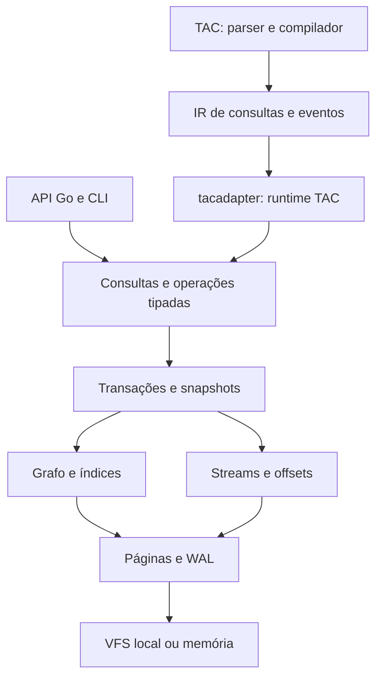
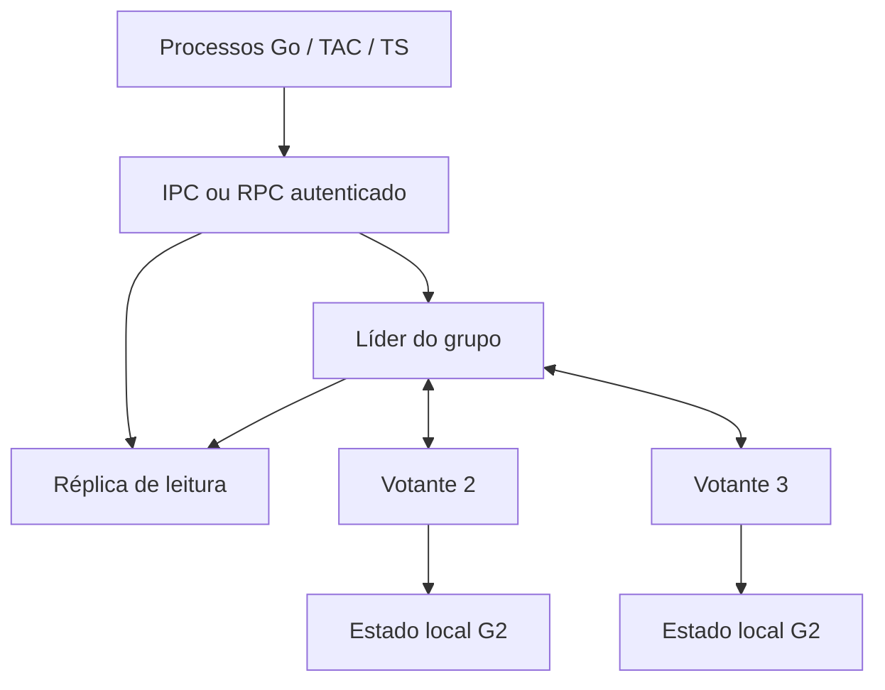

# SPEC — tacdb: motor Go com integração nativa à TAC

**Versão da SPEC:** 1.3 · **Data:** 24 de outubro de 2026 · **Estado:** especificação de implementação

**Objetivo:** implementar o tacdb, porte funcional do motor de referência (R0, §2) em Go, incorporável ao processo TacFlow, e incorporar o dialeto Cypher de R0 à TAC. O produto deve reunir grafo, propriedades, busca textual, busca vetorial opcional, transações e eventos duráveis, com modos embedded, servidor multiprocesso e cluster de réplicas. O modo embedded não exige serviços; cluster e multiprocesso são capacidades obrigatórias do produto 1.0.

Este documento especifica o produto a construir. Não representa uma implementação já disponível, uma certificação do código original nem resultados de desempenho medidos. A decisão de portar para Go está tomada; as escolhas internas abaixo tornam essa decisão implementável.

**Revisão 1.1:** nome único do produto `tacdb`; correções AUD-01 a AUD-14; fila de escritores, group commit e durabilidade explícita; vetores por propriedade e planner sem truncamento oculto; FTS em português; estratégias estudadas no Neo4j; SDK TypeScript assíncrono; cluster Raft, réplicas e acesso multiprocesso obrigatórios em 1.0. As medições trazidas pelo usuário são insumos de requisitos, não benchmarks reproduzidos nesta revisão. G2 substitui o formato preliminar G1 da SPEC 1.0: nenhum arquivo de protótipo G1 deve ser reinterpretado como G2; usar migração lógica. A versão-alvo do produto continua sendo 1.0.

**Revisão 1.2:** incorpora a revisão de desempenho e segurança registrada em §32.4 (REV-01 a REV-48). Mudanças normativas principais: checkpoint passivo e concorrente com WAL segmentado, sem quiescência para checkpoint, backup, Serialize ou snapshot Raft; idade máxima de snapshots com política explícita sob pressão de WAL; group commit adaptativo com coalescimento de páginas por grupo durável; reserva adaptativa de IDs; alocador por bitmap com preferência pelo menor endereço; páginas com prefixo comum, separadores truncados e overflow por extents; metadados e propriedades de cada entidade co-localizados; FTS em runs imutáveis com merge transacional, estatísticas exatas, WAND exato e autômato de Levenshtein; armazenamento vetorial contíguo por índice com quantização opcional e rerank exato; construção online de índices e índices únicos; governador de memória por processo; duração máxima de transações; consumidores com confirmação em lote; determinismo numérico entre plataformas; e o modelo de segurança de §20 (autenticação, capacidades, políticas obrigatórias, classificação, proveniência, expurgo LGPD/GDPR, assinatura opcional, endurecimento de arquivos e cadeia de suprimentos). O layout G2 desta revisão (`format_revision=12`) substitui integralmente o layout G2 da SPEC 1.1: protótipos baseados na 1.1 não são lidos e migram por LTX1.

**Revisão 1.3:** aplica a análise registrada em §32.5 (R13-01 a R13-21). Mudanças normativas principais: o motor de referência deixa de ser nomeado neste repositório, e sua identificação, o oráculo diferencial e o exportador de origem passam ao repositório de ferramentas de referência (§2.1); a regra de valor inline garante split em duas páginas (célula completa de até 1344 bytes); um valor em overflow usa no máximo 337 extents; symlinks dentro do diretório do banco são recusados e o arquivo principal também é travado contra aliases por hard link; `ChangefeedMode` passa a ter default `Disabled`; payloads de changefeed importados sem `schema_version` valem como esquema 0; a TAC referencia resultados na forma existente `<nó>.result`, com linhas como mapas por alias; `Open(Create)` substitui um WAL órfão comprovadamente não publicado; o analisador de compatibilidade passa a se chamar `compat-en-v1`; forma e tamanho canônicos das páginas, medida exata de split e fusão, classificação ordenada das cópias do superbloco, `Error.Details` e permissões por objeto (inclusive dono no Windows e ACLs no macOS) ficam definidos; toolchain Go 1.27.3. O layout G2 desta revisão (`format_revision=13`) substitui o da 1.2: protótipos baseados na 1.2 não são lidos e migram por LTX1.

**Como usar:** adotar este arquivo como `SPEC.md`; implementar os marcos da seção 27; acompanhar requisitos pela matriz da seção 25 e pelas decisões ADR. “Deve”, “obrigatório” e “exige” são requisitos de aceite; “pode” é uma liberdade de implementação dentro dos contratos. Limites e decisões novas não devem ser confundidos com garantias do upstream.

| Parte | Seções | Conteúdo |
|---|---|---|
| [Contrato do produto](#1-decisões-executivas-e-interpretação-do-escopo) | 1–6 | Escopo, referências, arquitetura, valores e API. |
| [Motor persistente](#7-formato-físico-g2) | 7–12 | Formato, páginas, alocação, governador de recursos, WAL, snapshots, recovery e grafo. |
| [Consultas e busca](#13-busca-textual-e-qualidade-sem-embeddings) | 13–15 | FTS, HNSW, semântica e executor. |
| [Agentes, TAC e segurança](#16-streams-duráveis-e-changefeed) | 16–20 | Eventos, gramática, IR, runtime e modelo de segurança. |
| [Operação](#21-exportação-importação-e-migração-zig--go) | 21–24 | Migração, backup, retenção, configuração e CLI. |
| [Entrega](#25-conformidade-e-estratégia-de-testes) | 25–31 | Testes, benchmarks, marcos, paridade, fontes e contratos complementares. |
| [Correções e referências adicionais](#32-registro-de-correções-e-três-ondas-de-entrega) | 32–34 | Auditoria informada, revisões 1.2 (desempenho e segurança) e 1.3, estratégias Neo4j e SDK TypeScript assíncrono. |
| [Cluster e multiprocesso](#35-cluster-e-acesso-multiprocesso-obrigatórios-na-versão-10) | 35 | Raft, réplicas, IPC/RPC, failover, membership e gates distribuídos obrigatórios em 1.0. |

## 1. Decisões executivas e interpretação do escopo

| ID | Decisão normativa |
|---|---|
| ADR-01 | O motor de produção será Go nativo. Biblioteca, CLI e integração TAC devem compilar com `CGO_ENABLED=0`. |
| ADR-02 | A referência funcional é o motor de referência R0, fixado no repositório de ferramentas de referência (§2.1). Reimplementar suas capacidades centrais; não manter uma biblioteca Zig escondida sob um wrapper Go. Este repositório não nomeia R0. |
| ADR-03 | RethinkDB, ReQL, LAYA e SLM não fazem parte desta arquitetura. Não existe treinamento, pré-treinamento continuado, fine-tuning, RL ou geração de embeddings no motor. |
| ADR-04 | O modo padrão de recuperação de informações usa propriedades, grafo e busca textual. HNSW permanece como capacidade opcional do porte completo, recebendo vetores fornecidos pela aplicação. |
| ADR-05 | Três modos obrigatórios: embedded, servidor com clientes multiprocesso e cluster replicado. Um owner por arquivo/réplica e um escritor em mutação no líder; acesso concorrente por IPC/RPC, com réplicas de leitura. |
| ADR-06 | TAC ganha construções de consulta, transação e assinatura de streams. O dialeto Cypher continua disponível pela API Go e pela CLI para testes, migração e uso independente. |
| ADR-07 | A compatibilidade exigida é funcional e semântica. Esta SPEC escolhe um formato físico Go próprio, `G2`, e migração lógica tipada. Arquivos Zig não serão abertos diretamente. |
| ADR-08 | O porte mantém a arquitetura de páginas, B+trees, índices e WAL. A adaptação Go usa versões de páginas no WAL para snapshots consistentes e commits atômicos entre todos os subsistemas. |
| ADR-09 | Todas as leituras de uma transação veem o mesmo snapshot, incluindo índices e streams. Essa garantia é explícita para o produto Go; não se presume que todo caminho público do upstream já a ofereça. |
| ADR-10 | Realtime significa eventos duráveis após commit e consumidores com cursor. Não significa atualização incremental automática de qualquer resultado Cypher. |
| ADR-11 | Compactação física, retenção de eventos e arquivamento lógico são operações diferentes. Nenhuma apaga ou resume conhecimento silenciosamente. |
| ADR-12 | Paridade é comprovada por testes diferenciais e de conformidade. Desempenho é medido; trocar a linguagem não constitui evidência de ganho. |
| ADR-13 | Leitura não gera WAL nem sync. Escritores entram em fila limitada; commits selados formam grupos duráveis adaptativos, sem espera artificial para um commit isolado, com snapshots e ordem de dependência explícitos. |
| ADR-14 | Correção prevalece sobre aceleração: busca exata é default; ANN é opt-in, sem subpreenchimento oculto causado pelo planner. |
| ADR-15 | Neo4j é referência de algoritmos e instrumentação, não dependência, formato compatível ou justificativa de ganhos ainda não medidos. |
| ADR-16 | Propriedades têm registros separados; símbolos têm namespaces u32; índices FTS/vetoriais são identificados por definição e propriedade. |
| ADR-17 | Cluster 1.0 usa Raft Go, 3/5 votantes, réplicas completas, quorum durável, ReadIndex e failover; Async é apenas standalone. |
| ADR-18 | Multiprocesso acessa owner por IPC/RPC. Arquivos não são gravados por vários processos diretamente; cada réplica usa seu diretório. |
| ADR-19 | Manutenção não exige quiescência. O checkpoint é passivo até o snapshot ativo mais antigo, o WAL é segmentado, e backup, Serialize, export e snapshot Raft leem um snapshot fixado. Snapshots têm idade máxima e política explícita sob pressão de WAL; nenhuma revogação é silenciosa. |
| ADR-20 | Amplificação de escrita é requisito de projeto: em modos duráveis, um grupo grava só a imagem final de cada página; FTS usa runs imutáveis com merge transacional; vetores têm armazenamento contíguo por índice. Bytes de WAL por byte lógico são medidos e têm gate. |
| ADR-21 | Orçamentos são globais além de locais: um governador por processo limita cache, execuções, overlays e transporte; transações têm duração máxima; quotas por principal valem fora do processo. |
| ADR-22 | Segurança por padrão (§20): negação por default, autenticação obrigatória em IPC/RPC, capacidades avaliadas no servidor, políticas obrigatórias do host, classificação de dados, proveniência Untrusted, expurgo verificável e assinatura opcional. CRC e hash sem chave nunca contam como autenticidade. |
| ADR-23 | Índices derivados podem ser construídos online por máquina de estados explícita (BUILDING → ONLINE); planos usam somente índices ONLINE do snapshot. Índices únicos são declarados, nunca implícitos. |
| ADR-24 | Determinismo numérico: distâncias, BM25 e agregações têm ordem de acumulação normativa e não dependem de fusão FMA; resultados são bit a bit iguais entre as plataformas suportadas. |

**Significado de “100%”:** todo o caminho de execução necessário ao motor e à integração TAC é implementado em Go. As capacidades centrais da referência precisam passar pela matriz de conformidade antes da versão 1.0. Isso não inclui reproduzir a ABI C, bindings Python/Java, site, empacotamento Zig ou serviços de embeddings. Para TypeScript, entregar um SDK cliente fino e uma ponte Go assíncrona opcional (§34), sem portar koffi para o motor. O SDK é código de integração; todo o motor, formato, planner e runtime TAC continuam 100% Go.

**Consequência de ADR-07:** o usuário migra bancos existentes por exportação/importação tipada. Não se deve renomear um arquivo Zig para fazê-lo parecer G2. Abertura binária compatível seria outro projeto, com uma matriz própria de formatos e recuperação. A decisão evita acoplar o porte ao layout nativo de estruturas Zig; ela não autoriza perda de dados ou de funcionalidades.

**Limite da simplificação:** o banco armazena e recupera dados; ele não passa a compreender toda linguagem natural. Os agentes existentes traduzem intenção para consultas e usam os resultados. Eliminar a obrigação de embeddings é possível; garantir qualidade semântica idêntica para qualquer acervo exige avaliação, não uma propriedade presumida do banco.

## 2. Referências fixadas e precedência

| Referência | Revisão adotada | Uso |
|---|---|---|
| Motor de referência (R0) | Commit completo fixado no repositório de ferramentas de referência (§2.1) | Comportamento, algoritmos, testes, inventário de recursos, contrato de conformidade, suíte diferencial e streams duráveis. |
| [Raft Go](https://github.com/etcd-io/raft/tree/f35a02212416d045c574e30aa59d4b07c4b8d732) | `v3.6.0`, commit `f35a02212416d045c574e30aa59d4b07c4b8d732` | Consenso em Go; persistência/transporte/apply fornecidos pelo tacdb. |
| [Neo4j Community](https://github.com/neo4j/neo4j/tree/54a7dcf7c2501b31866199143364c5332da8936f) | `54a7dcf7c2501b31866199143364c5332da8936f` (branch observada 2026.09) | Referência adicional de algoritmos/planner/runtime/WAL; não é base de compatibilidade nem dependência do produto. |
| [TAC](https://github.com/TacFlow/tac-language/tree/c4cd152f9838e65d3ae4b893de232c9255911fbb) | `c4cd152f9838e65d3ae4b893de232c9255911fbb` | AST, parser, compilador, formatter, diagnóstico e IR existentes. |

O commit fixado de R0 inclui uma correção posterior à tag nominal, de recuperação de vetores comprometidos no WAL; usar o commit completo, não apenas a tag. O checkout TAC usa módulo Go e já contém construções LAYA; isso não as torna parte do novo runtime.

Ordem de decisão: requisitos explícitos deste documento → contrato de conformidade upstream → comportamento demonstrado por testes e código da revisão fixada → documentação descritiva. Uma divergência deve virar um caso de teste e uma entrada em `COMPATIBILITY.md`; não copiar um comportamento incorreto silenciosamente.

As páginas de documentação Neo4j/Snowball/Node citadas foram consultadas em 17/10/2026; URLs `current` são móveis, enquanto os links de código Neo4j desta SPEC fixam o commit acima. Observação de código, hipótese de adaptação e medição futura são categorias distintas (§33).

Os formatos G2, a API Go nova e as extensões TAC deste documento são **decisões de implementação propostas aqui**, não recursos já presentes nos repositórios. As interfaces apresentadas são contratos a implementar, não código que tenha sido compilado nesta análise.

### 2.1 Nomes, ferramentas de referência e licença

O código, a documentação, os nomes de arquivos, pacotes, funções, identificadores e mensagens deste repositório não nomeiam o motor de referência; usar “motor de referência” ou “R0”. A identificação de R0 e seu commit, o oráculo diferencial (§25.1), o exportador de origem (§21.2) e todo código que chame a API nativa de R0 residem no repositório de ferramentas de referência, fora deste. Daqui só entram artefatos neutros produzidos por eles: fixtures JSON de conformidade, arquivos LTX1 e relatórios. Literais que a origem usa nos dados (prefixo reservado de streams, marcador de omissão) chegam como dados no header LTX1 (§21.1). Um job de CI verifica que nenhum arquivo do repositório contém o nome de R0, lendo o padrão de uma variável do repositório de CI, nunca de arquivo versionado.

As partes do tacdb derivadas de R0 preservam o aviso de copyright e o texto da licença MIT de R0 no arquivo `NOTICE`, como a licença exige, sem nomear o projeto de origem.

## 3. Entregáveis e limites da versão 1.0

### 3.1 Entregáveis obrigatórios

1. Módulo Go `github.com/TacFlow/tacdb`, pacote público `tacdb`.
2. CLI `tacdb`, com consulta, índices, import/export, backup, restore, verificação e compactação.
3. Extensão do repositório `tac-language`, com parser, AST, análise semântica, IR, formatter e diagnósticos.
4. Adaptador de execução `tacadapter`, separado do compilador TAC e do núcleo de armazenamento.
5. Ponte de migração da revisão fixada de R0 para o formato lógico LTX1: o importador fica neste repositório; o exportador de origem, no repositório de ferramentas de referência (§2.1).
6. Corpus de conformidade, testes de recuperação, fuzzing, benchmarks reproduzíveis e exemplos executáveis.
7. Documentação de operação, formato G2, matriz de compatibilidade, migração e recuperação de incidentes.
8. Preservação do aviso de copyright e da licença MIT de R0 no `NOTICE` para as partes derivadas, sem nomear o projeto de origem (§2.1); `LICENSE` e `NOTICE` acompanhando a distribuição.
9. SDK TypeScript fino com bridge Go opcional, protocolo limitado e teste real de event loop.
10. `AUDIT-REGRESSIONS.md` e `ALGORITHMS.md`, com a rastreabilidade das seções 32 e 33, versões de fontes e medições.
11. Servidor Go `tacdb serve`, cliente Go/TS por IPC/RPC e adaptador TAC com providers local/remoto.
12. Cluster de 3/5 votantes com réplicas de leitura, bootstrap, membership, snapshots, failover e operação documentada.
13. `CLUSTER.md`, `PROTOCOL.md` e suíte multiprocesso/distribuída com histórico verificável; gates MP/CL obrigatórios na 1.0.
14. Modelo de segurança de §20 implementado, com `SECURITY.md`, `THREATMODEL.md`, suíte SEC e auditoria; as revisões 1.2 e 1.3 são rastreadas em `AUDIT-REGRESSIONS.md` (REV-01 a REV-48 e R13-01 a R13-21).

### 3.2 Fora da versão 1.0

Sharding automático, transações entre bancos/grupos, múltiplos líderes escrevendo no mesmo grupo (multi-primary), replicação ativa/ativa, manutenção incremental de consultas arbitrárias, geração de embeddings, inferência local, treinamento, resumo semântico automático, escrita direta multiprocesso no mesmo arquivo, armazenamento em filesystem de rede, criptografia própria, spill de ordenação/agregação para disco, relocação online de páginas vivas no interior do arquivo e compatibilidade total com Neo4j/Cypher moderno. Cluster, consenso Raft, réplicas de leitura e acesso multiprocesso por IPC/RPC estão **dentro** da versão 1.0 (§35).

Uma biblioteca auxiliar de mapa concorrente não substitui isolamento, WAL, recuperação ou índices persistentes. Não existe dependência obrigatória de ConcurrentOrderedMap. Estruturas auxiliares em memória só entram se um benchmark justificar seu uso e sem alterar os contratos persistentes.

### 3.3 Plataformas e dependências

- Baseline de desenvolvimento: diretiva `go 1.27` e `toolchain go1.27.3` (a 1.27.2 da revisão anterior já foi substituída por uma release de correções); manter ambos explícitos no módulo e atualizar o toolchain a cada release de correção de segurança. A referência TAC usa Go 1.25 e terá sua política de versão atualizada no PR de integração.
- Alvos de release: Linux amd64/arm64, macOS amd64/arm64 e Windows amd64. Cada alvo precisa passar pelo teste real de lock, sync, reopen e recuperação; compilar cruzado não comprova durabilidade.
- Produção: apenas dependências Go auditáveis, versionadas em `go.mod`/`go.sum`; `golang.org/x/sys` para locks, credenciais de par em sockets locais, pré-alocação e primitivas de durabilidade por plataforma, e `golang.org/x/text` para normalização. Criptografia usa somente a biblioteca padrão (`crypto/tls`, `crypto/ed25519`, `crypto/sha256`, `crypto/rand`).
- Nenhum download de modelo, chamada a serviço de inferência ou processo filho iniciado pelo núcleo durante Open/consulta/escrita. O modo embedded não faz rede; cliente/servidor e cluster usam exclusivamente os transports configurados de §35 para RPC, replicação e administração. O cliente TypeScript pode iniciar explicitamente o bridge Go uma vez por conexão (§34); isso não altera o funcionamento embedded da API Go/TAC.
- A dependência Go de consenso `go.etcd.io/raft/v3` é obrigatória para o modo cluster, sem executar servidor etcd. Nenhuma dependência de SQLite, RocksDB, LMDB ou de outro motor substituindo o porte. Não usar `unsafe` para serializar estruturas; assembly específico fica fora da implementação inicial.
- Filesystem local, com locking e sincronização suportados. NFS/SMB e compartilhamento de arquivo entre hosts não são suportados.

## 4. Arquitetura, responsabilidades e pacotes



O motor não importa TAC. O compilador TAC importa apenas a superfície de compilação de consultas, que não abre arquivos. O adaptador importa o motor e o IR TAC. Nenhum ciclo entre módulos é permitido.

| Pacote Go | Responsabilidade |
|---|---|
| `value/`, `internal/codec/` | Tipos, limites, codecs e comparação. |
| `internal/vfs/` | I/O, locks, memória e injeção de falhas. |
| `internal/page/`, `internal/cache/` | Layout G2, alocação, CRC, cache de versões. |
| `internal/btree/` | Busca, cursores, split, merge e overflow. |
| `internal/wal/`, `internal/recovery/` | Redo, publicação de commits e checkpoint. |
| `internal/txn/` | Fila de escritor, snapshots, coordenador de commits, savepoints e estado do handle. |
| `internal/graph/`, `internal/catalog/` | Nós, arestas, símbolos, labels e índices de propriedades. |
| `internal/fts/` | Analisadores, postings, BM25, prefixo, fuzzy e destaque. |
| `internal/vector/` | Vetores, métricas, HNSW e reconstrução. |
| `query/` | Compilação pública sem I/O, AST e diagnósticos. |
| `internal/plan/`, `internal/exec/`, `internal/stats/` | Custo/cardinalidade, plano físico, slots, operadores e PROFILE. |
| `internal/plancache/` | Cache limitado de planos, sem cache implícito de resultados. |
| `internal/stream/` | Eventos, sequências, consumidores e retenção. |
| `backup/` | Snapshots, segmentos de WAL e restauração. |
| raiz `tacdb` e `compat/` | API idiomática e adaptação de conformidade. |
| `cmd/tacdb/` | Ferramentas locais e bridge stdio opcional. |
| `sdk/typescript/`, `internal/bridge/`, `tacadapter/` | Transporte assíncrono e integração TAC; dependência sempre em direção ao núcleo. |
| `client/`, `server/`, `internal/cluster/`, `internal/raftstore/`, `internal/rpc/` | IPC/RPC, Raft, journal, aplicação replicada e snapshots; API de storage não depende do compilador TAC. |
| `internal/alloc/`, `internal/govern/` | Bitmaps de grupos, extents, scrub de páginas livres, governador de memória e quotas. |
| `internal/authn/`, `internal/authz/`, `internal/policy/`, `internal/audit/` | Credenciais, capacidades, políticas obrigatórias, classificação, saneamento de erros e auditoria. O planner recebe políticas como dados tipados; storage não importa authn. |

Pacotes `internal` não são API estável. `value`, `query`, API raiz, `backup` e o esquema do IR têm versionamento. Nenhum subsistema pode fazer `WriteAt` diretamente fora de `page`/`wal`/`vfs`.

Arquivos de projeto exigidos: `SPEC.md`, `FORMAT.md`, `COMPATIBILITY.md`, `MIGRATION.md`, `OPERATIONS.md`, `BENCHMARKS.md`, `SECURITY.md`, `THREATMODEL.md`, `ALGORITHMS.md`, `AUDIT-REGRESSIONS.md`, `LICENSE`, `NOTICE`, `go.mod`, `go.sum`. Este documento pode ser adotado como `SPEC.md`; separar anexos depois não deve mudar o conteúdo normativo.

## 5. Modelo de valores e propriedade dos dados em memória

### 5.1 Tipos

| Tag G2 | Tipo público | Representação lógica |
|---|---|---|
| `0x00` | Null | Valor nulo explícito. |
| `0x01` | Bool | `false` ou `true`. |
| `0x02` | Int | Inteiro assinado de 64 bits. |
| `0x03` | Float | IEEE-754 binary64. |
| `0x04` | String | UTF-8 válido, sem normalização automática do valor original. |
| `0x05` | Bytes | Sequência arbitrária de bytes. |
| `0x06` | Vector | Sequência de float32, dimensão entre 1 e 65535; limite operacional default 4096, configurável. |
| `0x07` | List | Lista ordenada e heterogênea de valores. |
| `0x08` | Map | Chaves string únicas, valores recursivos. |

`NodeID` e `EdgeID` são `uint64` opacos e maiores que zero. Não passam por `float64` na API, no IR nem nos dumps. Referências de nó, aresta e caminho usadas pelo executor são tipos próprios; não introduzem novas tags de propriedade persistente. Arestas paralelas são entidades diferentes.

Preservar NaN, infinidades e sinal de zero em propriedades Float e no transporte tipado. Índices ordenados de propriedades recusam valores não finitos. Distâncias e entradas para HNSW recusam componentes não finitos. Uma propriedade Vector pode ser preservada na migração sem ser indexada; habilitar um índice sobre dados inválidos deve falhar com diagnóstico.

Limites padrão: profundidade de valor 64; valor codificado 16 MiB; chave de propriedade ou label 255 bytes; nome de stream, kind ou consumidor 255 bytes. Chaves de mapas internos de um valor podem ter até 64 KiB, respeitado o limite total. Um valor tem no máximo `MaxValueElements` (default 1.000.000) elementos de List/Map somados em todos os níveis. Nomes estruturais precisam ser UTF-8 não vazio; NUL é rejeitado. Strings de dados podem conter NUL.

### 5.2 Ausência, NULL e mutabilidade

- `GetProperty` retorna `(Value, exists, error)`. Propriedade ausente é diferente de propriedade existente com Null.
- A expressão Cypher de uma propriedade ausente resulta em Null.
- `SetProperty(id, key, Null())` grava Null explícito.
- Cypher `SET n.p = null` remove a propriedade; `REMOVE n.p` faz o mesmo.
- `SET n = $map` substitui o mapa completo; `SET n += $map` aplica uma fusão superficial. Valores Null vindos dessas atribuições removem as respectivas chaves, conforme a semântica de mutação do dialeto.
- Valores de entrada são copiados antes de serem retidos. Alterar um slice/map da aplicação após a chamada não altera o banco.
- Valores retornados por APIs materializadas pertencem ao chamador. `Rows.Values()` pode ter validade até o próximo `Next`; `Rows.CloneValues()` entrega uma cópia independente. A documentação e os testes devem tornar a diferença explícita.

### 5.3 Codec de valores G2

Todos os inteiros de payload são little-endian, exceto chaves ordenáveis. Cada valor começa com tag u8. Bool acrescenta u8 0/1; Int acrescenta i64; Float acrescenta os 8 bytes de `Float64bits`.

String e Bytes: tag, comprimento u32, conteúdo. Vector: tag, dimensão u32, componentes float32. List: tag, quantidade u32, valores recursivos. Map: tag, quantidade u32, pares `key_length:u32 + key_utf8 + Value`, com chaves ordenadas por bytes UTF-8.

Decodificadores validam comprimentos e overflow antes de alocar, rejeitam tags desconhecidas, Bool fora de 0/1, UTF-8 inválido, chaves duplicadas ou fora de ordem (a codificação é canônica: cada valor tem exatamente uma forma) e Vector com dimensão fora de 1..65535. A decodificação é debitada do orçamento da operação antes de alocar: cada elemento custa ao menos 64 bytes além dos bytes variáveis e o total respeita MaxValueElements, de modo que 16 MiB de Nulls não viram dezenas de milhões de Values. Um registro possui comprimento externo; bytes restantes após o último valor são erro. Codificar e decodificar não dependem de alinhamento, arquitetura ou ordem aleatória de `map` em Go.

Ordenação de valores para `ORDER BY`, DISTINCT e agregação deve usar um comparador compartilhado. Null fica por último em ASC e primeiro em DESC. Valores de famílias diferentes têm ordem determinística: Bool, número, String, Bytes, Vector, List, Map, referência de entidade; Null é tratado separadamente. Int/Float são comparados numericamente sem converter todos os inteiros para float64. NaN ordena após os outros números e antes da próxima família; igualdade de expressão com NaN é falsa. Para agrupamento, NaNs têm uma chave canônica única e `-0`/`+0` compartilham chave. Essa escolha Go deve ser coberta por casos próprios e registrada quando o upstream não fixar o comportamento.

Aritmética de ponto flutuante do motor (somas de agregação, distâncias, BM25) não depende de fusão FMA, que a especificação de Go permite ao compilador em algumas arquiteturas: cada produto é arredondado por conversão explícita (`float64(a*b)`) antes de somar, e a ordem de acumulação é a definida em cada seção. Resultados são bit a bit iguais entre amd64 e arm64 (DET-01).

## 6. API Go pública e ciclo de vida

As assinaturas abaixo definem o contrato; as declarações de tipos auxiliares aparecem nas seções correspondentes. Contextos não podem ser `nil`.

```go
type NodeID uint64
type EdgeID uint64
type CommitID uint64
type CommitToken [16]byte
type CommitReceipt struct {
    ID      CommitID
    Token   CommitToken // zero para encerramento sem novo commit
    Durable bool
}
type Params map[string]value.Value

func Open(path string, opts Options) (*DB, error)
func OpenMemory(opts Options) (*DB, error)
func Deserialize(data []byte, opts Options) (*DB, error)

func (db *DB) BeginRead(ctx context.Context) (*Tx, error)
func (db *DB) BeginReadDurable(ctx context.Context) (*Tx, error)
func (db *DB) BeginWrite(ctx context.Context) (*Tx, error)
func (db *DB) TryBeginWrite(ctx context.Context) (*Tx, error)
func (db *DB) Flush(ctx context.Context) error
func (db *DB) WaitDurable(ctx context.Context, id CommitID) error
func (db *DB) CommitStatus(token CommitToken) (CommitState, error)
func (db *DB) View(ctx context.Context, fn func(*Tx) error) error
func (db *DB) Update(ctx context.Context, fn func(*Tx) error) error
func (db *DB) Query(ctx context.Context, text string, p Params) (*Rows, error)
func (db *DB) Exec(ctx context.Context, text string, p Params) (Result, error)
func (db *DB) Prepare(ctx context.Context, text string) (*Statement, error)
func (db *DB) Checkpoint(ctx context.Context) error
func (db *DB) Compact(ctx context.Context) (CompactResult, error)
func (db *DB) Serialize(ctx context.Context) ([]byte, error)
func (db *DB) Close() error
func (db *DB) Shutdown(ctx context.Context) error

func (tx *Tx) Query(ctx context.Context, text string, p Params) (*Rows, error)
func (tx *Tx) Exec(ctx context.Context, text string, p Params) (Result, error)
func (tx *Tx) Commit(ctx context.Context) (CommitReceipt, error)
func (tx *Tx) Rollback() error
func (tx *Tx) ReadOnly() bool
func (tx *Tx) Snapshot() CommitID

func (tx *Tx) CreateNode(o CreateNodeOptions) (Node, error)
func (tx *Tx) GetNode(id NodeID) (Node, error)
func (tx *Tx) DeleteNode(id NodeID, detach bool) error
func (tx *Tx) AddLabel(id NodeID, label string) error
func (tx *Tx) RemoveLabel(id NodeID, label string) error
func (tx *Tx) GetProperty(id NodeID, key string) (value.Value, bool, error)
func (tx *Tx) SetProperty(id NodeID, key string, v value.Value) error
func (tx *Tx) RemoveProperty(id NodeID, key string) error
func (tx *Tx) CreateEdge(from, to NodeID, typ string, p map[string]value.Value) (Edge, error)
func (tx *Tx) GetEdge(id EdgeID) (Edge, error)
func (tx *Tx) DeleteEdge(id EdgeID) error
func (tx *Tx) GetEdgeProperty(id EdgeID, key string) (value.Value, bool, error)
func (tx *Tx) SetEdgeProperty(id EdgeID, key string, v value.Value) error
func (tx *Tx) RemoveEdgeProperty(id EdgeID, key string) error
func (tx *Tx) Edges(id NodeID, o EdgeScanOptions) (*EdgeCursor, error)
```

`Node` contém ID, labels em ordem de inserção e propriedades. `Edge` contém ID, origem, destino, tipo e propriedades. Retornos de APIs legadas são adaptados em `compat`; não usar remoção por `(origem,destino,tipo)` como API principal porque pode haver várias arestas.

`DB` é seguro para goroutines concorrentes. `Tx`, `Rows`, cursores e statements em execução têm um proprietário por vez; uso concorrente do mesmo Tx retorna `TX_IN_USE`, sem corrida de dados. Um `Statement` preparado imutável pode iniciar execuções independentes. Chamadas depois do encerramento retornam erro estável.

`DB.Query` aceita apenas leitura; consulta com mutação retorna `QUERY_WRITE_REQUIRES_EXEC`. `DB.Exec` executa uma transação própria, consome integralmente a consulta, materializa o resultado dentro do limite e só então confirma. `Tx.Query` é leitura; `Tx.Exec` pode escrever e usa savepoint por statement. Não fazer commit de uma escrita porque o usuário fechou um cursor parcialmente consumido. Toda WriteTx está sujeita a MaxWriteTxDuration e toda ReadTx a MaxReadTxAge (§10).

`View` garante rollback/fechamento ao sair. `Update` confirma apenas se a função retornar nil; erro ou panic da função antes de Commit desfaz a Tx, e panic é relançado. Erros COMMIT_PENDING/UNKNOWN de Commit preservam o token e não são convertidos em rollback. Nunca repetir automaticamente uma função fornecida pelo chamador. A obtenção do escritor usa a fila FIFO de `BeginWrite`; `TryBeginWrite` oferece tentativa imediata com `DB_BUSY`. Os contratos de espera e timeout estão na seção 10.

`Close` é idempotente depois de concluído. Sem recursos ativos, drena commits aceitos e sincroniza escritas voláteis antes de fechar; erro nessa barreira é devolvido. Fechar uma Tx de leitura não inicia essa barreira. Se houver transações ou cursores ativos, retorna `BUSY`, mantendo o handle aberto. O chamador cancela/fecha esses recursos e tenta novamente. Se um erro de I/O tiver deixado o handle em estado fatal, `Close` apenas encerra os arquivos; reabrir executa recovery. Finalizers não são mecanismo de commit ou fechamento. `Shutdown(ctx)` é o encerramento com prazo: impede novos Begins (`SHUTTING_DOWN`), cancela Tx ACTIVE e cursores (que passam a retornar CLOSED), aguarda intents selados e a barreira durável até o deadline e fecha. Se o prazo expirar com intents pendentes, retorna erro com as contagens; o desfecho desses intents é resolvido por recovery/token, nunca por rollback presumido.

### 6.1 Erros e diagnóstico

`Error` contém `Code`, `Op`, `Message`, `Cause`, `Retryable`, `CommitToken` opcional, localização quando houver e `Details`, um mapa de valores numéricos nomeados (por exemplo `waited`, `limit`, `active`, `requested`, `available`; durações em nanossegundos) cujas chaves por código são contrato estável. Suportar `errors.Is`/`errors.As`. Categorias mínimas:

| Categoria | Códigos |
|---|---|
| Ciclo de vida | `CLOSED`, `BUSY`, `TX_CLOSED`, `TX_IN_USE`, `READ_ONLY`, `DB_BUSY`, `BUSY_TIMEOUT`, `WRITER_QUEUE_FULL`, `TOO_MANY_TRANSACTIONS`, `SNAPSHOT_EXPIRED`, `WRITE_TX_TIMEOUT`, `SHUTTING_DOWN` |
| Entrada | `INVALID_ARGUMENT`, `TYPE_MISMATCH`, `LIMIT_EXCEEDED`, `NOT_FOUND`, `DUPLICATE_KEY` |
| Consulta | `QUERY_LEX`, `QUERY_PARSE`, `QUERY_SEMANTIC`, `QUERY_UNSUPPORTED`, `QUERY_WRITE_REQUIRES_EXEC`, `PARAM_MISSING`, `PARAM_TYPE` |
| Persistência | `LOCKED`, `IO`, `NO_SPACE`, `CORRUPT`, `UNSUPPORTED_FORMAT`, `WAL_LIMIT`, `COMMIT_UNKNOWN`, `COMMIT_PENDING`, `COMMIT_QUEUE_FULL`, `RECOVERY_REQUIRED` |
| Backup | `BACKUP_LAG`, `BACKUP_INVALID`, `DESTINATION_EXISTS` |
| Índices | `INDEX_NOT_FOUND`, `INDEX_EXISTS_DIFFERENT`, `INVALID_VECTOR`, `VECTOR_DISABLED`, `VECTOR_KEY_MISMATCH`, `INDEX_INVALID`, `INDEX_INCONSISTENT`, `INDEX_BUILDING`, `INDEX_BUILD_FAILED`, `UNIQUE_VIOLATION` |
| Eventos | `RESERVED_STREAM`, `CURSOR_EXPIRED`, `OFFSET_REGRESSION`, `INVALID_SEQUENCE` |
| Execução | `CANCELED`, `DEADLINE`, `RESOURCE_LIMIT`, `QUERY_INCOMPLETE` |
| Cluster/IPC | `NOT_LEADER`, `NO_QUORUM`, `LEADER_CHANGED`, `REPLICA_LAG`, `SESSION_EXPIRED`, `CURSOR_LOST`, `CLUSTER_MODE_REQUIRED`, `VERSION_INCOMPATIBLE`, `INVALID_DURABILITY_MODE`, `REQUEST_CONFLICT`, `REQUEST_OUT_OF_ORDER`, `RESULT_EXPIRED`, `REQUEST_ALREADY_APPLIED` |
| Segurança | `UNAUTHENTICATED`, `PERMISSION_DENIED`, `POLICY_VIOLATION`, `CLASSIFIED_VALUE`, `QUOTA_EXCEEDED`, `SIGNATURE_REQUIRED`, `SIGNATURE_INVALID`, `UNSAFE_PATH`, `INSECURE_PERMISSIONS` |

O limite de transações nunca retorna falta de memória. Falha imediata por ocupação nunca retorna timeout. `BUSY_TIMEOUT` informa `waited` e `limit`; `TOO_MANY_TRANSACTIONS` informa `active` e `configured_max`. `COMMIT_PENDING` não autoriza repetição da mutação.

Mensagens podem evoluir; códigos não. Erros de consulta incluem estágio, intervalo em bytes e linha/coluna; na TAC incluem também posição no arquivo hospedeiro. Não capturar um erro de armazenamento e devolvê-lo como “nenhum resultado”. Erros que cruzam IPC/RPC são saneados conforme §20.12.

## 7. Formato físico G2

### 7.1 Arquivos e regras gerais

Um banco persistente usa `nome.tacdb` (arquivo principal), o diretório `nome.tacdb-wal/`, com segmentos `NNNNNNNNNNNNNNNN.wal` (segment_seq u64 em 16 dígitos hexadecimais, nunca reutilizado), e `nome.tacdb.lock`. O arquivo de lock tem identidade estável e não é apagado enquanto o banco existir. Temporários usam o prefixo do banco, sufixo aleatório de `crypto/rand` e criação exclusiva no mesmo diretório do destino. “Um banco local” não significa que seja seguro copiar somente o arquivo principal: o estado durável é o arquivo principal mais os segmentos a partir de `wal_floor_segment`.

Arquivos e diretórios do banco são criados com permissões restritas (0600/0700 em Unix; DACL restrita ao usuário proprietário em Windows) e acessados por `os.Root` aberto no diretório do banco, sem seguir symlinks (§20.9). O caminho recebido do chamador é resolvido uma única vez para um diretório canônico, e symlinks nesse caminho são aceitos; dentro do diretório do banco, toda entrada que não seja arquivo regular ou diretório (symlink, junction ou outro ponto de reparse, dispositivo, socket) é recusada com `UNSAFE_PATH`, verificada por `Lstat` via `os.Root` antes de abrir, porque `os.Root` sozinho segue symlinks que não escapam da raiz.

G2 usa páginas fixas de 4096 bytes. Este formato não aceita outro tamanho. PageID é u64; a posição é `PageID * 4096`, com verificação de overflow e do limite do VFS. Páginas 0 e 1 são superblocos alternados; a página 2 é o bitmap do primeiro grupo de alocação (§8.4). PageID zero representa raiz ou ponteiro ausente nos campos de referência a dados. PageID 1, páginas de bitmap e qualquer PageID ≥ `pageCount` nunca são ponteiros de dados válidos; encontrá-los como raiz, filho, irmã ou extent é `CORRUPT`.

Inteiros de tamanho fixo são codificados por funções explícitas de `encoding/binary`; inteiros de comprimento variável usam uvarint (LEB128) em forma mínima, e forma não mínima é corrupção. Checksum é CRC32C Castagnoli. Campos reservados são zero e entram no checksum. Todas as páginas são verificadas antes de serem expostas aos subsistemas. Não usar o layout de uma struct Go, `gob` ou JSON como formato de página.

R0 usa outros layouts: entre eles, cabeçalho de página de 8 bytes e formatos próprios de arquivo/WAL. Não reutilizar a assinatura de R0 para G2. Documentação upstream e layout de memória não são uma definição alternativa do formato abaixo.

### 7.2 Superbloco — 4096 bytes

| Offset | Bytes | Campo |
|---:|---:|---|
| 0 | 8 | Magic ASCII `TACDBG2` seguido de byte zero. |
| 8 | 2 | `format_version = 2`. |
| 10 | 2 | `min_reader_version = 2`. |
| 12 | 4 | `page_size = 4096`. |
| 16 | 16 | UUID do banco. |
| 32 | 8 | Geração do superbloco. |
| 40 | 8 | `checkpoint_lsn`: LSN do COMMIT cujo estado o arquivo principal incorpora. |
| 48 | 8 | CommitID incorporado. |
| 56 | 8 | Epoch do catálogo/esquema. |
| 64 | 8 | Contagem de nós vivos. |
| 72 | 8 | Contagem de arestas vivas. |
| 80 | 8 | High-watermark reservado de NodeID. |
| 88 | 8 | High-watermark reservado de EdgeID. |
| 96 | 8 | High-watermark de SymbolID. |
| 104 | 8 | Quantidade de páginas lógicas do arquivo (`pageCount`). |
| 112 | 8 | `wal_floor_segment`: primeiro segmento necessário ao recovery. |
| 120 | 8 | Flags de formato; bit 0 = cluster; demais zero. |
| 128 | 256 | 32 raízes de árvores, u64 cada (§7.4). |
| 384 | 8 | `free_page_count`. |
| 392 | 8 | appliedRaftIndex; zero em standalone. |
| 400 | 8 | appliedRaftTerm; zero em standalone. |
| 408 | 2 | `format_revision = 13`. |
| 410 | 3682 | Reservado, zero. |
| 4092 | 4 | CRC32C dos bytes 0..4091. |

Na abertura, validar ambos e escolher o de maior geração válida. Se ambos forem inválidos, falhar; não criar um banco por cima. Uma geração igual com conteúdo diferente é corrupção. Geração não é CommitID: só avança em publicação de checkpoint/metadados físicos. `format_revision` diferente de 13 retorna `UNSUPPORTED_FORMAT`; até o congelamento do formato na release 1.0, toda mudança de layout incrementa esse campo, e depois dele mudanças compatíveis usam `min_reader_version`.

Cada cópia é classificada isoladamente, nesta ordem: **estrangeira**, se o magic difere de `TACDBG2\0`; **danificada**, se o CRC é inválido; **não suportada**, se `format_version ≠ 2`, `format_revision ≠ 13` ou `min_reader_version` está acima da versão do leitor; **danificada**, se algum outro campo é inválido (`page_size ≠ 4096`, flags desconhecidas, área reservada ou raízes 19–31 diferentes de zero, `pageCount < 2`, `pageCount·4096` acima do limite do VFS, `free_page_count > pageCount`, raiz que não seja ponteiro de dados válido); **válida**, nos demais casos. Os campos de versão são testados antes dos que dependem da revisão, para que uma cópia de revisão futura nunca seja tomada por danificada; o CRC vem antes deles porque uma escrita parcial do superbloco é exatamente a falha que as duas cópias cobrem. Mudanças futuras de formato preservam o magic, os campos de versão (offsets 8–11 e 408) e o CRC no offset 4092, para que leitores antigos as reconheçam como não suportadas. Qualquer cópia não suportada leva a `UNSUPPORTED_FORMAT`, para não reabrir em silêncio um estado anterior a uma mudança de formato; duas estrangeiras também. Entre as válidas vale a maior geração, e geração igual com conteúdo diferente é `CORRUPT`. Sem cópia válida, `CORRUPT`.

### 7.3 Cabeçalho de página de dados — 48 bytes

| Offset | Bytes | Campo |
|---:|---:|---|
| 0 | 1 | Tipo: free=0, internal=1, leaf=2, overflow=3, bitmap=4, fixed=5. |
| 1 | 1 | Flags: bit 0 = PREFIX (slot 0 guarda o prefixo comum da página); demais zero. |
| 2 | 2 | `header_bytes = 48`. |
| 4 | 4 | CRC32C da página inteira, com este campo zerado durante o cálculo. |
| 8 | 8 | PageID da própria página. |
| 16 | 8 | CommitID da versão desta página; zero para páginas iniciais vazias. |
| 24 | 2 | Número de slots em leaf/internal; bytes úteis em overflow/fixed; zero em bitmap/free. |
| 26 | 2 | Limite inferior do espaço livre (leaf/internal). |
| 28 | 2 | Limite superior do espaço livre (leaf/internal). |
| 30 | 2 | Nível; folha=0, pai de folhas=1. |
| 32 | 8 | Próxima folha à direita (leaf); número do grupo (bitmap); indexID proprietário (fixed); zero nos demais. |
| 40 | 8 | Primeiro filho (internal); zero nos demais. |

Uma página slotted (leaf/internal) mantém slots de 4 bytes após o cabeçalho, `offset:u16` e `length:u16`, na ordem das chaves; células crescem do fim da página para baixo. `lower = 48 + 4*count`; `upper` aponta para o primeiro byte ocupado pelas células. Espaço entre ambos e padding não utilizado é zerado. Com a flag PREFIX, o slot 0 contém o prefixo comum de todas as chaves completas da página e cada célula guarda só o sufixo; o prefixo é recalculado ao serializar a página, o que já ocorre a cada nova versão. A busca binária compara a chave procurada com prefixo e sufixo sem materializar a chave completa. Forma canônica, exigida em toda imagem publicada: seja `p` o maior prefixo comum entre a primeira e a última chave completa; a flag PREFIX fica ligada se e somente se a página tem pelo menos duas chaves, `p ≥ 1` e a codificação com o prefixo `p` é estritamente menor que a codificação sem prefixo; ligada, o prefixo armazenado é exatamente `p`. O tamanho canônico de um conjunto de células é o tamanho dessa forma, que nunca supera o de nenhuma outra escolha de prefixo. Toda decisão de caber (inserção, substituição, split, fusão, redistribuição) usa o tamanho canônico do conjunto resultante, nunca o leiaute momentâneo de uma cópia privada. Uma cópia privada no overlay pode ter outro leiaute durante a transação, desde que caiba fisicamente; quando uma edição no lugar não cabe fisicamente mas o conjunto cabe na forma canônica, a cópia é reescrita nela. A finalização sempre normaliza.

Célula de folha: `flags:u8` (bit 0 = valor fora da página; bit 1 = descritor em página própria), `suffix_len:uvarint`, `value_len:uvarint` (comprimento lógico total do valor), sufixo da chave e então o valor inline ou o descritor de overflow. Descritor inline: `extent_count:u8` (1–4) seguido de `extent_count` pares `start:u64 + pages:u32`; com mais de quatro extents, o bit 1 indica `descriptor:u64`, uma página overflow cujo conteúdo útil é a lista completa de extents. Uma página-descritor comporta no máximo 337 extents (4048/12), e esse é o limite de extents por valor (§8.4). Forma canônica: até 4 extents ficam inline e nunca em página-descritor; os extents seguem a ordem dos bytes do valor, têm `pages ≥ 1`, somam exatamente `ceil(value_len/4048)` páginas, e dois extents consecutivos nunca são fisicamente contíguos (seriam um só); a página-descritor é do tipo overflow, com `count = 12·n`. Chave completa máxima 1024 bytes (antes da remoção do prefixo); valor máximo 16 MiB. O valor fica inline somente se a célula completa ocupar no máximo 1344 bytes, medida como `1 + uvlen(len(chave)) + uvlen(len(valor)) + len(chave) + len(valor)` com a chave completa; a medida depende só da chave e do valor, nunca do prefixo da página, para que fusões e splits não mudem a decisão; caso contrário, vai para overflow. Chaves não usam overflow. Com essa regra, cada célula com seu slot ocupa no máximo `(4048 − 4)/3 = 1348` bytes (os 4 bytes descontados são do slot do prefixo), e um split em duas páginas sempre cabe: o lado mais cheio recebe no máximo metade do conteúdo mais uma célula, e uma chave nova que não compartilha o prefixo da página é menor ou maior que todas as chaves dela, indo sozinha para uma ponta. A regra da 1.2 (inline até 1024 bytes de valor) admitia células de cerca de 2 KiB e casos sem nenhum ponto de split em duas páginas.

Célula interna: `key_len:uvarint` (comprimento do sufixo armazenado), `right_child:u64` e o separador (sufixo após o prefixo da página). `aux` (offset 40) contém o filho à esquerda do primeiro separador. Um separador s entre os filhos L e R satisfaz `max(L) < s <= min(R)`; no split, escolher o menor s com essa propriedade (truncamento de sufixo), o que mantém nós internos densos mesmo com chaves longas. A busca por igualdade desce para o filho cujo intervalo contém a chave.

Overflow: páginas tipo 3 em extents contíguos obtidos do alocador (§8.4), preferindo um único extent. Bytes úteis começam em 48, até 4048 por página; `count` registra os bytes úteis da página, e a soma deve coincidir com `value_len`. Extents fora de pageCount, sobrepostos, com página de tipo diferente ou compartilhados por dois registros são corrupção. Ler um valor grande percorre os extents em ordem, com leitura sequencial e sem dependência de ponteiro página a página.

Páginas bitmap (tipo 4) e fixed (tipo 5) são definidas em §8.4 e §14.1. Página livre gravada pelo scrub tem tipo 0, payload zero e campos de identidade/CRC válidos. Nos tipos que não usam lower/upper/level/rightSibling, esses campos ficam zero. Em leaf/internal, cada célula deve caber integralmente em sua região, e regiões de células não podem se sobrepor. O limite de 16 MiB aplica-se também ao registro B+tree completo; validar cada registro de metadados/propriedade separadamente; limites agregados de materialização continuam sendo aplicados ao reconstruir uma entidade.

### 7.4 Árvores lógicas e catálogo

Os IDs abaixo são do formato G2. Eles não tornam as páginas compatíveis com Zig.

| Slot | Árvore | Chaves e conteúdo |
|---:|---|---|
| 0 | Nodes | `(NodeID,0) → metadados/labels`; `(NodeID,1,PropertySymbolID) → Value`. Metadados e propriedades do mesmo nó ficam contíguos. |
| 1 | Adjacency | `(node, direction, type, peer, edgeID) → vazio`. |
| 2 | Labels | `(labelID,nodeID) → vazio`. |
| 3 | SymbolsForward | `(symbolKind,nome UTF-8) → SymbolID`. |
| 4 | SymbolsReverse | `(symbolKind,SymbolID) → nome UTF-8`. |
| 5 | FTSRuns | `(indexID,runID) → metadados do run` (§13.3). |
| 6 | FTSPostings | `(indexID,runID,fieldID,term,entityID,chunkNo) → postings` (§13.3). |
| 7 | FTSDocs | Localização, comprimentos e tombstones por documento (§13.3). |
| 8 | VectorMeta | Metadados, mapas nodeID↔ordinal, extents, camadas superiores e tombstones por índice vetorial (§14.1). |
| 9 | Edges | `(EdgeID,0) → origem/destino/tipo`; `(EdgeID,1,PropertySymbolID) → Value`. |
| 10 | StreamMeta | `(0,nome) → streamID + nextSequence + trimmedThrough`; `(1,streamID) → nome`. |
| 11 | StreamEvents | `(streamID,sequence) → kind + payload`. |
| 12 | StreamOffsets | `(streamID,consumer) → sequence`. |
| 13 | Catalog | Somente declarações e configuração persistida: configuração=1, índice=2, versão de analisador=3, estado operacional durável e watermarks de IDs internos=4, watermarks de símbolos=5, classificação e políticas=6. |
| 14 | NodeProperty | `(indexID,valorOrdenável,nodeID) → vazio`. |
| 15 | EdgeProperty | `(indexID,valorOrdenável,edgeID) → vazio`. |
| 16 | Stats | Estatísticas do planner=1, graus de adjacência=2 e contadores exatos de FTS (`N_f`, `totalTerms_f`)=3. |
| 17 | Sessions | Sessões=1, deduplicação=2 e claims de consumidores=3 (§35.7). |
| 18 | Maintenance | Construção online de índices=1, merge FTS=2, compact pendente=3 e expurgo=4. |
| 19–31 | Reservadas | Zero; uso exige nova `format_revision`. |

Uma raiz ausente representa árvore vazia. Registros de Catalog, Stats, Sessions e Maintenance têm versão u16 e payload Value Map. Nomes das chaves do mapa fazem parte do formato e são validados; campos desconhecidos de versões superiores exigem leitor compatível. Somente mudanças nas declarações do Catalog (prefixos 2, 3 e 6) incrementam schemaEpoch; Stats, Sessions e Maintenance mudam com frequência e nunca invalidam planos por epoch (planos usam o fingerprint de estatísticas de §33.2).

SymbolID é u32 com zero reservado, em três namespaces independentes: label=1, property=2 e edge_type=3. Os dois índices de símbolos incluem kind:u8; IDs iguais de namespaces diferentes não são intercambiáveis. Usar tipos Go distintos e validar o kind. Cada namespace mantém seu próprio watermark no catálogo; `symbolHWM` do superbloco/State é apenas o máximo agregado para verificação, nunca o alocador. Cada namespace aceita no máximo `MaxSymbolsPerNamespace` (default 1.000.000, configurável até 2^32−1); exceder retorna `LIMIT_EXCEEDED`, e o host pode exigir a capacidade `schema.extend` para criar símbolos (§20.3). Símbolos não são coletados; o limite impede que chaves arbitrárias vindas de dados (`SET n += $map`) façam o catálogo crescer sem controle. Erro de esgotamento é explícito; não fazer cast para u16. Índices usam ID u64 monotônico. Nomes de índices são únicos por banco. O catálogo identifica domínio node/edge, escopo label/type, propriedade, tipo de índice, unicidade, estado (BUILDING/ONLINE/FAILED) e opções. Dois índices com mesma definição reutilizam a declaração; mesmo nome com definição diferente retorna erro. StreamID é u64 monotônico, alocado por watermark no Catalog prefixo 4 e nunca reutilizado.

Chaves compostas usam inteiros unsigned big-endian. Strings de chave usam bytes UTF-8 com escape `00 → 00 FF`, terminados por `00 00`, para preservar ordenação e permitir prefix scan. O limite de 1024 bytes vale após encoding. Sempre verificar o tamanho antes da mutação.

## 8. B+trees, buffer pool e VFS

### 8.1 B+tree

Operações internas mínimas: `Get`, `Put`, `Delete`, `SeekGE`, `SeekGT`, `First`, `Next`, `Range`, `CountRange` opcional e `Verify`. Todos recebem uma interface de páginas associada à transação, nunca acesso ao estado global sem snapshot.

- `Put` substitui somente uma chave idêntica. Armazenamento de multivalores inclui ID da entidade na chave.
- Split escolhe o ponto próximo da metade dos bytes ocupados, respeitando células indivisíveis e ao menos uma célula por lado. A regra de célula inline de §7.3 garante que esse ponto sempre existe; split em três páginas não é necessário nem permitido. O tamanho de cada lado candidato é o seu tamanho canônico exato (§7.3), calculado com o maior prefixo comum entre sua primeira e sua última chave e com os uvarint dos sufixos resultantes, nunca com o prefixo da página original nem com aproximações por somas de tamanhos completos, que deixa de ser limite superior quando a chave nova não o compartilha. Fusão e redistribuição usam a mesma medida; uma redistribuição cujo separador novo não caiba no pai não é feita, e o nó fica abaixo de 25%, o que a regra de delete já admite. Atualiza separadores, ligação entre folhas e raiz dentro do mesmo overlay.
- Delete tenta redistribuir ou fundir quando a ocupação por bytes fica abaixo de 25%; a ausência de possibilidade de fusão por células grandes não viola a árvore. Raiz com um filho colapsa; árvore vazia tem raiz zero.
- O cursor usa uma raiz e um snapshot fixos. Mutar a própria árvore enquanto um cursor de escrita está aberto invalida o cursor com erro; operadores de mutação materializam IDs antes de alterar a árvore percorrida.
- Alocação e liberação de overflow pertencem à mesma transação da célula. Uma substituição nunca libera os extents antigos antes de tornar os novos recuperáveis.
- `Verify` verifica ordem, intervalos dos filhos, separadores, links das folhas, ausência de ciclos, ocupação dos slots, contagem e propriedade única de páginas/overflow.
- Prefixo comum por página e separadores truncados (§7.3) são obrigatórios; `Verify` checa `max(L) < s <= min(R)` para todo separador.
- A descida é limitada a `MaxTreeHeight` = 40 níveis, com nível estritamente decrescente; exceder o limite ou repetir PageID no caminho é CORRUPT. Isso protege contra arquivos forjados com CRCs válidos (§20.11).

### 8.2 Buffer pool

CLOCK com segunda chance, particionado em shards (default: maior potência de 2 ≤ 2×GOMAXPROCS, mínimo 8) e limitado por bytes; chave de cache inclui UUID do banco, PageID e CommitID da versão. LRU global com lock único não é aceitável no caminho de leitura. Page faults concorrentes da mesma página são coalescidos em uma única leitura de backing, sem lock global durante ReadAt. Páginas comprometidas são imutáveis em memória. O overlay do escritor contém cópias privadas. Não reutilizar um buffer ainda referenciado por transação, cursor, checksum ou operação de I/O.

Leituras grandes não expulsam o conjunto quente: valores em overflow acima de `LargeValueBypassBytes` (default 1 MiB), scans sequenciais marcados pelo planner e leituras de backup, merge e rebuild usam buffers da própria execução ou entram com prioridade fria. Cada execução fixa no máximo `MaxPinnedBytesPerExecution` (default 8 MiB) e contabiliza pins no seu orçamento.

Limite padrão do cache: 64 MiB por handle, debitado do governador do processo (§8.5); handles que compartilham um governador compartilham o pool, cada um com cota mínima de 16 páginas. Evicção só remove referências não fixadas. Se o orçamento não permitir uma página necessária e todas estiverem fixadas, retornar `RESOURCE_LIMIT`; não bloquear indefinidamente esperando a própria transação.

Não fazer checkpoint como efeito lateral de evict de uma página. Dados não confirmados jamais são gravados no arquivo principal. Depois do append, o diretório de versões guarda offsets/metadados e usa o cache, não todas as imagens duplicadas em RAM. Intents selados ainda sem backing WAL retêm imagens dentro do budget explícito da fila de commits.

### 8.3 VFS

Interface mínima: abrir/criar exclusivamente, `ReadAt`, `WriteAt`, `Size`, `Truncate`, `Preallocate`, `Sync`, `SyncData`, rename atômico local, `SyncDir`, remoção, listagem do diretório do banco, lock/unlock e close, sempre confinados a um `os.Root` (§20.9). Tratar short reads/writes explicitamente. `WriteAt` parcial é erro, mesmo sem erro retornado pelo wrapper subjacente. Coordenar retry de `EINTR` no adaptador de plataforma.

Durabilidade por plataforma, exposta pelo adaptador e verificada no teste de plataforma: Linux usa `fdatasync` para segmentos pré-alocados e `fsync` quando tamanho ou metadados mudam; macOS usa `F_FULLFSYNC`, porque `fsync` simples não garante gravação no meio físico; Windows usa `FlushFileBuffers` e renames com `MoveFileEx(MOVEFILE_REPLACE_EXISTING|MOVEFILE_WRITE_THROUGH)`, e `SyncDir` é no-op documentado. Pré-alocar segmentos de WAL e crescer o arquivo principal em blocos de `FileGrowthBytes` (default 4 MiB) com `fallocate`/`F_PREALLOCATE`/`SetFileInformationByHandle` quando disponível; falha de pré-alocação degrada para escrita normal sem perder correção.

Locks: escrita/owner usa lock exclusivo; múltiplos processos read-only podem compartilhar somente quando não há owner de escrita. Em Unix, usar locks associados ao descritor aberto (OFD em Linux, `flock` em macOS), nunca locks POSIX por processo, que se perdem quando qualquer outro descritor do mesmo arquivo é fechado; em Windows, `LockFileEx`. Clientes em vários processos acessam simultaneamente o banco por IPC/RPC (§35); cada réplica de cluster tem seu próprio arquivo. Compartilhamento direto de páginas entre processos não substitui esse protocolo. Um segundo handle no mesmo processo para o mesmo arquivo também deve ser detectado por um registro de identidade (dispositivo + inode, ou ID de arquivo no Windows). Hard links dão ao arquivo principal nomes com arquivos de lock diferentes; por isso o owner também trava o próprio arquivo principal enquanto o mantém aberto (o mesmo tipo de lock em Unix; no Windows, `LockFileEx` sobre uma faixa de bytes muito além do fim do arquivo, que não bloqueia I/O), e um alias por hard link em outro processo recebe `LOCKED`. Resolver caminho absoluto, symlinks e identidade de arquivo; não confiar apenas na string recebida. `DisableLock` não integra a API de produção.

`MemoryVFS` implementa a mesma semântica de bytes e erros, exceto durabilidade contra perda do processo. Deve oferecer injeção determinística de falhas, escritas parciais, perda de writes não sincronizados, reorder permitido e truncamento. O teste de falha de energia opera sobre uma imagem “durável” distinta da imagem corrente.

### 8.4 Alocação de páginas

O espaço é dividido em grupos de alocação. O grupo g tem uma página bitmap (tipo 4) em `2 + g·(B+1)` e cobre as B páginas seguintes, com `B = 4048·8 = 32384`; bit 1 significa página alocada; o bit da página de índice `i` no grupo (`i = PageID − bitmap − 1`) é o bit `i mod 8`, contado a partir do menos significativo, do byte `48 + i/8`. Superblocos e bitmaps não aparecem nos bits. O bitmap é versionado como qualquer página (overlay, WAL, snapshot), e o primeiro grupo é criado na primeira alocação.

Política: menor endereço livre, com dica de localidade (uma página nova de uma árvore prefere o grupo da irmã ou do pai; extents de overflow e de armazenamento vetorial pedem faixas contíguas). Um sumário em memória por grupo (páginas livres, maior faixa livre) é reconstruído sob demanda e mantido por deltas; ele é cache, não formato, e `check` o compara com os bitmaps. O arquivo cresce somente até a maior página escrita, em blocos de FileGrowthBytes. Um valor em overflow usa no máximo 337 extents (§7.3): quando os buracos internos exigiriam mais, o alocador usa uma faixa contígua na cauda do arquivo, interrompida apenas pelas páginas de bitmap.

Liberar uma página só altera o bitmap; o conteúdo antigo continua disponível para snapshots anteriores pelo diretório de versões, e a página pode ser reutilizada por um commit posterior sem afetá-los. Com `ScrubFreedPages` (default ligado), o checkpoint grava uma página livre zerada no arquivo principal para cada página liberada até seu alvo T e não realocada até T (§11.1). Essa escrita dispensa WAL: a página é livre no estado durável, nenhum snapshot vivo (todos ≥ T) a resolve pela base, e o scrub pode ser refeito após crash.

`free_page_count` em State e superbloco é verificado por `check`. Como a alocação prefere endereços baixos, a cauda do arquivo tende a esvaziar, e o Compact (§23.3) a libera sem movimentar páginas vivas.

### 8.5 Governador de recursos

Todo handle pertence a um `Governor`: o padrão do processo, criado na primeira abertura, ou um explícito em `Options.Governor`. Ele contabiliza memória de cache, execuções (operadores, materialização, decode de valores), overlays de escrita, intents selados, buffers de transporte e spool. Default `GovernorMemoryBytes` 1 GiB, com frações mínimas garantidas (cache: 16 páginas por handle; execuções: 64 MiB no total; commits selados: MaxPendingCommitBytes; transporte: 32 MiB); o restante é compartilhado. Reservas são incrementais e liberadas no Close de cada recurso.

Quando uma reserva não cabe, a operação espera de forma cancelável até `GovernorWait` (default 1 s) e então retorna `RESOURCE_LIMIT` com `requested`, `available` e `limit`. Recovery, commits selados e o coordenador de WAL têm reserva própria e nunca esperam por consultas. Quotas por principal remoto (§20.8) são aplicadas antes do governador. O motor não altera GOGC nem GOMEMLIMIT do processo hospedeiro; `OPERATIONS.md` documenta que o orçamento do governador deve ficar abaixo do GOMEMLIMIT, com folga para o restante do TacFlow.

Métricas expõem uso por categoria, esperas e recusas. GOV-01 prova que 1024 transações com consultas pesadas não ultrapassam o orçamento em mais de 10% de RSS medido.

## 9. WAL G2 e atomicidade física

Esta seção define durabilidade **local** e o caminho standalone. Em cluster, §35 acrescenta journal Raft/quorum antes da aplicação local; um fsync local não autoriza sucesso de cluster. Async só é permitido em standalone.

### 9.1 Segmentos e registros

O WAL é uma sequência de segmentos no diretório `nome.tacdb-wal/`. Cada segmento tem tamanho-alvo `WALSegmentBytes` (default 64 MiB), é pré-alocado e começa com cabeçalho de 4096 bytes:

| Offset | Bytes | Campo |
|---:|---:|---|
| 0 | 8 | Magic ASCII `TACWAL2` seguido de byte zero. |
| 8 | 2 | Versão u16 = 2. |
| 10 | 2 | `header_bytes = 4096`. |
| 12 | 4 | `page_size = 4096`. |
| 16 | 16 | UUID do banco. |
| 32 | 8 | `segment_seq`. |
| 40 | 8 | `first_lsn`: LSN do primeiro registro do segmento. |
| 48 | 8 | `base_checkpoint_lsn` vigente na criação. |
| 56 | 8 | `created_unix_ns` (i64), de relógio injetável; testes de golden usam relógio fixo. |
| 64 | 2 | `format_revision = 13`. |
| 66 | 4026 | Reservado, zero. |
| 4092 | 4 | CRC32C dos bytes 0..4091. |

`segment_seq` cresce de um em um e nunca é reutilizado; o `first_lsn` de um segmento é o último LSN do anterior + 1. Um grupo de commit nunca é dividido entre segmentos: o segmento corrente pode exceder o alvo para concluir o grupo. O próximo segmento é criado, pré-alocado e sincronizado (arquivo e diretório) em background, antes de ser necessário e fora do caminho do commit.

Cada registro começa com cabeçalho de 64 bytes, seguido de payload e padding zero até múltiplo de 8:

| Offset | Bytes | Campo |
|---:|---:|---|
| 0 | 4 | Magic u32 `0x32524354`. |
| 4 | 1 | Tipo. |
| 5 | 1 | Flags, zero. |
| 6 | 2 | Header size, 64. |
| 8 | 4 | Comprimento total, incluindo header e padding. |
| 12 | 4 | Comprimento do payload. |
| 16 | 8 | LSN global crescente. |
| 24 | 8 | GroupID; zero para reserva de identificadores. |
| 32 | 8 | CommitID do intent (BEGIN) ou da versão (PAGE, COMMIT); zero em reserva. |
| 40 | 8 | LSN anterior do mesmo grupo, ou zero. |
| 48 | 8 | PageID em PAGE; zero nos demais. |
| 56 | 4 | Reservado. |
| 60 | 4 | CRC32C de header + payload + padding, com este campo zerado. |

Tipos: BEGIN=1, PAGE=2, COMMIT=3, ABORT=4, RESERVE_IDS=5, APPLIED=6 (cluster). Registro até 8192 bytes; comprimentos superiores são inválidos. Não existe registro para início/encerramento de leitura.

- BEGIN: um por intent do grupo, na ordem da cadeia: `token:16` (aleatório, de `crypto/rand`), `parentCommitID:u64`, `commitID:u64`, `flags:u32` e reservado u32. Identifica cada tentativa de commit para `CommitStatus`.
- PAGE: imagem completa de 4096 bytes da **versão final** da página no grupo. Cada PageID aparece no máximo uma vez por grupo; o CommitID do registro e do cabeçalho da página é o do último intent do grupo que a alterou.
- COMMIT: `intent_count:u32`, `page_count:u32`, `State:384 bytes` e `manifest_digest:32 bytes`. O State é o do último intent. O digest é SHA-256 do manifesto canônico do grupo: para cada BEGIN, `token + parentCommitID + commitID`; para cada PAGE, `PageID:u64 + CRC32C da página:u32`, em ordem de LSN. Os escritores montam o manifesto durante a finalização, quando cada página já tem CRC, a cerca de 12 bytes por página; o coordenador não calcula hash criptográfico sobre as imagens.
- ABORT: vazio; invalida tentativa ainda não confirmada. Não é necessário no rollback normal em memória e jamais desfaz COMMIT válido.
- RESERVE_IDS: `kind:u8` (node=1, edge=2), 7 zeros, `high_watermark:u64`. Reserva autônoma sobrevive a rollback.

`State` (384 bytes): nove u64 (CommitID, schemaEpoch, nodeCount, edgeCount, nodeHWM, edgeHWM, symbolHWM, pageCount, freePageCount), 32 raízes u64, `parentCommitID:u64` no offset 328, `appliedRaftIndex:u64` no 336, `appliedRaftTerm:u64` no 344 e 32 bytes zero. Os dois campos Raft são zero em standalone; APPLIED=6 permite avançá-los sem commit de domínio conforme §35. O pai é o commit lógico sobre o qual o escritor construiu seu overlay, não uma transação concorrente.

Um grupo é atômico: o primeiro BEGIN tem `parentCommitID` igual ao último CommitID recuperado, cada BEGIN seguinte tem pai igual ao `commitID` do anterior, e o State do COMMIT corresponde ao último BEGIN. Recovery exige cadeia contínua de pais a partir do checkpoint; um intent nunca é recuperado sem sua base, e ou todos os intents do grupo são reconhecidos ou nenhum. Contagens, cadeia de LSNs, manifesto, páginas e State precisam ser válidos. Em Async, cada intent forma seu próprio grupo, porque estados intermediários são visíveis e precisam de imagem própria.

### 9.2 Protocolo de commit e group commit

O coordenador mantém três fronteiras: `stagedHead` (último delta selado, utilizável apenas pelo próximo escritor), `visibleHead` (snapshot público) e `durableHead` (prefixo sincronizado). Existe **um escritor em mutação**, mas vários commits imutáveis podem aguardar a mesma sincronização. Liberar o escritor somente depois de fsync impediria group commit efetivo neste modelo; liberá-lo antes sem encadear as bases perderia atualizações. O protocolo obrigatório é:

1. No modo read-only, encerrar o snapshot sem entrar neste protocolo, sem GroupID, WAL, ABORT, reserva de IDs ou Sync. Escrita sem alterações também não cria COMMIT; se sua base ainda não for durável, o encerramento respeita a barreira dessa base no modo durável.
2. Para escrita ativa, validar contexto, duração (MaxWriteTxDuration), cursores, savepoints e budgets. Consolidar somente páginas alteradas de grafo, propriedades, índices, catálogo, eventos, offsets e bitmaps. Reservar espaço na fila de commits e no WAL, inclusive para os commits já selados. Uma falha de admissão não sela a Tx e não deixa dependentes.
3. Alocar CommitID e token, registrar `parentCommitID=stagedHead.ID`, preencher imagens, calcular o CRC32C de cada página e sua entrada do manifesto e construir o novo diretório imutável de versões fora de qualquer lock global. Usar estrutura persistente com cópia apenas dos caminhos alterados, por exemplo radix tree; copiar o mapa de todas as páginas a cada commit é proibido. Finalizar o delta torna-o imutável.
4. **Selar** o intent e avançar stagedHead atomicamente; liberar o slot de mutação. O próximo escritor usa essa base e seu próprio overlay. Ele pode observar efeitos provisórios dos predecessores, mas não pode publicar sucesso antes do prefixo exigido pelo seu modo de durabilidade. Leituras comuns não usam stagedHead.
5. Um único coordenador forma grupos na ordem dos pais e faz append: BEGINs do grupo, PAGEs finais ordenadas por PageID e COMMIT. Em modos duráveis, uma página alterada por vários intents do mesmo grupo é anexada uma única vez, com sua versão final: nenhum leitor vê os estados intermediários (visibleHead só avança em fronteira de grupo durável) e nenhum escritor futuro os usa (todos derivam do último intent selado). Manter imagens seladas acessíveis em memória até existir backing WAL legível da versão final; referências não podem apontar para bytes ainda não gravados. Não executar serialização, I/O ou callbacks sob locks compartilhados com leitores.
6. `GroupSync` (default) é adaptativo. Se nenhum Sync está em andamento, o coordenador anexa e sincroniza imediatamente o que estiver selado, de modo que um commit isolado paga apenas o seu Sync. Enquanto um Sync está em andamento, os intents selados formam o próximo grupo, que é anexado e sincronizado assim que o anterior termina. Limites por grupo: 64 intents ou 8 MiB-alvo; uma Tx maior segue sozinha, dentro de MaxTxBytes. `GroupWindow` (default 0) acrescenta espera máxima a partir do primeiro intent apenas quando um benchmark do host comprovar ganho. Em `Sync`, cada intent forma seu grupo e é sincronizado imediatamente.
7. Após Sync bem-sucedido, avançar durableHead e publicar o último State/diretório do grupo por troca curta de ponteiro. Em modos duráveis, visibleHead acompanha durableHead. Sinalizar streams e concluir cada recibo do grupo com `Durable=true`. Nenhum leitor precisa esperar o fsync para continuar usando seu snapshot anterior.
8. Em `Async`, opt-in por banco, cada intent é anexado como grupo próprio, publicado e devolvido com `Durable=false` após append completo ao cache do sistema operacional. Sincronização periódica tem intervalo-alvo de 100 ms ou ocorre por Flush/limite de bytes. Após Sync, avançar durableHead e notificar eventos. Crash pode perder um sufixo de escritas já reconhecidas; 100 ms não é limite garantido de perda durante I/O lento ou falha.

`CommitReceipt` informa ID, token e durabilidade. `Flush(ctx)` captura uma barreira dos intents aceitos e aguarda que seu prefixo seja durável; escritas posteriores não prolongam indefinidamente essa chamada. `WaitDurable(ctx,id)` só aceita IDs emitidos por este handle e não prova identidade de tentativa após reopen. Usar token/idempotência para reconciliação entre processos. Modo é por handle/banco aberto, sem mistura de modos por Tx nesta versão.

Cancelamento é seguro **antes de selar**. Após selar, rollback não é possível, pois outros intents podem depender da Tx. Cancelar a espera retorna `COMMIT_PENDING` com token, mantendo o coordenador responsável pelo resultado; não significa falha de escrita. `CommitStatus(token)` devolve Pending, Volatile, Durable ou Unknown. O token deve ser confrontado com BEGIN, nunca apenas com CommitID, que pode voltar a um prefixo anterior após crash em Async. Histórico pode desaparecer após checkpoint; nesse caso retorna Unknown e a aplicação consulta sua chave de idempotência. Não repetir mutação automaticamente. Acesso remoto a CommitStatus responde apenas ao principal dono do token (§20.2).

Erro de append/COMMIT/Sync marca o handle `RECOVERY_REQUIRED`, impede novos Begins e invalida os intents pendentes e o escritor que tenha derivado da base falha. Retornar `COMMIT_UNKNOWN` aos envolvidos; não permitir sucesso de filho cujo pai não esteja no prefixo válido. Leitores já abertos não recebem páginas parcialmente publicadas. Recovery pode reconhecer commits completos que não receberam resposta; não compensar alterando páginas principais. Um Sync que falhou nunca é repetido para declarar sucesso: depois de uma falha de fsync, o conteúdo do cache do sistema operacional é desconhecido, e só o recovery decide o prefixo durável.

Máximo de bytes de commits selados e voláteis ainda não duráveis: 128 MiB por default e máximo de 256 intents pendentes, além dos budgets de Tx/cache. Contabilizar também metadados/recibos por intent; GroupMaxCommits limita um grupo, MaxPendingCommits limita a fila inteira. Na admissão, aplicar backpressure cancelável e o deadline do chamador; tentativa sem espera pode receber `COMMIT_QUEUE_FULL`. Não acumular uma fila ilimitada quando o disco está lento. Registrar separadamente tempo de finalização, espera, append, sync e publicação, além de páginas coalescidas por grupo.

O custo da finalização deve depender de `D` páginas sujas e `B` bytes alterados: alvo O(D log D + B), além dos caminhos do diretório persistente. Não varrer todos os nós, todas as páginas do banco ou serializar todo o HNSW no caminho genérico do commit. Cada página suja é serializada uma vez por Tx e anexada uma vez por grupo. O trabalho serial do coordenador por grupo é proporcional às páginas finais (CRC de registro e I/O), sem hash criptográfico sobre imagens. A complexidade da inserção nos índices é medida separadamente do commit.

### 9.3 Identificadores e rollback

NodeID e EdgeID são monotônicos, nunca reutilizados após exclusão, rollback ou reabertura. Reservas são blocos adaptativos por espécie, limitados a MaxInt64: o primeiro bloco tem `IDReservationInitial` (1024) IDs; se um bloco se esgota em menos de 1 s, o seguinte dobra, até `IDReservationMax` (1.048.576), e volta ao inicial após 60 s sem pressão. Quando metade do bloco corrente foi consumida, o coordenador anexa o RESERVE_IDS do próximo bloco, que se torna durável no próximo Sync de grupo; um Sync dedicado só ocorre se o bloco corrente se esgotar antes disso. IDs de um bloco só são entregues depois que o seu RESERVE_IDS é durável. Em processo vivo, rollback não devolve IDs. Na abertura seguinte, iniciar em `high_watermark + 1`, descartando a sobra da reserva anterior (no máximo 2^20 por espécie por reabertura, irrelevante num espaço de 2^63). Se o watermark já é MaxInt64, retornar esgotamento sem somar/overflow.

Reservas usam o mesmo serializador/coordenador de WAL e Sync, preservando a ordem com commits; não podem correr em paralelo sobre o arquivo. Contadores de Sync distinguem razão `id_reservation` de `commit_group`. Todo Sync do coordenador, inclusive para reserva, avança durableHead até o último COMMIT completo no prefixo sincronizado e conclui recibos/notificações correspondentes. Uma reserva pode tornar commits Async anteriores duráveis antecipadamente, mas nunca publicar um intent apenas selado. Reservas são independentes do estado lógico da transação e processadas mesmo em uma cauda sem COMMIT. Checkpoint incorpora o maior watermark observado, inclusive reservas sem nenhuma criação confirmada. IDs esgotados retornam erro; overflow jamais volta a zero.

Sequências de streams têm outro contrato: são alocadas no overlay da transação e podem ser reutilizadas se essa transação abortar. Não confundir sequência de evento com identidade de nó/aresta.

## 10. Snapshots, concorrência e transações

### 10.1 Snapshots e leitura sem escrita de I/O

`BeginRead` captura State, CommitID, durabilidade e raiz imutável do diretório de páginas de visibleHead, registra o snapshot no registro sharded e fixa o `walFloor` desse diretório (§11.1). Uma leitura resolve a versão correta de PageID nesse diretório, usando WAL ou página-base do checkpoint. A raiz capturada não muda durante a Tx; índices, grafo e streams transacionais usam a mesma visão.

Em `Sync`/`GroupSync`, todo snapshot público é durável localmente. Em cluster, apenas estado Raft comprometido e aplicado é publicado; a atualização/frescura da leitura depende de Linearizable/AtLeast/Stale (§35). Em `Async`, uma consulta comum pode capturar snapshot volátil e informa `Stats.Durable=false`. `BeginReadDurable(ctx)` é a variante que captura durableHead. Consumidores de eventos e runtime TAC usam essa variante por default, inclusive quando o host optou por Async para outros clientes. `Tx.ReadStream` respeita o snapshot da própria Tx e pode mostrar eventos provisórios ao escritor; isso não é entrega externa.

`begin`, `commit`, `rollback`, abort por erro, cancelamento, EOF e fechamento de cursor/Tx somente-leitura **não** fazem append, reserva persistente, fsync ou checkpoint. O modo é checado antes de qualquer caminho que escreva WAL. `Open`/recovery e manutenção autônoma têm métricas separadas. Fechar leitura não dispara manutenção síncrona disfarçada. Teste com banco já aberto, sem escritores/manutenção: 200 consultas e todos os caminhos de saída deixam WALAppend, WALBytes e Sync inalterados.

Snapshots antigos mantêm suas raízes/versões vivas; não descartar dados necessários até a última referência sair. O diretório pode reter referências a imagens seladas enquanto não há offset WAL, trocando o backing de forma segura sem mudar conteúdo lógico. Só páginas modificadas e caminhos do diretório são copiados; nunca o banco inteiro. Reutilização de PageID preserva versões antigas e não sobrescreve base com leitores ativos.

Snapshots têm idade máxima `MaxReadTxAge` (default 10 min; `Unlimited` exige opção explícita). Ao expirar, o snapshot é revogado de forma cooperativa: a operação em curso termina o lote corrente, as seguintes retornam `SNAPSHOT_EXPIRED`, os cursores fecham e os pins são liberados. Snapshots de manutenção (backup, Serialize, export, snapshot Raft, construção online de índice, merge FTS) não expiram por idade, mas obedecem à política de pressão. `SnapshotPressurePolicy`: quando os bytes de WAL que não podem ser removidos por causa de snapshots atingem `WALPinnedSoftBytes` (default 512 MiB), `ExpireOldest` (default) revoga, do mais antigo para o mais novo, snapshots com idade ≥ `MinSnapshotAgeForEviction` (default 30 s) até liberar segmentos; `RejectWrites` preserva os leitores e recusa escritas com `WAL_LIMIT` ao atingir MaxWALBytes. As duas emitem métrica e evento de diagnóstico com idade, origem e quantidade dos snapshots afetados. Nenhuma política revoga snapshot em silêncio, e a revogação nunca altera resultados já entregues.

### 10.2 Admissão de escritores e erros

Um escritor por vez executa mutações. `BeginWrite(ctx)` entra em fila **FIFO**, default 128 candidatos, com BusyTimeout default 5 s. Ao ser admitido, captura stagedHead, incluindo predecessores já selados. O timeout é o mínimo entre BusyTimeout e deadline do contexto. Context cancelado retorna CANCELED; deadline do contexto retorna DEADLINE; expiração da espera configurada retorna BUSY_TIMEOUT, com tempo efetivamente esperado. Remover candidatos cancelados sem bloquear quem vem depois.

`TryBeginWrite(ctx)` nunca espera: DB_BUSY se ocupado. BusyTimeout=0 também significa fail-fast. Fila cheia retorna WRITER_QUEUE_FULL. Não usar o nome timeout para uma recusa imediata. MaxActiveTransactions default 1024, configurável: inclui ReadTx e escritor em mutação, não candidatos ainda não admitidos nem intents selados (estes têm budget próprio). Exceder retorna TOO_MANY_TRANSACTIONS. Admissão, incremento de contador e obtenção do writer slot são atômicos; a Tx nunca fica meio aberta.

Uma WriteTx admitida tem duração máxima `MaxWriteTxDuration` (default 30 s, contada desde a admissão): ao exceder, a Tx é desfeita e as operações retornam `WRITE_TX_TIMEOUT`; intents já selados não são afetados. Isso impede que uma consulta lenta, um backfill mal dimensionado ou um cliente interativo segure o escritor único indefinidamente. `DB.Exec` e transações TAC herdam o limite, que o host pode reduzir.

Não promover leitura a escrita, nem admitir Tx aninhada. Esperar escritor sem manter uma ReadTx aberta. TAC e bridge usam a mesma fila do motor, sem camada de polling/backoff por fora. Cancelamentos e timeout não deixam goroutines, tickets ou pins vazando.

### 10.3 Sincronização e estados

Estados: ACTIVE → SEALED → APPENDED → DURABLE; ACTIVE → ABORTED. Em Async, APPENDED pode produzir recibo volátil. SEALED/APPENDED podem terminar UNKNOWN em falha fatal. Só ACTIVE aceita operações; Rollback é idempotente após ABORTED e retorna TX_CLOSED ou COMMIT_PENDING depois de selar, sem desfazer intent aceito.

O State publicado e a raiz do diretório de versões são lidos por `atomic.Pointer`; Begin e fim de leitura não adquirem lock compartilhado global, porque `sync.RWMutex.RLock` disputa a mesma linha de cache entre núcleos. Um mutex de coordenação protege apenas admissão de escritores, transições de manutenção e estados raros, e nunca é mantido durante consulta, travessia, serialização de lote, espera de fila, Sync ou callback. O registro de snapshots e os pins são particionados em shards escolhidos na abertura da Tx; o mínimo global é calculado pelo checkpointer, fora do caminho das leituras. Diretórios/AST/planos publicados são imutáveis. Cache usa shards; contadores usam atomics. Adquirir locks de cache nunca chama de volta a admissão de Tx. O coordenador de WAL serializa I/O sem deter nenhum lock compartilhado com leitores.

Antes de habilitar concorrência, auditar HNSW, buffer pool, símbolos, dicionário FTS, cache de planos, PRNG, métricas e iteradores. HNSW publicado é imutável por snapshot; visited sets/heaps são por execução; inserts alteram apenas overlay privado. Pool só recupera buffers sem leitores. A simples troca de mutex por RWMutex não conclui essa auditoria. Testes race/stress cobrem simultaneamente consulta vetorial, FTS, insert, delete e commit.

### 10.4 Savepoints e manutenção

Cada statement de escrita começa com savepoint interno de raízes, overlay, índices, eventos e contadores. O overlay é estrutura persistente com cópia de caminho: criar e restaurar savepoint é O(1) (troca de raiz), e uma Tx com S statements nunca copia o overlay S vezes. Erros não fatais restauram exatamente o estado anterior ao statement; anteriores permanecem válidos. IDs já reservados não são devolvidos. Falha fatal de I/O encerra Tx/handle conforme §9. Resultados de Tx.Exec são provisórios. DB.Exec devolve recibo coerente com o modo: durável por default, explicitamente volátil em Async.

Manutenção não exige quiescência. O checkpoint é passivo e concorrente (§11.1): não bloqueia Begins, leituras, escritores nem Sync, e não espera transações terminarem. Backup, Serialize, export, snapshot Raft, construção online de índice e merge FTS usam snapshots de manutenção (§10.1). Apenas o truncamento de Compact espera snapshots anteriores ao seu commit (§23.3); rebuild, restore e import operam em destinos novos, nunca sobre um handle aberto. Manutenção automática roda sob carga, com prioridade de I/O menor que a do coordenador de WAL e métricas próprias.

Defaults: checkpoint a cada 64 MiB de WAL desde o último checkpoint, teto de WAL 1 GiB, MaxTxBytes 64 MiB. Pré-reservar espaço considerando a fila selada; não admitir commits que juntos ultrapassem o teto. Se snapshots impedirem a remoção de segmentos, aplicar a política de pressão (§10.1) antes de recusar; `WAL_LIMIT` informa idade, origem e quantidade dos snapshots bloqueadores. Budget inclui páginas, metadados, eventos e índices, não apenas payload de usuário. DDL cujo backfill excede MaxTxBytes usa construção online (§12.2), nunca commits ocultos.

## 11. Checkpoint, recuperação e falhas de energia

### 11.1 Checkpoint passivo

Um único checkpointer por banco roda concorrentemente com leitores, escritores e o coordenador de WAL:

1. Escolher o alvo `T = min(durableHead, snapshot vivo mais antigo)`, contando snapshots de manutenção. Se T não avançou desde o último checkpoint, não há trabalho.
2. Para cada página com versão no WAL posterior ao checkpoint vigente e ≤ T, escrever no arquivo principal a versão mais recente ≤ T, em ordem de PageID, sem lock de admissão. Isso é seguro: todo snapshot vivo tem CommitID ≥ T, e nenhum deles resolve essa página pelo arquivo principal, porque a versão ≤ T já estava no WAL quando o seu diretório foi publicado. Com ScrubFreedPages, gravar também as páginas livres zeradas (§8.4). Nunca escrever páginas a partir do pageCount de T.
3. Sincronizar o arquivo de dados.
4. Escrever o superbloco alternativo, geração + 1, com o State de T, `checkpoint_lsn` igual ao LSN do COMMIT do grupo que publicou T e `wal_floor_segment` igual ao segmento que contém `checkpoint_lsn + 1`. Sincronizar.
5. Publicar, por troca de ponteiro, um diretório rebaseado: páginas cuja versão mais recente já está no arquivo principal passam a resolver pela base. Cada diretório publicado carrega `walFloor`, o menor segmento que ele referencia.
6. Remover segmentos cujo último LSN ≤ `checkpoint_lsn`, cujo seq seja menor que o menor `walFloor` fixado por snapshot vivo e que não estejam retidos por backup incremental (§22.2); remover em lote e sincronizar o diretório.

Crash antes do passo 4 mantém o superbloco anterior e todos os segmentos desde o seu `wal_floor_segment`; páginas parcialmente escritas no arquivo principal têm versão no WAL e não são lidas pela base até um checkpoint completo. Crash depois do passo 4 deixa segmentos excedentes, que o recovery valida e remove. O checkpoint é idempotente e retomável. Não aceitar segmento com UUID diferente; segmento ausente no intervalo vivo é `CORRUPT`.

O superbloco inicial de um banco novo tem geração 1, raízes zero, `pageCount=2`, CommitID/LSN zero, `wal_floor_segment=1` e `format_revision=13`. Criar o diretório de WAL com o segmento 1 sincronizado e SyncDir; criar o arquivo principal como temporário, sincronizar, publicá-lo por rename e sincronizar o diretório. Assim, um banco principal publicado já tem WAL associado. Arquivos existentes ou sobras conflitantes não são sobrescritos por `Open(Create)`; a CLI oferece diagnóstico para remover apenas temporários não publicados comprovados. Exceção: um crash entre a criação do WAL e a publicação do arquivo principal deixa um diretório de WAL órfão, e `Open(Create)` o substitui somente se não houver arquivo principal publicado e o diretório contiver apenas o segmento 1, com cabeçalho válido e nenhum registro, estado que só a criação interrompida produz. WAL ausente em um banco persistente existente retorna `RECOVERY_REQUIRED`; restore/Deserialize inicializam seu WAL por um caminho administrativo explícito.

### 11.2 Recovery na abertura

1. Adquirir lock antes de interpretar ou modificar arquivos.
2. Validar superblocos e escolher o último válido.
3. Listar segmentos a partir de `wal_floor_segment`; validar cabeçalho, UUID, `format_revision`, sequência contígua de `segment_seq` e continuidade de LSN entre segmentos.
4. Percorrer registros a partir de `checkpoint_lsn + 1`, validando comprimento, CRC, LSN crescente e cadeias por GroupID.
5. Processar reservas autônomas. Reconhecer apenas grupos com COMMIT íntegro, manifesto correto e cadeia de pais contínua a partir do último estado recuperado. Um grupo sem pai válido é corrupção, não commit independente. Nunca inferir commit porque a última página parece completa.
6. Reconstruir State e diretório de versões a partir desses grupos. Validar as raízes e todas as páginas presentes no WAL recuperado (CRC, tipo, PageID e estrutura local). A verificação completa do banco é a operação explícita `check`; o tempo de abertura é proporcional ao WAL, não ao tamanho do banco.
7. Uma cauda final incompleta, sem COMMIT íntegro, pode ser descartada até o último limite válido do segmento final. Registro completo com CRC errado, buraco no meio, segmento faltante ou COMMIT sem todas as páginas é `CORRUPT`; não pular o problema procurando outro magic.
8. Servir leituras pelo diretório: páginas com versão no WAL vêm do WAL, mesmo que um checkpoint interrompido tenha escrito parte delas no arquivo principal. Não é preciso concluir checkpoint antes de abrir; o checkpointer o faz de forma passiva. Nunca servir uma combinação de raízes antigas com páginas novas.
9. Persistir os watermarks recuperados no próximo checkpoint. Remover segmentos excedentes e temporários incompletos apenas depois de estabelecer o estado recuperável.

Recovery é idempotente: interrompê-lo e reabrir produz o mesmo estado lógico. Não reconstruir silenciosamente um índice a partir de dados potencialmente corrompidos; `check --repair-indexes` é operação explícita e só funciona com grafo base íntegro.

Uma abertura read-only constrói o diretório em memória a partir do WAL íntegro e nunca altera arquivos; como as leituras resolvem pelo WAL, um checkpoint interrompido não exige reparo físico antes de ler.

### 11.3 Matriz mínima de pontos de falha

Testar interrupção antes/depois de cada write e sync: BEGIN, cada PAGE, COMMIT parcial, COMMIT completo antes de sync, após sync antes da publicação, após publicação antes de resposta, criação e pré-alocação de segmento, SyncDir, cada página do checkpoint passivo, sync de dados, superbloco, publicação do diretório rebaseado, remoção de segmentos e scrub de páginas livres. Em todos os casos, o resultado recuperado é o estado anterior ou o grupo completo; jamais um subconjunto das suas alterações.

O estado reconhecido após um `COMMIT_UNKNOWN` pode ser o commit completo. Um teste não deve exigir rollback nesse cenário. Um recibo Durable=true precisa sobreviver à falha de energia dentro do modelo do filesystem testado. Recibos Async com Durable=false podem desaparecer como sufixo; recuperação preserva atomicidade e cadeia de pais. Testar múltiplos intents no mesmo grupo com páginas coalescidas, crash antes e depois do COMMIT do grupo, CommitStatus de cada token, checkpoint concorrente com leitores e escritores, e falha de Sync enquanto outro escritor deriva de stagedHead.

## 12. Grafo e índices de propriedades

### 12.1 Registros, propriedades independentes e adjacência

Árvore Nodes, chave `(NodeID,0)`: `version:u16=2`, reservado u16, labelCount:u32, LabelSymbolIDs:u32[] em ordem de inserção. Chave `(NodeID,1,PropertySymbolID)` contém um Value; ausência de chave significa propriedade ausente. Árvore Edges, chave `(EdgeID,0)`: `version:u16=2`, reservado u16, source:u64, target:u64, EdgeTypeSymbolID:u32, reservado u32. Propriedades da aresta usam `(EdgeID,1,PropertySymbolID)`. Metadados e propriedades da mesma entidade são contíguos, e IDs monotônicos fazem entidades novas crescerem pela borda direita da árvore. Inteiros de chave são big-endian; payload segue codec G2.

GetProperty é seek direto. GetNode/GetEdge materializam metadados e range de propriedades apenas quando a API exige entidade completa; filtros/projeções leem propriedades sob demanda. SET de uma propriedade grava seu registro, índices afetados e changefeed; não recodifica todas as propriedades. `SET n=map` é substituição explícita; `SET n+=map` calcula delta das chaves alteradas. Copy-on-write pode copiar a página física compartilhada de 4 KiB, mas não deve copiar novamente todos os valores overflow não alterados. Scans de entidades leem a célula `(ID,0)` de cada entidade e, quando não precisam das propriedades, saltam por seek para `(ID+1,0)`; contagens vêm do State e de Stats, jamais de registros de propriedade. Materializar uma entidade lê metadados e propriedades contíguos, normalmente na mesma página.

Adjacência mantém `(origem,0,tipo,destino,edgeID)` e `(destino,1,tipo,origem,edgeID)`, inclusive para self-loop. Prefix scans por nó/direção/tipo são o caminho normal de expansão; não varrer a árvore de todas as arestas. Graus por `(node,direction,type)` e total por direção ficam na árvore Stats (prefixo 2), atualizados na mesma Tx. ExpandInto usa o lado de menor grau quando ambas as pontas estão vinculadas (§33). Contar self-loop uma vez em semântica não direcionada, mantendo suas duas entradas físicas.

Invariantes: nó sem label é válido; `(n:A:B)` exige ambos; repetir label é idempotente. Remover label atualiza todos os índices afetados. Aresta tem dois nós existentes e exatamente um tipo; paralelas são entidades distintas. Delete sem detach falha com incidentes; detach remove cada EdgeID uma vez. Contagens do State representam entidades vivas. Delete de entidade remove seus registros de propriedade e índices atomicamente. Cache de adjacência/propriedade inclui snapshot/versão; invalidação não substitui isolamento. MATCH com nome desconhecido retorna vazio sem internar símbolos; CREATE/SET pode internar no namespace correto, sujeito a MaxSymbolsPerNamespace e à política de extensão de schema (§20.3).

### 12.2 Índices declarativos

```go
type EntityKind uint8 // NodeEntity, EdgeEntity
type IndexKind uint8  // PropertyIndex, FullTextIndex, VectorIndex
type IndexState uint8 // IndexBuilding, IndexOnline, IndexFailed
type IndexDefinition struct {
    Name       string
    Entity     EntityKind
    Scope      string // label para nó; tipo para aresta
    Property   string
    Kind       IndexKind
    Unique     bool          // somente PropertyIndex
    Text       TextOptions   // Fields permite múltiplas propriedades somente em FTS
    Vector     VectorOptions
}
type IndexBuildStatus struct {
    Name      string
    State     IndexState
    Scanned   uint64
    Estimated uint64
    StartedAt CommitID
    Failure   *Error // conflitos de unicidade, limites ou corrupção
}
func (tx *Tx) CreateIndex(def IndexDefinition) error
func (db *DB) BuildIndex(ctx context.Context, def IndexDefinition) (IndexBuildStatus, error)
func (db *DB) IndexStatus(name string) (IndexBuildStatus, error)
func (tx *Tx) DropIndex(name string) error
func (tx *Tx) Indexes() ([]IndexDefinition, error)
```

`CreateIndex` exige WriteTx, faz backfill sobre o próprio snapshot + overlay e publica índice/catálogo juntos quando o trabalho cabe em MaxTxBytes; caso contrário, retorna `LIMIT_EXCEEDED` indicando `BuildIndex`. `BuildIndex` é a construção online: (1) um commit publica a declaração com estado BUILDING, a partir do qual todo escritor mantém o índice; (2) lotes de manutenção, cada um uma WriteTx curta na fila FIFO limitada a `IndexBuildBatchBytes` (default 4 MiB), percorrem o escopo por ID crescente e inserem entradas com Put idempotente, registrando o cursor na árvore Maintenance; (3) um commit final confere contagens e publica ONLINE. Crash retoma do cursor. O planner usa apenas índices ONLINE no snapshot da consulta; BUILDING e FAILED são invisíveis a planos. DropIndex cancela uma construção. Lotes cedem a vez a escritores de usuário entre si. Leitores antigos continuam vendo o catálogo antigo. Create idêntico é idempotente; Drop inexistente retorna `INDEX_NOT_FOUND`. Mudança de declaração ou de estado incrementa schemaEpoch uma vez por commit.

Índice de propriedade oferece igualdade e seeks por faixa/prefixo sobre chaves ordenáveis elegíveis. O planner só usa faixa se o comparador do índice representar integralmente a ordem requerida; tipos mistos, chaves hash e predicados não cobertos usam estratégia completa com residual. Todo caminho otimizado é comparado com full scan. Prefixo inclui indexID. Valores escalares curtos usam tag + representação ordenável: Int com bit de sinal invertido em big-endian; Float finito com bits invertidos se negativo, ou bit de sinal invertido se não negativo; `-0` usa a chave de `+0`. String/Bytes usam escape terminador da seção 7.

Unicidade é sempre declarada (`Unique: true`), nunca criada implicitamente. Um índice único garante que não existam duas entidades vivas no escopo com valores iguais pelo codec de igualdade (Int 1 e Float 1.0 são iguais); propriedade ausente e Null explícito não participam. Violação retorna `UNIQUE_VIOLATION` e desfaz o statement pelo savepoint; durante BuildIndex, duplicatas levam a FAILED, com as primeiras chaves conflitantes no status. MERGE usa índice único ou de igualdade aplicável; sem índice, cada MERGE é um scan do escopo, e EXPLAIN e o compilador TAC emitem aviso (TAC-DB-011).

String/Bytes cuja chave excederia `IndexKeyPrefixBytes` (default 896 bytes após escape) usam a variante truncada: tag, prefixo escapado até o limite, marcador `00 01` (que ordena depois da string exatamente igual ao prefixo, terminada em `00 00`), os 16 primeiros bytes do SHA-256 do valor completo e entityID. Igualdade busca prefixo e hash e confirma no registro base. Faixas e `STARTS WITH` continuam usando o índice: entradas truncadas na fronteira de um limite são decididas pelo predicado residual sobre o valor completo, e ORDER BY por índice reordena pelo valor completo cada grupo de entradas com o mesmo prefixo truncado.

Valores compostos (List/Map) usam a variante hash de igualdade: tag `0xF0`, SHA-256 da chave canônica de igualdade e entityID. Essa chave é diferente do codec de armazenamento: números finitos equivalentes usam sua fração binária exata reduzida, inclusive dentro de listas/maps; Int é a fração com denominador 1, e os dois zeros são equivalentes. NaNs usam marcador canônico, mas continuam sujeitos ao predicado residual. Sempre reavaliar a igualdade no registro base; hash não é prova de igualdade. Comparações numéricas Int/Float que exigem procura em mais de uma família devem fazer as buscas necessárias ou cair para full scan. Não converter int64 em float64 e perder precisão para acelerar um índice.

Índices têm entradas para Null explícito; propriedade ausente não tem entrada. Como a linguagem trata ausência como Null em expressões, predicados que também possam aceitar ausentes precisam complementar com scan apropriado. `IS NULL` nunca pode virar somente uma procura pela tag Null.

Na escrita, remover a entrada do valor anterior e inserir a nova na mesma Tx. Falha de validação ou orçamento desfaz ambas. A suíte precisa comparar consultas com índice habilitado, sem índice, depois de rebuild e depois de BuildIndex concorrente com escritas.

## 13. Busca textual e qualidade sem embeddings

### 13.1 Escopo, propriedades e índices multicampo

FTS é declarada por entidade, label/tipo, campos e analisador. Indexar apenas String. Trocar String por outro tipo remove os postings do campo. A declaração simples `Property` continua disponível; para multicampo usar `Text.Fields`, mutuamente exclusivo com Property, normalizando ambos para lista de campos no catálogo. Máximo operacional 16 campos por índice; fieldID é u16 estável dentro da declaração, não índice de um map Go.

```go
type TextField struct { Property string; Weight float64 }
type TextOptions struct {
    AnalyzerID string // neutral-v1, snowball-v1, compat-en-v1
    Language   string // "und", "pt", "en"; outros só com fixtures
    Fields     []TextField
    StopWords  bool
    AccentFold bool
    K1, B      float64
}
```

Pesos são finitos e positivos; defaults 1. Não concatenar silenciosamente propriedades nem transformar valores arbitrários em texto. `d.text @@ $q` exige escopo e índice aplicável e busca **somente o campo text**, mesmo se o índice for multicampo. Busca em todos os campos usa índice nomeado via SearchText/CALL. Sem índice: INDEX_NOT_FOUND; ambiguidade entre índices aplicáveis exige seleção explícita, não ordem de map.

Termos de consulta são AND sobre a união dos campos escolhidos: cada termo deve aparecer em pelo menos um desses campos. OR da linguagem combina predicados completos. `@@` mantém essa interpretação dentro de AND, OR e residual; substring não é fallback. Ausência de LIMIT em Cypher significa todos os matches, sem cap de 100. Filtros de autorização/escopo pertencem ao mesmo conjunto elegível, antes do limite final.

### 13.2 Analisadores versionados e português

`compat-en-v1` preserva o algoritmo/tokenização/stopwords/stemming inglês da revisão fixada de R0 para compatibilidade, com corpus golden. Seus defaults originais (tokens 2–64, lowercase, accent-fold e stopwords, stemming desligado, idioma inglês) não se tornam defaults linguísticos universais do tacdb.

Novo default `neutral-v1`: normalização NFC, lowercase Unicode, tokenização Unicode, sem stemmer nem stopwords de idioma presumido. Tokens são sequências de letras/dígitos com marcas combinantes associadas; pontuação separa tokens; comprimentos aceitos 1–64 code points, excessos são ignorados com contador por execução. URLs/apóstrofos seguem as mesmas regras explícitas e fixtures; não prometer tokenização linguística completa.

`snowball-v1` acrescenta os algoritmos Snowball em **Go puro**, com português (`pt`) e inglês (`en`) obrigatórios. Pipeline: NFC → lowercase → tokens → stopwords versionadas do idioma, quando habilitadas → Snowball → accent-fold opcional. Não remover acentos antes do algoritmo português, pois ele os utiliza. Consulta e documento usam exatamente o mesmo pipeline. Nenhum uso de libstemmer por cgo. A implementação pode usar `github.com/blevesearch/snowballstem` (Go puro, BSD-3-Clause, gerado pelo compilador Snowball oficial, com `portuguese` e `english`), fixado por versão e validado pelas fixtures oficiais; sua licença entra no `NOTICE`. `Language=pt` cobre o algoritmo português oficial, sem alegar normalização perfeita de todas as diferenças PT-PT/PT-BR.

No M0, fixar revisão/hash e atribuição dos algoritmos, vocabulários de entrada/saída e listas de stopwords oficiais; guardar fixtures no repositório. Fonte primária: [Snowball — português](https://snowballstem.org/algorithms/portuguese/stemmer.html). Testar também inglês, diacríticos, Unicode equivalente, textos vazios, stopwords, tokens curtos/longos e dados brasileiros/europeus do corpus da aplicação.

Catálogo persiste analyzer ID, versão, idioma, tokenização, stopword hash e opções. Atualização de algoritmo ou lista exige novo ID/versão e rebuild explícito. Abertura não migra índice em silêncio. Consultar índice com implementação de analisador desconhecida retorna INDEX_INVALID, sem degradar a substring. Exemplos de português devem criar índice com `AnalyzerID:"snowball-v1", Language:"pt"` e opções declaradas.

### 13.3 Runs imutáveis, estatísticas exatas e ranking

Unidade indexada é `(indexID,fieldID,entityID)`. Postings são gravados em **runs** imutáveis: cada WriteTx que indexa documentos cria um run de nível 0 com todos os seus postings, ordenados por `(fieldID,term,entityID)`. Como runID é monotônico e prefixa a chave, um run novo ocupa páginas contíguas na borda direita da árvore, e o custo de indexar um documento é proporcional ao tamanho codificado dos seus postings, não ao número de termos distintos nem ao tamanho do dicionário. O layout de postings por termo e documento atualizado no lugar, que faz um documento tocar centenas de páginas, não é aceito.

Layout:

- FTSRuns `(indexID,runID) → {level, state(live|merging|retired), docCount, perField[{docCount,totalTerms}], createdCommit, termCount}`.
- FTSPostings `(indexID,runID,fieldID,term,entityID,chunkNo) → tf:uvarint, position_count:uvarint, posições em delta-uvarint`, em chunks de até 32 KiB. A chave de cabeçalho de cada `(run,field,term)`, com entityID 0 e chunkNo 0, guarda `df_run`, `maxTf` e `minLen` do termo no run.
- FTSDocs prefixo 1 `(indexID,entityID) → {runID, comprimento por campo, analyzerVersion}`; prefixo 2 `(indexID,runID,entityID) → commitID` é o tombstone de uma versão anterior.

Atualizar um documento grava o tombstone da versão anterior no run onde ela está e a nova versão no run da Tx; excluir grava só o tombstone. As duas operações tocam um número constante de chaves além dos postings novos, sem buffer de termos e sem scan global. Uma WriteTx vê os próprios postings como run provisório do overlay, com as mesmas regras. Documento além do budget é rejeitado atomicamente com limite explícito. Metadado de documento faltando ou incoerente retorna INDEX_INCONSISTENT; reparo é operação administrativa observável. Não aceitar degradação normal com aviso apenas no stderr.

Estatísticas são exatas por snapshot. `N_f` e `totalTerms_f` são contadores transacionais em Stats (prefixo 3). `df(t) = Σ_runs (df_run(t) − |tombstones(run) ∩ postings(run,t)|)`, calculado na consulta: o termo de correção percorre o menor dos dois lados (tombstones do run com seek em `(run,field,t,entityID)`, ou postings de t com teste de tombstone), com cache por (run, conjunto de tombstones) no snapshot. PROFILE mostra esse trabalho, e o merge mantém os tombstones por run limitados.

Merge é manutenção transacional de baixa prioridade. Quando um nível tem `FTSMergeFanout` (default 8) runs vivos, ou a fração de tombstones de um run passa de `FTSTombstoneMergeRatio` (default 20%), o merger lê esses runs num snapshot de manutenção e grava um run do nível seguinte sem os documentos tombstoned, em lotes de até `FTSMergeBatchBytes` (default 16 MiB) no estado `merging`, invisível a consultas. Uma WriteTx curta final publica o novo run como `live`, aposenta os antigos, atualiza FTSDocs dos documentos movidos e remove tombstones e páginas dos runs aposentados. Crash retoma pela árvore Maintenance ou descarta o run parcial. Runs vivos por índice ficam limitados a `FTSMergeFanout` por nível, em cerca de `log_8 N` níveis; uma consulta por termo faz no máximo esse número de seeks por campo.

BM25 por campo, `k1=1.2`, `b=0.75`:

`score(q,d,f) = Σ log(1 + (Nf - dff(t) + 0.5)/(dff(t) + 0.5)) * tf(t,d,f)*(k1+1) / (tf(t,d,f) + k1*(1-b+b*len(d,f)/avgLenf))`.

Score multicampo é soma ponderada `Σ weight(f)*score(q,d,f)`; não chamar essa fórmula de BM25F. Tokens repetidos de consulta contam uma vez. Campo sem termos não entra no denominador da média; Nf=0 não gera divisão por zero. Acumular em float64, na ordem de fieldID e termo, sem fusão FMA implícita; score finito; ordenar decrescente e entityID no empate. A API pode selecionar campos; @@ seleciona um só. AND começa pelo posting mais raro; OR entre predicados da linguagem mantém seus bindings e multiplicidade, usando score máximo somente quando a API define união de hits da mesma entidade.

Com LIMIT e ordenação apenas por score, o executor usa MaxScore/WAND exato. O limite superior de um termo num run é `idf(t)·g(maxTf, minLen)`, em que g é o componente de tf do BM25, crescente em tf e decrescente em len; portanto majora qualquer documento do run para qualquer avgLen corrente. O resultado é idêntico ao da pontuação exaustiva, inclusive no desempate por entityID, e PROFILE mostra documentos pontuados e pulados. Sem LIMIT, todos os matches são pontuados.

Testar 2.500, 2.501, 10 mil e 50 mil termos únicos, update/delete/rollback/reopen, dicionário externo muito maior, múltiplos campos, merges concorrentes com consultas e crash durante merge, sempre contra um oráculo monolítico reconstruído do zero. Contadores: postings e páginas escritos por documento, runs vivos, tombstones, trabalho de correção de df e `dictionary_scan_fallbacks` (§24.2), que deve ficar zero.

### 13.4 Fuzzy, prefixo e APIs

```go
type ExpansionPolicy uint8 // ExpansionError (default), ExpansionTopByDF
type TextSearchOptions struct {
    Limit            uint32   // zero => 10 na API direta
    MaxDistance      uint32   // default 1; máximo 2
    MinTermLength    uint32   // default 3
    Prefix           bool
    Fields           []string // vazio => campos declarados no índice
    MaxExpansions    uint32   // zero => 64 em fuzzy, 1024 em prefixo
    OnExpansionLimit ExpansionPolicy
}
type TextHit struct { EntityID uint64; Score float64 }
type TextSearchResult struct { Hits []TextHit; Complete bool; Expansions uint32 }
func (tx *Tx) SearchText(index, q string, o TextSearchOptions) (TextSearchResult, error)
func (tx *Tx) SearchTextFuzzy(index, q string, o TextSearchOptions) (TextSearchResult, error)
```

Fuzzy usa a métrica de distância da referência (fixada no M0), implementada por autômato de Levenshtein intersectado com os termos ordenados de cada run; o custo é proporcional aos termos visitados, não ao tamanho do dicionário. Prefixo faz range scan por run e considera só termos do mesmo índice/analisador. Expansões são unidas entre runs sem duplicar termo nem entityID. Exceder MaxExpansions retorna `RESOURCE_LIMIT` por default; `ExpansionTopByDF` mantém, de forma determinística, as expansões de maior df e devolve `Complete=false` com a razão em stats. O limite da API direta se aplica depois de combinar, filtrar e pontuar. Em consultas Cypher, ausência de LIMIT significa todos os matches, independentemente do default da API.

Uma WriteTx deve buscar também o texto que ela própria inseriu, atualizou ou removeu. O produto Go exige o mesmo tratamento fuzzy no overlay e no estado confirmado; isso fortalece uma limitação documentada da referência para texto pendente. Testar essa diferença como extensão intencional.

Highlight preserva o texto original e recebe intervalos de correspondência validados. Não retorna HTML inseguro como resultado padrão; fornece offsets e trechos, deixando escaping para a interface da aplicação. Highlight e trechos respeitam a classificação de dados (§20.5).

### 13.5 Caminho sem vetores

O caminho padrão é: parâmetros estruturados → filtros exatos → relações do grafo → FTS/BM25 → retorno de propriedades e proveniência. Sinônimos, aliases e relações de domínio podem ser dados explícitos no grafo. Não há expansão automática por modelo nem equivalência garantida entre similaridade lexical e semântica.

O produto deve incluir avaliação de perguntas reais com IDs de documentos relevantes. Medir Recall@K, MRR/nDCG, consultas sem resposta e latência separadamente de consumo de recursos. A decisão de operar sem embeddings é validada nesse conjunto. Caso haja perda de qualidade em uma categoria, o relatório identifica a categoria; não altera resultados para parecer equivalente.

## 14. Vetores, múltiplos índices e planejamento de candidatos

### 14.1 Declaração e armazenamento

Vetores são opcionais e desabilitados por default; habilitar não inicia modelo nem rede. HashEmbed da referência é auxiliar demonstrativo, fora do runtime. Busca vetorial de arestas não é requisito desta versão.

Cada índice tem indexID e definição `(NodeEntity, scopeLabel, property, dimensions, metric, buildOptions)`. Scope vazio significa todos os nós; label nomeado restringe o universo. `title_embedding` e `body_embedding` são propriedades diferentes, podem coexistir com dimensões/métricas diferentes e não se sobrescrevem. API, parser, WAL, migração e bridge transportam a chave inteira. Um adaptador temporário que só suporte um slot deve retornar VECTOR_KEY_MISMATCH para outra chave; nunca executar `_ = key` ou equivalente. O produto 1.0 exige múltiplos índices reais.

```go
type VectorOptions struct {
    Dimensions     uint32
    Metric         DistanceMetric // Cosine, Euclidean, InnerProduct
    M, M0          uint16         // 16, 32
    EfConstruction uint32         // 200
    EfSearch       uint32         // 64; parâmetro inicial, não promessa de recall
    Quantization   VectorQuantization // None (default) ou Int8, só para travessia ANN
}
type VectorSearchOptions struct {
    K              uint32 // default 10 na API direta
    Mode           SearchMode // ExactSearch default, ApproximateSearch opt-in
    EfSearch       uint32
    Oversample     uint32 // default 2
    MaxCandidates  uint32 // default 20000; budget, não limite oculto de resultados
    Filter         *FilterExpr // AST tipada: label, propriedade, AND/OR; ver contrato abaixo
}
type VectorAssignment struct { NodeID NodeID; Property string; Components []float32 }
type VectorHit struct { NodeID NodeID; Distance float64 }
type VectorSearchResult struct {
    Hits            []VectorHit
    Approximate     bool
    Complete        bool // execução cumpriu o contrato; não prova top-K exato em ANN
    Candidates      uint64
    Retries         uint32
    EffectiveEF     uint32
    ExactFallback   bool
}
func (tx *Tx) SetVector(id NodeID, key string, v []float32) error
func (tx *Tx) BatchSetVectors(items []VectorAssignment) error
func (tx *Tx) SearchVector(index string, q []float32, o VectorSearchOptions) (VectorSearchResult, error)
```

`FilterExpr` suporta Label(name), HasProperty(key), Compare(key, op, typedValue), And(children) e Or(children), com op em Eq/Lt/Le/Gt/Ge/In. Não aceita callbacks, mutações, referências a outra entidade ou sintaxe interpolada. Semântica de valores/Null é a do dialeto; planner só usa índice para restringir universo quando há cobertura completa, e reavalia residual. OR requer união completa dos ramos. Predicado não indexável usa scan elegível/exato, nunca elimina candidatos por aproximação do filtro. Filtro de tenant é dado de consulta, não fronteira de autenticação (§20).

Dimensão válida 1..65535 no codec; MaxVectorDimensions default 4096 configurável até esse teto. Dimensão é fixa **por índice**, não por banco. Índices aplicáveis à mesma propriedade exigem compatibilidade com seu valor. Validar componentes finitos, M>=2, M0>=M, efConstruction>=M. Para HNSW, ef efetivo é max(ef solicitado, k de candidatos da rodada), com valor efetivo informado. Não fazer cast u16 de K/ef. Produto interno usa distância -dot; L2 usa raiz; cosseno usa `1-dot/(normA*normB)` com a norma armazenada pré-calculada. A acumulação é float64 em ordem normativa: quatro acumuladores intercalados por índice mod 4, combinados como `((a0+a1)+(a2+a3))`, com cada produto arredondado por conversão explícita antes da soma, sem fusão FMA implícita. Kernels em Go puro, com laços desenrolados e buffers reutilizáveis por execução, sem alocação por distância. Empate por NodeID. Perfil compatível mantém distância 0 quando denominador de cosseno é zero; documentar e testar, sem inferir significado semântico de vetor zero.

Propriedade Vector na árvore de propriedades é a fonte de verdade. Cada índice vetorial mantém, na mesma Tx e no mesmo snapshot, uma cópia derivada em armazenamento contíguo: ordinais densos u32 por índice; componentes float32 little-endian em páginas fixed (tipo 5) organizadas em extents de `VectorExtentPages` (default 64 páginas), com o vetor de ordinal i no byte `i·4·dim` do fluxo lógico do índice (sem padding; um vetor pode atravessar duas páginas); norma float64 pré-calculada por ordinal; e vizinhança da camada 0 num fluxo fixed de stride `4 + 4·M0` (count:u32 + ordinais). VectorMeta (slot 8) guarda metadata=1 (entrypoint, maxLayer, count, opções, estado do PRNG, extents), nodeID→ordinal=2, ordinal→(nodeID, versão da propriedade)=3, camadas superiores=4 e ordinais tombstoned=5. Ordinais não são reutilizados antes de rebuild explícito. Referência registra PropertySymbolID, resolvido no mesmo snapshot. A cópia nunca diverge: é escrita na mesma Tx que a propriedade, e `check` verifica igualdade bit a bit (divergência é INDEX_INCONSISTENT). Endereços são calculados por aritmética, sem seek em B+tree por distância; o cache de páginas atende o fluxo, e nenhum cache paralelo de componentes é necessário para correção.

Quantização opcional (`VectorOptions.Quantization = None|Int8`, default None): Int8 acrescenta um fluxo de componentes quantizados com escala e offset por dimensão, recalibrados só em rebuild e usados apenas na travessia ANN. Os candidatos finais são sempre reavaliados com float32 exato antes de ordenar, aplicar limiar e devolver; o modo exato nunca usa a cópia quantizada. Recall é publicado com e sem quantização.

### 14.2 HNSW persistente e inserção

Portar greedy search por camadas, heaps de candidatos/resultados, seleção diversificada de vizinhos, inserção, atualização/exclusão e métricas da referência. Topologia e metadados são páginas transacionais, persistidas com propriedade/índices na mesma Tx. Reabrir recupera páginas e carrega estruturas sob demanda; **não** reconstrói todo HNSW automaticamente. Documentar separadamente reopen, replay de WAL, cache warm-up e rebuild explícito. Verificar a ausência de chamadas de construção em reopen normal, não inferir isso apenas pelo tempo.

PRNG G2 é SplitMix64: estado += `0x9E3779B97F4A7C15`; z recebe estado; z=(z^(z>>30))*`0xBF58476D1CE4E5B9`; z=(z^(z>>27))*`0x94D049BB133111EB`; saída z^(z>>31), aritmética u64 modular. Uniforme u=((saída>>11)+1)/2^53; nível min(32,floor(-ln(u)*ml)); perfil de referência ml=1/ln(2). Seed fixa em testes e, em produção, obtida de `crypto/rand` e persistida. Alterar ml/heurística requer novo perfil de build e medição de recall, não ajuste silencioso de índice existente.

Mutações usam overlay privado; leitores têm topologia de snapshot. Heaps/visited são por query ou buffer emprestado com posse exclusiva. Não reutilizar visited global sem isolamento. Exclusão elimina elegibilidade imediatamente; tombstones de navegação são permitidos somente com filtro final e reconstrução explícita. BatchSetVectors usa savepoint e coalesce páginas sujas, não reserializa todo o grafo por vetor. Medir distância calculada, arestas alteradas, páginas únicas, alocações, bytes e throughput em função de N; não prometer inserção constante. Com o layout fixed, atualizar a vizinhança de um nó altera uma faixa de `4 + 4·M0` bytes numa página calculada por aritmética, e o coalescimento por grupo (§9.2) evita reemitir páginas de vizinhança tocadas por vários inserts do mesmo grupo. Medir bytes de WAL por vetor inserido.

### 14.3 Seleção de plano e contrato de LIMIT

**Exato por default.** `<=>` calcula cosseno; distância é expressão, não necessariamente um predicado booleano. ANN só quando explicitamente selecionado pela API, TAC `read approximate` ou hint abaixo. Ordenação incompatível, agregação que precise do universo completo, OR/NOT não separáveis, consulta de limiar sem LIMIT ou ausência de autorização para ANN usam plano exato. EXPLAIN informa a escolha. LIMIT=0 retorna vazio sem busca, preservando efeitos de statements de escrita conforme §33.

Nova sintaxe tacdb, não alegada como sintaxe Neo4j:

```cypher
MATCH (d:Document)
USING VECTOR d.body_embedding OPTIONS {
  mode: 'approximate', ef_search: $ef,
  oversample: 2, max_candidates: 20000, fallback: 'exact'
}
WHERE d.tenant_id = $tenant AND d.body_embedding <=> $v < 0.8
RETURN d.id AS id, d.body_embedding <=> $v AS distance
ORDER BY distance ASC
LIMIT $k
```

Hint vem imediatamente depois de MATCH, antes de WHERE; opções têm AST e tipos próprios. `fallback:'exact'` é a única política suportada na versão 1. `SearchMode` não especificado herda hint ou default Exact; uma opção explícita divergente gera QUERY_SEMANTIC. Manifesto TAC registra modo, ef e budgets; host pode proibir ANN independentemente de hint.

Algoritmo obrigatório:

1. Normalizar AND sem alterar short-circuit, erros observáveis ou escopo; extrair comparações de distância e ORDER BY elegíveis mesmo dentro de conjunção/parênteses. Manter residual completo. Nunca extrair um ramo de OR e descartar os outros.
2. Construir conjunto elegível por label, índices de propriedades e FilterExpr suportado; interseção pode ser lista ordenada/bitmap dentro do budget. IDs u64 esparsos não justificam alocar um bitmap proporcional ao maior ID; usar representação esparsa ou iteradores de interseção. Para conjunto pequeno (default <=2048), preferir distâncias exatas nesse conjunto. Filtros residuais não indexados continuam obrigatórios antes da saída. Travessia do HNSW pode passar por nós inelegíveis para conectividade, mas nunca os emite como hits elegíveis.
3. Estimar custo (§33). Para ANN seletivo por distância, começar por **VectorTopK → NodeIDLookup → filtros/expansões → ordenação/limite**, evitando varrer todo MATCH antes de consultar HNSW. Para filtros estruturados muito seletivos, IndexSeek → ExactDistance pode ser melhor. Não impor HNSW quando ele custa mais ou muda semântica.
4. `needed = SKIP + LIMIT`, com overflow e budgets validados. Primeira rodada `k = min(população, max(needed, needed*oversample))`; nenhuma constante 100. Se a rodada inicial exceder MaxCandidates, seguir direto para fallback exato ou erro de budget; não alocar além do limite. Dobrar também usa saturação antes de multiplicação. A contagem útil é de linhas finais após filtros, joins, DISTINCT quando aplicável e limiar, não apenas de IDs candidatos. Preservar bindings correlacionados e multiplicidade de arestas/linhas.
5. Se faltar linha, dobrar k/ef com saturação até população ou budget. Reutilizar/deduplicar candidatos sem transformar duplicatas legítimas de join em uma só linha. Para provar que não existem linhas suficientes ou ao atingir MaxCandidates, executar fallback exato sobre o universo elegível completo. Se o budget de tempo/memória impedir esse fallback, retornar QUERY_INCOMPLETE/RESOURCE_LIMIT; não sucesso curto silencioso.
6. Se houver pelo menos needed linhas entre candidatos, ANN pode concluir com Approximate=true e Complete=true. Isso significa contrato de cardinalidade/execução cumprido, **não** ranking global exato. Menos que LIMIT só é sucesso quando a execução exata/exaustiva comprova menos linhas elegíveis (descontado SKIP). Fallback que reavalia integralmente o universo pode retornar Approximate=false.

Não usar um top-K prematuro em plano cuja expansão/ordenação não possa ser completada corretamente. O caminho exato enumera todo o universo necessário, calcula distâncias e usa heap TopK quando seguro. Quando o universo é o escopo inteiro do índice, a enumeração lê o fluxo contíguo em ordem de ordinal (leitura sequencial); quando é um conjunto elegível pequeno, endereça cada ordinal diretamente. APIs diretas, CALL e Cypher compartilham implementação; diferenças de ef/filtro/mode aparecem em stats. Nenhum caminho devolve IDs apagados, de outra propriedade/índice ou fora de scope.

### 14.4 Qualidade e diagnóstico

QueryStats inclui modo, índice/propriedade, candidatos visitados/aceitos, ef efetivo, retries, fallback, Complete e Approximate. EfSearch é ajustável por query; ef64 não é promessa de recall adequado. Publicar curva recall@K × p95 × custo com vetores agrupados, isotrópicos e embeddings reais, incluindo consultas não presentes no conjunto, com e sem quantização Int8. Exato serve de oráculo; sem garantia universal de recall ANN. Testar LIMIT 1/10/100/500/1000, SKIP, filtros de 0,1%/1%/5%/50%, AND em ambas as ordens, OR, limiares, joins, empates e duas propriedades vetoriais na mesma entidade.

## 15. Linguagem de consulta e executor

### 15.1 Dialeto versionado

Nome do dialeto: `tacdb-cypher/1`. Não anunciar compatibilidade com todo Cypher ou com Neo4j. O mesmo parser e analisador são usados pela API Go, CLI e bloco TAC.

| Construção | Obrigação da versão 1 |
|---|---|
| MATCH | Nós, labels múltiplos, propriedades, arestas direcionadas/não direcionadas, tipos e variáveis. |
| OPTIONAL MATCH | Left outer apply/expand; novas variáveis Null quando o padrão opcional não encontra correspondência. |
| CALL ... YIELD | Procedimentos internos tipados de busca e menor caminho; registro fechado (§15.5/§33). |
| USING VECTOR ... OPTIONS | Hint tipado de busca vetorial (§14); nunca texto ignorado pelo planner. |
| Caminhos variáveis | `*`, limites mínimo/máximo, prevenção de reutilização da mesma aresta no caminho e orçamento de expansão. |
| WHERE | Operadores do dialeto, parâmetros, propriedades, AND/OR/NOT, IN e testes de Null. |
| RETURN | Expressões, aliases, DISTINCT e projeção de entidades. |
| WITH | Novo escopo, projeção, agregação e WHERE subsequente. |
| ORDER BY / SKIP / LIMIT | Ordenação explícita, deslocamento e limite inteiro não negativo. |
| UNWIND | Expansão de lista e nova variável. |
| CREATE | Nós e arestas, reutilizando variáveis já vinculadas. |
| MERGE | Padrão e `ON CREATE SET` / `ON MATCH SET`, conforme parser de referência. |
| SET / REMOVE | Propriedades, labels, substituição e fusão de mapas. |
| DELETE / DETACH DELETE | Respeito às identidades e integridade referencial. |
| Busca | `@@` e `<=>`, preservando bindings e limites globais. |
| Agregações | `count`, `sum`, `avg`, `min`, `max`, `collect`, agrupamento implícito. |
| Funções escalares | `id`, `coalesce`, `abs`, `size`, `toInteger`, `toFloat`, `toString`, `toLower`, `toUpper`, `trim`, `substring`, `replace`, `split`, `head`, `tail`, `last`, `range`, `type`, `labels`, `properties`. |

OPTIONAL MATCH e CALL restrito são extensões obrigatórias do tacdb, não capacidades presumidas do upstream. UNION, LOAD CSV, procedimentos externos, CALL arbitrário e subqueries permanecem QUERY_UNSUPPORTED. Não anunciar suporte ao Cypher completo. Não aceitar a sintaxe descartando uma parte dela. Uma consulta contém exatamente um statement; ponto e vírgula final é permitido, múltiplos statements exigem o bloco de transação TAC ou chamadas explícitas Go.

### 15.2 Semântica de expressões

O dialeto pinado não é automaticamente a semântica SQL de Null. Preservar explicitamente: `null = null` é true; Null comparado por igualdade com não Null é false; `<>` é a negação correspondente; outras comparações com Null resultam em Null. Ausência de propriedade se comporta como Null nesse contexto. `IS NULL` aceita ambos.

Truthiness compatível: Null=false; Bool usa seu valor; números zero=false; String/Bytes/List/Vector/Map vazios=false; referências de entidade=true. AND/OR fazem short-circuit usando essa conversão. Não substituir isso por lógica trivalente sem mudar o dialeto. Casos envolvendo NaN e operadores devem constar no corpus.

Operações Int com overflow retornam erro, sem wrap. Divisão por zero, índices negativos inválidos, conversões impossíveis e range excessivo não podem causar panic. Funções string e conversões seguem fixtures da referência; entradas fora do domínio definido recebem erro estável ou Null conforme o contrato individual inventariado. Essa tabela por função, com aridade e tipos, deve ser extraída para `query/functions.go` e `testdata/functions.json` no marco M0, usando os casos da fonte fixada como autoridade.

Parâmetros são valores tipados, nunca fragmentos de sintaxe. `$x` não pode substituir label, nome de propriedade ou cláusula. Faltante é erro; parâmetro adicional não utilizado é permitido na API Go e gera aviso no compilador TAC. Colunas com aliases explícitos são portáveis; aliases duplicados são rejeitados para evitar perda em mapas de resultados.

`count(*)` conta linhas; `count(expr)` ignora Null. `collect` preserva a ordem de entrada quando definida; sem ORDER BY anterior não há ordem de consulta garantida. Grupos e DISTINCT usam o mesmo codec de igualdade. Agregação em entrada vazia sem agrupamento retorna uma linha (`count=0`, `sum=0`, `collect=[]`, demais Null); com chave de agrupamento retorna zero linhas. Registrar divergências observadas da referência como decisões explícitas, não deixá-las ao acaso.

### 15.3 Compilação e planejamento

Pipeline: fonte → tokens com spans → AST tipada → resolução de variáveis/parâmetros → classificação read/write → plano lógico → plano físico → execução. Parser não conhece DB; resolução de índices ocorre na preparação contra schemaEpoch. AST e plano preparados são imutáveis.

Para uma consulta dentro de Tx existente, schemaEpoch e definições vêm do snapshot dessa Tx, mesmo se outro catálogo já tiver sido publicado. Cache de catálogo/plano não pode trocar o esquema de um leitor antigo. Para DB.Query/Statement, capturar primeiro o novo snapshot e depois resolver o plano contra ele.

Operadores mínimos: source, node/label scan, property seek/range, edge scan, ExpandAll/ExpandInto, bounded variable expand, OptionalApply, hash join, filter, project, unwind, aggregate/ordered aggregate, distinct, sort/TopK, limit/skip, cross product, mutation, FTS, VectorTopK/ExactDistance e ProcedureCall. A seção 33 fixa custo, cardinalidade, escolhas de algoritmo e benchmarks. Cada operador implementa `Open`, `Next`, `Close`; `Close` é chamado em sucesso, erro, cancelamento e término antecipado por LIMIT.

Cada linha usa slots tipados, com índices resolvidos na compilação, sem map de nomes em cada linha. Default 256 bindings, configurável até 4096; ultrapassar retorna limite explícito, jamais truncamento. Os arrays de primitivos/referências e bitmap Null são alocados por execução e respeitam o budget (§33). Entidades podem ser referências internas lazy; retornos públicos devem continuar válidos segundo o contrato de propriedade da seção 5.

Regras do planner:

1. Pushdown só quando preserva Null, escopo, multiplicidade e variáveis já vinculadas.
2. Um scan FTS/vector não substitui a linha corrente perdendo outras variáveis.
3. Em AND, usar um índice seletivo como candidato e reavaliar o restante.
4. Em OR com ramo não coberto pelo mesmo universo de índice, fazer união completa ou scan com filtro; não restringir todo o OR aos candidatos do ramo indexado.
5. Não aplicar top-K final antes de filtros/joins/ORDER BY incompatível. Geração de candidatos ANN pode preceder esses operadores apenas com expansão/fallback e metadados da seção 14.
6. Não otimizar `ORDER BY n.vector <=> $q LIMIT K` como ANN no modo exato.
7. MERGE opera sob escritor único; constraints de unicidade novas não são presumidas. MATCH prévio e criação estão na mesma Tx.
8. Para mutação em scan, materializar IDs necessários ou usar uma estratégia comprovadamente estável; erro de orçamento não permite mutação parcial.
9. Usar apenas índices ONLINE do snapshot. Políticas obrigatórias do principal (§20.4) entram como filtros não removíveis no ponto de acesso a cada entidade, antes de qualquer projeção, agregação, LIMIT ou TopK, e valem também para expansões, CALL e contagens.

Sem ORDER BY, o cliente não depende da ordem. Com ORDER BY empatado, o executor usa desempate estável interno, mas a aplicação deve fornecer coluna única se precisar de paginação reproduzível entre snapshots. Paginação por SKIP sob commits concorrentes pode mover resultados; paginação consistente usa a mesma ReadTx.

### 15.4 Recursos, cache e introspecção

Limites padrão: consulta fonte 1 MiB, AST depth 128, bindings 256, parâmetros 1024, hops 64, expansões 1 milhão, memória de execução 64 MiB, resultado materializado 64 MiB e `QueryWorkUnits` de 100 milhões (páginas lidas, linhas produzidas por operador, expansões e distâncias calculadas). No servidor, toda consulta tem duração máxima `ServerQueryTimeout` (30 s), mesmo quando o cliente não envia deadline. Se uma travessia sem máximo explicitado precisar exceder hops/expansões, retornar `RESOURCE_LIMIT`; não truncar silenciosamente. A API streaming não possui limite oculto de linhas, mas continua sujeita aos outros orçamentos. Produtos cartesianos, `range`, `collect`, `split`, `replace` e listas intermediárias são contabilizados em memória e trabalho antes de alocar.

Verificar context, duração e orçamento entre lotes de até 256 linhas/expansões e antes de operações de I/O. Sort/hash aggregation/distinct materializam dentro do orçamento; spill para disco fica fora da primeira versão. Exceder memória retorna erro e desfaz o statement quando necessário. Toda reserva de memória passa pelo governador (§8.5).

Cache LRU de planos: 256 entradas e teto 16 MiB. A chave contém a fonte normalizada, com literais escalares em posição de valor extraídos como parâmetros implícitos (auto-parametrização), dialeto, tipos dos parâmetros, schemaEpoch, fingerprint das políticas do principal e opções que mudam semântica. Literais de LIMIT/SKIP, hops e opções de hint permanecem na chave porque mudam o plano. Nem o texto original nem valores de literais ou parâmetros ficam no cache ou em métricas. Um principal ocupa no máximo 25% das entradas. Plano registra fingerprint das estatísticas usadas; replanejamento por divergência e sensibilidade a parâmetros segue §33, sem trocar o snapshot da Tx. Não guardar resultados. `CacheClear` funciona vazio, zera entradas e mantém contadores acumulados; `ResetCacheStats` é separado. Hits/misses são atômicos e testáveis.

`Explain` retorna plano sem executar. `PROFILE` é alias diagnóstico de Analyze, com a mesma proteção para escrita. Informar estimativas e valores reais, páginas/cache, db hits, unidades de trabalho, memória, spill não suportado, ordenação e razão de fallback; não chamar uma estimativa de medição. `Analyze` executa apenas leitura e informa linhas, duração e candidatos por operador. Uma consulta de escrita com Analyze exige flag explícita da CLI e transação controlada; não executar uma escrita porque o usuário pediu para ver o plano. No servidor, Explain, PROFILE e Stats exigem a capacidade `db.explain` e, sob políticas obrigatórias, não revelam cardinalidade de entidades ocultas ao principal (§20.4).

### 15.5 OPTIONAL MATCH e procedimentos internos

OPTIONAL MATCH é left outer apply: para cada linha de entrada, avaliar todo o padrão opcional e seu WHERE no mesmo contexto. Se não houver resultado, emitir uma linha com as variáveis novas em Null e preservar as já vinculadas. WHERE anexado ao opcional não pode ser movido para fora e eliminar essa linha. Reordenação não cruza a barreira opcional sem prova de equivalência. Testar label desconhecido, filtro falso, encadeamento de opcionais, arestas paralelas, self-loop e agregação subsequente, usando a semântica Null do dialeto tacdb.

Registro de CALL é fechado, com aridade, tipos, saída, determinismo e classificação read/write declarados. Procedimentos iniciais:

| Assinatura | Colunas de YIELD | Regras |
|---|---|---|
| `tacdb.vector.search(index, vector, options)` | `node`, `distance` | Índice de nós; opções de §14; mode exato default. |
| `tacdb.fts.search(index, query, options)` | `entity_id`, `entity_kind`, `score` | Índice nomeado de nós ou arestas; fields/limit explícitos. |
| `tacdb.graph.shortest_path(source_id, target_id, options)` | `path`, `hops` | Menor caminho sem peso, semântica/budgets de §33. |

`CALL ... YIELD ...` pode ser standalone ou correlacionado às linhas em escopo; executar uma vez por combinação de argumentos, preservando multiplicidade. Cache por execução só para argumentos iguais no mesmo snapshot e procedimento sem efeitos. Erro de tipo, índice ou budget é propagado. YIELD não declarado é erro. O registro não aceita plugins nativos, arquivos, rede, eval nem função de host arbitrária. Esses CALLs são read-only; compilador TAC valida a classificação antes de abrir Tx. Hints, opções API e CALL não podem divergir silenciosamente.

## 16. Streams duráveis e changefeed

### 16.1 Contrato de armazenamento e API

```go
type StreamRecord struct {
    Sequence uint64
    CommitID CommitID
    Kind     string
    Payload  value.Value
}
type StreamReadOptions struct {
    After uint64
    Limit uint32
    Wait  time.Duration
    Kinds []string // vazio = todos; filtrado no servidor
}
type StreamBatch struct {
    Records        []StreamRecord
    ScannedThrough uint64 // última sequência examinada, inclusive as ignoradas pelo filtro
}
func (tx *Tx) Publish(stream, kind string, payload value.Value) (uint64, error)
func (tx *Tx) ReadStream(stream string, after uint64, limit uint32) ([]StreamRecord, error)
func (tx *Tx) StreamOffset(stream, consumer string) (uint64, bool, error)
func (tx *Tx) SetStreamOffset(stream, consumer string, sequence uint64) error
func (tx *Tx) TrimStream(stream string, through uint64) error
func (db *DB) ReadStream(ctx context.Context, stream string, o StreamReadOptions) (StreamBatch, error)
func (db *DB) Changes(ctx context.Context, o StreamReadOptions) (StreamBatch, error)
```

Stream é criado no primeiro publish confirmado. Sequência começa em 1, aumenta por stream e não precisa coincidir com CommitID. Um publish retorna sequência provisória dentro da WriteTx; abortar permite reutilizá-la. Sequências confirmadas não são renumeradas após trim. Para transporte sem perda por Int na TAC, sequências e CommitIDs usam 1..MaxInt64 em G2; exceder esse intervalo é erro. `nextSequence` pode armazenar MaxInt64+1 como sentinela de esgotamento, sem entregar esse valor como evento.

StreamMeta `(0,nome)`: `version:u16=2`, 6 bytes zero, `streamID:u64`, `nextSequence:u64`, `trimmedThrough:u64`; `(1,streamID)` guarda o nome. Evento em `(streamID,sequence)`: `version:u16=1`, `kind_length:u16`, `commitID:u64`, kind UTF-8 e payload Value. O CommitID é preenchido durante a finalização de commit, antes do cálculo das imagens PAGE. Offset em `(streamID,consumer)`: u64. Streams vazios após trim mantêm seus metadados e seu streamID.

Limite de payload de evento de aplicação: 1 MiB por padrão, configurável até o limite de Value. `Limit` da leitura deve estar entre 1 e 1000. `After` é exclusivo. Ler stream desconhecido retorna vazio e não o cria. `Wait=0` retorna imediatamente. Wait positivo aceita stream ainda inexistente. `Kinds` filtra no servidor, sem transferir eventos ignorados; sequências, cursores e `After` não mudam com o filtro, e `ScannedThrough` permite ao consumidor avançar o offset sobre eventos ignorados.

Prefixo `__tacdb_` é reservado. Aplicação não pode publicar ou remover metadados desses streams; `Changes` lê `__tacdb_changes`. Trim do changefeed exige capacidade de manutenção do host, não privilégio normal de agente. Ler `__tacdb_changes` exige a capacidade `changes.read` (§20.3).

Offset é um cursor confirmado explicitamente. Ler não confirma. O primeiro offset ausente é tratado como 0 pelo consumidor. `SetStreamOffset` permite repetição do mesmo valor e avanço até a última sequência comprometida ou publicada na mesma Tx; regressão retorna `OFFSET_REGRESSION`. Uma operação administrativa separada de reset exige interrupção do consumidor e não é usada pelo fluxo normal.

Trim é inclusivo: remove `sequence <= through`, nunca reutiliza números e atualiza `trimmedThrough`. Se `after < trimmedThrough`, leitura retorna `CURSOR_EXPIRED` com o piso atual; não pula eventos silenciosamente. Se `after == trimmedThrough`, leitura é válida. Trim além da última sequência existente é limitado à última sequência, sem inventar um cursor futuro.

### 16.2 Notificação sem perda de wakeup

`DB.ReadStream`/Changes usam durableHead, inclusive em Async; notificações só avançam depois de Sync. Dentro de WriteTx, ReadStream continua own-writes e não representa entrega a consumidores. `DB.ReadStream` com espera faz: capturar geração de notificação → abrir BeginReadDurable e consultar → fechar ReadTx → se vazio, verificar se a geração mudou → aguardar canal/condição de geração, context ou timeout → repetir. O registro do observador e a comparação de geração devem impedir a janela entre “consultei vazio” e “comecei a esperar”.

Não manter snapshot aberto enquanto espera eventos, pois isso fixaria segmentos de WAL e contaria para a política de pressão (§10.1). Notificação é apenas um sinal; a fonte verdadeira é o stream persistido. Vários commits podem ser coalescidos em uma notificação, mas seus registros continuam disponíveis. Um observador lento não bloqueia o escritor; ele retoma pelo cursor. Fechar DB desperta esperas com `CLOSED`.

### 16.3 Changefeed do grafo

Kinds obrigatórios: `node.insert`, `node.delete`, `node.label_add`, `node.label_remove`, `node.property_set`, `node.property_remove`, `edge.insert`, `edge.delete`, `edge.property_set`, `edge.property_remove`.

Payload mínimo padronizado G2: `schema_version:1`, `entity_id`, campos de identificação pertinentes, `key` quando houver, `old_exists`, `new_exists`, `old`, `new`, e `origin` opcional. Identificação de aresta inclui source, target e type. Eventos importados de R0 (§21.1) preservam o payload original, sem `schema_version`; consumidores tratam a ausência do campo como `schema_version:0`, o formato de R0 documentado em `MIGRATION.md`. Metadados de origem vêm de um contexto definido pelo host, contendo flow/run quando disponíveis; valores declarados pelo agente não podem sobrescrevê-los.

Uma criação gera `*.insert` com estado inicial limitado; não gera também um evento por propriedade inicial. Atualizações posteriores geram eventos de propriedade/label em ordem da operação. Uma alteração sem efeito pode ser eliminada; essa decisão é uniforme e testada: na versão 1, comparar valores canônicos e omitir no-op. Alterações distintas na mesma Tx não são coalescidas entre si. Excluir nó com detach gera primeiro os eventos das arestas incidentes, em EdgeID crescente, e depois o evento do nó.

Valores old/new codificados acima de 8 KiB são substituídos por mapa de omissão com `__tacdb_value_omitted:true`, `type` e `encoded_bytes`. Limitar evento de changefeed a 64 KiB; estados completos de insert/delete podem usar a mesma marca de omissão. Identificação, operação e indicação de presença nunca são omitidas.

Um fetch após receber o evento recupera o estado **atual**, que pode já ter mudado. Não prometer reconstrução histórica quando old/new foram omitidos. Aplicações que precisam de histórico completo devem publicar payload de auditoria explícito na mesma Tx ou manter suas próprias versões.

Grafo, índices, eventos e offsets são atômicos. Rollback não deixa evento “fantasma”; evento confirmado jamais aparece antes do dado correspondente ser legível em uma nova Tx.

`ChangefeedMode` por banco, persistido no Catalog: `Disabled` (default), `Full` ou `KeysOnly` (sem old/new; só identificação, operação, chave e presença). O default é `Disabled` porque o changefeed grava eventos a cada mutação e nenhuma retenção apaga eventos sozinha (§23); ligado sem consumidor, o banco cresceria sem limite. Voltar a `Disabled` só é permitido quando nenhum consumidor obrigatório depende do changefeed, e a importação de um banco cujo changefeed de origem tinha eventos liga `Full`. O modo é por banco, com overrides por label/tipo/propriedade no Catalog. Propriedades classificadas como Sensitive ou Secret (§20.5) nunca têm valores no changefeed: old/new viram `{__tacdb_value_omitted:true, classified:true}`. A leitura do changefeed pode ser restrita por escopo de label/tipo na capacidade, aplicado no servidor; sob políticas obrigatórias, eventos de entidades ocultas ao principal não são entregues. O expurgo (§20.10) redige old/new e payloads das entidades expurgadas sem renumerar sequências.

## 17. Extensão sintática TAC

### 17.1 Perfil e estratégia de integração

Novo nível de linguagem: `0.6`; perfil de execução: `tacdb-v1`; IR de flows com banco: `1.3`. Versões são escolhas desta SPEC, ainda não versões publicadas do projeto.

Adicionar blocos de consulta à linguagem, reutilizando o parser Cypher do novo módulo Go. Não implementar dois parsers de Cypher, nem transformar o bloco em uma string interpolada enviada a uma skill genérica. O compilador conhece parâmetros, dependências, tipo read/write e posições de origem.

Declaração `database memoria` define um alias lógico. Caminho, abertura, modo e capacidades são fornecidos pelo host na inicialização. Arquivos TAC não contêm credenciais nem escolhem caminhos arbitrários de filesystem.

### 17.2 Gramática normativa da extensão

O restante da gramática TAC permanece válido. EBNF abaixo usa `[]` para opcional e `{}` para repetição; chaves literais estão entre aspas.

```ebnf
database_decl = "database", identifier ;

query_node = "node", node_name, "->", "query", identifier,
             query_mode, ["approximate"], bindings, query_block ;
query_mode = "read" | "write" ;
bindings = "(", [binding, {",", binding}, [","]], ")" ;
binding = identifier, ":", binding_expr ;
binding_expr = typed_literal | input_ref | result_ref | event_ref ;
input_ref = "input", ".", identifier, {path_part} ;
result_ref = identifier, ".", "result", {path_part} ; (* forma existente da TAC: <nó>.result *)
event_ref = "event", ".", identifier, {path_part} ;
path_part = ".", identifier | "[", unsigned_integer, "]" ;
query_block = "{", cypher_statement, "}" ;

transaction_node = "node", node_name, "->", "transaction",
                   identifier, bindings, "{", tx_item, {tx_item}, "}" ;
tx_item = "query", query_block
        | "publish", string, "kind", string, "payload", parameter ;
parameter = "$", identifier ;

stream_trigger = "on", "stream", identifier, string,
                 "{", stream_options, "}", "->", identifier ;
stream_options = "consumer", ":", string,
                 {option_separator, stream_option} ;
stream_option = "kinds", ":", string_array
              | "batch", ":", unsigned_integer
              | "delivery", ":", ("\"at_least_once\"" | "\"atomic\"")
              | "exclude_self", ":", boolean
              | "ack_max_events", ":", unsigned_integer
              | "ack_max_delay", ":", duration_string
              | "batch_commit", ":", unsigned_integer ;
duration_string = string ; (* formato de time.ParseDuration, de "0s" a "10s" *)
option_separator = "," | newline ;
```

`identifier` usa a regra lexical TAC; nomes de nós novos referenciados por bindings precisam também ser identificadores válidos, embora possam estar entre aspas na declaração. `typed_literal` admite Null, Bool, inteiro decimal exato, Float, String, listas e mapas compostos de literais. Não permite chamada de função, leitura de arquivo ou interpolação. Valores Bytes/Vector vindos de inputs são tipados pelo host; a primeira versão não adiciona um literal textual especial para eles. Referências a resultados usam a forma que a TAC já usa, `<nó>.result…` (por exemplo `buscar.result.rows[0].titulo`); `input`, `event` e `output` são nomes de nó reservados no perfil `tacdb-v1`, para que essas formas não sejam ambíguas.

`approximate` só é permitido em query read e marca explicitamente a admissão de ANN. Um hint mode approximate dentro de query read sem essa marca é rejeitado pelo perfil TAC, mesmo que a API Cypher independente o permita; knobs ef/oversample sem mudança de modo podem ser declarados no hint. Transações TAC executam consultas exatas. Dentro de transaction há uma ou mais consultas/publicações; não há skill, LLM, HTTP, outro banco, espera por evento ou transação aninhada.

### 17.3 Exemplos completos

Consulta de texto e grafo, com índices declarados pelo host:

```tac
requires "0.6"
database memoria

flow "Buscar documentos" {
  input pergunta: string
  input categoria: string

  node "buscar" -> query memoria read(
    q: input.pergunta,
    categoria: input.categoria
  ) {
    MATCH (d:Documento)-[:PERTENCE_A]->(c:Categoria)
    WHERE d.texto @@ $q AND c.nome = $categoria
    RETURN id(d) AS id, d.titulo AS titulo, d.texto AS texto
    ORDER BY id(d)
    LIMIT 20
  }

  buscar -> output
}
```

Atomicidade entre duas consultas e evento de aplicação:

```tac
requires "0.6"
database memoria

flow "Atualizar documento" {
  input id: int
  input texto: string
  input evento: map

  node "gravar" -> transaction memoria(
    id: input.id,
    texto: input.texto,
    evento: input.evento
  ) {
    query {
      MATCH (d:Documento)
      WHERE id(d) = $id
      SET d.texto = $texto
      RETURN id(d) AS id
    }
    query {
      MATCH (d:Documento)
      WHERE id(d) = $id
      SET d.revisado = false
      RETURN id(d) AS id
    }
    publish "app.documentos" kind "documento.atualizado" payload $evento
  }

  gravar -> output
}
```

Consumidor com efeito e offset no mesmo commit:

```tac
requires "0.6"
database memoria

flow "Marcar documento recebido" {
  on stream memoria "app.documentos" {
    consumer: "marcador-v1"
    kinds: ["documento.atualizado"]
    batch: 32
    delivery: "atomic"
    exclude_self: true
  } -> marcar

  node "marcar" -> transaction memoria(id: event.payload.id) {
    query {
      MATCH (d:Documento)
      WHERE id(d) = $id
      SET d.recebido = true
      RETURN id(d) AS id
    }
  }

  marcar -> output
}
```

Os exemplos descrevem a sintaxe a implementar. `output` é um terminal especial, validado explicitamente; não pode ser convertido em ID vazio porque não aparece no mapa de nós do compilador atual. O evento publicado pelo segundo exemplo deve trazer `id` no mapa de entrada; a aplicação valida a coerência com o parâmetro id antes da chamada, ou usa diretamente o changefeed gerado pelo banco.

### 17.4 Scanner do bloco e posições

Ao reconhecer `query ... {`, o lexer TAC entra em modo de bloco Cypher. Conta chaves de mapas, respeita strings simples/duplas, identificadores escapados por backtick, escapes e comentários de linha/bloco conforme o lexer de consulta. Uma chave dentro de string/comentário não encerra o bloco. Chegar a EOF sem a chave externa é erro.

Preservar o intervalo de bytes original e construir um mapa entre posição local Cypher e posição TAC, incluindo CRLF e Unicode. Não remover comentários ou normalizar espaços antes de calcular spans. O formatter pode emitir uma forma normalizada depois de uma AST válida; ele não transforma uma fonte inválida em válida descartando tokens.

## 18. AST, análise semântica e IR TAC

### 18.1 Alterações por pacote

| Pacote TAC | Alteração |
|---|---|
| `lexer` | Modo de bloco Cypher e source spans completos; fixtures de chaves/strings/comentários. |
| `parser` | DatabaseDecl, QueryNode, TransactionNode, PublishStmt e StreamTrigger antes das heurísticas de SkillCall. |
| `ast` | Campos tipados para consulta/transação/bindings; valores numéricos exatos, sem passar por `NumVal float64`. |
| `semantic` | Escopo de aliases, inputs, dependências, parâmetros, read/write, capacidades e triggers. |
| `compiler` | IR 1.3, discriminador de node e serialização determinística. |
| `formatter` | Impressão de todas as construções e round-trip AST → texto → AST. |
| `manifest` | Bancos, operações, labels/types/properties/streams tocados, leitura/escrita e limites. |
| `cmd/tac` | Compile/validate/explain das novas construções e perfil sem LAYA. |
| `types` | Tipos de dados de banco separados dos tipos de confiança já existentes. |

O AST atual é genérico e o compilador atual produz principalmente chamadas de skills. Não basta acrescentar texto em `Attrs`: o novo nó deve ter estrutura própria com spans, fonte Cypher, AST Cypher, bindings tipados e modo declarado. Walkers precisam visitar os campos novos; caminhadas sobre mapas usadas para fingerprints devem ordenar chaves.

### 18.2 Validações de compilação

- Alias de banco deve existir e ser único no programa.
- Cada `$param` usado deve ter binding no cabeçalho; duplicação de nome é erro. Binding não usado gera warning.
- `input.x` precisa existir; `n.result` precisa ser saída de um predecessor garantido pelo grafo. Um caminho pode exigir validação runtime quando seu esquema é dinâmico; ausência não vira Null automaticamente.
- `event.*` só existe em um fluxo ativado pelo stream correspondente. Fluxo com gatilhos incompatíveis deve ser separado ou declarar um esquema comum verificável.
- `query read` não pode conter nenhuma mutação, inclusive dentro de MERGE/SET ou construção futura. A classificação vem da AST e do registro fechado de CALL. Manifesto e IR incluem search mode, hints tipados, campos de prefilter e limites; rejeitar ANN não autorizado pelo modo TAC/host.
- `query write` executa uma WriteTx própria; transaction sempre executa uma WriteTx compartilhada por seus itens.
- Proibir propriedades de controle do host em bindings produzidos pelo usuário e respeitar os tipos Secret/Untrusted/Fact/Hallucinable/Control da TAC.
- Persistência não converte automaticamente Untrusted ou Hallucinable em Fact. Proveniência e validação são campos distintos de “está no banco”.
- Não permitir dois consumers com o mesmo `(database, stream, consumer)` no mesmo deployment.
- `delivery: atomic` só aponta para um transaction node do mesmo banco, com saída direta para terminal; não pode abranger skills ou efeitos externos.
- Prefixos reservados e capacidades proibidas são verificados novamente no runtime, pois um IR pode vir de arquivo externo.
- Recursos antigos não reconhecidos pelo perfil geram erro. Parser que ignora tokens desconhecidos não é aceitável no caminho novo.
- Resultados de query e payloads de `event.*` entram na TAC com confiança Untrusted, salvo propriedades classificadas como Fact por política do host (§20.6); o compilador propaga o tipo por bindings e outputs.
- MERGE sem índice aplicável declarado no manifesto gera aviso TAC-DB-011; literal escalar que poderia ser parâmetro gera aviso TAC-DB-012.
- Gravar valor Secret ou Untrusted em propriedade cuja classificação não o admite é erro TAC-DB-013.
- Quando o host exige assinatura de IR, IR sem assinatura válida é rejeitado com TAC-DB-014 antes de qualquer outra validação.
- Uma transaction alimentada por `event.payload.*` sem `require_origin` configurado no host gera aviso TAC-DB-015.

### 18.3 IR proposto

`FlowNode` recebe `kind` (`skill`, `query`, `transaction`) e payload correspondente. `skill`/`args` mantêm significado nos nós antigos. Não permitir mais de um payload. Novo programa contém `databases` e `flows`; AST e IR carregam versão do dialeto.

Exemplo de payload de query, omitindo a árvore de expressão completa apenas para legibilidade:

```json
{
  "kind": "query",
  "id": "n0",
  "name": "buscar",
  "query": {
    "database": "memoria",
    "mode": "read",
    "dialect": "tacdb-cypher/1",
    "search_mode": "exact",
    "source": "MATCH (d:Documento) WHERE d.texto @@ $q RETURN id(d) AS id LIMIT 20",
    "bindings": [
      {"name": "q", "expr": {"kind": "input", "name": "pergunta", "path": []}}
    ],
    "result": {"columns": [{"name": "id", "type": "int"}]}
  }
}
```

A implementação completa inclui `ast_version`, `ast`, `source_span`, `source_sha256` e `ast_sha256`, além de `search_options` com AST dos hints/knobs, campos de filtro e parâmetros referenciados quando presentes. Opções de consulta entram no manifesto e no fingerprint; não apenas na string source. SHA-256 usa UTF-8 exato da fonte e representação canônica da AST, respectivamente. Esses hashes identificam conteúdo, mas não autenticam: quando o host exige, o IR é assinado com Ed25519 e o runtime verifica a assinatura antes de qualquer outra validação (§20.11). Literais numéricos são tipados com representação decimal/string exata no IR; JSON Number não pode ser decodificado por padrão em float64.

Schema do IR usa JSON Schema versionado no repositório. Um AST interno não é um plano físico persistente: não contém ponteiros, pageIDs, custos obsoletos ou resoluções fixas de catálogo. Runtime valida AST, classificação de escrita e hashes; compila a fonte com o parser compartilhado e exige equivalência com a AST recebida. Planos físicos são preparados contra o catálogo do snapshot escolhido e podem ser cacheados. Em provider remoto, servidor revalida source/AST/capacidades; RPC não recebe plano com PageIDs do cliente. Consistência/revision pertencem ao envelope de execução do host e são incluídas nos resultados.

Fingerprint de flow inclui versão TAC, IR, dialeto, definições de database, AST canônica, bindings, dependências, capacidades e política de confiança. Exclui spans, comentários, timestamps, caminhos locais e valores runtime. Ordenar mapas e preservar a ordem semântica das listas. Fontes semanticamente iguais só precisam ter fingerprint igual se a canonicalização do AST assim as definir; não prometer equivalência algébrica geral.

Compatibilidade: fontes antigas sem recursos novos mantêm comportamento. Podem continuar emitindo IR 1.2; novos flows usam 1.3. Atualização da versão do compilador é esperada nos metadados, sem mudança oculta em args/edges. Um runtime antigo deve rejeitar IR 1.3, nunca interpretá-lo como skill vazia.

### 18.4 Remoção de LAYA do caminho novo

O `compiler/program.go` da referência importa o pacote LAYA diretamente. Refatorar para que `ProgramIR` do perfil `tacdb-v1` contenha somente dados necessários a flows e bancos. Isolar compilação legada de task/model/episode/dataset em pacote de compatibilidade opt-in; o binário e o grafo de dependências de produção desta arquitetura não importam esse pacote.

Construções LAYA e skills `laya.*` são rejeitadas no perfil novo com `TAC-DB-UNSUPPORTED`. Nenhuma delas é traduzida para consulta de banco como se tivesse o mesmo significado. Não é necessário apagar o histórico ou módulos independentes do repositório TAC para cumprir a remoção desta arquitetura.

As construções antigas `remember`, `recall`, `forget`, `relate` e `auto_summarize` não recebem uma nova semântica implícita. Na versão 1 deste perfil, converter fontes manualmente para os blocos explícitos query/transaction; se ainda aparecerem sem um adaptador legado registrado pelo host, retornar `TAC-DB-MEMORY-LEGACY`. `auto_summarize` não tem substituto automático. Isso impede que uma abstração antiga reintroduza modelos, armazenamento distinto ou geração de embeddings sem ser percebida.

### 18.5 Diagnósticos específicos

| Código | Situação |
|---|---|
| `TAC-DB-001` | Alias de banco inexistente/duplicado. |
| `TAC-DB-002` | Bloco Cypher não fechado ou inválido. |
| `TAC-DB-003` | Parâmetro ausente/duplicado ou tipo incompatível. |
| `TAC-DB-004` | Mutação em query read. |
| `TAC-DB-005` | Binding a resultado sem dependência garantida. |
| `TAC-DB-006` | Ação externa/transação aninhada em bloco transaction. |
| `TAC-DB-007` | Consumer ou configuração de entrega inválidos. |
| `TAC-DB-008` | Capacidade ou stream reservado não permitido. |
| `TAC-DB-009` | IR/dialeto/AST incompatível. |
| `TAC-DB-010` | Índice necessário ausente na validação de deployment. |
| `TAC-DB-011` | MERGE sem índice único ou de igualdade aplicável (aviso). |
| `TAC-DB-012` | Literal escalar que poderia ser parâmetro (aviso). |
| `TAC-DB-013` | Valor Secret/Untrusted gravado em propriedade sem classificação compatível. |
| `TAC-DB-014` | IR sem assinatura válida quando o host a exige. |
| `TAC-DB-015` | Transaction alimentada por payload de evento sem verificação de origem (aviso). |
| `TAC-DB-UNSUPPORTED` | Recurso excluído do perfil, incluindo LAYA. |
| `TAC-DB-MEMORY-LEGACY` | Construção antiga de memória sem migração explícita. |

## 19. Runtime TAC, transações e entrega de eventos

### 19.1 Execução de consultas

`tacadapter` recebe um registry imutável `alias → SessionProvider local/remoto + capabilities + limits`. Provider local usa DB; remoto usa cliente IPC/RPC, preservando modo de consulta/Tx e durabilidade. Em cluster, read usa Linearizable por default (com ReadIndex coalescido, §35.5) e write exige recibo de quorum; o host pode declarar `consistency: session`, que usa AtLeast(maior revisão observada pela execução) e garante read-your-writes e leituras monotônicas sem rodada no líder. Cada execução valida o manifesto, resolve bindings e copia seus valores antes de abrir a Tx. Parâmetros de dados não podem escolher banco, stream reservado, nome de função ou fragmento da consulta.

Query read abre BeginReadDurable, executa, materializa dentro do limite do nó, fecha Rows e Tx e só então libera a saída para os sucessores. Query write usa Exec e só libera saída após recibo Durable=true. O registry recusa banco Async para writes TAC e consumidores atomic por default; uma integração que aceite volatilidade deve declarar capacidade específica e não pode anunciar entrega atomic durável. Transaction resolve todos os bindings uma vez, abre uma WriteTx, executa itens na ordem e confirma uma única vez. Se um item falhar, todo o bloco é desfeito.

Saída de query: `{columns, rows, stats, commit_id?, durable, approximate, complete}`; valores de rows entram com confiança Untrusted (§20.6). No IR e no transporte, rows usa arrays na ordem de columns; na visão TAC usada por bindings, cada linha é um mapa por alias (`n.result.rows[0].titulo`), sem perder tipos, o que é possível porque aliases duplicados já são rejeitados (§15.2). Saída de transaction: `{results:[...], published:[{stream,sequence}], commit_id}`. Resultados e sequências provisórios não chegam a outros nós antes do commit.

Limites padrão do adaptador: espera pelo writer até 5 s, consulta/transaction até 30 s, 10 mil linhas materializadas e 16 MiB por saída. Exceder limite é erro, não truncamento com aparência de sucesso. O host pode alterar os valores por manifesto; a biblioteca Go não impõe timeout universal quando o chamador fornece context sem deadline.

Espera pelo writer acontece dentro de BeginWrite, na fila FIFO do motor, com context e BusyTimeout. Não criar outro loop de polling no adaptador nem duas filas com timeout acumulado. Não reexecutar automaticamente um bloco já iniciado ou com commit indeterminado. Um flow com vários query nodes não é uma única transação; utilizar transaction quando essa atomicidade for necessária.

### 19.2 Consumidores

Uma assinatura é identificada por `(UUID do banco, stream, consumer)`, com cluster UUID adicional em deployment replicado. Registrar uma única instância ativa por processo proprietário. Em embedded/standalone, esse registro local é suficiente. Em cluster, claims replicados com fencing de termo/epoch (§35.7) coordenam consumidores entre processos; o registry local não é autoridade global. `batch` controla fetch; a versão 1 processa eventos sequencialmente por consumidor para manter a confirmação ordenada, e as confirmações são agrupadas como abaixo. A leitura usa `Kinds` no servidor (§16.1), de modo que eventos não elegíveis não trafegam.

Procedimento padrão at_least_once:

1. Ler offset durável; se ausente, usar 0.
2. Ler próximo lote filtrado; executar uma ativação de flow por registro elegível.
3. Registros não elegíveis (kinds/exclude_self) não geram WriteTx própria: o offset avança sobre eles junto com a próxima confirmação ou, sem eventos elegíveis, numa única WriteTx a cada `SkipAckEvents` (1000) eventos examinados ou `SkipAckInterval` (1 s). Reprocessá-los após crash apenas os ignora de novo.
4. Após concluir todos os efeitos de uma ativação, a confirmação pode ser agrupada: no máximo `ack_max_events` (default 32) ativações ou `ack_max_delay` (default 100 ms) entre confirmações, numa WriteTx que grava o offset do último evento concluído. Nunca confirmar evento posterior deixando uma falha anterior para trás.
5. Se houver crash entre efeito e confirmação, os eventos ainda não confirmados (no máximo um grupo de ack) são reentregues. Chave de idempotência: UUID + stream + sequência + consumer.
6. Em falha de ativação, confirmar os eventos anteriores já concluídos, pausar a assinatura e reportar o erro, mantendo o offset do evento falho. Retomada é explícita. Política adicional de retry deve estar no host e declarar quais efeitos são idempotentes; não há retry invisível no motor.

Não prometer exatamente uma execução de chamadas HTTP, emails ou outras skills. Um efeito externo exige suporte de idempotência do destino ou protocolo de outbox na aplicação.

No modo atomic, o evento é lido fora da WriteTx; ao executá-lo, o adaptador abre WriteTx, relê offset e verifica se já foi processado. Se sim, encerra sem repetir. Caso contrário, executa o transaction node e grava o offset nessa mesma Tx. Grafo, eventos produzidos e offset são confirmados juntos. Com `batch_commit: N` (default 1), até N eventos são executados na mesma WriteTx, cada um sob seu próprio savepoint; se o evento k falhar, desfaz-se só o seu savepoint, confirmam-se os efeitos e o offset até k−1, e a assinatura pausa com o erro de k. Um lote nunca confirma evento cujo efeito falhou e respeita MaxWriteTxDuration. Esse contrato oferece uma única aplicação dos efeitos **dentro desse banco**, mesmo com reentrega; não se estende a efeitos externos.

Consumidores verificam a origem do evento quando o host configura `require_origin` e podem validar o schema do payload antes da ativação (§20.6).

### 19.3 Realtime e ciclos

`exclude_self=true` compara `origin.flow_id` com o flow consumidor e evita sua própria realimentação direta. Não elimina ciclos entre flows diferentes. O host deve propagar um contador de causalidade e rejeitar a continuação quando exceder 16 saltos, com diagnóstico; não descartar silenciosamente o evento nem avançar offset de um evento falho.

Para atualizar uma UI/agente após mudanças, o consumidor pode executar novamente uma query read e publicar o novo resultado. Essa reconsulta vê o snapshot atual. Não é um diff incremental exato de uma consulta arbitrária e pode agregar várias mudanças recentes.

O worker de eventos usa canais limitados para sinais; overflow de sinais resulta em nova leitura por cursor, não em perda de registros. Atraso do consumidor, stream acumulado e cursor expirado aparecem em métricas. Nenhum agente mantém ReadTx aberta durante raciocínio ou espera por ferramenta externa.

## 20. Segurança, controle de acesso e integração com agentes

Esta seção é normativa em todos os modos. `THREATMODEL.md` mantém o modelo de ameaças atualizado, e cada controle tem teste na série SEC (§25.2).

### 20.1 Modelo de ameaças e fronteiras

| Fronteira | Confiança | Controles obrigatórios |
|---|---|---|
| Processo embedded | O processo proprietário é confiável; plugins hostis no mesmo processo não são isolados. | Validação de entrada, orçamentos, políticas e classificação continuam ativos, sem constituir fronteira de autenticação. |
| Consultas e TAC produzidas por agente/LLM | Não confiáveis, mesmo quando o principal está autenticado. | Parser compartilhado, classificação read/write pela AST, capacidades, políticas obrigatórias, orçamentos e proveniência Untrusted. |
| Clientes IPC/RPC | Não confiáveis até autenticar; depois, limitados às capacidades do principal. | §20.2 a §20.4, quotas de §20.8 e saneamento de erros de §20.12. |
| Peers de cluster | Autenticados por mTLS; modelo não bizantino. | Certificado vinculado a cluster/member ID. Um peer comprometido compromete a integridade do grupo; isso é documentado, não mitigado pelo consenso. |
| Arquivos recebidos (LTX1, backup, imagem para Deserialize, snapshot, IR) | Não confiáveis até verificação. | Assinatura quando exigida, verificação estrutural completa, limites de recursos e caminhos confinados (§20.9, §20.11). |
| Meio de armazenamento | Íntegro contra falhas, não confidencial. | Permissões restritas; confidencialidade pela camada de volume (§20.10). |

TAC pode ser produzida por um agente e passa pelo mesmo parser, validação, manifesto e orçamento. Uma consulta válida ainda pode ser ampla ou cara; por isso os limites são obrigatórios. DDL, backup, restore, compact, purge e trim são operações do host, não permissões automáticas de uma consulta gerada.

### 20.2 Identidade e autenticação

Toda conexão IPC/RPC autentica antes de qualquer mensagem além do handshake. Mecanismos suportados, configurados pelo host:

1. mTLS com certificado de cliente emitido por uma CA de clientes distinta da CA de peers. O principal vem de um SAN URI `tacdb://principal/<nome>`; validade, cadeia e revogação (lista local recarregável sem reinício) são verificadas a cada handshake.
2. Token opaco de 256 bits gerado por `crypto/rand`, com prefixo identificador, guardado no servidor apenas como SHA-256, com expiração, escopo e estado. A comparação é em tempo constante; a rotação permite dois tokens ativos por principal; a revogação vale para novas requisições imediatamente e encerra as sessões do token em até `RevocationPropagation` (default 5 s).
3. IPC local em Unix: além do diretório 0700 e do socket 0600, o servidor obtém UID/GID do par (SO_PEERCRED em Linux, getpeereid/LOCAL_PEERCRED em macOS, via `x/sys/unix`) e o mapeia para um principal por configuração; UID não mapeado é recusado. Em Windows: listener somente em 127.0.0.1/::1, TLS 1.3 e token em arquivo com DACL exclusiva do usuário; o cliente verifica o certificado do servidor fixado nesse mesmo arquivo.

Falhas de autenticação aplicam backoff exponencial por origem (`AuthFailureBackoff`, até 30 s) e geram evento de auditoria sem a credencial. Credenciais nunca aparecem em argv, logs, métricas, mensagens de erro, dumps ou backups; a CLI lê credenciais de arquivo, variável de ambiente ou stdin. Sessões, CommitTokens, cursores e Tx remotas pertencem ao principal que os criou; outro principal recebe `NOT_FOUND`, sem distinção de existência.

### 20.3 Autorização por capacidades

Negação por default. Capacidades são configuração do host, avaliadas no servidor a cada requisição e de novo no nó que executa; nunca vêm de fonte TAC, IR, manifesto ou parâmetro. A classificação read/write vem da AST, nunca de declaração do cliente.

| Capacidade | Permite |
|---|---|
| `db.read` / `db.write` | Consultas de leitura / escrita no banco. |
| `db.write.interactive` | WriteTx interativa remota (BeginWrite, TxExec, Commit). |
| `db.approximate` | Busca vetorial aproximada (ANN). |
| `db.explain` | EXPLAIN, PROFILE e Stats com cardinalidades. |
| `schema.extend` | Criar símbolos novos (labels, tipos, propriedades), quando o host exige essa capacidade. |
| `schema.ddl` | CreateIndex, BuildIndex, DropIndex, classificação e políticas. |
| `stream.publish:<padrão>` / `stream.consume:<padrão>` / `stream.trim:<padrão>` | Streams de aplicação cujo nome casa com o padrão; `__tacdb_` nunca casa. |
| `changes.read[:escopo]` | Changefeed, opcionalmente restrito a labels/tipos. |
| `data.read.sensitive` / `data.read.secret` | Ler propriedades classificadas (§20.5). |
| `data.write.fact` | Gravar propriedades marcadas como Fact. |
| `admin.backup`, `admin.restore`, `admin.purge`, `admin.maintenance`, `admin.cluster`, `admin.credentials` | Operações administrativas correspondentes. |

### 20.4 Isolamento de tenants e políticas obrigatórias

Tenants mutuamente não confiáveis exigem um banco por tenant (arquivo/handle; em cluster, grupo). Só essa configuração elimina também os canais laterais de estatística: df e scores BM25, cardinalidades do planner, contagens e tempo de resposta. Não alegar isolamento forte por um `WHERE` gerado por LLM; filtro de tenant na consulta é dado, não fronteira (§14.1).

Para bancos compartilhados entre principais que confiam entre si, o host pode definir políticas obrigatórias: `Policy{Name, Entity, Scope, Predicate}`, em que Predicate é um FilterExpr tipado (§14.1) que compara propriedades da entidade com atributos do principal (por exemplo `$principal.tenant`). O planner injeta a política em todo acesso a entidades do escopo: scans, seeks, expansões (uma entidade oculta não é atravessada nem aparece como ponta), FTS, busca vetorial, CALL, shortest_path, changefeed, contagens (contagem por metadados é desabilitada sob política) e EXPLAIN, sempre antes de projeção, agregação, LIMIT ou TopK. A consulta não remove nem enfraquece a política. Mutar entidade invisível ao principal é tratado como entidade inexistente; criar entidade que violaria a política retorna `POLICY_VIOLATION`. Políticas ficam no Catalog (prefixo 6), incrementam schemaEpoch e entram na chave do cache de planos. Nesse modo, scores BM25 e estatísticas do planner continuam globais, e a documentação declara esse canal lateral.

### 20.5 Classificação de dados

O Catalog registra classificação por `(entity, scope, property)`: Normal (default), Sensitive ou Secret, e a marca opcional Fact.

- Sensitive: leitura exige `data.read.sensitive`. Valores são omitidos do changefeed e excluídos de logs, métricas, PROFILE, mensagens de erro e estatísticas com valores (o planner usa só contagens e cardinalidade estimada, sem valores frequentes nem limites de histograma). Índices de propriedade/FTS/vetoriais exigem `AllowClassified` explícito na declaração.
- Secret: tudo o que vale para Sensitive; leitura exige `data.read.secret`; índices FTS e vetoriais são proibidos, porque um índice textual sobre segredo vira oráculo por prefixo, fuzzy e highlight. Valores TAC do tipo Secret só podem ser gravados em propriedades Secret.
- Projeção explícita de propriedade classificada sem capacidade (`n.cpf`) retorna `CLASSIFIED_VALUE`; materializações amplas (`RETURN n`, `properties(n)`) omitem as chaves classificadas e marcam a entidade com `__tacdb_redacted:true`, sem fingir que o valor é Null.
- Fact: só principais com `data.write.fact` gravam a propriedade; a leitura entra na TAC como Fact (§20.6).

### 20.6 Confiança, proveniência e injeção armazenada

Todo valor lido do banco entra na TAC como Untrusted, salvo propriedade marcada Fact; isso vale para resultados de query, payloads de evento e changefeed. Persistir não promove confiança, e proveniência e validação são campos distintos de “está no banco”. O runtime entrega conteúdo do banco a skills e LLMs como dado delimitado, nunca como instrução; a documentação de integração exige esse padrão, porque texto persistido pode conter instruções plantadas (injeção armazenada). Eventos carregam `origin` definido pelo host (flow, run, principal), que valores declarados pelo agente não sobrescrevem. O host pode exigir origem específica por assinatura (`require_origin`) e validar o schema do payload antes da ativação; um consumidor com escrita não deve agir sobre IDs de payload de origem não verificada (TAC-DB-015).

### 20.7 Injeção de consulta e identificadores dinâmicos

Valores sempre vão por parâmetros. Para identificadores dinâmicos (labels, tipos, propriedades), a API oferece `query.QuoteIdentifier(kind, name) (string, error)`, que valida UTF-8, comprimento e NUL e escapa backticks, e APIs tipadas (`CreateNode` com labels, `SetProperty` com chave) que não passam pelo parser. Montar texto de consulta com dados não validados é proibido nos exemplos e sinalizado pelo analisador estático `tacdbvet`, distribuído com o módulo. A TAC não tem interpolação.

### 20.8 Limites contra abuso

Além dos limites por operação (§15.4) e do governador (§8.5), cada principal remoto tem quotas configuráveis, com defaults: 64 requisições em voo, 16 Tx abertas, 1 WriteTx interativa, 256 sessões, 64 esperas long-poll, 25% do cache de planos e 64 MiB de buffers de transporte. O spool em disco tem limite global `SpoolBytes` (default 1 GiB). Consultas no servidor têm duração máxima `ServerQueryTimeout` (30 s) mesmo sem deadline do cliente e orçamento `QueryWorkUnits`. A criação de símbolos é limitada por MaxSymbolsPerNamespace e, opcionalmente, pela capacidade `schema.extend`. A decodificação respeita MaxValueElements e é debitada do orçamento (§5.3). Exceder retorna `QUOTA_EXCEEDED` ou `RESOURCE_LIMIT` com o limite atingido; nenhum limite trunca resultado em silêncio.

### 20.9 Arquivos, caminhos e permissões

Banco, WAL, lock, temporários, spool, segmentos Raft, snapshots, backups e arquivos de credencial são criados com 0600 (diretórios 0700) em Unix e DACL restrita ao proprietário em Windows. A abertura recusa permissões mais amplas ou dono diferente do processo com `INSECURE_PERMISSIONS`, salvo `AllowSharedDirectory` explícito. A regra vale por objeto: arquivos e diretórios criados pelo tacdb (banco, lock, diretório de WAL e seus segmentos, temporários) precisam ter exatamente essas permissões e o usuário efetivo como dono; o diretório do chamador que os contém precisa ter o usuário efetivo (ou root) como dono e não pode dar escrita a grupo ou outros (0755 é aceito; 0777 e 1777 não), salvo `AllowSharedDirectory`. No Windows, o dono de cada objeto precisa ser o usuário, SYSTEM ou Administradores; a DACL dos objetos criados concede acesso só a esses três, e o diretório do chamador não pode ter ACE efetiva que conceda escrita a outro SID. No macOS, ACLs estendidas entram na mesma regra: uma entrada allow que conceda escrita, append ou criação e remoção de entradas a um principal que não o dono torna o objeto inseguro; entradas deny não contam. Em todas as plataformas, entradas que não sejam arquivo regular ou diretório são `UNSAFE_PATH`. Operações dentro do diretório do banco/membro e nos destinos de backup, restore e snapshot usam `os.Root` (Go 1.24+), que impede escapar do diretório por `..` ou symlink; nomes vindos de manifesto passam por `filepath.IsLocal` e por lista de padrões permitidos (`UNSAFE_PATH` caso contrário). Criação é exclusiva, e renames atômicos ficam no mesmo diretório. Descompressão e reassembly respeitam limites declarados antes de alocar.

### 20.10 Dados em repouso, retenção e expurgo

Criptografia em repouso é responsabilidade da camada de volume nesta versão: `OPERATIONS.md` exige volume cifrado para banco, WAL, journal, snapshots e backups com dados pessoais, e o motor não oferece flag de criptografia sem implementação. Backups podem ser entregues a um `io.Writer` do host, para cifragem externa, e assinados (§20.11). Backup e export carregam os mesmos dados do banco e recebem as mesmas permissões de acesso no host.

Expurgo para LGPD/GDPR:

```go
type PurgeRequest struct {
    Nodes   []NodeID
    Edges   []EdgeID
    Detach  bool
    Streams []string // streams de aplicação a redigir, além do changefeed
    Reason  string   // registrado na auditoria
}
type BackupRef struct {
    Manifest    string
    Destination string
    ExpiresAt   time.Time // pela política de retenção do host
}
type PurgeReport struct {
    PurgeID         string
    Entities        uint64
    EventsRedacted  uint64
    SegmentsRemoved uint64
    PagesScrubbed   uint64
    PendingBackups  []BackupRef // backups e destinos que ainda contêm os dados, com vencimento
    Complete        bool
}
func (db *DB) Purge(ctx context.Context, r PurgeRequest) (PurgeReport, error)
```

`Purge` exige `admin.purge` e: (1) exclui as entidades e seus índices; (2) redige old/new no changefeed e os payloads dos streams indicados que referenciem as entidades, preservando sequências com a marca `purged:true`; (3) regrava sem os documentos expurgados os runs FTS que os contêm, zera os componentes (inclusive quantizados) dos ordinais vetoriais correspondentes, remove payloads de resultados de deduplicação retidos (mantendo recibos e hashes) e recalcula estatísticas que guardem valores dessas entidades; (4) aguarda ou expira snapshots anteriores conforme a política (§10.1), força checkpoint passivo até um estado posterior, remove os segmentos de WAL que continham imagens antigas e grava o scrub das páginas liberadas; (5) em cluster, replica o expurgo como bundle e compacta journal e snapshots até depois dele em todos os membros. Trabalho acima de MaxTxBytes avança em lotes registrados na árvore Maintenance e retomáveis após crash. `Complete=true` só quando nenhum arquivo sob controle do motor contém os valores; backups e destinos externos aparecem em `PendingBackups` com o vencimento dado pela política de retenção do host. O expurgo é auditado e não apaga a trilha de auditoria (que nunca contém valores).

### 20.11 Integridade e autenticidade

CRC32C e SHA-256 sem chave detectam corrupção acidental, não adulteração. Com `SigningKey`/`VerifyKeys` configurados, o motor assina com Ed25519 (`crypto/ed25519`) manifestos de backup, exports LTX1, manifestos de snapshot Raft e pacotes de IR, e verifica antes de usar; `RequireSignatures` recusa entrada sem assinatura válida (`SIGNATURE_REQUIRED`/`SIGNATURE_INVALID`). Chaves são do host e nunca entram em backups.

Toda entrada externa (Deserialize, Restore, Import, snapshot recebido, LTX1) é tratada como não confiável: tamanho limitado antes de alocar; verificação estrutural completa (`check --structural`: páginas, árvores, bitmaps, extents, ordem, ciclos e alturas) antes de expor qualquer dado; e guardas de runtime (altura máxima de árvore, níveis decrescentes, extents dentro do arquivo) contra arquivos forjados com CRCs válidos. O fuzzing inclui mutações com recálculo de CRC (§25.3).

### 20.12 Segredos, aleatoriedade e vazamento de informação

Tokens, SessionIDs, CommitTokens, nomes temporários e seeds de produção usam `crypto/rand`. Logs contêm IDs de operação, hash da consulta normalizada, código de erro, duração e contagens; nunca parâmetros, literais, payloads, textos ou propriedades. Erros que cruzam IPC/RPC são saneados: sem caminhos de arquivo, valores de dados, nomes de entidades ocultas ou detalhes internos, com código estável e ID de correlação que o operador consulta no log local. EXPLAIN, PROFILE e Stats exigem `db.explain` no servidor. `Secret` mantém sua classificação ao passar por bindings e outputs; gravar um segredo exige política explícita do host. Não promover resultado de banco a fato verificado só porque foi persistido.

### 20.13 Auditoria

Geram eventos de auditoria: autenticação (falhas sempre, sucessos opcionalmente), mudanças de capacidades, credenciais, políticas e classificação, DDL, backup, restore, purge, compact e rebuild, membership e leader transfer, e recusas por política. Os registros vão para um sink do host e podem ser encadeados por hash para evidenciar adulteração. Auditoria nunca contém credenciais nem valores de dados.

### 20.14 Cadeia de suprimentos e distribuição

Toolchain e dependências ficam fixadas; `govulncheck` sem vulnerabilidade alcançável é gate de CI; SBOM acompanha cada release; builds são reprodutíveis (`-trimpath`, `-buildvcs`, timestamps fixos) e verificados por rebuild independente; binários e pacotes do SDK são assinados, além de terem checksum. O SDK TypeScript inicia o bridge somente por caminho absoluto, verifica checksum ou assinatura antes do spawn, usa `shell: false` e ambiente mínimo. O bridge redireciona `os.Stdout` para stderr na inicialização e usa o descritor original exclusivamente para frames, de modo que nenhuma dependência corrompa o protocolo.

## 21. Exportação, importação e migração Zig → Go

### 21.1 Formato lógico LTX1

O formato de migração é JSON Lines UTF-8, uma linha por registro, terminado em LF. Inteiros de identidade/contagem potencialmente de 64 bits usam strings decimais. Cada linha tem `record` discriminador. Ordem obrigatória: header, catalog, nodes, edges, stream_meta, stream_events, stream_offsets, footer.

| Registro | Conteúdo obrigatório |
|---|---|
| header | `format:"LTX1"`, source_engine, source_revision, source_uuid, source_reserved_prefix, source_omission_marker, snapshot, watermarks, opções necessárias à interpretação. |
| catalog | Declaração lógica de índice, analisador, opções e escopo; não inclui páginas/topologia física. |
| node | ID, labels e propriedades tipadas. |
| edge | ID, source, target, type e propriedades tipadas. |
| stream_meta | Nome, next_sequence e trimmed_through. |
| stream_event | Nome, sequence, kind, payload tipado e commit de origem quando disponível. |
| stream_offset | Nome, consumer e sequence. |
| footer | Contagens por classe de registro e SHA-256 de todos os bytes anteriores, incluindo LF. |

Valores são envelopes tipados; não deduzir Bytes/Vector a partir de uma lista JSON:

```json
{"t":"null"}
{"t":"bool","v":true}
{"t":"int","v":"9007199254740993"}
{"t":"float","bits":"3ff0000000000000"}
{"t":"string","v":"ação"}
{"t":"bytes","base64":"AAEC/w=="}
{"t":"vector","bits":["3f800000","40000000"]}
{"t":"list","v":[{"t":"int","v":"1"},{"t":"null"}]}
{"t":"map","v":[{"k":"origem","v":{"t":"string","v":"manual"}}]}
```

Float usa 16 dígitos hexadecimais dos bits IEEE-754; cada componente Vector usa 8. Base64 é RFC 4648 padrão, com padding. Map usa lista de pares para permitir rejeitar duplicatas antes de converter para map Go; chaves são ordenadas por bytes UTF-8. Preservar NaN, infinitos, zero negativo, bytes e inteiros exatos na migração.

Nós são ordenados por ID; arestas por source, target, type e ID. Streams por nome e sequência; offsets por nome/consumer; catálogo por nome. Export canônico ordena labels, mas grava também `label_order` para restaurar a enumeração de inserção da API. Propriedades e mapas aninhados são ordenados. Nó com vários labels aparece uma vez; nó sem label também aparece.

Para byte-estabilidade, o encoder LTX1 usa objetos com chaves ordenadas por bytes UTF-8, sem espaços externos; strings escapam aspas, barra invertida e controles JSON, preservando outros caracteres UTF-8, exceto U+2028/U+2029 que usam `\u2028`/`\u2029`. Não escapar `/`, `<`, `>` e `&`. O footer usa o mesmo encoder, mas não entra no próprio hash. Exportações do mesmo snapshot e opções são idênticas; não incluir hora atual no stream canônico.

O header declara, como dados, o prefixo reservado de streams e a chave do marcador de omissão usados pela origem (`source_reserved_prefix`, `source_omission_marker`); o importador mapeia os streams e metadados internos com esse prefixo para `__tacdb_` e o marcador para `__tacdb_value_omitted`, preservando sequências, payloads tipados, offsets e marcações de omissão. Esses literais da origem não aparecem no código deste repositório (§2.1). Esse mapeamento é versionado no manifesto de migração; colisão com stream de aplicação no destino falha antes da publicação. Não renomear conteúdo textual arbitrário do usuário.

A leitura de LTX1 é streaming e limitada: linha até `LTXMaxLineBytes` (default 64 MiB), profundidade e elementos conforme §5, sem `bufio.Scanner` com limite implícito; uma linha acima do limite é erro com o número da linha. Exports podem ser assinados (§20.11).

### 21.2 Exportador de origem

Construir, no repositório de ferramentas de referência (§2.1), uma ferramenta offline contra o checkout fixado de R0. Ela pode usar a CLI/C API e uma extensão temporária do exportador para enumerar o modelo completo. O import/export JSON legado não é considerado suficiente, pois seu caminho de importação não cobre toda a árvore de tipos de LTX1.

O exportador deve acessar valores aninhados, vetores, bytes, entidades sem label, labels múltiplos, identidades de aresta, definições de índice, streams, metadados de trim e offsets. Se uma informação não estiver exposta pelo binding, adicionar acesso read-only no exportador de migração; não omiti-la.

Se o vetor legado estiver armazenado em slot sem chave recuperável, exigir mapeamento explícito `legacy_vector_property` no manifesto e registrar sua origem; não inventar title/body a partir dos componentes. Valores que já foram sobrescritos pelo bug original não podem ser recuperados por migração sem fonte externa/backup. Preservar todo o estado ainda existente, reportar ambiguidade e impedir publicação que alegue reconstrução completa de dados perdidos.

Toolchain Zig e cgo são permitidos **somente** nesse utilitário isolado e no oráculo de testes. Não integram o módulo/binary Go de produção e não residem neste repositório. Registrar checksum do executável de exportação, commit de origem e opções usadas.

### 21.3 Importação atômica para destino novo

1. Abrir origem de forma exclusiva/quiescente e capturar export consistente. Não copiar arquivo ativo ignorando WAL.
2. Validar LTX1 inteiro (e a assinatura, quando exigida): versões, tipos, tamanhos, IDs duplicados, relações, sequências, offsets, nomes e digest. Para arquivos grandes, usar uma passagem streaming de validação e contagem, com estruturas externas limitadas quando necessário.
3. Criar destino temporário G2 em diretório do destino final, com novo UUID e modo administrativo de importação.
4. Importar nós e arestas preservando IDs, em lotes de até 16 MiB de dados de entrada ou 10 mil entidades, ajustando para o orçamento de páginas. Esse trabalho não precisa caber em uma Tx única porque o destino ainda não está publicado.
5. Importar streams/metadados/offsets preservando sequências, kinds e payloads. Não regenerar changefeed da história importada. Metadados de commit do envelope G2 são locais; o commit de origem, quando presente, fica no relatório de mapeamento, sem afirmar equivalência de snapshots entre motores.
6. Definir watermarks no mínimo nos máximos exportados e maiores/iguais aos IDs vivos. Preservar buracos e IDs de arestas; nunca renumerar para “compactar”.
7. Construir índices a partir dos dados lógicos e definições. HNSW é reconstruído; topologia e scores bit a bit não são contrato de migração. Analisador sem equivalente é erro que exige decisão explícita, não substituição silenciosa.
8. Executar `check --full`, export canônico lógico comparável e suíte de consultas de aceitação. Comparar valores, relações, presença/Null, eventos e offsets, além de contagens.
9. Checkpoint, sync, fechar e publicar por rename atômico no destino, seguido de sync de diretório. Destino existente não é sobrescrito pelo caminho padrão.
10. Emitir relatório com hashes de entrada/saída lógica, contagens, índices, diferenças autorizadas, UUIDs e versão do importador.

O hash do arquivo LTX1 valida transporte, mas pode mudar porque origem, UUID e metadados do motor mudam. O comparador de migração calcula um segundo digest lógico sobre registros normalizados, excluindo esses campos e CommitIDs locais, mantendo IDs de entidades, ordem de labels, tipos/bits de propriedades, definições lógicas de índices, sequências, kinds, payloads, trim e offsets. Aplicar somente o mapeamento declarado de namespaces/markers internos antes desse digest lógico; dados de aplicação permanecem intactos. Não comparar apenas contagens nem exigir igualdade entre hashes de arquivos com headers diferentes.

Falha deixa apenas um destino temporário não publicado. O importador não modifica a origem. Modo de importação que aceita IDs/seq explícitos e suprime changefeed é interno à ferramenta; não é uma opção normal de `CreateNode`/`Publish`.

### 21.4 Cutover e retorno

Para o primeiro corte, usar janela de manutenção: parar escritas de origem, exportar, importar, validar, mudar o registry do host para Go e iniciar consumidores a partir dos offsets importados. Não introduzir dual-write como requisito inicial.

Até a primeira escrita Go, retornar ao arquivo Zig original é simples. Depois de escritas Go, rollback de versão requer exportação inversa validada ou replay de operações de aplicação; o original sozinho já está atrasado. A SPEC não promete que arquivos G2 sejam lidos pelo motor Zig nem que novos metadados TAC tenham equivalente nele.

## 22. Backup, réplica de backup e restore

### 22.1 Snapshot

`DB.Backup(ctx, destination)` fixa um snapshot de manutenção em durableHead e copia um estado consistente sem bloquear admissão, leitores, escritores ou checkpoint. Cada PageID de 0 a pageCount−1 do snapshot é resolvido pelo diretório de versões (WAL ou arquivo principal) e gravado numa imagem G2 autossuficiente, com superbloco do snapshot e WAL inicial vazio; o checkpoint passivo nunca sobrescreve páginas que o backup resolve pela base (§11.1). A leitura é sequencial e não polui o cache (§8.2). Escrever primeiro em arquivo temporário, calcular SHA-256 por chunk e do conjunto, sincronizar, renomear e sincronizar o diretório de destino. Uma variante streaming entrega a imagem a um `io.Writer` do host e evita `Serialize` de bancos grandes. Backup longo obedece à política de pressão de WAL (§10.1); se o snapshot for revogado, retorna `SNAPSHOT_EXPIRED` e remove temporários.

Backup de snapshot contém imagem G2 e manifesto: versão, `format_revision`, UUID, CommitID, checkpointLSN, tamanho, hashes, revisão do motor, opções de compressão e assinatura opcional (§20.11). Não incluir conteúdo do lock. Backup pode usar gzip determinístico com mtime zero; descompressão tem limite de tamanho declarado e valida o digest.

Uma chamada de backup deve usar o handle proprietário já aberto. CLI offline não tenta abrir o arquivo que outro processo mantém bloqueado; o operador usa API do host ou interrompe o owner. Não criar um bypass de lock para facilitar backup.

### 22.2 Replicação para diretório de backup

Esta funcionalidade específica de backup transporta snapshot e segmentos íntegros para diretório; ela é distinta das réplicas de leitura/failover do cluster obrigatório (§35). Standalone usa segmentos de WAL G2; backup de cluster identifica journal R1 e apenas prefixo comprometido, com revisão Raft e snapshot correspondente.

Inicializar com snapshot confirmado. Cada passe copia os segmentos selados desde o último passe e o prefixo íntegro do segmento ativo até o último COMMIT sincronizado, incluindo reservas. Cada objeto copiado registra UUID, segment_seq, primeiro/último LSN, último CommitID e SHA-256. Só publicar o manifesto novo depois que todos os objetos referenciados estiverem sincronizados.

Com replicação configurada, o checkpoint não remove segmentos ainda não confirmados pelo destino (§11.1, passo 6). Limite `BackupRetainedWALBytes`, padrão 2 GiB. Atingir o limite reporta `BACKUP_LAG`; a política normal de teto de WAL pode então recusar novas escritas. Não apagar segmentos não enviados silenciosamente. Como segmentos selados são imutáveis e nunca renomeados, não há janela em que o WAL ativo desapareça durante a cópia.

O manifesto de passe é append-only/versionado. A publicação do ponteiro “latest” é atômica, e o leitor verifica a cadeia inteira e, quando configurada, a assinatura. Snapshot base só é removido quando nenhum manifesto retido depende dele. Transporte remoto é uma implementação separada da interface de destino; não é dependência da versão 1, que entrega destino de filesystem local.

### 22.3 Restore

Restaurar sempre em caminho novo/temporário confinado por `os.Root`, validar hashes, assinatura (quando exigida), UUID e continuidade de LSN e segmentos, materializar snapshot, executar `check --structural` antes de aplicar qualquer segmento, aplicar WAL com o mesmo recovery do motor, concluir checkpoint e executar `check --full`. Publicar o destino depois da verificação. Restaurar sobre banco aberto é proibido.

O ponto selecionável é um manifesto de passe confirmado. Não prometer recuperação para qualquer instante do relógio. Reabrir com apenas metade de um segmento é erro; o processo pode escolher explicitamente um manifesto anterior íntegro.

Restore standalone preserva UUID e offsets. Em cluster, reparar membro segue membership vigente; desastre sem quorum cria novo cluster UUID e invalida sessões/claims antigos, preservando dados/offsets conforme manifesto (§35.8). Uma cópia que passará a ser um banco independente deve solicitar nova identidade para evitar colisão de chaves de evento/idempotência no host. Testar restore usando um processo sem o arquivo original e sem nenhum cache em memória.

## 23. Retenção, compactação e dados legados

Defaults: nenhuma exclusão automática de entidades, nenhum trim automático, nenhum resumo semântico e nenhum rebaixamento de precisão. “Legado” é uma classificação da aplicação, não uma idade presumida pelo motor.

### 23.1 Retenção de streams

Uma política opcional do host pode reter pelo menos N eventos e respeitar consumidores cadastrados. Calcular `candidate = min(minOffsetDosConsumidoresObrigatórios, max(0,lastSequence-N))`; executar trim inclusivo até candidate. Consumidor obrigatório sem offset equivale a zero e impede avanço. Consumidores desativados saem da política somente por operação administrativa explícita.

Idade por relógio exige timestamp de evento fornecido/persistido pela aplicação; G2 não inventa um tempo original para eventos importados. Não usar o tempo de leitura como tempo de criação. Trim e atualização de metadados são transacionais.

### 23.2 Retenção de dados de domínio

O host pode selecionar entidades por propriedades como `expires_at` e fazer exclusão em lotes limitados. Deve declarar se detach é permitido e como documentos relacionados serão tratados. Arquivar primeiro requer um export verificável do conjunto selecionado; falha no arquivo não autoriza exclusão.

TTL, sumarização, deduplicação por significado e fusão automática de fatos não são capacidades ocultas do banco. Compressão sem perda em backups é independente da retenção. O dado original continua acessível até uma exclusão explícita.

### 23.3 Compact físico

`Compact` libera páginas livres no fim do arquivo, sem movimentar páginas vivas e sem exigir quiescência. Em cluster, a mudança de bitmaps/pageCount é proposta pelo líder como bundle replicado; o truncamento físico local só ocorre depois de aplicar e incorporar esse estado e de liberar snapshots locais anteriores a ele. Não executar Compact independente que mude layout em uma única réplica. Retorna páginas/bytes antes, depois e liberados; zero bytes liberados pode ser resultado correto mesmo com espaço livre interno. Como a alocação prefere endereços baixos (§8.4), o espaço livre tende a se concentrar na cauda.

Protocolo:

1. Assumir o papel de compact, exclusivo com outro compact, rebuild ou restore; leitores e escritores continuam.
2. Numa WriteTx de manutenção, identificar o maior prefixo do arquivo que contém todas as páginas vivas, reduzir pageCount e ajustar bitmaps e `free_page_count` (commit C).
3. Aguardar que todo snapshot anterior a C termine (respeitando MaxReadTxAge e a política de pressão) e que um checkpoint passivo com alvo ≥ C seja publicado; o checkpoint nunca grava páginas a partir do novo pageCount. Se o prazo da chamada expirar antes disso, registrar o truncamento pendente na árvore Maintenance e retornar `BUSY`; o próximo checkpoint elegível conclui.
4. Truncar o arquivo principal para `pageCount*4096` e sincronizar.
5. Invalidar buffers das páginas removidas.

Crash antes do truncate mantém bytes excedentes inofensivos. Crash depois não pode deixar um superbloco confirmado apontando para páginas truncadas. Recovery pode terminar uma redução previamente confirmada. A transação de manutenção não emite changefeed de entidades.

Para recuperar espaço fragmentado no interior, oferecer comando separado `rebuild`: export/import lógico para arquivo novo, com índices reconstruídos, preservação de identidades e validação antes da troca. Ele exige indisponibilidade do handle e espaço temporário; em cluster, exige manutenção coordenada do grupo e snapshot físico comum em todas as réplicas (§35.8); não deve ser chamado automaticamente de dentro de uma consulta.

## 24. Configuração, métricas e CLI

### 24.1 Defaults normativos

| Opção | Default | Regra |
|---|---:|---|
| PageSize | 4096 B | Fixo em G2. |
| CacheBytes | 64 MiB | Por handle, debitado do Governor; pool compartilhado entre handles do mesmo Governor; CLOCK em shards. |
| GovernorMemoryBytes / GovernorWait | 1 GiB / 1 s | Orçamento do processo para cache, execuções, overlays, intents e transporte (§8.5). |
| WAL / WALSegmentBytes | Habilitado / 64 MiB | Obrigatório para banco persistente; segmentos pré-alocados; grupo nunca dividido entre segmentos. |
| Durability | GroupSync | Adaptativo; standalone aceita Sync/Async; cluster exige quorum + durabilidade local e recusa Async. |
| GroupWindow / GroupMaxCommits | 0 ms / 64 | Zero = adaptativo puro; janela só com ganho medido. |
| GroupTargetBytes | 8 MiB | Tx maior segue sozinha; não altera MaxTxBytes. |
| MaxPendingCommitBytes / MaxPendingCommits | 128 MiB / 256 | Intents selados + sufixo volátil, com backpressure por bytes e contagem. |
| AsyncSyncInterval | 100 ms | Alvo de flush; só em Async; não SLA de perda máxima. |
| BusyTimeout / WriterQueueCapacity | 5 s / 128 | FIFO; timeout zero é fail-fast. |
| MaxWriteTxDuration | 30 s | Desde a admissão; excedente desfaz com WRITE_TX_TIMEOUT. |
| MaxReadTxAge | 10 min | Revogação cooperativa com SNAPSHOT_EXPIRED; Unlimited só explícito. |
| SnapshotPressurePolicy / WALPinnedSoftBytes / MinSnapshotAgeForEviction | ExpireOldest / 512 MiB / 30 s | Pressão de WAL causada por snapshots; RejectWrites opcional (§10.1). |
| CheckpointThreshold / MaxWALBytes | 64 MiB / 1 GiB | Checkpoint passivo e concorrente; recusa antes de selar só depois da política de pressão. |
| ScrubFreedPages / FileGrowthBytes | Ligado / 4 MiB | Scrub de páginas liberadas no checkpoint; crescimento e pré-alocação do arquivo principal. |
| MaxTxBytes | 64 MiB (16 MiB em cluster) | Overlay, índices, metadados e eventos; trabalho maior usa BuildIndex/Purge em lotes. |
| MaxActiveTransactions | 1024 | Configurável; exclui tickets e intents selados. |
| MaxQueryBytes / ASTDepth | 1 MiB / 128 | Fonte e profundidade. |
| QueryMemoryBytes / ResultMemoryBytes | 64 MiB / 64 MiB | Por execução, dentro do Governor, incluindo buffers de operadores. |
| QueryWorkUnits / ServerQueryTimeout | 100 milhões / 30 s | Trabalho por consulta; duração máxima no servidor mesmo sem deadline do cliente. |
| MaxValueBytes / Depth / MaxValueElements | 16 MiB / 64 / 1.000.000 | Por valor/registro; validar e debitar antes de alocar; chave de mapa até 64 KiB. |
| MaxSerializeBytes | 256 MiB | Acima: backup streaming. |
| MaxBindings / MaxParams | 256 / 1024 | Bindings configuráveis até 4096. |
| MaxHops / MaxExpansions | 64 / 1.000.000 | Sem truncamento oculto. |
| PlanCache | 256 / 16 MiB | Auto-parametrização; no máximo 25% por principal; fingerprint de estatísticas. |
| PlannerMaxAlternatives / PlannerBudget | 4096 / 25 ms | Fallback determinístico para plano completo, não erro de resultado. |
| QueryBatchRows | 128 | Caminho em lotes só após equivalência/benchmark; teto 1024. |
| StatsDivergenceThreshold | 0,25 | Fórmula e debounce em §33; altera custo, não semântica. |
| MaxSymbolsPerNamespace | 1.000.000 | Até 2^32−1; LIMIT_EXCEEDED ao esgotar. |
| IndexKeyPrefixBytes / IndexBuildBatchBytes | 896 B / 4 MiB | Variante truncada de chaves longas; lotes da construção online. |
| LargeValueBypassBytes / MaxPinnedBytesPerExecution | 1 MiB / 8 MiB | Leituras grandes fora do conjunto quente; pins por execução. |
| Vectors | Desabilitado | Modelo externo nunca é exigido. |
| MaxVectorDimensions | 4096 | Configurável até 65535; dimensão persistida por índice. |
| VectorOversample / MaxCandidates | 2 / 20000 | Expansão/fallback explícitos, não limite de resultados. |
| VectorExactFilterThreshold | 2048 | Heurística inicial para conjunto elegível pequeno. |
| VectorExtentPages / VectorQuantization | 64 / None | Armazenamento contíguo; Int8 só na travessia ANN, com rerank exato. |
| FTSAnalyzer | neutral-v1 | Snowball pt/en por declaração explícita. |
| FTSMaxFields / FTSChunkBytes | 16 / 32 KiB | Campos por índice; chunks de postings. |
| FTSMergeFanout / FTSMergeBatchBytes / FTSTombstoneMergeRatio | 8 / 16 MiB / 20% | Runs limitados por nível; merge transacional. |
| FuzzyMaxExpansions / PrefixMaxExpansions | 64 / 1024 | Excesso é erro por default; TopByDF só explícito. |
| StreamReadLimit / StreamPayloadBytes | 1–1000 / 1 MiB | Payload configurável até MaxValueBytes. |
| ChangefeedMode / ChangeValueBytes / EventBytes | Disabled / 8 KiB / 64 KiB | Full/KeysOnly por banco; importação com changefeed de origem liga Full; classificados sempre omitidos. |
| SkipAck / AtLeastOnceAck / AtomicBatchCommit | 1000 eventos ou 1 s / 32 eventos ou 100 ms / 1 | Confirmações de consumidores (§19.2). |
| IDReservationInitial / IDReservationMax | 1024 / 1.048.576 | Adaptativo, com pré-reserva a 50%; Sync dedicado só se o bloco esgotar antes do próximo grupo. |
| BackupRetainedWALBytes | 2 GiB | Somente se backup incremental habilitado. |
| LTXMaxLineBytes | 64 MiB | Leitura streaming de LTX1. |
| ClusterVotingMembers | 3 | 3 ou 5 em produção; learners separados. |
| RaftTick / HeartbeatTick / ElectionTick | 100 ms / 1 / 10 | PreVote/CheckQuorum ativos; ReadOnlySafe. |
| ReadConsistency | Linearizable | ReadIndex coalescido; AtLeast(revision), Session e Stale explícitos. |
| ApplySyncInterval | 100 ms / 16 MiB | Cluster: Sync do WAL G2 fora do caminho do recibo (§35.3). |
| MaxClientConnections / TransportBytes | 1024 / 256 MiB | Por owner; limites por conexão e por principal também aplicados. |
| FrameBytes / Codec | 256 KiB (máx. 1 MiB) / g2bin/1 | `json/1` para depuração (§34.2). |
| RemoteReadTxMax / RemoteWriteTxIdle / RemoteWriteTxMax | 30 s / 5 s / 30 s | WriteTx interativa remota exige capacidade. |
| ConsumerLease | 30 s | Claims fenced por termo/epoch. |
| DedupResultBytes | 4 KiB | Acima disso, retém recibo e hash do resultado. |
| Quotas por principal | 64 req / 16 Tx / 1 WriteTx interativa / 256 sessões / 64 esperas | §20.8. |
| SpoolBytes | 1 GiB | Spool global de reassembly e transporte. |
| AuthFailureBackoff / RevocationPropagation | até 30 s / 5 s | §20.2. |

Fornecer `DefaultOptions()` e validação antes de abrir arquivos. Números com zero=default devem ser identificados no tipo/documentação; para opções em que zero é válido usar enum ou ponteiro/Optional. **BusyTimeout=0 significa tentativa imediata**, não 5 s; **GroupWindow=0 significa group commit adaptativo**; o default vem de DefaultOptions. Durability zero enum é GroupSync. MaxReadTxAge e MaxWriteTxDuration usam Optional, e “sem limite” exige a constante `Unlimited`. Valores negativos são inválidos. Validar consistência entre Tx, WAL, fila de commits e Governor; cache mínimo 16 páginas. Configuração persistida (analisador/dimensão/semântica/classificação) não muda por defaults de reopen; orçamento de processo pode mudar.

NodeID/EdgeID/CommitID e sequências usam 1..MaxInt64, embora armazenados como u64. Labels por nó default 64; propriedades de topo default 1024; ambos configuráveis dentro dos limites de Value/materialização. Namespace de símbolos é u32 independente por espécie, limitado por MaxSymbolsPerNamespace e não limitado a 64,5 mil nomes. Migração que exige orçamento maior falha com diagnóstico; nunca truncar ou renumerar identidades.

### 24.2 Observabilidade

Expor snapshot de métricas por API e hook opcional; não iniciar servidor de métricas automaticamente. Counters: commits, rollbacks, erros por código, db_busy, busy_timeout, queue_full, cache hits/misses, páginas lidas, bytes de WAL, checkpoints, recoveries, publicações e trims. Gauges: transações ativas, idade do snapshot mais antigo, páginas fixadas, overlay, WAL vivo e retido por backup, e lag de consumidores. Histograms: begin/commit/sync/query, operadores, FTS e HNSW.

Métricas adicionais obrigatórias: wal_append_count/bytes; sync_count por razão (commit_group, id_reservation, checkpoint, maintenance); commits por sync; durable/visible/staged CommitID; volatile_commits/bytes e sync_lag; writer_queue_depth/wait; pending_commit_bytes; commit_finalize/append/sync/publish; touched_pages/serialized_pages; fts_runs e dictionary_scan_fallbacks; HNSW distance_evals/ef/retries/exact_fallback; planner estimates/actuals/replans; query db_hits/page_hits/page_misses/allocations. `dictionary_scan_fallbacks` normal deve ser zero. Latência de publicação e número de linhas nunca substituem recall/Complete.

Métricas da revisão 1.2: checkpoint_target_lag (CommitIDs e bytes entre durableHead e o alvo T), checkpoint_pages e pages_scrubbed, wal_live_segments/bytes, wal_pinned_bytes, oldest_snapshot_age por origem (consulta, cursor, manutenção), snapshots_expired por política, group_pages_coalesced, id_block_size e id_dedicated_syncs; fts_runs_live por nível, fts_merge_debt, fts_tombstones, fts_df_correction_work e fts_pages_per_doc; vector_store_bytes e vector_quantized_bytes; wal_bytes_per_logical_byte por classe de operação; governor_used/waits/denials por categoria; quota_exceeded por tipo, auth_failures, policy_denials, classified_redactions, purge_runs e purge_pending_backups. Nenhuma métrica usa principal arbitrário, valor de dado ou texto de consulta como label ilimitado.

`Stats()` não deve realizar scan completo nem bloquear commits por I/O. Métricas de cardinalidade alta como texto de query, entityID e consumer arbitrário não viram labels ilimitados. `Check` e `Explain` são operações explícitas para diagnóstico profundo.

### 24.3 CLI

| Comando | Resultado |
|---|---|
| `tacdb init PATH` | Cria banco novo; falha se já existir. |
| `tacdb query PATH --file q.cypher --params params.ltv.json` | Consulta, parâmetros tipados; read-only por padrão. |
| `tacdb exec PATH --file mutation.cypher --params ...` | Escrita explícita, commit único. |
| `tacdb explain PATH --file q.cypher` | Plano sem efeitos. |
| `tacdb index list/create/build/status/drop PATH ...` | Administração de índices, inclusive construção online e acompanhamento. |
| `tacdb export PATH --output data.ltx` | Export LTX1 consistente. |
| `tacdb import --input data.ltx --output NEWPATH` | Import atômico em destino novo. |
| `tacdb check PATH --structural` ou `--full` | Estrutura física (páginas, árvores, bitmaps, extents) ou invariantes completos de grafo, índices e cópias vetoriais. |
| `tacdb checkpoint PATH` | Executa checkpoint passivo imediato e informa o alvo T alcançado. |
| `tacdb compact PATH` | Libera cauda livre. |
| `tacdb rebuild PATH --output NEWPATH` | Reconstrói em arquivo novo. |
| `tacdb backup create PATH --output DIR` | Snapshot verificável. |
| `tacdb backup replicate PATH --target DIR --once` | Passe de backup incremental. |
| `tacdb backup verify DIR` | Valida cadeia e objetos. |
| `tacdb restore DIR --output NEWPATH --manifest ID` | Restaura ponto publicado. |
| `tacdb stream read PATH NAME --after N --limit N` | Leitura sem confirmação automática. |
| `tacdb stream offset/trim PATH ...` | Administração explícita de consumidores/retenção. |
| `tacdb version --json` | Engine, G2, LTX1, dialeto, commit e toolchain. |
| `tacdb profile PATH --file q.cypher --params ...` | Plano executado de leitura, estimativas/reais, I/O e candidatos. |
| `tacdb analyze PATH` | Atualiza estatísticas do planner por transação administrativa. |
| `tacdb bridge --stdio --path PATH` | Transporte privado opcional; proprietário único de seu arquivo (§34). |
| `tacdb serve --config FILE` | Servidor multiprocesso standalone ou membro de cluster. |
| `tacdb cluster init/status ...` | Bootstrap explicitamente configurado e estado de quorum/revisões. |
| `tacdb member add/promote/remove ...` | Membership via Raft; learner antes de promoção. |
| `tacdb leader transfer ...` | Transferência controlada de liderança. |
| `tacdb client query/exec/watch --endpoint ...` | Operações remotas com consistência e credenciais do host. |
| `tacdb restore --new-cluster ...` | DR com novo cluster UUID e manifesto validado. |
| `tacdb fts merge PATH --index NAME` | Força merge de runs FTS e informa a dívida restante. |
| `tacdb purge PATH --request FILE` | Expurgo LGPD/GDPR com relatório (§20.10); exige credencial administrativa. |
| `tacdb credentials create/rotate/revoke --config FILE` | Administração de tokens e mapeamento de principais (§20.2). |
| `tacdb verify --signature FILE --keys FILE` | Verifica assinatura de backup, export, snapshot ou IR (§20.11). |

Saída máquina é JSON tipado; humano pode usar tabela, mas deve indicar truncamento visual. Credenciais nunca são aceitas como argumento de linha de comando: a CLI lê arquivo, variável de ambiente ou stdin (§20.2). Erros vão para stderr. Exit codes: 0 sucesso, 2 uso/entrada, 3 consulta/tipo/capacidade, 4 lock/busy, 5 I/O, 6 corrupção/recovery, 7 limite/cancelamento, 8 commit indeterminado. Nenhum comando confirma parcialmente um arquivo com vários statements por acidente.

## 25. Conformidade e estratégia de testes

### 25.1 Oráculo e corpus

Criar um adaptador `Engine` comum com implementações `Reference` (R0) e `NativeGo`. A suíte Go de R0 serve de ponto de partida; seu adaptador cgo não é o novo motor. O oráculo fica no repositório de ferramentas de referência (§2.1), compilado contra a revisão fixada e seu toolchain Zig declarado, e entrega a este repositório fixtures JSON neutras com entradas, saídas tipadas, erros normalizados e dumps canônicos.

Cada cenário gera dados, aplica operações e captura saídas tipadas, erros normalizados e dump canônico. Comparar conteúdo e semântica; desconsiderar tempo, endereços, plano interno e mensagens humanas. Ordenar linhas somente quando a consulta não impõe ORDER BY; preservar duplicatas. Comparar floats finitos com tolerância declarada por operação, mantendo exatidão de round-trip de bits de propriedades.

Três classes de casos: paridade upstream, decisões Go explicitamente diferentes e robustez além da suíte original. Uma divergência só é permitida se tiver ID, razão, teste e entrada na matriz. Bug upstream não deve ser “corrigido” sem registro nem copiado para satisfazer igualdade bruta.

### 25.2 Matriz mínima de aceitação

| ID | Caso | Resultado exigido |
|---|---|---|
| VAL-01 | Todos os tipos, aninhamento e reabertura | Bits/tipos preservados; sem coerção JSON. |
| VAL-02 | Ausência, Null explícito, SET null e REMOVE | Distinção na API e semântica de query corretas. |
| VAL-03 | int64 acima de 2^53, -0, NaN, bytes | Round-trip sem perda; índices rejeitam não finitos quando exigido. |
| VAL-04 | Input mutado após chamada, output após close | Propriedade de memória respeitada. |
| BT-01 | Split/merge, raiz vazia, overflow e prefix scan | Igual a mapa ordenado de referência. |
| BT-02 | Chaves limites e registros corrompidos | Erro limitado; sem panic, hang ou alocação descontrolada. |
| TX-01 | Uma WriteTx, BeginWrite e TryBeginWrite concorrentes | FIFO admite após liberar slot; Try retorna DB_BUSY sem fingir timeout. |
| TX-02 | Leitor antes, durante e depois de commit | Snapshot antigo constante; novo vê commit inteiro. |
| TX-03 | Reads own writes em grafo/índices/streams | Mesmo snapshot lógico em todos os subsistemas. |
| TX-04 | Rollback de Tx e erro no segundo statement | Nada da Tx abortada; savepoint preserva primeiro statement quando aplicável. |
| TX-05 | IDs em rollback, delete, reserva e crash | Nenhum ID entregue é reutilizado. |
| TX-06 | Mutação gera evento e atualiza offset | Tudo ou nada, inclusive após crash. |
| TX-07 | Cancelamento antes/depois de selar | Antes: rollback possível; depois: COMMIT_PENDING com token, sem repetição automática. |
| REC-01 | Recibo Durable=true; processo morto/perda simulada de energia | Todo o commit reaparece; Async volátil é testado separadamente. |
| REC-02 | Cauda sem commit e último registro parcial | Invisível e recuperação determinística. |
| REC-03 | Checksum inválido no meio do WAL | CORRUPT; nada é pulado silenciosamente. |
| REC-04 | Todos os pontos do checkpoint passivo, criação e remoção de segmentos | Reopen consistente e idempotente; leituras pelo WAL durante checkpoint interrompido. |
| REC-05 | Vetor confirmado seguido de crash | Propriedade, referência vetorial, HNSW e metadados recuperados. |
| REC-06 | Falta de espaço/short write/Sync falho | Erro correto; sem sucesso falso; indeterminação explicitada. |
| GRA-01 | Sem label, multilabel, label removido | Scans e índices coincidem. |
| GRA-02 | Arestas paralelas, self-loop, DELETE vinculado | Identidade exata preservada. |
| GRA-03 | DETACH e rollback | Nenhuma adjacência órfã ou contador incorreto. |
| IDX-01 | Backfill/drop e atualização de escopo | Catálogo e dados atômicos. |
| IDX-02 | Hash collision simulado e chave longa | Filtro residual impede falso match. |
| QRY-01 | Matriz de cláusulas/funções/aliases | Conformidade do dialeto. |
| QRY-02 | WITH, agregação, DISTINCT, entrada vazia | Escopo e cardinalidade corretos. |
| QRY-03 | Search combinado com travessia/AND/OR | Bindings e multiplicidade preservados. |
| QRY-04 | LIMIT com filtro seletivo tardio | Nenhum top-K prematuro no modo exato. |
| QRY-05 | Texto não suportado e trailing tokens | Erro; sem execução parcial. |
| FTS-01 | Índices por label/type/propriedade | Sem vazamento entre escopos. |
| FTS-02 | Mais de 100 matches sem LIMIT | Todos os resultados. |
| FTS-03 | Fuzzy antes e depois do commit | Own-writes consistente segundo contrato Go. |
| FTS-04 | Analisador e Unicode | Golden por etapa e versão. |
| VEC-01 | Métricas, dimensão e vetor zero | Contrato explícito e sem panic. |
| VEC-02 | HNSW vs brute force, update/delete/reopen | Recall medido; sem IDs inválidos. |
| STR-01 | Publish, abort, reuso de sequência | Só commits são duráveis. |
| STR-02 | Corrida leitura vazia/notificação | Nenhum wakeup perdido que impeça avanço. |
| STR-03 | Trim no cursor e atrás dele | Inclusividade correta; CURSOR_EXPIRED quando necessário. |
| STR-04 | Leitor lento e canal cheio | Releitura recupera todos os registros retidos. |
| STR-05 | Banco novo sem configurar changefeed; importação com changefeed de origem | Nenhum evento gravado por default; a importação liga Full e preserva eventos sem `schema_version`. |
| TAC-01 | Blocos com mapas, strings e comentários | Parser e spans corretos. |
| TAC-02 | AST/formatter/IR round-trip | Sem perda de construções ou tipos. |
| TAC-03 | write em read, parâmetro injetado, IR adulterado | Rejeição antes de efeitos. |
| TAC-04 | Transação com segundo item falhando | Primeiro item e publish também revertidos. |
| TAC-05 | Crash antes/depois do ack | Reentrega segura; modo atomic sem duplicar efeitos locais. |
| TAC-06 | Regressão de fontes antigas | Compatibilidade ou erro de perfil explicitamente esperado. |
| MIG-01 | Dump com todos os tipos e grafos especiais | Import/export lógico equivalente. |
| MIG-02 | Streams, trims e offsets migrados | Continuidade de cursores sem renumeração. |
| OPS-01 | Backup/restore em processo limpo | Mesmo dump lógico e índices válidos. |
| OPS-02 | Compact com buracos internos e cauda livre | Só cauda liberada; nenhum dado alterado. |
| OPS-03 | Lock por alias/symlink e outro processo | Nenhum segundo owner de escrita. |
| OPS-04 | Leitores contínuos e sobrepostos, sem nenhum instante quiescente, com escritas | Checkpoint progride; WAL estável abaixo do limiar; nenhuma pausa de admissão; nenhum WAL_LIMIT. |
| TX-08 | 200 leituras; commit/abort/EOF/erro/cancel em ReadTx | Zero append WAL, zero bytes WAL, zero Sync após warm-up, sem manutenção concorrente. |
| TX-09 | MaxActiveTransactions=1024 e tentativa 1025; limite maior | TOO_MANY_TRANSACTIONS, liberação correta; configuração maior funciona. |
| TX-10 | Fila FIFO, cheia, timeout e cancelamento | WRITER_QUEUE_FULL/BUSY_TIMEOUT/CANCELED/DEADLINE distintos; sem ticket vazado. |
| TX-11 | Oito intents selados enquanto um Sync anterior está bloqueado | Um Sync para o grupo, oito recibos duráveis, ordem dos pais preservada, uma imagem por página; IDs pré-reservados. |
| TX-12 | Sync artificialmente bloqueado por 500 ms | Leitura já admitida conclui no snapshot antigo sem esperar Sync; publicação atômica depois. |
| TX-13 | Escritor B deriva de A selado; Sync de A falha | Nenhum sucesso durável de B; writer derivado invalidado; recovery prefix-consistente. |
| TX-14 | Async + Flush + crash + consumidor | Volatilidade declarada; Flush confirma prefixo; evento externo só após durableHead. |
| TX-15 | Update de uma propriedade entre payloads grandes | Não recodificar overflow de propriedades inalteradas; índices corretos. |
| REC-07 | Grupo interrompido entre COMMITs; filho sem pai íntegro | Prefixo atômico válido ou CORRUPT, nunca filho isolado. |
| REC-08 | Reopen com 20 mil vetores persistidos | Nenhum rebuild HNSW implícito; replay e carregamento lazy mensuráveis. |
| REC-09 | G1 preliminar ou magic/versão incompatível | UNSUPPORTED_FORMAT; não reinterpretar como G2. |
| GRA-04 | 70 mil símbolos por namespace; nomes coincidentes | Sem overflow u16 e sem mistura de label/property/type. |
| GRA-05 | ExpandInto entre nó de grau 100 mil e nó de grau 3 | Mesmo multiconjunto; lado barato/seek de peer, sem scan de todas as arestas. |
| GRA-06 | Shortest path contra BFS de referência | Comprimento correto, direção/tipo/filtros respeitados, budgets explícitos. |
| QRY-06 | OPTIONAL MATCH com WHERE/Null/duas opcionais | Left outer sem perda de linhas preservadas ou bindings. |
| QRY-07 | CALL e YIELD válidos/inválidos/correlacionados | Registro tipado, multiplicidade e erro antes de efeitos. |
| QRY-08 | 17/256/257/4096 bindings e limite customizado | Capacidade configurada respeitada; acima gera erro, sem corrupção. |
| QRY-09 | TopK/ordered aggregate/index range vs execução completa | Mesmo resultado, Null/ties/duplicatas/collation; sem early-stop de mutação. |
| QRY-10 | Estimativas enviesadas, stats alteradas e cache | Plano completo em todos os casos; replan/invalidação observáveis. |
| QRY-11 | Execução escalar vs slots/lotes | Mesmo multiconjunto/ordem explícita, cancelamento e posse de buffers. |
| FTS-05 | Snowball pt/en e stopwords versionadas | Fixtures oficiais e corpus da aplicação; rebuild em mudança de analisador. |
| FTS-06 | 2500/2501/10k/50k termos únicos + dicionário maior | Update/delete por tombstone e run novo; zero scan global; atomicidade em limite/falha. |
| FTS-07 | Multicampo com pesos e @@ em um campo | Score soma ponderada; @@ não vaza para outra propriedade. |
| VEC-03 | LIMIT 500/1000 e SKIP | Cardinalidade correta; nenhum cap=100; overflow/budget explícitos. |
| VEC-04 | Filtro de 5% e LIMIT 10; escopos 0,1% a 50% | Completa por expansão/fallback ou prova poucos matches; sem sucesso incompleto. |
| VEC-05 | title_embedding + body_embedding, índices/dimensões diferentes | Coexistem, update/delete/reopen independentes; compat rejeita chave não suportada. |
| VEC-06 | Distância em AND, ordem invertida, parênteses e OR | Extração segura; OR não perde candidatos; plano mostra escolha. |
| VEC-07 | ANN por Cypher/API/CALL/TAC com mesmo ef/filtro/K | Mesmos contratos/metadata; nenhuma restauração oculta de ef default. |
| VEC-08 | Corridas read/insert/delete/reopen de HNSW | Sem data race; heaps/visited privados, snapshots íntegros. |
| VEC-09 | MaxCandidates atingido e fallback sem budget | QUERY_INCOMPLETE/RESOURCE_LIMIT, não lista curta apresentada como completa. |
| SDK-01 | Query de 500 ms por TypeScript com timer ativo | Event loop continua; cancel/backpressure/erro testados, sem chamada síncrona nativa. |
| SDK-02 | EOF/kill do bridge antes/depois de selar | Active aborta; intent selado tem resultado reconciliável por token, sem retry oculto. |
| PERF-01 | Commit de 3k/12k nós vazios; dados/indexados separados | Contadores por delta; sem scan do banco nem crescimento superlinear inexplicado. |
| PERF-02 | ANN direta/Cypher/TAC/TS com 5k/20k/100k vetores | Mesmo recall/configuração; perfil mostra ausência de MATCH scan obrigatório. |
| DOC-01 | Snippets README/design/FTS/vector/SDK executados na CI | Promessas de WAL, reopen, LIMIT e async correspondem ao comportamento testado. |
| REC-10 | Segmentos com buraco, UUID trocado, seq repetido ou sobra anterior ao floor | CORRUPT, ou remoção validada da sobra; nunca anexar a WAL de identidade ambígua. |
| REC-11 | Abertura após crash com WAL de 1 GiB em bancos de 1 GiB e de 100 GiB | Tempo de abertura proporcional ao WAL, igual nos dois tamanhos dentro de 10%. |
| REC-12 | Crash entre a criação do WAL e a publicação do arquivo principal | `Open(Create)` substitui o WAL órfão; WAL com registros ou com arquivo principal presente nunca é substituído. |
| OPS-05 | Leitor além de MaxReadTxAge e pressão de WAL nas duas políticas | ExpireOldest: SNAPSHOT_EXPIRED cooperativo e segmentos liberados; RejectWrites: leitores preservados e WAL_LIMIT; eventos de diagnóstico nos dois casos. |
| OPS-06 | Backup online sob carga de leitura e escrita | Imagem igual ao snapshot; nenhuma pausa de admissão; restore com o mesmo dump lógico. |
| OPS-07 | Compact com snapshots anteriores ao commit de compactação | Truncamento só depois desses snapshots; nenhum leitor afetado; pendência retomada após crash. |
| OPS-08 | Purge com changefeed, FTS, vetores, deduplicação e backups | Valores ausentes de todos os arquivos sob controle do motor (busca binária no diretório); PendingBackups correto; auditoria sem valores. |
| TX-16 | Grupos com páginas quentes alteradas por vários intents | Uma imagem por PageID por grupo; CommitStatus correto por token; crash antes e depois do COMMIT do grupo. |
| TX-17 | Escritor isolado em GroupSync | Latência mediana ≤ Sync + 0,2 ms; nenhuma espera de janela. |
| TX-18 | Criação em massa de nós e arestas | Blocos adaptativos e pré-reserva; Syncs dedicados ≈ 0 em regime; nenhum ID reutilizado após crash. |
| TX-19 | WriteTx lenta e WriteTx interativa remota ociosa ou longa | WRITE_TX_TIMEOUT ou abort por ociosidade; a fila FIFO volta a andar; intents selados intactos. |
| TX-20 | 10 mil statements numa Tx, com erros intercalados | Tempo linear no número de statements; rollback de statement O(1). |
| BT-03 | Chaves longas, prefixo comum e separadores truncados | Igual a mapa ordenado; fanout interno mínimo medido; Verify valida separadores. |
| BT-04 | Valores de 1 KiB a 16 MiB em extents | Round-trip, leitura sequencial, cache quente preservado, extents inválidos detectados. |
| BT-05 | Alocação e liberação aleatórias com reabertura | Bitmaps coerentes com free_page_count; preferência por endereço baixo; scrub correto. |
| BT-06 | Células no limite de 1344 bytes, a sequência adversarial 2000/2064/2000 bytes da regra 1.2 e chave nova sem o prefixo de uma página cheia de sufixos curtos | Split em duas sempre cabe; nenhuma célula inline acima de 1344 bytes; `Verify` rejeita célula inline maior e valor com mais de 337 extents. |
| IDX-03 | BuildIndex com escritas concorrentes, crash e retomada | Índice igual ao rebuild offline; BUILDING invisível ao planner; cancelamento por Drop. |
| IDX-04 | Índice único: Int/Float iguais, Null/ausente, MERGE e backfill com duplicatas | UNIQUE_VIOLATION por statement; FAILED com chaves conflitantes; MERGE usa o índice. |
| IDX-05 | Strings acima de 896 bytes em igualdade, faixa, STARTS WITH e ORDER BY | Mesmo resultado do full scan, inclusive empates de prefixo truncado. |
| QRY-12 | Consultas iguais com literais diferentes e cota por principal | Uma entrada de cache; nenhum literal no cache ou em métricas; cota respeitada. |
| FTS-08 | Runs, tombstones, merges e crash durante merge | Resultados e scores iguais ao oráculo monolítico; df exato; runs vivos limitados. |
| FTS-09 | Fuzzy e prefixo com dicionário de 1 milhão de termos | Autômato igual à força bruta dentro do limite; RESOURCE_LIMIT ou Complete=false conforme a política. |
| FTS-10 | MaxScore/WAND com LIMIT 1/10/100 | Top-K idêntico ao exaustivo, inclusive empates; documentos pulados reportados. |
| VEC-10 | Cópia vetorial contígua, quantização e rerank | Cópia bit a bit igual à propriedade; distâncias finais exatas; recall com e sem Int8 publicado. |
| VAL-05 | 16 MiB de elementos mínimos, chaves de mapa grandes e mapas fora de ordem | Rejeição antes de alocar; orçamento debitado; forma canônica exigida. |
| DET-01 | Mesmas consultas em amd64 e arm64 reais | Distâncias, scores BM25 e agregações float bit a bit iguais. |
| GOV-01 | 1024 Tx com consultas pesadas e vários handles no mesmo processo | RSS ≤ orçamento + 10%; RESOURCE_LIMIT com detalhes; nenhuma espera sem prazo. |
| CON-01 | Consumidor com kinds seletivos, ack em lote e atomic em lote com falha no meio | Nenhuma WriteTx por evento ignorado; reentrega limitada a um grupo de ack; efeitos até k−1 confirmados e pausa em k. |
| SEC-01 | Token inválido, expirado ou revogado, certificado errado e UID não mapeado | Recusa antes de qualquer efeito; backoff; auditoria sem credencial. |
| SEC-02 | Cada RPC sem a capacidade exigida | PERMISSION_DENIED em todos os caminhos; nenhuma capacidade vinda de TAC, IR ou parâmetro. |
| SEC-03 | Políticas em scans, expansões, FTS, vetor, CALL, shortest_path, changefeed, contagens e EXPLAIN | Nenhum caminho revela entidade oculta; criação violadora recusada. |
| SEC-04 | Propriedades Sensitive/Secret em projeções, changefeed, logs, erros, estatísticas e índices | CLASSIFIED_VALUE ou redação; nenhum valor fora do lugar; índice FTS/vetorial em Secret recusado. |
| SEC-05 | Texto persistido com instruções plantadas e payload de origem não verificada | Valores Untrusted na TAC; aviso ou recusa por origem; nenhum valor promovido a Fact. |
| SEC-06 | Identificadores hostis e consulta montada por concatenação | QuoteIdentifier rejeita ou escapa; tacdbvet sinaliza; API tipada não passa pelo parser. |
| SEC-07 | Abuso de sessões, long-polls, símbolos, cartesiano, range/collect e spool | QUOTA_EXCEEDED/RESOURCE_LIMIT corretos; serviço dos demais principais preservado. |
| SEC-08 | Symlink, `..`, permissões amplas e diretório de outro dono | UNSAFE_PATH/INSECURE_PERMISSIONS; nenhuma escrita fora do diretório. |
| SEC-09 | Arquivos forjados com CRC recalculado e assinaturas inválidas | Rejeição estrutural antes de expor dados; SIGNATURE_INVALID; sem panic, hang ou alocação descontrolada. |
| SEC-10 | Erros, EXPLAIN, CommitStatus de outro principal, argv e logs | Erros saneados; NOT_FOUND sem distinguir existência; nenhuma credencial ou valor em saída. |
| SEC-11 | Release: govulncheck, rebuild reprodutível, assinatura de artefatos e spawn do SDK | Gates aprovados; SDK recusa binário com checksum ou assinatura inválidos. |
| SEC-12 | Fuzzing de frames RPC/bridge, CB1, journal R1, manifestos e catálogo | Campanha sem falhas; corpus minimizado versionado. |
| SDK-03 | Codec g2bin/1 versus json/1 | Mesmos valores e erros; CPU e bytes por linha medidos. |
| TAC-07 | Diagnósticos TAC-DB-011 a TAC-DB-015 | Avisos e erros emitidos com spans corretos. |

Os 22 casos adicionais MP-01 a MP-03 e CL-01 a CL-19 da seção 35.9 integram esta matriz e são gates obrigatórios da 1.0, não testes opcionais.

### 25.3 Testes de falha e fuzzing

O crash harness deve realmente iniciar processo filho e encerrá-lo nos failpoints; apenas fechar/reabrir corretamente não testa crash. Testes de VFS simulam perda de energia e durabilidade de sync; testes reais exercitam kill, locks e rename nos sistemas suportados. As duas classes são necessárias.

Fuzz targets: codec Value, página (todos os tipos), superbloco, segmentos e registros de WAL, bitmaps e extents, LTX1, lexer/parser Cypher, scanner TAC, frames de RPC e do bridge, CB1, journal R1, manifestos de backup e snapshot, registros de Catalog/Stats/Sessions e sequências de operações B+tree/grafo/FTS contra modelo em memória. Além de mutação bruta, usar mutação estrutural com recálculo de CRC, para exercitar os validadores que um arquivo forjado alcançaria. Limitar cada entrada por tempo/memória. Corpus inclui bugs encontrados e casos minimizados; todos os alvos rodam em campanha noturna.

Teste concorrente mistura leitores, escritor, cancelamento, Close, cache eviction, espera de stream e manutenção. Rodar detector de races em job separado. `go test -race` pode exigir cgo pelo próprio toolchain; isso é compatível com exigir artefatos de produção `CGO_ENABLED=0`. Não usar `CGO_ENABLED=0 go test -race` como gate impossível.

### 25.4 Gates de CI

```bash
CGO_ENABLED=0 go test ./...
CGO_ENABLED=0 go build ./cmd/tacdb
go vet ./...
CGO_ENABLED=1 go test -race ./...
go test ./internal/codec -fuzz=FuzzValue -fuzztime=60s
govulncheck ./...
tacdbvet ./...
```

Esses comandos são o contrato futuro de CI, não testes executados nesta elaboração. Nomes finais dos fuzz targets devem coincidir com o repositório. Jobs adicionais rodam conformance contra Zig, crash/fault injection, TAC golden tests, SDK TypeScript/event loop, documentação executável, migração, plataformas e benchmarks, além de determinismo em amd64 e arm64 reais (DET-01), rebuild reprodutível com comparação de hashes, suíte SEC e campanha noturna de todos os fuzz targets. Plano completo de operadores é golden nos casos de otimização; não testar apenas a presença de uma palavra no EXPLAIN.

Inspecionar `go list -deps -json` do binário de produção e falhar se algum pacote exigir CgoFiles, a biblioteca nativa de R0, Zig ou arquivo de modelo para funcionar. Um job verifica que nenhum arquivo do repositório contém o nome de R0, com o padrão lido de uma variável do repositório de CI, nunca de arquivo versionado (§2.1). O núcleo não inicia subprocessos; o bridge é um executável Go opcional iniciado explicitamente pelo SDK cliente. Referência cgo está fora do módulo de distribuição. Fixar dependências, gerar SBOM, anexar checksums e assinar binários e pacotes do SDK (§20.14).

## 26. Desempenho, qualidade e critérios mensuráveis

### 26.1 Matriz de benchmark

| Workload | Escalas e variações | Medidas |
|---|---|---|
| Lookup/update | 10k/100k/1M nós; 1 vs muitas propriedades grandes | p50/p95/p99, ops/s, allocs/op, bytes e páginas alteradas. |
| Commit vazio de domínio | 3k/12k nós sem label/propriedade; repetir com eventos habilitados | Finalize/append/sync/publish separados; páginas, CPU e wall-clock. |
| Commit indexado | Lotes 1/100/1000; depois labels/FTS/vetores separadamente | Custo de índices separado do caminho genérico; WAL amplification. |
| Grafo | Graus 4/32/256 e hubs 100k; 1–4 hops; pontas conhecidas | Expansões, seeks, materialização, memória, correção do multiconjunto. |
| Planner | Cadeias/estrelas/ciclos; filtros seletivos e enviesados; cache quente/frio | Planning time, custo estimado/real, plano, tempo total. |
| FTS | 10k/100k documentos; 2500/2501/10k/50k termos únicos | Busca, update/delete, runs vivos, merges, postings e páginas por documento e dicionário visitado. |
| ANN | 5k/20k/100k vetores; 128/384/768 dimensões; K 10/500/1000 | Recall@K, ef curve, throughput insert, build time, p95/p99, RAM/disco. |
| Filtros ANN | 0,1%/1%/5%/50%; duas propriedades; AND/OR/joins | Cardinalidade final, retries, candidates, fallback, qualidade. |
| Concorrência | 1/8/32/100 leitores + escritores enfileirados | Vazão, justiça, timeout, p99, tempo de lock e de Sync. |
| Group commit | Sync/GroupSync/Async; janela 0/1/2/5 ms | Syncs/commit, latência do commit isolado, páginas coalescidas por grupo, fila, memória, fronteira durável e recuperação. |
| Streams | Lotes 1/32/1000; consumidor rápido/atrasado | Commit durável→evento, backlog e retomada. |
| Reopen/operação | 20k vetores, WAL curto/longo; backup/restore/compact | Replay, carga lazy, rebuild separado, espaço temporário e invariantes. |
| Ponta a ponta | API Go, Cypher, TAC, TypeScript bridge | Mesmo trabalho e opções; parse/materialização/transporte/event-loop separados. |
| Manutenção sob carga | Leitura contínua e escrita; checkpoint, backup online, merge FTS e BuildIndex | p99 de leitura e commit com e sem manutenção, pausas de admissão (devem ser zero), WAL vivo e lag do checkpoint. |
| Amplificação de escrita | Propriedade pequena, documento FTS de 300 termos, vetor 768d e aresta | Bytes de WAL e páginas por operação lógica; páginas coalescidas por grupo; amplificação amortizada de merges. |
| Recovery | WAL de 64 MiB e 1 GiB, bancos de 1 GiB e 100 GiB | Tempo de abertura e páginas verificadas. |
| Recursos | 1/64/1024 consultas concorrentes; vários handles | RSS, esperas e recusas do Governor, CPU de GC e pausas. |
| Cache frio | Cache do sistema operacional descartado antes de cada repetição | p50/p99 e leituras de disco por consulta. |

Vetores devem incluir distribuições agrupadas, isotrópicas e embeddings reais de dataset/modelo identificados, com licença/proveniência, seed e dimensão registradas. Separar self-query de consultas held-out; não publicar apenas o caso fácil de clusters. Os embeddings são dados de benchmark pré-computados, não dependência do motor. Qualidade textual/grafo sem embeddings tem corpus real rotulado e métricas próprias de relevância.

Fixar CPU, RAM, OS/kernel, filesystem, disco, toolchains, revisões, GOMAXPROCS, modo de durabilidade, cache, limites e opções de índice. Ao comparar ANN direta e Cypher, usar exatamente o mesmo índice/K/ef/filtro/modo; não comparar HNSW com scan exato sem identificar a diferença. Medir disk e MemoryVFS separadamente, cache quente/frio e motor isolado/E2E. Ao menos cinco repetições independentes; publicar distribuição e benchstat/equivalente. Números do relato do usuário em §32 são alvos de regressão a investigar, não baseline medido pelo tacdb.

### 26.2 Gates de aceite e hipóteses de ganho

1. Correção, recuperação, limites e conformidade: todos os casos obrigatórios; zero divergências não classificadas, races ou recursos vazados. ANN nunca permite falso resultado completo por cap oculto.
2. Leituras isoladas: zero WAL append e zero Sync, inclusive em erro/rollback/fechamento. Não incluir Open, reservas ou manutenção no mesmo intervalo sem identificar a origem.
3. Commit: contagem de serialização de PAGE igual a páginas finais únicas da Tx, e de PAGE anexadas igual a páginas finais únicas do grupo; nenhum scan global. Com 4× mutações equivalentes, alvo de CPU de finalização <=5,5× na mediana controlada; acima exige perfil e correção/justificativa registrada. Esse alvo é de projeto, não afirmação de resultado já alcançado. Sync de disco é relatado separadamente.
4. Durante Sync artificialmente bloqueado por 500 ms, uma leitura independente deve concluir no snapshot anterior sem depender da liberação do Sync; teste usa barreiras/canais, não timing frágil como única prova. Budget de 100 ms para leitura simples em CI dedicada, com plano e hardware registrados.
5. HNSW: configuração publicada deve atingir recall@10 >=0,95 nos datasets declarados. Publicar ef/latência/memória necessários, inclusive pior distribuição; não prometer a mesma qualidade para todo acervo. Fallback exato é explicitado e não usado para disfarçar recall ANN.
6. Melhorias Neo4j-inspired: comparar algoritmo novo e baseline completo, demonstrando resultado idêntico e redução do trabalho relevante. TopK mede memória O(K) versus sort; ExpandInto mede arestas examinadas; slots medem allocs/op; custo mede plano escolhido e tempo total. Uma otimização sem ganho medido fica desabilitada ou é removida.
7. TypeScript: query com I/O prolongado não bloqueia timer/event loop; reportar p99 de lag, alvo <=20 ms em CI dedicada sem carga externa. Materialização grande usa chunks e backpressure; teste inclui fluxo de resultados, não apenas espera por I/O.
8. Depois do primeiro baseline tacdb aprovado, regressão >15% em p95 ou bytes/op de workload obrigatório exige causa e decisão registrada. Ganho de linguagem não é pressuposto. Não reduzir checksum, durabilidade ou universo consultado para ganhar benchmark.
9. Qualidade sem embeddings: Recall@K/MRR/nDCG e consultas sem resposta no corpus da aplicação. Relatório deve mostrar perdas por categoria; nenhuma equivalência semântica universal é assumida.
10. Manutenção: nenhuma pausa de admissão causada por checkpoint, backup, merge FTS ou BuildIndex; p99 de leitura e de commit com manutenção ativa ≤ 1,2× o p99 sem manutenção, no mesmo hardware; WAL vivo estável sob leitura contínua (OPS-04, OPS-06).
11. Amplificação de escrita, como alvo de projeto: em GroupSync, bytes de WAL por grupo ≤ páginas finais distintas × 4160 + metadados; a parte FTS de indexar um documento de 300 termos distintos grava, antes de merges, no máximo 3× o tamanho codificado dos seus postings + 4 páginas; atualizar uma propriedade pequena não indexada grava 1 página de domínio mais, no máximo, 2 páginas do changefeed. Merges e construção online são relatados à parte, como amplificação amortizada.
12. Commit isolado em GroupSync: latência mediana ≤ latência do Sync + 0,2 ms (TX-17).
13. Recovery: tempo de abertura proporcional ao WAL, não ao tamanho do banco (REC-11).
14. Recursos: RSS ≤ orçamento do Governor + 10% em GOV-01; nenhuma espera sem prazo; quotas preservam o serviço dos demais principais (SEC-07).
15. Determinismo e segurança: DET-01 e a série SEC aprovados. Nenhuma otimização pode desligar validação estrutural, checksums, políticas, classificação ou limites para ganhar benchmark.

Perfis CPU/heap/mutex/block, traces de GC, contadores de páginas/distâncias e EXPLAIN/PROFILE acompanham anomalias. Não exigir um algoritmo mais sofisticado quando o custo adicional de planejamento supera seu ganho para consultas pequenas. Os limites numéricos novos são defaults iniciais a validar, não valores copiados de Neo4j nem resultados comprovados.

## 27. Plano de implementação com saídas verificáveis

Os marcos abaixo têm dependências técnicas, não datas estimadas. M10 pode começar após API/snapshots de M2–M4; M11 após M2/G2; M12 integra grafo, eventos e TAC. M13 exige todos, incluindo cluster, multiprocesso e o modelo de segurança. Um porte de banco exige evidência por fase; estimar duração depende da equipe e do volume de casos encontrados no upstream.

| Marco | Trabalho | Saída e critério de conclusão |
|---|---|---|
| M0 — contratos | Fixar checkouts, inventariar API/cláusulas/funções/flags, montar adaptador e corpus; modelo de ameaças inicial e matriz REV | `COMPATIBILITY.md` cobrindo cada recurso; fixtures do oráculo reproduzíveis, entregues pelo repositório de ferramentas de referência (§2.1); diferenças Go deste documento registradas; schema de IR/LTX1 e goldens binários G2 (`format_revision=13`); política de nomes de §2.1 com o job de CI; `THREATMODEL.md` e `AUDIT-REGRESSIONS.md` iniciais. |
| M1 — fundação | Value, codecs, VFS com `os.Root` e durabilidade por plataforma, locks, páginas com prefixo e extents, alocador por bitmap, cache CLOCK em shards, governador e B+tree | Fuzz/round-trip, B+tree contra modelo, check de páginas, teste multiprocesso de lock, BT-03/04/05/06, VAL-05 e SEC-08. |
| M2 — durabilidade | WAL segmentado, fila de writer, snapshots com idade e política de pressão, savepoints O(1), coordenador adaptativo com coalescimento, reserva adaptativa de IDs, recovery e checkpoint passivo | Matriz de crash/fault injection, REC-10/11, OPS-04/05 e TX-16 a TX-20 aprovadas antes de construir features sobre o motor. |
| M3 — grafo | Nós/arestas com chaves co-localizadas, símbolos por namespace, Stats, graus, índices de igualdade/faixa, chaves truncadas, índices únicos e BuildIndex | Testes de identidades, multilabel, arestas paralelas, rollback e dump canônico; IDX-03/04/05. |
| M4 — consultas | Parser/AST/semantic, OPTIONAL MATCH/CALL, custo/cardinalidade, slots, TopK, expansão, cache com auto-parametrização, orçamento de trabalho e QuoteIdentifier | Matriz de cláusulas e funções; erro semântico antes de mutação; LIMIT/OR/bindings corretos; QRY-12, SEC-06 e DET-01 para agregações. |
| M5 — texto | Índices multicampo, Snowball pt/en, runs imutáveis com merge, BM25 com df exato, WAND, autômato de Levenshtein, prefixo e highlight | Corpus de analisador, own-writes, resultados sem cap oculto, comparação scan/index e FTS-06/08/09/10. |
| M6 — eventos | Streams com StreamID, offsets, trim, filtro por kind, changefeed com ChangefeedMode e redação, wait e notificações | Atomicidade dado+evento+offset e testes de wakeup/cursor/rollback. |
| M7 — TAC | Sintaxe, AST, formatter, IR, manifesto e runtime; proveniência Untrusted, ack em lote e diagnósticos TAC-DB-011 a 015 | Exemplos desta SPEC executáveis; rejeição de LAYA no perfil; entrega atomic validada com crash; CON-01, TAC-07 e SEC-05. |
| M8 — vetores | Múltiplas propriedades/índices, armazenamento contíguo, prefilter, ef por query, candidatos adaptativos, HNSW persistente, Int8 com rerank exato e recovery | Recall medido com e sem quantização; regressão de commit vetorial recuperado coberta; VEC-10 e DET-01. |
| M9 — operação | LTX1 completo, migração, backup online/replicate/restore, compact concorrente, rebuild, purge e assinaturas | Migração de fixture real Zig e restore independente preservando modelo completo; OPS-06/07/08 e SEC-09. |
| M10 — IPC/RPC | Servidor/cliente Go/TS, sessão remota, autenticação, capacidades, políticas, classificação, quotas, auditoria, streaming, cancelamento e codec g2bin/1 | MP-01/02/03; várias aplicações acessam o owner e o SDK mantém event loop livre; SEC-01 a 04, SEC-07, SEC-10, SEC-12 e SDK-03. |
| M11 — consenso | Journal R1, integração Raft, bundles físicos, IDs, apply sem fsync duplo no recibo e snapshot sem pausar apply | CL-01/02/03/04/05/09/11/16/17/19; nenhum fsync local confundido com quorum. |
| M12 — cluster completo | Réplicas de leitura, ReadIndex coalescido, consistência Session, sessão idempotente, claims, membership, DR e ferramentas | CL-06/07/08/10/12/13/14/15/18; TAC remoto e evento atomic validados em failover. |
| M13 — release | Plataformas, SDK TypeScript assíncrono, budgets, observabilidade, documentação executável, packaging assinado, rebuild reprodutível e govulncheck | Todos os gates, binários CGO=0, matriz sem lacunas, SEC-11 e relatório de limitações publicado. |

A ordem de prioridade das correções segue as ondas da seção 32; etapas posteriores só habilitam funcionalidades após os gates de atomicidade. As decisões de formato e protocolo da revisão 1.2 (§32.4) entram em M0–M2, mesmo quando a funcionalidade que as usa vem depois: layout de páginas e células, árvores 16 a 18, segmentos de WAL, State de 384 bytes, runs FTS, armazenamento vetorial e codecs do bridge não podem ser adiados para depois da estabilização de arquivos. M5 e M6 podem ser desenvolvidos independentemente depois de M3/M4, desde que ambos usem o mesmo protocolo transacional. M8 e M10/M11 podem avançar independentemente da integração TAC quando seus contratos base estiverem estáveis; nenhum pode ser removido da entrega chamada “porte completo”. O primeiro incremento utilizável pode excluir vetores habilitados, mantendo-os desativados; essa entrega deve ser chamada preview, não 1.0 completa.

Em cada marco: implementar o contrato mínimo → rodar testes do subsistema e diferenciais pertinentes → integrar com recovery → medir recursos e amplificação → verificar os controles de segurança afetados → documentar divergências. Não traduzir arquivos mecanicamente sem exercitar os casos de falha e relações entre subsistemas.

## 28. Matriz de compatibilidade e diferenças intencionais

| Área | Política |
|---|---|
| Modelo de propriedades/grafo | Paridade, incluindo ausência/Null, listas/maps e IDs de arestas. |
| Dialeto Cypher da revisão | Paridade nos recursos inventariados; casos não congelados recebem regra explícita. |
| FTS/BM25/fuzzy | Paridade funcional; score não precisa ter os mesmos bits do upstream, mas é bit a bit determinístico entre plataformas; fuzzy em own-writes é fortalecido; runs, merge e WAND são decisões internas Go. |
| HNSW | Mesmas capacidades, métricas e ordenação básica; topologia e resultados ANN não são identidade binária; armazenamento contíguo e Int8 com rerank exato são extensões Go. |
| Transações | Um escritor em mutação por banco/líder; leitores paralelos, FIFO, intents encadeados, group commit adaptativo e quorum no modo cluster; duração máxima de Tx e idade máxima de snapshot são decisões Go. |
| Manutenção física | Checkpoint passivo, WAL segmentado, alocador por bitmap, scrub e compact concorrente são decisões Go e não alteram a semântica lógica. |
| Cluster/multiprocesso | Obrigatórios em 1.0; replicação completa Raft, réplicas de leitura e clientes IPC/RPC (§35). |
| Streams | Sequências/offsets/trim e atomicidade preservados; envelope/payload G2 versionados e documentados; filtro por kind e ack em lote são extensões. |
| Segurança | O modelo de §20 é novo no tacdb: capacidades, políticas, classificação, proveniência, expurgo e assinatura não têm equivalente upstream. |
| Arquivo principal/WAL Zig | Incompatíveis fisicamente; migração LTX1 obrigatória. |
| API Go original | Adaptador de conformidade; API principal nova é contextual, tipada e explícita sobre escrita. |
| C ABI / Python / Java | Não pertencem à distribuição inicial Go. |
| TypeScript | SDK novo por bridge Go assíncrono opcional, sem koffi/cgo no motor; codec g2bin/1 por default. |
| Melhorias Neo4j | Implementação Go própria dos contratos de §33, em clean room; sem compatibilidade binária, Bolt ou extensão Enterprise. |
| Memória/serialize | Implementados por VFS comum; Serialize produz snapshot consistente G2 sem quiescência. |
| Embedding helpers/serviços | Excluídos do runtime; vetores externos são aceitos opcionalmente. |
| TAC | Nova linguagem 0.6/IR 1.3 para DB; novas construções não são simples aliases de skill. |
| Construtos LAYA/SLM e memória antiga implícita | Ausentes do perfil; erro ou migração explícita de fonte. |
| Performance | Sem promessa de melhoria automática; comparar e registrar; amplificação de escrita tem gate. |
| Limites G2 | IDs de entidades, CommitIDs e sequências até MaxInt64; arquivos acima de limites fixos exigem nova `format_revision`/adaptação, não truncamento. |

Nenhuma divergência descoberta depois pode desaparecer da matriz. Se um teste demonstrar que uma regra desta SPEC muda comportamento relevante não registrado, corrigir a regra ou adicionar uma decisão justificada antes de declarar paridade. O padrão “o upstream faz isso por acidente” não basta para uma decisão silenciosa.

## 29. Definition of Done da versão 1.0

O porte está concluído apenas quando:

1. Todo o motor e runtime TAC são Go nativo e não precisam de bibliotecas Zig/C, modelos ou serviços externos; o SDK TypeScript opcional é cliente do bridge Go, sem código de armazenamento fora do motor.
2. Todos os recursos centrais inventariados no M0 têm implementação, teste e referência cruzada na matriz.
3. Todo recibo Durable=true sobrevive às falhas suportadas; Async é opt-in com volatilidade explícita. COMMIT_PENDING/UNKNOWN nunca são apresentados como rollback seguro.
4. Grafo, catálogo, propriedades, FTS, HNSW e cópias vetoriais, streams, offsets e bitmaps de alocação pertencem à mesma atomicidade e snapshot.
5. As consultas TAC passam pelo parser compartilhado, transportam parâmetros sem perda e respeitam capacidades/limites.
6. Os exemplos de consulta, transação e evento deste documento funcionam end-to-end e não dependem de LAYA/SLM.
7. Um banco de origem com todos os tipos e recursos é migrado e validado; não há omissão de valores ou metadados obrigatórios.
8. Backup e restore são comprovados em processo limpo; compact não corrompe dados; retenção não apaga conteúdo por default.
9. Há resultados de benchmarks reproduzíveis, relatório de recall ANN e avaliação separada do caminho sem embeddings.
10. Todas as plataformas anunciadas passaram por testes reais de persistência/locking e seus binários foram publicados com checksums e assinatura.
11. Documentação de API, limites, migração, recuperação, segurança e divergências corresponde ao comportamento executado.
12. Não restam stubs, TODOs funcionais, fallback para o motor original ou testes ignorados sem justificativa nas capacidades obrigatórias.
13. AUD-01 a AUD-14 e melhorias de design têm evidência cruzada; leituras não sincronizam, LIMIT não trunca e o SDK não bloqueia o event loop.
14. As estratégias da seção 33 têm baseline, plano e evidência de correção; otimizações condicionais só são ativadas quando aprovadas.
15. Cluster de 3/5 votantes passa por failover/partição/recovery, leituras linearizáveis e réplica atrasada; MP-01 a MP-03 e CL-01 a CL-19 aprovados.
16. Vários processos Go/TAC/TS acessam o mesmo banco pelo owner sem corrupção; reconexão, cancelamento e deduplicação funcionam.
17. Bootstrap, membership, snapshot, backup/DR e fencing de consumidores foram exercitados em processos independentes; não restam cluster/IPC como promessa futura.
18. Checkpoint, backup, Serialize e snapshot Raft operam sem quiescência; sob leitura contínua o WAL permanece limitado, e snapshots antigos seguem a política declarada (OPS-04/05/06, CL-16).
19. Amplificação de escrita e latência de commit isolado atendem os gates de §26.2; FTS em runs e armazenamento vetorial contíguo estão validados contra oráculos (FTS-08 a FTS-10, VEC-10).
20. Governador, quotas e limites de duração impedem que um principal, uma consulta ou uma Tx esquecida degradem os demais (GOV-01, SEC-07, TX-19).
21. O modelo de segurança de §20 está implementado, a série SEC aprovada e `THREATMODEL.md` revisado; expurgo e assinaturas comprovados em processo limpo (OPS-08, SEC-09).
22. Resultados numéricos são bit a bit iguais entre as plataformas suportadas (DET-01).
23. REV-01 a REV-48 e R13-01 a R13-21 têm evidência cruzada em `AUDIT-REGRESSIONS.md`.

## 30. Referências de implementação por assunto

As referências abaixo são fontes primárias pinadas. Os novos codecs G2, LTX1 e a gramática TAC deste documento prevalecem quando se trata de decisões próprias do porte.

- Fontes de R0 (contrato de conformidade, tipos, storage, transações, grafo, consultas, FTS, vetores, streams e API Go): no repositório de ferramentas de referência, no commit fixado (§2.1).
- [AST TAC](https://github.com/TacFlow/tac-language/blob/c4cd152f9838e65d3ae4b893de232c9255911fbb/ast/ast.go).
- [Parser TAC](https://github.com/TacFlow/tac-language/blob/c4cd152f9838e65d3ae4b893de232c9255911fbb/parser/parser.go).
- [Compilador e IR TAC](https://github.com/TacFlow/tac-language/tree/c4cd152f9838e65d3ae4b893de232c9255911fbb/compiler).
- [Especificação TAC existente](https://github.com/TacFlow/tac-language/blob/c4cd152f9838e65d3ae4b893de232c9255911fbb/SPEC.md).
- [Histórico oficial de releases Go](https://go.dev/doc/devel/release).
- [Neo4j: fontes pinadas e matriz de estratégias](#33-estratégias-estudadas-no-neo4j-e-adaptação-ao-tacdb).
- [Snowball: algoritmo português e fixtures](https://snowballstem.org/algorithms/portuguese/stemmer.html) e [snowballstem em Go](https://github.com/blevesearch/snowballstem).
- [Node.js: child_process e APIs assíncronas](https://nodejs.org/api/child_process.html).
- [SQLite: busy_timeout](https://www.sqlite.org/c3ref/busy_timeout.html), referência conceitual de espera limitada, sem dependência de SQLite.

Referências acrescentadas na revisão 1.2. As bibliográficas não foram consultadas como código; implementar a partir das fontes e registrar edição/versão em `ALGORITHMS.md`:

- Schulz e Mihov, *Fast String Correction with Levenshtein Automata* (IJDAR, 2002), para o autômato de fuzzy.
- Broder et al., *Efficient Query Evaluation Using a Two-Level Retrieval Process* (CIKM, 2003), para WAND; Turtle e Flood, *Query Evaluation: Strategies and Optimizations* (Information Processing & Management, 1995), para MaxScore.
- [Malkov e Yashunin, HNSW](https://arxiv.org/abs/1603.09320).
- [Especificação Go: operadores aritméticos e fusão de ponto flutuante](https://go.dev/ref/spec#Arithmetic_operators), [os.Root](https://pkg.go.dev/os#Root) e [govulncheck](https://go.dev/doc/security/vuln/).
- [LGPD — Lei 13.709/2018](https://www.planalto.gov.br/ccivil_03/_ato2015-2018/2018/lei/l13709.htm) e [GDPR — Regulamento (UE) 2016/679](https://eur-lex.europa.eu/eli/reg/2016/679/oj), para requisitos de expurgo.

## 31. Contratos complementares para implementação

### 31.1 Resultados, cursores e statements

```go
type Column struct {
    Name     string
    Type     QueryType
    Nullable bool
}
type QueryOptions struct {
    SearchMode SearchMode // Unspecified herda hint/default Exact; Approximate exige opt-in
}
type QueryStats struct {
    Rows        uint64
    Examined    uint64
    Approximate bool
    Snapshot    CommitID
    Durable     bool
    Complete    bool
    SearchMode  SearchMode
    EffectiveEF uint32
    Candidates  uint64
    Retries     uint32
    ExactFallback bool
    IndexName   string
    Property    string
    AcceptedCandidates uint64
    PlanMode    string
    WorkUnits   uint64
    PolicyApplied bool
    Redacted    bool // chaves classificadas omitidas (§20.5)
}
type Result struct {
    Columns  []Column
    Rows     [][]QueryValue
    Stats    QueryStats
    CommitID CommitID // zero quando ainda dentro de WriteTx não confirmada
    Pending  bool
    Durable  bool
    Token    CommitToken
}
func (db *DB) QueryWithOptions(ctx context.Context, text string, p Params, o QueryOptions) (*Rows, error)
func (tx *Tx) QueryWithOptions(ctx context.Context, text string, p Params, o QueryOptions) (*Rows, error)
func (r *Rows) Columns() []Column
func (r *Rows) Next() bool
func (r *Rows) Values() []QueryValue
func (r *Rows) CloneValues() []QueryValue
func (r *Rows) Err() error
func (r *Rows) Stats() QueryStats
func (r *Rows) Close() error
func (s *Statement) Query(ctx context.Context, p Params, o QueryOptions) (*Rows, error)
func (s *Statement) Exec(ctx context.Context, p Params) (Result, error)
func (s *Statement) Close() error
```

`QueryValue` é uma união tipada de valor escalar, Node, Edge, Path, lista de QueryValues e mapa de QueryValues. Um valor de propriedade nunca contém uma referência interna de nó, aresta ou caminho. `RETURN n` produz Node materializado com ID/labels/propriedades; `collect(n)` produz lista dessas entidades. A conversão de resultado para propriedade precisa ser explícita e rejeita referências não convertidas. `id()` produz Int dentro do intervalo G2.

`Columns()` retorna uma cópia ou view imutável documentada. `Next=false` exige consulta a `Err`; EOF e erro fecham automaticamente recursos do cursor. `Close` é idempotente e libera o snapshot quando Rows é dono de uma ReadTx criada por DB.Query. Fechar Rows de Tx.Query não fecha a Tx fornecida pelo usuário. Um cursor cujo snapshot expira (§10.1) passa a retornar `SNAPSHOT_EXPIRED` em `Err` e libera seus pins.

Commit com cursor aberto retorna BUSY; Rollback encerra todos os cursores associados, que passam a retornar TX_CLOSED. Um ReadTx.Commit apenas libera o snapshot e devolve CommitReceipt com ID/durabilidade do snapshot e token zero, sem WAL/Sync. Begin/abort/rollback/Close de leitura obedecem ao mesmo contrato. WriteTx sem alterações de páginas/eventos/catálogo encerra sem novo commit; em modo durável aguarda sua base selada quando necessário e devolve recibo da base com token zero. Reservas de IDs continuam válidas independentemente disso.

`Statement` preparado retém AST/fonte e referência ao DB; não mantém Tx aberta. Na execução, verificar schemaEpoch e replanejar se necessário. Parâmetros e Rows pertencem à execução individual. Fechar Statement impede novas execuções, mas não invalida uma execução já iniciada. DB.Close continua condicionado às execuções ativas.

APIs de conveniência `NodeExists`, `NodesByLabel`, `FindNodesByLabelProperty`, `FindEdgesByTypeProperty`, `OutgoingEdges`, `IncomingEdges` e batch insert devem ser implementadas como wrappers das mesmas primitivas transacionais, com ordenação/limite documentados. Batch não é um segundo caminho de persistência: uma chamada pertence à Tx e falha atomicamente por savepoint. O adaptador `compat` traduz esses contratos para as assinaturas da suíte upstream.

### 31.2 Memória, Serialize e Deserialize

OpenMemory usa as mesmas páginas e operadores. Pode usar WAL em memória para exercitar o protocolo, mas não promete sobrevivência ao processo. Desabilitar WAL não é uma opção de banco persistente. Diferenças de durabilidade do modo memória aparecem em Stats/Version/Options, sem alterar tipos ou semântica de consultas. O modo memória também é contabilizado pelo Governor.

Serialize não exige quiescência: fixa um snapshot de manutenção em durableHead e resolve cada página pelo diretório de versões, como o backup (§22.1), produzindo uma imagem G2 autossuficiente, com ambos os superblocos e páginas até pageCount. O chamador recebe cópia independente. Antes de alocar, verificar tamanho, MaxSerializeBytes (default 256 MiB) e o Governor; acima disso usar Backup streaming.

Deserialize trata a entrada como não confiável (§20.11): verifica o limite de tamanho antes de copiar, valida tamanho múltiplo de 4096, superblocos, `format_revision`, pageCount, checksums e, antes de expor qualquer dado, a estrutura completa (`check --structural`). Cria um banco em MemoryVFS e não mantém referência ao slice da aplicação. Para produzir banco em disco, usar Restore/Import explícito. Uma imagem que dependa de WAL ausente é recusada; Serialize nunca produz essa imagem.

### 31.3 Igualdade e precedência de operadores

O parser do dialeto deve portar a tabela de precedência da revisão fixada e manter testes de AST para cada par de níveis, incluindo a expressão `n.embedding <=> $v < 0.3`. Não derivar precedência da ordem dos cases em Go. `@@` opera sobre propriedade indexada e string; `<=>` sobre Vector/Vector. Comparações, aritmética, indexação e acesso a propriedade têm diagnóstico de tipo antes da operação quando os tipos forem conhecidos.

O codec de igualdade tem função distinta do codec persistente e do codec de chave ordenável. Deve satisfazer: se dois valores são iguais para agrupamento, possuem mesma chave de grupo; se uma busca por igualdade usa hash, todo valor que possa satisfazer o predicado está no conjunto de candidatos. Para predicados em que isso não pode ser garantido, planner usa scan. Falso positivo de hash é resolvido pelo predicado residual; falso negativo não é permitido.

### 31.4 Limites fixos versus configuráveis

Fixos em G2: tamanho de página, tags, endianness, offsets dos headers, layout de slots e células, grupos de alocação, slots de árvores, chaves B+tree até 1024 bytes, valores/registro até 16 MiB, dimensão até 65535, limites de identidade até MaxInt64, esquema de checksums e `format_revision`. Ultrapassá-los exige formato/codec novo, ou migração lógica que preserve o contrato de dados; aumentar uma flag não é suficiente.

Configuráveis dentro dos limites fixos: cache, Governor, quotas, idade de snapshot, duração de Tx, tamanho de segmento de WAL, merge FTS, expansões, quantização vetorial, tamanho máximo de Tx/WAL, memória de consulta, BusyTimeout do motor, fila de escritores, agrupamento de commits, dimensão operacional até 65535, bindings até 4096, número de labels/propriedades, depth até 64, retenção, limites de resultados e tamanho de payload de aplicação. Persistir configurações que influenciem interpretação de dados; manter apenas no processo as que influenciem desempenho ou orçamento. A migração distingue erro de limite configurável de incompatibilidade fixa.

### 31.5 Papéis de manutenção e identificação de WAL

LSN é global no banco e contínuo entre segmentos: o `first_lsn` de cada segmento é o último LSN do anterior + 1. `segment_seq` nunca reinicia. GroupID é único entre os segmentos vivos; o recovery continua a partir do maior visto + 1. CommitID cresce apenas em commit lógico e não reinicia. Geração de superbloco, segment_seq, GroupID, LSN e CommitID são campos diferentes.

Papéis: checkpointer (um por banco, concorrente com qualquer Tx); compact (exclusivo com outro compact, rebuild e restore; seu truncamento espera snapshots anteriores ao commit de compactação); operações por snapshot de manutenção (backup, Serialize, export, snapshot Raft, construção online de índice, merge FTS e purge, concorrentes com tudo e sujeitas à política de pressão); e operações offline (rebuild, restore, import), que operam em destinos novos e nunca sobre handle aberto. Nenhum papel bloqueia Begins. Encerrar um papel libera seus pins mesmo em erro não fatal. Operações internas reutilizam o papel que já detêm, sem aquisição recursiva.

Uma abertura aceita segmentos anteriores a `wal_floor_segment` apenas como sobras de remoção interrompida: devem estar inteiramente ≤ `checkpoint_lsn` e são removidos após validação. Segmento ausente no intervalo vivo ou UUID divergente é CORRUPT; `format_revision` diferente é UNSUPPORTED_FORMAT. Nunca anexar novas escritas a um WAL cuja identidade seja ambígua.

### 31.6 Checklist de revisão de cada alteração

Para uma alteração que grava dados, o PR deve identificar: páginas/árvores afetadas; estado no overlay; efeito no savepoint; imagens no WAL; recuperação após commit; leitura em snapshot antigo; efeito em changefeed; formato/migração; limites de memória; testes de falha relevantes. Para uma alteração de query/TAC: AST e spans; tipos; dependências; classificação read/write; preservação de multiplicidade; IR/formatter; limites; regressões de compatibilidade. Para qualquer alteração: capacidades e políticas afetadas; classificação de dados; o que pode aparecer em logs, erros e métricas; limites contra abuso; caminhos de arquivo e permissões; bytes de WAL por operação lógica; efeito sobre manutenção concorrente.

Essa revisão é uma disciplina de implementação, não uma exigência de confirmação do usuário a cada commit. O implementador avança pelos marcos com os contratos deste documento e registra decisões técnicas quando surgirem evidências novas.

## 32. Registro de correções e três ondas de entrega

### 32.1 Proveniência e rastreabilidade da auditoria

Os números desta tabela foram **fornecidos pelo usuário** sobre R0. Não foram reproduzidos nesta atualização e não são resultados do tacdb. A revisão fixa esses relatos como requisitos de regressão, que o implementador reproduzirá com scripts, dataset, hardware, binding e commit identificados. Evidência estática pode explicar um caminho, mas não comprova por si só uma latência, recall ou causa exclusiva de regressão. O código original é referência de comportamento; bugs conhecidos não viram obrigação de compatibilidade.

| ID | Problema informado | Correção normativa no tacdb | Testes e evidência de aceite | Onda |
|---|---|---|---|---|
| AUD-01 | 200 leituras causaram 200 fsyncs; commit/abort sem gate read-only | Gate de modo antes de begin/WAL; todos os encerramentos de leitura sem append/sync (§9–10) | TX-08, DOC-01; instrumentar VFS e isolar manutenção | 1 |
| AUD-02 | Planner k=100; LIMIT 500 devolveu 54–63 linhas | K derivado de SKIP+LIMIT; sem cap fixo; cardinalidade final, expansão/fallback (§14) | VEC-03/09; testar K>100 em API/Cypher/TAC | 1 |
| AUD-03 | Label de 5%, LIMIT 10: média de 3 linhas, às vezes 1 | Elegibilidade estruturada, candidato vetorial primeiro, expansão e exato quando faltar (§14) | VEC-04; provar universo menor ou completar/errar explicitamente | 1/3 |
| AUD-04 | API C ignora key; segundo vetor sobrescreve primeiro | Key obrigatória ponta a ponta; guarda provisória VECTOR_KEY_MISMATCH; índices por propriedade no produto completo (§14) | VEC-05; title/body, update/delete/rollback/reopen | 1/3 |
| AUD-05 | Tx 1025 retorna falta de memória em vez de limite 1024 | MaxActiveTransactions configurável e TOO_MANY_TRANSACTIONS, contadores sem vazamento (§6/10) | TX-09; validar também configuração >1024 | 1 |
| AUD-06 | “LockTimeout” imediato, relatado em 26 µs | DB_BUSY imediato; BeginWrite FIFO com timeout real, deadline/cancel distintos (§10) | TX-01/10; relógio controlado e tempo de espera registrado | 1/2 |
| AUD-07 | Promise/async no binding TS bloqueia event loop por chamada nativa síncrona | SDK por bridge Go com spawn/streams assíncronos, chunks e backpressure; nenhum koffi no motor (§34) | SDK-01/02, timer de heartbeat e lag p99 | 2 |
| AUD-08 | Design promete zero WAL em leitura; docs dizem rebuild HNSW, reopen de 20k vetores em 0,4 s | Docs executáveis; zero escrita de leitura; índice persistido, replay/load/rebuild nomeados separadamente (§10/14/25) | TX-08, REC-08, DOC-01; não concluir arquitetura apenas pela latência | 1/3 |
| AUD-09 | 4× nós tornou commit 7–8× mais lento; leitura esperou 11,5 s durante commit de 12k nós | Delta de páginas, diretório persistente, perfil por fase e ausência de lock global no I/O (§9/10/26) | PERF-01, TX-12/13; instrumentação de trabalho e cadeia de commits | 2 |
| AUD-10 | Cypher vetorial percorre MATCH: 91/315 ms para 5k/20k vs 1–1,5 ms direto | VectorTopK→ID lookup→filtro; ou índice estruturado→distância exata se mais barato (§14/33) | PERF-02; mesmos mode/K/ef/filtro, plano e contadores | 1/2 |
| AUD-11 | `<=>` dentro de AND perde índice; 1,2 s com 20k | Extração semântica de distância dentro de conjunção, preservando residual/erros/escopo (§14/15) | VEC-06, QRY-03; exemplo README como teste E2E | 1 |
| AUD-12 | Recall@10 relatado de 54% com 20k; ef não ajustável no Cypher | Ef por API/hint/CALL/TAC; curva recall/latência e exato default (§14/26) | VEC-07, PERF-02; meta declarada >=0,95 nos datasets de release | 1/3 |
| AUD-13 | Insert vetorial caiu de 180/s para 127/s entre 5k e 20k | Batch no mesmo overlay, páginas coalescidas, não serializar índice inteiro; perfis de construção (§14) | PERF-02; vazão por N, distance evals, páginas, GC e efConstruction | 2/3 |
| AUD-14 | >~2500 termos únicos leva update/delete a scan global; aviso só stderr | Runs imutáveis com tombstones: update/delete tocam número constante de chaves, sem scan global; limite/erro observável (§13.3, revisão 1.2) | FTS-06; dicionário externo ampliado sem crescer trabalho linear de remoção | 1/3 |

### 32.2 Pontos de design e resultado esperado

| Limitação levantada | Decisão do tacdb |
|---|---|
| Um escritor sem fila | Um escritor **em mutação**, fila FIFO e commits imutáveis sobrepostos ao Sync. Múltiplos escritores concorrentes alterando páginas ficam fora de 1.0. |
| Mutex único serializa tudo | State publicado por atomic.Pointer, registro de snapshots em shards e mutex só de coordenação; snapshots imutáveis; cache/índices auditados; zero I/O sob lock compartilhado com leitores. |
| Um processo por arquivo | Owner exclusivo por arquivo/réplica; **acesso multiprocesso obrigatório** por IPC/RPC, com clientes simultâneos e leitores de réplicas. RWMutex isolado não fornece coordenação multiprocesso. |
| Todo commit exige Sync individual | GroupSync default; Sync imediato disponível; Async explícito e observável, com consumidores na fronteira durável. |
| Um vetor/nó e um HNSW/banco | Várias propriedades e índices independentes; chave/dimensão/métrica/escopo persistidos por definição. |
| Dimensão global fixa e falta de prefilter | Dimensão por índice, limite operacional configurável; conjunto elegível + escolha custo de HNSW/exato. |
| FTS inglês/uma propriedade/fuzzy desatualizado | Snowball pt/en, analisadores versionados, campos ponderados e own-writes inclusive fuzzy. |
| Símbolos u16, 16 variáveis e rewrite de entidade | Namespaces u32, slots configuráveis até 4096, registros de propriedade separados. |
| Ausência de OPTIONAL MATCH/CALL | Extensões definidas em §15, sem prometer Cypher completo ou procedimentos arbitrários. |
| Sem cluster/réplicas de leitura | **Resolvido como requisito de 1.0:** grupo Raft replicado, 3/5 votantes, failover e réplicas de leitura. Backup continua sendo função separada. |
| Benchmarks isolados e vetores fáceis | Matriz E2E/concorrente, embeddings reais + isotrópicos, cardinalidade/recall e bytes/GC/I/O por fase. |
| Projeto jovem, API/documentação instável | Fixar commit, adaptador de conformidade, contratos versionados, goldens e documentação executável. O relato sobre mantenedores não substitui avaliação técnica nem prova estado atual do projeto. |

### 32.3 Ondas e ordem de habilitação

**Onda 1 — correção observável antes da aceleração.** Gate read-only; erros tipados; modo exato sem perdas; K/ef explícitos; distância em AND; candidato vetorial primeiro; expansão/fallback; guarda de propriedade; diagnóstico de FTS sem degradação silenciosa; fixtures de documentação. Dependências: fundação M1–M4 e um caminho vetorial mínimo verificável. Enquanto prefilter/indexação multicampo não estiver pronto, fallback exato é permitido e deve aparecer no plano. Guarda temporária de key não satisfaz a entrega final de múltiplos índices.

**Onda 2 — concorrência e custo de persistência.** Auditoria de estruturas compartilhadas antes de habilitar concorrência; fila de escritores; perfis do commit; diretório por delta; coordenador de intents com pais, group commit adaptativo com coalescimento por grupo, backpressure e modos de durabilidade; WAL segmentado e checkpoint passivo; SDK assíncrono. Só habilitar group commit após testes de falha entre commits dependentes. Esta é mudança arquitetural, não apenas mover fsync algumas linhas. Critério: TX-10 a TX-15, REC-07 e SDK-01/02 aprovados, sem bloquear leitura pelo Sync.

**Onda 3 — produto, qualidade, cluster e escala.** Múltiplos índices/propriedades, prefilter integrado ao planner por custo, Snowball/multicampo/runs FTS com merge, OPTIONAL MATCH/CALL, otimizações de §33, migração e operação, E2E e documentação executável. Não postergar os contratos de armazenamento G2: implementar o layout final antes de estabilizar arquivos, mesmo que APIs sejam habilitadas por fases. Preview pode desabilitar recurso incompleto; release 1.0 exige todos os contratos obrigatórios, inclusive servidor multiprocesso e cluster de §35. Transporte/consenso precisam avançar após M2, com integração de eventos/TAC antes do gate final, não apenas depois de estabilizar standalone.

As ondas priorizam trabalho, não datas. Elas não autorizam release com busca incompleta, Sync inesperado em leitura ou corrupção. A matriz M0–M13 continua definindo dependências técnicas e a Definition of Done decide a conclusão. As decisões de formato e protocolo da revisão 1.2 (REV-01, REV-06, REV-09, REV-10, REV-13, REV-18 a REV-22, REV-27 e REV-32) precedem a estabilização de arquivos e entram em M0–M2, mesmo quando a funcionalidade que as usa é habilitada depois.

### 32.4 Revisão 1.2: desempenho e segurança

Achados da revisão de desempenho e segurança desta SPEC, feita por análise do próprio documento, sem medições. Cada item vira requisito normativo, caso de teste e entrada em `AUDIT-REGRESSIONS.md`; os números das correções são alvos de projeto, não resultados medidos. O marco indica onde a correção precisa estar pronta; decisões de formato entram antes da estabilização de arquivos (§32.3).

| ID | Problema | Correção normativa | Evidência de aceite | Marco |
|---|---|---|---|---|
| REV-01 | Checkpoint quiescente nunca roda sob leitura contínua; o WAL chega ao teto e as escritas falham; réplicas de leitura deixariam de aplicar | Checkpoint passivo até o snapshot mais antigo e WAL segmentado (§9.1, §11.1) | OPS-04, REC-04, REC-10 | M2 |
| REV-02 | Checkpoint bloqueava novos Begins durante cópia e syncs | Checkpoint concorrente, sem token de admissão (§10.4, §31.5) | OPS-04; gate 10 de §26.2 | M2 |
| REV-03 | Backup e Serialize bloqueavam o banco durante toda a cópia | Snapshot de manutenção (§22.1, §31.2) | OPS-06 | M9 |
| REV-04 | Snapshot Raft pausava o apply; no líder, congelava os recibos | Captura por snapshot fixado, sem pausar apply (§35.4) | CL-16 | M11 |
| REV-05 | Snapshot esquecido prendia WAL e memória indefinidamente | MaxReadTxAge e política de pressão (§10.1) | OPS-05 | M2 |
| REV-06 | Páginas quentes eram reemitidas por cada intent do grupo | Coalescimento por grupo durável (§9.1, §9.2) | TX-11, TX-16 | M2 |
| REV-07 | Janela fixa de 2 ms penalizava o commit isolado | GroupSync adaptativo (§9.2) | TX-17; gate 12 | M2 |
| REV-08 | Um Sync dedicado a cada 1024 IDs | Blocos adaptativos e pré-reserva (§9.3, §35.3) | TX-18, CL-11 | M2 |
| REV-09 | SHA-256 sobre todas as imagens no coordenador serial | Digest do manifesto PageID + CRC (§9.1, §35.3) | TX-16; gate 3 | M2 |
| REV-10 | FTS tocava centenas de páginas por documento | Runs imutáveis com merge transacional (§13.3) | FTS-06, FTS-08; gate 11 | M5 |
| REV-11 | Fuzzy e prefixo sem limite de expansão | Autômato de Levenshtein e MaxExpansions (§13.4) | FTS-09 | M5 |
| REV-12 | Ranking com LIMIT pontuava todos os matches | MaxScore/WAND exato (§13.3) | FTS-10 | M5 |
| REV-13 | Vetores em overflow e seek por distância | Armazenamento contíguo, normas e Int8 opcional (§14.1) | VEC-10, PERF-02 | M8 |
| REV-14 | Sem orçamento global de memória | Governor por processo (§8.5) | GOV-01 | M1 |
| REV-15 | Escritor único preso por operações longas | MaxWriteTxDuration, WriteTx remota com capacidade, ANALYZE em snapshot (§10.2, §33.2, §35.6) | TX-19 | M2/M10 |
| REV-16 | DDL não indexava base grande online | BuildIndex com BUILDING → ONLINE (§12.2) | IDX-03 | M3 |
| REV-17 | Consumidor gravava uma WriteTx por evento ignorado | Avanço preguiçoso e ack em lote (§19.2) | CON-01 | M7 |
| REV-18 | Metadados e propriedades em regiões distantes da árvore | Chaves co-localizadas (§7.4, §12.1) | Benchmark Lookup/update (§26.1) | M3 |
| REV-19 | Fanout baixo com chaves longas; slots largos | Prefixo comum, separadores truncados, slots de 4 bytes e uvarint (§7.3) | BT-03 | M1 |
| REV-20 | Overflow encadeado sem readahead; valores grandes poluíam o cache | Extents e bypass de cache (§7.3, §8.2) | BT-04 | M1 |
| REV-21 | Freelist LIFO espalhava páginas e anulava o compact | Bitmap por grupos com menor endereço (§8.4) | BT-05, OPS-07 | M1 |
| REV-22 | Strings longas perdiam faixa e prefixo no índice | Variante truncada com residual (§12.2) | IDX-05 | M3 |
| REV-23 | MERGE sem índice custava O(N) por chamada | Índice único declarado e avisos (§12.2, §18.5) | IDX-04, TAC-07 | M3/M7 |
| REV-24 | Cache de planos poluído por literais | Auto-parametrização e cota por principal (§15.4) | QRY-12 | M4 |
| REV-25 | Savepoint por statement podia copiar o overlay | Overlay persistente, savepoint O(1) (§10.4) | TX-20 | M2 |
| REV-26 | Contenção de RWMutex, registro de snapshots e LRU globais | atomic.Pointer, registro em shards e CLOCK em shards (§8.2, §10.3) | Benchmark Concorrência (§26.1) | M2 |
| REV-27 | Catálogo misturava declarações e contadores quentes; schemaEpoch ambíguo | Árvores Stats, Sessions e Maintenance; epoch só por declaração (§7.4) | QRY-10 | M3 |
| REV-28 | Recibo de cluster exigia dois fsyncs em série | Sync do WAL G2 fora do caminho do recibo (§35.3) | CL-17 | M11 |
| REV-29 | Bundles de até 65 MiB atravessavam o Raft | ClusterMaxTxBytes de 16 MiB (§35.3) | CL-19 | M11 |
| REV-30 | Uma rodada de ReadIndex por leitura | Coalescimento e consistência Session (§35.5) | CL-18 | M12 |
| REV-31 | Deduplicação retinha resultados inteiros replicados | DedupResultBytes com recibo e hash (§35.7) | CL-07 | M12 |
| REV-32 | Protocolo JSON tipado pesado para vetores e resultados grandes | Codec g2bin/1 negociado (§34.2) | SDK-03 | M10 |
| REV-33 | Recovery com verificação completa do banco | Verificação proporcional ao WAL (§11.2) | REC-11; gate 13 | M2 |
| REV-34 | Resultados float podiam divergir entre plataformas | Ordem normativa, sem FMA implícita (§5.3, §13.3, §14.1) | DET-01 | M4/M8 |
| REV-35 | Autenticação de clientes indefinida | Mecanismos de §20.2 | SEC-01 | M10 |
| REV-36 | Autorização sem modelo definido | Capacidades com negação por default (§20.3) | SEC-02 | M10 |
| REV-37 | Isolamento de tenants dependia de WHERE | Banco por tenant e políticas obrigatórias (§20.4) | SEC-03 | M10/M12 |
| REV-38 | Changefeed, índices e logs expunham dados sensíveis | Classificação de dados (§20.5, §16.3) | SEC-04 | M6/M10 |
| REV-39 | Injeção armazenada e confused deputy por eventos | Untrusted por default e verificação de origem (§20.6, §19.2) | SEC-05, TAC-07 | M7 |
| REV-40 | Identificadores dinâmicos montados por concatenação | QuoteIdentifier, API tipada e tacdbvet (§20.7) | SEC-06 | M4 |
| REV-41 | DoS por consultas sem prazo, símbolos, decode e sessões | Quotas, orçamentos e limites (§20.8, §5.3, §7.4) | SEC-07, VAL-05 | M10 |
| REV-42 | Permissões, symlinks e path traversal não especificados | `os.Root`, permissões e validação de nomes (§20.9) | SEC-08 | M1 |
| REV-43 | Dados excluídos persistiam em changefeed, WAL, índices e backups | Purge verificável (§20.10) | OPS-08 | M9 |
| REV-44 | Hash sem chave tratado como garantia; arquivos forjados com CRC válido | Assinatura Ed25519 opcional e check estrutural (§20.11) | SEC-09 | M9 |
| REV-45 | Vazamento por erros, EXPLAIN, tokens e argv | Saneamento e posse de recursos por principal (§20.12) | SEC-10 | M10 |
| REV-46 | Cadeia de suprimentos e bridge sem endurecimento | govulncheck, assinatura, build reprodutível e spawn seguro (§20.14) | SEC-11 | M13 |
| REV-47 | Fuzzing não cobria protocolos, manifestos e catálogo | Alvos ampliados e mutação com CRC recalculado (§25.3) | SEC-12 | M10–M13 |
| REV-48 | Código GPL citado como referência de implementação | Disciplina de clean room (§33.1) | Registro em `ALGORITHMS.md` | M0 |

### 32.5 Revisão 1.3: análise e correções

Achados da análise desta SPEC contra o motor de referência e o repositório TAC fixados, feita em 23–24/10/2026 por leitura de código e do documento, sem medições. Cada item vira requisito normativo, caso de teste e entrada em `AUDIT-REGRESSIONS.md`.

| ID | Problema | Correção normativa | Evidência de aceite | Marco |
|---|---|---|---|---|
| R13-01 | Split em duas páginas impossível com células de cerca de 2 KiB (valor inline até 1024 bytes com chave de 1024 bytes) | Célula inline de até 1344 bytes; split em duas sempre cabe (§7.3, §8.1) | BT-06 | M1 |
| R13-02 | Página-descritor comporta 337 extents, sem garantia de que o valor caiba nela | Limite de 337 extents por valor, com faixa contígua na cauda quando preciso (§7.3, §8.4) | BT-04, BT-06 | M1 |
| R13-03 | `os.Root` segue symlinks dentro da raiz, contrariando “sem seguir symlinks” | Caminho do chamador resolvido uma vez; symlink dentro do diretório do banco é `UNSAFE_PATH` (§7.1) | SEC-08 | M1 |
| R13-04 | Hard link do arquivo principal escapava do lock por nome | Lock também no arquivo principal (§8.3) | OPS-03 | M1 |
| R13-05 | PageID 1, bitmaps e PageIDs ≥ pageCount não eram declarados inválidos como ponteiro de dados | `CORRUPT` explícito (§7.1) | BT-02 e check estrutural no M1; SEC-09 no M9 | M1 |
| R13-06 | Changefeed ligado por default, sem retenção automática, crescia sem limite | `ChangefeedMode` default `Disabled`; importação liga `Full` (§16.3, §24.1) | STR-05 | M6 |
| R13-07 | Payloads de changefeed importados misturavam o formato de R0 com o G2 no mesmo stream | `schema_version` ausente vale 0, documentado em `MIGRATION.md` (§16.3, §21.1) | STR-05, MIG-02 | M9 |
| R13-08 | `result.<nó>` invertia a convenção TAC `<nó>.result`; linhas só posicionais | Forma existente da TAC e linhas como mapas por alias na visão TAC (§17.2, §18.2, §19.1) | TAC-01, TAC-02 | M7 |
| R13-09 | WAL órfão de criação interrompida impedia `Open(Create)` | Substituição de WAL órfão comprovado (§11.1) | REC-12 | M2 |
| R13-10 | Go 1.27.2 já substituído por release de correções | `toolchain go1.27.3` (§3.3) | Gates de CI | M1 |
| R13-11 | Nomes inconsistentes: métrica de varredura de dicionário com dois nomes; `compatibility.md` | `dictionary_scan_fallbacks` e `COMPATIBILITY.md` (§2, §13.3) | Revisão de documentação | M0 |
| R13-12 | `created_unix_ns` impedia goldens binários byte a byte | Relógio injetável; goldens com relógio fixo (§9.1) | Goldens de WAL | M2 |
| R13-13 | Nome do motor de referência em código e documentação | Política de §2.1: ferramentas fora do repositório, literais de origem como dados, `compat-en-v1`, job de CI | Job de nomes no CI | M0 |
| R13-14 | Snowball pt/en “em Go puro” sem fonte definida | `snowballstem` fixado e validado por fixtures oficiais (§13.2) | FTS-05 | M5 |
| R13-15 | Ambiguidades de formato: comprimento usado na regra inline, `key_len` da célula interna, quando ligar PREFIX, ordem dos bits do bitmap, forma canônica do descritor e cópias mistas do superbloco | Definições normativas (§7.2, §7.3, §8.4) | Goldens, FuzzPage, FuzzSuperblock | M1 |
| R13-16 | Split, fusão e redistribuição medidos pelo prefixo da página original subestimavam o tamanho quando a chave nova não o compartilha; separador alongado na redistribuição podia estourar o pai | Medida pelo prefixo exato de cada lado; redistribuição que não cabe no pai não é feita (§8.1) | BT-06 | M1 |
| R13-17 | `Error` sem campo para os detalhes numéricos que §6.1 exige | `Error.Details` com chaves estáveis por código (§6.1) | Testes de erro | M1 |
| R13-18 | §20.9 não dizia a quais objetos valem 0600/0700 e a checagem de dono; o diretório do chamador ficava ambíguo | Regra por objeto, inclusive DACL no Windows (§20.9) | SEC-08 | M1 |
| R13-19 | A forma canônica com prefixo podia ser maior que a página sem prefixo, e decisões de caber tomadas pelo leiaute de uma cópia privada falhavam na finalização | Prefixo só quando reduz o tamanho; toda decisão usa o tamanho canônico do conjunto resultante; medida exata por candidato, com os uvarint dos sufixos (§7.3, §8.1) | BT-06 e teste de propriedade de tamanho | M1 |
| R13-20 | Cópia de superbloco de revisão futura podia ser classificada como danificada e reabrir em silêncio a cópia antiga | Classificação ordenada e offsets de versão e CRC preservados por mudanças futuras (§7.2) | Testes de `ChooseSuperblock` | M1 |
| R13-21 | Permissões no Windows sem checagem de dono, ACLs estendidas do macOS ignoradas e junctions do Windows fora da regra de symlink | Dono e ACEs no Windows, ACLs allow no macOS e só arquivo regular ou diretório (§7.1, §20.9) | SEC-08 | M1 |

## 33. Estratégias estudadas no Neo4j e adaptação ao tacdb

### 33.1 Escopo da referência e evidência

Código público inspecionado: [neo4j/neo4j, commit 54a7dcf7c2501b31866199143364c5332da8936f](https://github.com/neo4j/neo4j/tree/54a7dcf7c2501b31866199143364c5332da8936f), branch observada `2026.09`. A inspeção foi estática, acompanhada de documentação oficial; não houve execução de benchmark Neo4j nesta revisão. A tabela distingue mecanismos observados de decisões próprias para o tacdb. Não presumir que o layout, locks ou constantes da JVM sejam adequados a Go.

O repositório identifica a edição Community sob GPLv3 e distingue componentes Enterprise que não estão nesse repositório. Esta SPEC usa os mecanismos como referência para uma implementação Go própria, sem incorporar trechos de código Neo4j nem declarar que uma tradução desse código teria licença MIT. Manter origem/atribuição de qualquer código efetivamente reutilizado e a licença correspondente em registro separado. Os componentes inspirados (NEO-01 a NEO-08) seguem disciplina de clean room: quem implementa trabalha a partir desta SPEC, de artigos e da documentação pública; a leitura do código GPL fica restrita à análise registrada em `ALGORITHMS.md`, sem tradução de trechos. Fonte: [README/licenciamento no commit fixado](https://github.com/neo4j/neo4j/blob/54a7dcf7c2501b31866199143364c5332da8936f/README.asciidoc).

| Ref. | Observação na fonte primária | Aplicação proposta ao tacdb | Onde validar |
|---|---|---|---|
| NEO-01 | [CardinalityCostModel.scala](https://github.com/neo4j/neo4j/blob/54a7dcf7c2501b31866199143364c5332da8936f/community/cypher/cypher-planner/src/main/scala/org/neo4j/cypher/internal/compiler/planner/logical/CardinalityCostModel.scala) calcula custos com cardinalidade e variantes de execução; [IDPQueryGraphSolver.scala](https://github.com/neo4j/neo4j/blob/54a7dcf7c2501b31866199143364c5332da8936f/community/cypher/cypher-planner/src/main/scala/org/neo4j/cypher/internal/compiler/planner/logical/idp/IDPQueryGraphSolver.scala) compõe alternativas, seleções e ordens. | Planner por custo com busca limitada, escolhendo ponto de entrada e ordem de joins. Não transcrever o modelo de custos JVM. | QRY-10, PERF-02, §33.2. |
| NEO-02 | [CachingExpandInto.java](https://github.com/neo4j/neo4j/blob/54a7dcf7c2501b31866199143364c5332da8936f/community/cypher/runtime-util/src/main/java/org/neo4j/internal/kernel/api/helpers/CachingExpandInto.java) usa capacidades do cursor, graus e caches para conexões entre pontas conhecidas. | Prefix seek por peer quando possível; senão escolher adjacência menor, com cache local limitado e snapshot correto. | GRA-05, §33.3. |
| NEO-03 | [SlottedRow.scala](https://github.com/neo4j/neo4j/blob/54a7dcf7c2501b31866199143364c5332da8936f/community/cypher/slotted-runtime/src/main/scala/org/neo4j/cypher/internal/runtime/slotted/SlottedRow.scala) separa arrays de primitivos e referências com slots compilados. | Slots tipados por execução, propriedades lazy, menos maps/alocações por linha. | QRY-08/11, §33.4. |
| NEO-04 | [Operadores oficiais](https://neo4j.com/docs/cypher-manual/current/planning-and-tuning/operators/operators-detail/) descrevem Top que retém os melhores N e agregação ordenada. | Heap TopK para ORDER BY+LIMIT e agregação streaming quando a ordem for provada. | QRY-09, memória e CPU em §26. |
| NEO-05 | [BatchingTransactionAppender.java](https://github.com/neo4j/neo4j/blob/54a7dcf7c2501b31866199143364c5332da8936f/community/kernel/src/main/java/org/neo4j/wal/BatchingTransactionAppender.java) separa append protegido, force e publicação; [TransactionLogQueue.java](https://github.com/neo4j/neo4j/blob/54a7dcf7c2501b31866199143364c5332da8936f/community/kernel/src/main/java/org/neo4j/wal/TransactionLogQueue.java) drena transações em lote e só completa depois de force/rotação. | Coordenador limitado por bytes/contagem, Sync fora do lock de leitores, recibo após durabilidade. Fila e cadeia de pais tacdb são decisões próprias (§9). | TX-11/12/13, REC-07. |
| NEO-06 | [PlanFingerprint.scala](https://github.com/neo4j/neo4j/blob/54a7dcf7c2501b31866199143364c5332da8936f/community/cypher/cypher/src/main/scala/org/neo4j/cypher/internal/PlanFingerprint.scala) associa plano a snapshot de estatísticas; [manual de estatísticas](https://neo4j.com/docs/operations-manual/current/performance/statistics-execution-plans/) explica relação com replanejamento. | Fingerprint das estatísticas relevantes, cache por schema/snapshot, replan limitado e mensurável. | QRY-10, §33.2. |
| NEO-07 | [BiDirectionalBFS.java](https://github.com/neo4j/neo4j/blob/54a7dcf7c2501b31866199143364c5332da8936f/community/cypher/runtime-util/src/main/java/org/neo4j/internal/kernel/api/helpers/traversal/BiDirectionalBFS.java) usa duas buscas em largura, interseção de fronteiras e predecessores para reconstruir caminhos. | Menor caminho sem peso com expansão por nível e budgets; separar de enumeração de todos os caminhos. | GRA-06, §33.5. |
| NEO-08 | [MuninnPageCache.java](https://github.com/neo4j/neo4j/blob/54a7dcf7c2501b31866199143364c5332da8936f/community/io/src/main/java/org/neo4j/io/pagecache/impl/muninn/MuninnPageCache.java) coordena page faults, evicção e reserva de páginas livres com instrumentação. | Cache Go de páginas imutáveis, coalescimento de leitura da mesma página e budgets/pins observáveis. Sem copiar memória off-heap/unsafe da JVM. | BT-01, TX-12, stress de cache. |

[Runtime concepts](https://neo4j.com/docs/cypher-manual/current/planning-and-tuning/runtimes/concepts/) distingue slotted da Community e pipelined/parallel da Enterprise. Batching em Go nesta SPEC é um experimento próprio sobre o executor do tacdb; não é promessa de portar o runtime Enterprise nem de paralelizar automaticamente toda consulta.

### 33.2 Planner por custo e estatísticas

**Contrato obrigatório de 1.0.** Parser/semântica produzem um grafo de consulta por escopo. Separar fronteiras de WITH, OPTIONAL MATCH, agregação, mutação e chamada correlacionada. Só reordenar operações dentro de um domínio em que bindings, multiplicidade, Null, ordem exigida e erros observáveis sejam preservados. Selectividade nunca autoriza excluir linhas por estimativa.

Estatísticas mínimas, na árvore Stats (prefixo 1): contagens globais/por label/tipo; quantidade de entidades elegíveis por índice; nulos/ausentes; amostra de distribuição de chaves; graus médios e percentis por direção/tipo; df para FTS já existe; população e tombstones de HNSW. Contagens exatas são atualizadas com deltas transacionais. Histogramas opcionais de até 64 buckets e até 32 valores frequentes por índice vêm de ANALYZE com versão/CommitID de coleta. Defaults de coleta e memória são limitados e persistidos; implementação inicial pode usar amostragem de até 10 mil chaves por índice com seed registrada. Estatística ausente/antiga recebe estimativa conservadora, não suposta precisão. Propriedades Sensitive/Secret têm só contagens e cardinalidade estimada, sem valores frequentes nem limites de histograma (§20.5).

ANALYZE é operação administrativa explícita de escrita: produz amostras sobre um snapshot consistente, valida versão/esquema e publica metadados por transação. Se a base mudar antes da publicação, marcar idade e não substituir contagens exatas atuais por valores velhos. A amostragem roda num snapshot de leitura e só a publicação usa uma WriteTx curta; nunca segurar o escritor durante a amostragem. Tempo e budget são visíveis. Uma consulta de leitura nunca persiste estatísticas nem aciona Sync. EXPLAIN não altera catálogo.

Alternativas de entrada: ID seek, property equality/range seek, label scan, FTS, ANN autorizado, conjunto elegível + distância exata e scan completo. Para componentes ligados, comparar nested index loop/expand versus hash join; materializar hash pelo lado menor estimado e preservar duplicatas. Componentes desconectados exigem produto cartesiano explícito no plano, sujeito a orçamento. Não substituir left outer por inner join para ganhar seletividade.

Modelo inicial próprio: `cost = Σ(rows_in*c_operator + expected_page_reads*c_io + materialized_bytes*c_memory)`. Estimar interseções com frequência/histograma quando disponível; independência é aproximação declarada, particularmente fraca para tenant/label correlacionados. Coeficientes vêm de microbenchmarks Go versionados, sem copiar números do Neo4j. Separar custo de busca, lookup de propriedades e ordenação. ANN também estima elegibilidade/retries/fallback; um filtro de 0,1% pode tornar exato no subconjunto mais barato.

Busca de planos: para até 8 padrões de aresta conectados, memoizar melhores alternativas por subconjunto/bindings e propriedade de ordem. Limitar a 4096 alternativas e 25 ms por default. Para padrões maiores ou budget atingido, usar ordem greedy que começa pela entrada mais seletiva estimada e adiciona expansões/joins conectados de menor custo. Esse fallback continua completo e conserva todas as cláusulas; a limitação é de otimização, não de resultado. Desempate por regra estável torna goldens reprodutíveis. Opcionalidade e agregação são barreiras explícitas, não bits ignorados no memo.

PlanCache guarda source/types/schema/options e fingerprint apenas das estatísticas consultadas, não resultados ou valores sensíveis. Para cada estatística relevante, calcular `abs(new-old)/max(old,1)`; acima de 0,25, marcar plano para replanejamento na próxima execução, com debounce mínimo 1 s por entrada. SchemaEpoch incompatível invalida imediatamente. Leitor antigo continua usando catálogo/estatísticas do seu snapshot. Divergência não dispara scan/sync durante a query.

Parâmetros enviesados: plano genérico pode ser ruim para tenant raro versus dominante. Reestimar na execução com histogramas e valor do parâmetro, sem armazenar valor no cache global. Se a categoria de seletividade muda substancialmente, construir plano específico daquela execução dentro do budget. Dados de parâmetro continuam valores, não sintaxe. Reportar `plan_cache_hit`, `replanned`, motivo, tempo e estimated/actual rows; não criar uma entrada de cache por valor arbitrário.

Testes: cadeia com filtro seletivo na última posição textual; estrela com hub; padrão cíclico; label muito comum versus raro; FTS mais seletivo que label; ANN versus conjunto pequeno; stats velhas; plan budget esgotado. Comparar multiconjunto com plano completo e registrar plano inteiro. O sucesso não é escolher sempre índice: é preservar resultado e reduzir trabalho medido.

### 33.3 Travessias por adjacência e custo de materialização

ExpandAll abre range por `(node,direction,type)` e emite referências de aresta/nó; propriedades só são buscadas quando filtro/projeção as usa. `RETURN id(n)` não materializa todos os valores de n. Cache por execução pode reter uma propriedade já lida por `(entity,property,version)`, dentro do orçamento e com limpeza antes de devolver buffers ao pool.

ExpandInto, com as duas pontas vinculadas:

1. Se direção e tipo estão definidos, usar prefixo `(node,direction,type,peer)` para buscar diretamente todas as arestas paralelas entre as pontas.
2. Se o tipo não for fixado ou houver várias alternativas, comparar graus compatíveis e percorrer o lado menor, invertendo direção corretamente ao trocar a ponta.
3. Reavaliar predicados de aresta/nó e produzir exatamente uma linha por correspondência, sem colapsar paralelas nem duplicar self-loop indevidamente.
4. Cache de conexões só dentro do snapshot/execução, chave inclui pontas, direção, tipos e filtros relevantes. Cap de 1024 pares e budget de QueryMemory; não cachear lista enorme fora desse limite. Writer invalida/versifica caches após mutações do overlay.

Não copiar a estratégia física de ponteiros de outro motor para G2 por analogia. G2 já tem adjacência ordenada e versionada; testar otimizações sobre esse contrato antes de redesenhar o armazenamento. Para hubs, medição separa custo de seek, arestas efetivamente lidas e materialização de payload.

### 33.4 Slots, TopK, agregação e lotes

Slots compilados têm tipo e índice: arrays de uint64 para IDs/inteiros/bits de float, bitmap de Null e slice de referências Value para tipos variáveis. Conversões preservam int64, NaN, -0, ausência e semântica do dialeto. Projeções copiam apenas slots vivos; lifetime analysis simples por fronteira de operador evita carregar colunas mortas. Não retornar view interna depois de reutilizar a linha.

Para `ORDER BY ... SKIP S LIMIT K`, manter max-heap com até S+K linhas, custo O(N log(S+K)) e memória O(S+K), seguida de ordenação final e corte. Usar o mesmo comparador total de §5, incluindo Null, ties e collation por bytes. K=0 evita trabalho de leitura pura. Sem LIMIT, sort completo dentro do budget. Se um index range produzir comprovadamente a mesma ordem e universo, permitir early-stop depois de filtros elegíveis; desigualdade de comparação ou valores hash impede a otimização.

Agregação ordenada mantém somente o grupo corrente quando a entrada garante ordem por todas as chaves de grupo, com igualdade compatível; caso contrário usa hash aggregate dentro do orçamento. DISTINCT streaming exige ordenação compatível com a igualdade de agrupamento. COUNT via metadados só para casos equivalentes às contagens mantidas, sem filtros/propriedades/joins que mudem a semântica. Nenhuma contagem aproximada é resposta de COUNT.

**Efeitos de escrita:** LIMIT/TopK não interrompem mutações que a semântica exige executar. `CREATE/SET ... RETURN ... LIMIT K` deve consumir todos os efeitos do statement e limitar somente a saída, equivalente ao princípio de ExhaustiveLimit descrito no catálogo de operadores Neo4j. Em erro, savepoint restaura tudo. Introduzir barreira de materialização quando ler e modificar o mesmo conjunto exigir IDs estáveis; medir seu custo, sem removê-la por performance sem prova.

O executor escalar é baseline. Caminho em lotes `NextBatch` de 128 linhas, configurável até 1024, pode fundir filter/project/ID lookup com buffers próprios por execução. Instrumentação mantém contagem por operador mesmo quando fundidos. Ativar por classe de plano apenas após QRY-11 e benchmark; consultas pequenas podem continuar escalares. Não usar uma goroutine por linha, não paralelizar WriteTx, e não adicionar paralelismo intraconsulta à versão 1 sem ADR/testes próprios. Leitores distintos já executam em goroutines independentes.

### 33.5 Menor caminho e enumeração de caminhos

Procedimento read-only `tacdb.graph.shortest_path(source_id,target_id,options)` retorna no máximo um caminho de menor número de arestas no snapshot. Opções: `direction` out/in/both, `types` lista, `max_hops` default 64 e `max_expansions` dentro do orçamento do host. IDs ausentes retornam vazio; origem=destino retorna caminho de zero arestas. Tipos vazios significam qualquer tipo. Filtros opcionais de nó/aresta são predicados tipados locais, aplicados durante a expansão; predicados sobre o caminho inteiro não integram essa API inicial. Não oferece pesos, k-shortest ou all-shortest-paths.

Algoritmo próprio: BFS bidirecional com mapas de distância e predecessores, duas fronteiras por nível e expansão da fronteira menor, respeitando direção reversa no lado do destino. Processar níveis completos necessários para a prova da distância mínima; manter melhor encontro e só terminar quando o limite inferior dos níveis ainda abertos não puder melhorá-lo. Não parar no primeiro encontro arbitrário dentro de expansão fora de nível. Reconstruir EdgeIDs e NodeIDs pelo predecessor, validando orientação. Empates escolhem deterministicamente por ordem de expansão/EdgeID, sem prometer caminho lexicográfico globalmente mínimo.

Memória O(V visitados), trabalho no pior caso O(V+E) dentro do subgrafo explorado; budgets interrompem com RESOURCE_LIMIT. `max_hops` solicitado delimita a pergunta: ausência de caminho até esse limite retorna vazio. Já limite operacional de memória/expansões não pode ser anunciado como prova de inexistência. Comparar com BFS unidirecional simples em grafos pequenos gerados, dirigidos, desconectados, cíclicos, com hubs e paralelas.

Caminhos variáveis de MATCH têm outra semântica: enumeram caminhos com prevenção de reutilização da mesma aresta. Usar DFS iterativa com stack e conjunto de EdgeIDs por caminho, min/max hops e cancelamento; um visited global de nós perderia caminhos válidos. Só substituir por reachability/BFS ou pruning de endpoints quando o plano provar que o consumidor pede apenas existência/endpoints distintos e que multiplicidade/caminho/limite não são observáveis. Essa otimização fica condicionada a testes diferenciais específicos, não habilitada genericamente.

### 33.6 Page cache, profiling e critérios de adoção

Page cache é compartilhado e limitado, indexado por identidade/versão. Coalescer page faults concorrentes da mesma página para uma leitura de backing; não segurar lock global durante ReadAt. Pin protege páginas em uso. Evicção usa CLOCK/segunda chance com shards (§8.2); LRU global com lock único não é aceito no caminho de leitura. A escolha é interna e não muda arquivo. Orçamento deve incluir metadados de versões, não só payloads. Páginas sujas privadas nunca são despejadas no arquivo-base pela evicção.

PROFILE por operador: estimated rows, actual rows, calls, examined entities/edges, page hits/misses, bytes materializados, memória máxima, tempo e candidatos. Tempos inclusivos não devem ser somados como se fossem exclusivos; marcar convenção no JSON. EXPLAIN não executa consultas. Page cache hits não equivalem a disco evitado em todas as camadas; distinguir VFS reads de faults lógicos. Queries e parâmetros sensíveis não aparecem em métricas por default.

Não importar como dependência ou implementação: cluster/consenso proprietário Neo4j, Bolt, APOC, catálogo completo de Graph Data Science, JIT JVM, runtime Enterprise, filesystem/formato Neo4j ou promessas de velocidade derivadas de marketing. Cluster faz parte do tacdb 1.0, usando a arquitetura Go/Raft de §35; essa obrigação não equivale a copiar o cluster Neo4j. A prioridade é reduzir trabalho desnecessário com contratos verificáveis. As referências orientam mecanismos; os ganhos só serão aceitos após §26.

## 34. Integração TypeScript realmente assíncrona

### 34.1 Arquitetura e propriedade do banco

O motor permanece Go puro. `sdk/typescript` suporta servidor multiprocesso/cluster por RPC (§35) e modo privado opcional `tacdb bridge --stdio`, processo Go que detém o handle. O SDK usa [child_process.spawn e streams assíncronos do Node](https://nodejs.org/api/child_process.html), sem spawnSync/execSync, koffi síncrono, busy-wait ou Promise envolvendo trabalho nativo bloqueante. O spawn usa caminho absoluto do binário, verificação de checksum ou assinatura antes de executar, `shell: false` e ambiente mínimo (§20.14). Go/TAC embedded não precisa desse processo. O cliente inicia o bridge explicitamente na conexão, não por consulta; falha de inicialização tem erro e timeout próprios.

Um bridge é owner de um arquivo, podendo atender requisições concorrentes dentro dos limites do motor. Não abrir outro owner por cada Promise. Clientes independentes que compartilham o mesmo banco conectam ao `tacdb serve` por IPC/RPC (§35); essa capacidade é obrigatória em 1.0. Stdio é modo privado opcional e não cria uma réplica por Promise. SDK oferece connect({endpoints, credentials, consistency}) para servidor/cluster, além de connect({path,binaryPath}) para owner privado.

### 34.2 Protocolo tipado e limites

Frames: comprimento u32 big-endian seguido do payload no codec negociado no hello: `g2bin/1` (default), binário com o codec de valores G2 (§5.3) e envelope tipado, ou `json/1`, JSON UTF-8 para depuração. Limite de frame negociado entre 64 KiB e 1 MiB (default 256 KiB); o servidor nunca aceita valor acima do seu teto. Os dois codecs têm testes de equivalência (SDK-03). Envelope contém `protocol:"tacdb-bridge/1"`, `request_id` string, `type` e payload. Em `json/1`, valores usam codec JSON tipado LTX1 (Int/IDs/seq como strings decimais, Float com representação sem perda quando necessário, Bytes/Vector codificados explicitamente); em `g2bin/1`, inteiros de 64 bits viram BigInt no SDK e vetores viram Float32Array lidos em little-endian. Nunca passar IDs por Number quando >2^53. Handshake informa versão de motor, protocolo, limites e modo de durabilidade.

Tipos mínimos: hello/hello_ok; query/exec/begin/commit/rollback; rows/end/error; cancel; flush/commit_status; close. Resposta end inclui stats, Complete, Approximate, snapshot, Durable e recibo quando houver. CommitToken é hexadecimal de 16 bytes. Erros carregam código estável e token, não só texto. Cada request_id tem uma única conclusão end/error e pode ter frames rows antes dela. EOF sem conclusão é falha de transporte, não resultado completo.

Chunks maiores que um frame: envelope `value_start/value_chunk/value_end` com tamanho declarado, sequência, digest e limite de Value; um valor de até 16 MiB não pode ser proibido por frame de 64 KiB. O SDK remonta valores em worker quando o custo de decode/materialização ameaçar o event loop, contabilizando bytes. Valores excessivos são rejeitados antes da alocação. Linhas grandes não são truncadas; subfragmentar conforme protocolo. Não intercalar fragmentos da mesma mensagem sem identificação de stream/request.

Máximo 128 requests pendentes e 8 MiB de bytes em trânsito por conexão, além de um valor em montagem limitado a MaxValueBytes. Ao atingir o limite, pausar produção/leitura com backpressure ou aguardar espaço de forma cancelável; não acumular todos os resultados em arrays sem orçamento. Go Rows e SDK AsyncIterable fecham cursores ao concluir/abortar. Tx IDs são opacos, vinculados à conexão, e o bridge serializa operações da mesma Tx; concorrência na mesma Tx retorna TX_IN_USE em vez de corrida.

### 34.3 API cliente e cancelamento

```typescript
const db = await connect({ path, binaryPath, signal });
for await (const row of db.query(text, params, { signal })) {
  // Linhas tipadas; consumo aplica backpressure.
}
const result = await db.exec(text, params, { signal });
await db.close();
```

Promise significa I/O e espera assíncronos reais. Decode/encode JavaScript também pode bloquear: limitar o trabalho por tick, usar chunks e worker para valores grandes; documentar custo e materialização opcional. Não garantir ausência de toda latência de CPU do cliente apenas porque há um subprocesso.

AbortSignal envia cancel e deixa de entregar novas linhas. Antes de selar, aborta escrita ativa; depois de selar, devolve COMMIT_PENDING/token conforme motor. A conexão continua lendo a conclusão para não vazar recursos. EOF/cliente morto fecha cursores e aborta Tx ACTIVE; intents SEALED já aceitos devem terminar no coordenador antes de encerramento normal do bridge. Kill do bridge pode deixar commit indeterminado, resolvido por recovery/token/idempotência, sem reexecução automática.

Fechamento normal solicita close, drena/barreira durável e confirma término; timeout de encerramento é erro explícito. Logs do bridge vão para stderr, sem payloads sensíveis; stdout contém apenas frames. Na inicialização, o bridge duplica o descritor de stdout para uso exclusivo dos frames e aponta `os.Stdout` para stderr, de modo que nenhum print de dependência corrompa o protocolo. Corromper framing encerra conexão e transações ativas, sem interpretar bytes extras como outra operação.

### 34.4 Testes e publicação

SDK-01 mantém heartbeat/timer durante query artificialmente bloqueada 500 ms, consulta real onerosa e streaming de resultado grande. Medir lag p50/p95/p99 e memória, com backpressure de consumidor lento; alvo de CI dedicada em §26. Testar AbortSignal, fila cheia, Unicode, Int >2^53, vetores grandes fragmentados, código de erro, crash/EOF e recibos voláteis/duráveis. Uma Promise que só resolve depois de chamada bloqueante falha no teste. SDK-03 compara `g2bin/1` e `json/1` em valores, erros, CPU e bytes por linha.

README do SDK explica owner/processo, limites, execução assíncrona, cancelamento e durabilidade. Não anunciar compatibilidade com o binding C antigo nem exigir o runtime Zig para distribuir o bridge. Fixar versões e checksums de binário; SDK não baixa executáveis/modelos durante consulta. As correções de async do binding upstream podem ser propostas separadamente, mas não são pré-requisito nem alegação desta SPEC.

## 35. Cluster e acesso multiprocesso obrigatórios na versão 1.0

### 35.1 Modos de implantação e garantias

**Cluster, réplicas de leitura e múltiplos processos clientes são entregáveis obrigatórios da 1.0.** O modo embedded continua disponível, mas sua conclusão isolada não conclui o produto.

| Modo | Processo proprietário | Clientes | Garantia de dados |
|---|---|---|---|
| Embedded | Aplicação Go/TAC detém DB e lock | Goroutines do mesmo processo | Snapshots e durabilidade local das seções 9–10. |
| Local multiprocesso | `tacdb serve` ou host Go expondo listener | Vários processos por IPC, incluindo Go, TAC e TS | Todos usam o mesmo owner, fila de escritores e snapshots; leitores e clientes simultâneos. |
| Cluster | Um owner por réplica, cada qual com diretório/arquivo próprio | IPC local ou RPC autenticado para qualquer membro | Replicação completa, líder por Raft, quorum de escrita e consistência de leitura definida abaixo. |

Multiprocesso significa acesso concorrente real de processos independentes ao mesmo banco lógico por IPC/RPC. Não significa vários processos escrevendo diretamente nas mesmas páginas de um arquivo compartilhado. O lock do arquivo continua exclusivo por owner; esse mecanismo impede split-brain local. Um segundo cliente faz Dial do endpoint, não Open do arquivo. Essa escolha é parte explícita do contrato da 1.0.

Um banco lógico corresponde a um grupo Raft. Topologias suportadas em produção: 3 ou 5 votantes, com maioria 2/3 ou 3/5; réplicas learner adicionais podem atender leituras quando sincronizadas. Cada membro mantém cópia completa do grafo, propriedades, FTS, HNSW, streams, offsets e catálogo. Há um escritor em mutação no líder do grupo, com fila e group commit. Cluster oferece disponibilidade e distribuição de leituras; aumento proporcional de throughput de escrita não é uma garantia. Sharding automático, transações entre bancos/grupos e multi-primary ficam fora de 1.0.



Sem maioria, não aceitar novas escritas nem leituras linearizáveis. Uma leitura stale explicitamente pedida pode continuar em réplica íntegra. Não promover membro sozinho com configuração anterior nem confirmar porque houve fsync local. Modelo de falhas: crash, reinício, atraso, perda/duplicação/reordenação de mensagens, partição e I/O falho; não é consenso bizantino. Réplicas precisam de domínios de falha independentes para tolerar falha de máquina/disco; três processos no mesmo host validam multiprocesso, não alta disponibilidade física.

### 35.2 Raft em Go e integração com o motor

Adotar `go.etcd.io/raft/v3` versão **v3.6.0**, commit [f35a02212416d045c574e30aa59d4b07c4b8d732](https://github.com/etcd-io/raft/tree/f35a02212416d045c574e30aa59d4b07c4b8d732), Apache-2.0, como baseline fixado de consenso. Não introduz servidor etcd nem outro banco como dependência de implantação. Pin e checksums em go.mod/go.sum; qualquer atualização passa pelos testes de consenso/recuperação. O gate CGO_ENABLED=0 abrange toda a árvore de dependências. A biblioteca fornece o protocolo; transporte, persistência, aplicação e integração continuam sendo responsabilidades do tacdb.

Fontes primárias: [README fixado](https://github.com/etcd-io/raft/blob/f35a02212416d045c574e30aa59d4b07c4b8d732/README.md), [doc.go](https://github.com/etcd-io/raft/blob/f35a02212416d045c574e30aa59d4b07c4b8d732/doc.go), [RawNode](https://pkg.go.dev/go.etcd.io/raft/v3@v3.6.0#RawNode) e [artigo Raft](https://raft.github.io/raft.pdf). A sequência Ready/persistência/aplicação deve obedecer à API fixada. Não implementar eleição caseira nem inferir liderança a partir de heartbeat HTTP.

Usar um RawNode por grupo, acionado serialmente por um event loop. Tick/Step/Propose/Ready/Advance não são chamados por goroutines concorrentes. I/O e rede podem usar workers, mas resultados voltam ao loop e batches Ready são concluídos em ordem. Marcar buffers imutáveis antes de enviá-los; não serializar mensagem enquanto outra goroutine modifica sua storage. Implementar `raft.Storage` sobre journal persistente com cache limitado, não guardar todo o histórico em MemoryStorage sem orçamento.

Defaults iniciais: tick 100 ms, HeartbeatTick=1, ElectionTick=10 (randomização da biblioteca), CheckQuorum=true, PreVote=true e ReadOnlySafe; AsyncStorageWrites=false para usar o ciclo Ready/Advance aqui especificado. MaxUncommittedEntriesSize=128 MiB e MaxInflightBytes=8 MiB por peer, além dos budgets do transporte. Lease-based reads por relógio ficam desabilitadas. Esses tempos são parâmetros de rede, não garantia de failover em 1 segundo. Testes devem variar atrasos e pausas de GC/Sync.

### 35.3 Unidade de replicação e autoridade de commit

**Replicação física de deltas transacionais.** O líder executa o statement uma vez, no motor Go, e produz `CommitBundle` com token, parentCommitID, CommitID, State lógico, imagens finais de páginas, evento/offset e registro de deduplicação. Seguidores aplicam o bundle já decidido; não reexecutam Cypher, HNSW, PRNG ou analisador. Isso evita divergência por heurística, versão de stemmer, ordem de mapas ou arredondamento. O custo de rede de page images é explícito e medido.

Bundle CB1: magic 4 bytes `TCB1`, codec_version:u16=2, flags:u16=0, token:16, parentCommitID:u64, commitID:u64, client_session:16, request_seq:u64, request_hash:32, page_count:u32, reserved:u32, State:384, seguido de pares `PageID:u64 + image:4096`, ordenados e únicos, de `manifest_digest:32` (SHA-256 do manifesto: campos do cabeçalho e pares `PageID + CRC32C da página`, calculado na finalização) e de um CRC32C final do bundle inteiro. Inteiros little-endian. Campos appliedRaft do State são zero no bundle; recebê-los não zero é erro. Tamanho máximo `ClusterMaxTxBytes` (default 16 MiB) + 1 MiB de envelope/metadados; validar antes de alocar. Uma Tx maior falha na admissão com `LIMIT_EXCEEDED`; cargas grandes usam lotes (BuildIndex, import, purge), para que nenhuma entrada Raft prenda o pipeline de replicação nem a fila de commits pequenos. Paginação/fragmentação de transporte não divide a transação em commits.

Entradas Raft normais têm envelope de versão com discriminador: `TX_COMMIT(CB1)`, `RESERVE_IDS(kind,hwm)`, `SESSION_OPEN`, `SESSION_CLOSE` e `CONTROL` para metadados administrativos tipados. SESSION_OPEN, SESSION_CLOSE e CONTROL que alteram páginas carregam CB1 e passam pelo mesmo escritor/stagedHead que TX_COMMIT, preservando a cadeia de pais e raízes. Não criar um segundo caminho que modifique catálogo durante a preparação de um bundle. Mudanças de membership usam EntryConfChangeV2, não uma propriedade de aplicação. Código de apply não pode decidir descartar bundle com base em estado externo. Pai/CRC/versão inválidos em entrada comprometida interrompem e isolam a réplica, exigindo reparo, sem pular a entrada. Nenhum timestamp, random ou UUID é gerado novamente em followers durante apply; campos necessários vêm do líder/proposta. ConfState e journal têm gestão local de Raft, separada do catálogo de domínio.

Fluxo de uma escrita em cluster:

1. Cliente chega ao líder ou recebe NOT_LEADER com destino autenticado. O líder valida sessão/capacidades/deduplicação e entra na fila de escritor. Captura base aplicada do termo atual ou stagedHead da mesma liderança. Ao assumir liderança, primeiro aplica todo prefixo comprometido e estabelece a barreira do termo antes de aceitar mutações.
2. Executar/savepoints/finalizar/selar como §9, mas encaminhar o bundle ao Raft. Não escrever COMMIT local que torne a Tx pública apenas porque o bundle foi preparado. Parents devem formar cadeia de intents do mesmo termo. Pending bytes/count continuam limitados.
3. Persistir Entries e HardState de Ready no journal de consenso e sincronizar antes das mensagens correspondentes, adotando a ordem conservadora permitida pela biblioteca. Agrupar Ready/intents próximos para amortizar Sync; nunca enviar confirmação de voto/log que dependa de estado ainda não durável. Mensagens de heartbeat não exigem Sync quando não há estado persistente alterado.
4. Somente `CommittedEntries` autoriza aplicação. Aplicar bundles em ordem, verificar pai e gravar páginas/State no WAL local G2. Preencher appliedRaftIndex/Term do State com a posição Raft decidida. O receipt público exige quorum durável no journal, que contém o CB1 completo, e aplicação no líder; o Sync do WAL G2 ocorre em lote fora do caminho do recibo (`ApplySyncInterval`, default 100 ms ou 16 MiB), porque o journal é o redo durável: após crash, entradas acima do appliedIndex durável são reaplicadas a partir dele. A compactação do journal nunca ultrapassa o appliedIndex do último State G2 sincronizado. Sync local isolado nunca significa commit de cluster.
5. Publicar durableHead/visibleHead e sinalizar consumidores apenas após a etapa anterior. Retornar `{cluster_id, database_uuid, raft_index, raft_term, commit_id, token, durable:true}`. Réplicas podem estar atrasadas; leitura linearizável precisa da barreira de §35.5.
6. Perda de liderança invalida a Tx ACTIVE e descarta qualquer staged suffix não aplicado daquela liderança. Intents propostos podem ter sido comprometidos: retornar COMMIT_UNKNOWN/PENDING com identidade de request e token, não rollback garantido. Após catch-up, reconstruir stagedHead a partir da base aplicada; não reutilizar overlay de líder antigo.

GroupSync e Sync continuam possíveis no **I/O local**, mas Async de sucesso ao cliente é proibido em modo cluster (`INVALID_DURABILITY_MODE`). Replicação requer logs duráveis de quorum. O intervalo de agrupamento de 2 ms é orçamento local, não inclui RTT/eleição. O princípio de leitura sem WAL continua: ReadIndex não escreve uma transação no log; mudanças autônomas de termo/configuração são contabilizadas separadamente.

Reservas de IDs também são entradas Raft confirmadas/aplicadas antes de entregar IDs ao chamador, mesmo se a Tx posterior abortar. Novo líder abandona o restante dos blocos do líder anterior e começa acima do watermark comprometido. Nunca entregar ID vindo apenas de RESERVE_IDS local. Reservas usam os blocos adaptativos de §9.3, com pré-reserva quando metade do bloco é consumida, coalescidas com outras propostas e sem bloquear leitores. SymbolIDs são internos ao estado replicado; remapeamento não pode ocorrer em follower.

### 35.4 Dois logs, aplicação idempotente e snapshots

Há dois papéis distintos: journal Raft decide a ordem/quorum; WAL G2 torna a aplicação local recuperável. Não confundir Raft commit index, applied index, LSN local, CommitID de dados e termo. Journal pode conter entrada ainda não comprometida e depois substituí-la; WAL de dados só recebe entrada já comprometida. Não promover uma cauda íntegra de journal a dado confirmado sem decisão Raft.

Diretório de membro: `member.json` com versão, cluster UUID, database UUID, member ID e formato; arquivos G2/WAL/lock; `raft/segments/`; `raft/snapshots/`. Member ID u64 não zero nunca é reutilizado no cluster. Endereços não são IDs. Cluster UUID é diferente do database UUID; cada membro tem identidade e diretório exclusivos. Abrir arquivo com flag cluster via modo embedded retorna CLUSTER_MODE_REQUIRED.

Journal R1, segmentos até 64 MiB-alvo: header 4096 bytes com magic `TACRFT1\0`, versão:u16=1, header_bytes:u16=4096, clusterUUID:16, databaseUUID:16, memberID:u64, segmentSequence:u64, reserved:4032 e CRC32C:u32 final. Registros de fragmento: header 40 bytes `{total:u32,type:u8,flags:u8,header:u16=40,index:u64,term:u64,payload_len:u32,fragment_no:u32,fragment_count:u32,crc32c:u32}` mais payload e padding a 8 bytes. CRC cobre header zerado no campo CRC + payload + padding. Fragmentos até 1 MiB; tipos Entry=1, HardState=2, SnapshotManifest=3, TruncateFrom=4. Flags zero; fragment_no inicia em 0, count positivo e constante na entrada; validar tamanho total e hash do envelope. Campos index/term de HardState usam Commit/Term; SnapshotManifest usa índice/termo do snapshot; TruncateFrom usa índice de corte e term zero, payload u64 de corte. Padding/reservados são zero; CRC do header do segmento cobre os primeiros 4092 bytes. Payload de Entry/HardState usa protobuf raftpb da versão fixada; SnapshotManifest usa JSON canônico versionado com hashes; TruncateFrom informa índice de substituição. Fragmentos incompletos de entrada nunca são aceitos como entrada durável.

Ao substituir sufixo não comprometido, registrar TruncateFrom e entradas novas no mesmo batch persistente antes do Sync/ack. Recovery interpreta esses marcadores em ordem, sem deixar entradas antigas reaparecerem. Não truncar índice <= committed/applied. Segmentos têm nomes por sequência, não apenas índice, pois há substituição de sufixos. Short write/CRC inválido no meio é falha fatal local; cauda incompleta de batch não reconhecido pode ser descartada. Preflight garante espaço para o batch, sem remover snapshot/log necessário antes de ter substituto durável.

Extensão G2: State de 384 bytes usa offsets 336 appliedRaftIndex:u64 e 344 appliedRaftTerm:u64, seguidos de 32 zeros. Superbloco usa offsets 392 e 400 para os mesmos campos (§7.2). Flag de formato bit 0 indica cluster. Em standalone campos são zero e flag desligada. WAL local acrescenta APPLIED=6, payload `index:u64,term:u64`, para avançar entrada Raft sem mutação de páginas (noop/config/reserva); aplicar reserva e APPLIED sob a mesma barreira Sync. Registros COMMIT incluem o índice aplicado no State e tornam dados+watermark atômicos.

Recovery local primeiro valida journal e G2. Entradas Raft com index<=appliedIndex não são aplicadas novamente. Para index maior, aplicar em ordem a partir do prefixo comprometido conhecido pela biblioteca. Crash após Sync do WAL e antes de Advance não duplica entidades/eventos. Se G2 reporta appliedIndex sem journal/snapshot que sustente esse prefixo, interromper e reparar o membro a partir de snapshot de peer íntegro, não continuar divergente. Métricas de aplicação e checksums lógicos no mesmo índice ajudam detectar divergência.

Snapshot Raft contém G2 consistente em appliedIndex I, termo de I, ConfState, UUIDs, versão de formato/analisadores, metadados de sessões/deduplicação e manifesto SHA-256 por chunk. A captura fixa um snapshot de manutenção no estado aplicado I e resolve as páginas pelo diretório de versões, como o backup (§22.1): o apply continua durante a captura e o líder nunca pausa recibos. Capturar preferencialmente num follower saudável. O snapshot contém só estado aplicado, sem staged intents, e seu manifesto é assinado quando configurado (§20.11). O snapshot de checkpoint é raiz lógica igual nos membros, embora offsets/segmentos locais sejam diferentes.

Envio/instalação é streaming para geração nova de diretório, com checksums, limite e retomada por chunks. Validar antes de ativar, com assinatura quando exigida e `check --structural`, dentro de um `os.Root` no diretório do membro; fsync de arquivos/manifesto, publicar ponteiro CURRENT atômico e SyncDir. Manter geração antiga até publicação durável, para recovery escolher uma geração inteira. Manifesto/journal de snapshot só pode referenciar geração cujos arquivos já estejam sincronizados; recovery termina instalação pendente antes de servir dados ou reiniciar o Raft com aquela base. Instalar snapshot nunca mistura páginas do estado antigo com estado novo. Aplicar Snapshot/ConfState ao Raft conforme API; só compactar journal anterior a I depois de snapshot publicado e recuperação comprovada. Cancelamento libera temporários identificados, não a geração ativa.

### 35.5 Consistência de leitura, réplicas e revisões

`ReadConsistency` explícita no cliente/API: **Linearizable** default; `AtLeast(revision)`; `Session`; `Stale` opt-in. Revision é `{cluster_uuid,database_uuid,raft_index,raft_term,commit_id}`. Índice só é comparável dentro do mesmo cluster/banco. Resultado informa réplica, revision, applied/leader-known index e modo solicitado/atendido; CommitReceipt/QueryStats/Result transportados remotamente acrescentam esse Revision, e a API local pode deixá-lo ausente em standalone; não fingir uma garantia superior.

- **Linearizable:** obter ReadIndex seguro com quorum, no líder ou via líder para follower; esperar aplicação local até esse índice; capturar snapshot e executar. Se liderança/quorum/catch-up não puder ser estabelecido até deadline, retornar erro, sem fallback stale. Um novo líder precisa satisfazer as condições de ReadOnlySafe da biblioteca antes de responder. Não usar apenas CheckQuorum ou relógio como prova de leitura fresca. Leituras Linearizable concorrentes compartilham rodadas de ReadIndex: as que chegam enquanto uma rodada está em voo esperam a próxima, e nenhuma usa um índice obtido antes da sua chegada.
- **Session:** AtLeast(maior revisão observada pela sessão do cliente, em leituras e recibos). Garante read-your-writes e leituras monotônicas na sessão sem rodada no líder quando a réplica já alcançou a revisão; não garante a versão mais recente global.
- **AtLeast(R):** esperar appliedIndex>=R no mesmo cluster e então capturar snapshot; garante read-your-writes da revisão indicada, mas não a versão mais recente global. Se a réplica não alcançar, REPLICA_LAG/DEADLINE, ou redirecionar antes de começar conforme política do cliente.
- **Stale:** capturar último snapshot local aplicado e durável sem round-trip ao líder. Permitido durante partição, explicitamente marcado. Sem contato recente, lag temporal global é desconhecido; não inventar “atraso máximo de X ms”.

ReadTx remota fixa réplica/snapshot por toda a duração, default máximo 30 s por sessão. Cursor continua consistente mesmo que o líder mude; se o processo/canal cair, cursor é encerrado, não retomado em outro snapshot silenciosamente. Reexecutar uma leitura antes de entregar qualquer linha pode ser política opt-in; depois de começar a saída, reconexão devolve CURSOR_LOST. Resume de eventos usa sequência durável, não cursor de páginas.

Learners não votam. Podem servir Stale/AtLeast depois de snapshot íntegro; Linearizable usa barreira do líder e catch-up como nos votantes. Tráfego de réplica atrasada tem flow control separado para não impedir quorum. Read routing nunca remove filtro de tenant/autorizações; permissões são revalidadas no nó que executa.

### 35.6 Multiprocesso, transporte e APIs

`tacdb serve --mode standalone|cluster --config ...` é o owner. `client.Dial(ctx,endpoints,ClientOptions)` conecta a owner existente. `Open` permanece API de acesso embedded exclusivo; não inicia servidor automaticamente nem remove lock alheio. Host Go pode expor o mesmo listener sobre DB já aberto para seus processos auxiliares, mantendo uma única instância de coordenação.

IPC local: Unix domain socket em Linux/macOS com diretório privado e permissões 0600; em Windows, loopback TCP com TLS e credencial de conexão em arquivo protegido pelo usuário, mantendo implementações Go nativas. Endereço local não substitui autenticação quando múltiplos usuários compartilham a máquina; a autenticação local segue §20.2, com credencial do par (UID/GID) em Unix e token com DACL exclusiva em Windows. Endpoint stale só é removido depois de adquirir lock de owner e comprovar ausência do servidor correspondente; não apagar socket vivo por falha transitória de conexão.

RPC remoto: HTTP/2 com TLS 1.3, mTLS para peers (CA de peers) e autenticação de clientes por certificado de uma CA de clientes distinta ou por token (§20.2), com as capacidades de §20.3. Listener de peers separado do listener de consultas; certificado vincula cluster/member ID e hostname. Membership só autoriza destinos autenticados presentes na configuração; redirecionamento não permite endereço arbitrário indicado por cliente. Endpoints e credenciais são configuração do host, não fonte TAC. Nenhum broker, etcd server ou ZooKeeper externo é necessário.

Wire de cliente reutiliza envelope/valores/chunks da seção 34 sobre streams RPC; `request_id`, deadline, sessão, modo de leitura e revision são campos tipados. Implementar Query streaming, Exec, BeginRead/BeginWrite, TxQuery/TxExec, Commit/Rollback, Flush/CommitStatus, ReadStream e administração autorizada. `client.Client`, `client.Tx`, `client.Rows` espelham contratos do pacote embedded, sem fingir que `*Tx` local é ponteiro serializável. O adaptador TAC usa interface SessionProvider com implementações local/remota; manifesto não muda a semântica da consulta.

No servidor standalone, sessões, deduplicação e fencing usam o mesmo catálogo/WAL local, sem Raft; no cluster, esses registros são replicados. Um processo cliente não assume ownership de consumidor apenas por conectar. Reinício do owner local invalida leases anteriores por geração persistida e exige nova aquisição com epoch maior.

Cada conexão tem budgets; cada processo owner aplica também limites globais (default 1024 conexões, 128 requests em voo/conexão, 256 MiB de buffers de transporte por owner) e quotas por principal (§20.8). Paginação/streaming preservam tipos; limite de transporte não vira truncamento de linhas. Requests em mesma WriteTx são serializados; múltiplos processos escritores usam a fila do líder. WriteTx interativa remota exige `db.write.interactive`, aborta após 5 s ociosa (`RemoteWriteTxIdle`) e dura no máximo 30 s (`RemoteWriteTxMax`), porque segura o escritor único; ReadTx remota dura no máximo 30 s. Tx ativa desconectada aborta após detecção; intent selado segue reconciliação. A abertura remota informa negociação de versão, modo e limites.

Peers usam mensagem raftpb versionada, fragmentada em chunks até 256 KiB com ID/comprimento/hash. MaxSizePerMsg de Raft é alvo de batching, não autorização para descartar uma entrada grande. Um bundle indivisível pode exceder esse alvo e usa reassembly limitado/spool temporário verificado. Aplicar somente mensagem completa. Limites iniciais: 64 mensagens em voo por peer, alvo 1 MiB por mensagem, 8 MiB de buffers ativos por peer e budget global; payloads grandes podem usar spool em disco até ClusterMaxTxBytes + 1 MiB, dentro de SpoolBytes. Heartbeats/controle têm prioridade sobre snapshot/data, sem burlar a ordem de persistência.

### 35.7 Failover, requests idempotentes e eventos

Cliente recebe NOT_LEADER, NO_QUORUM, LEADER_CHANGED, REPLICA_LAG, SESSION_EXPIRED, CURSOR_LOST, CLUSTER_MODE_REQUIRED e VERSION_INCOMPATIBLE como códigos próprios. Retry de leitura pode ocorrer antes de qualquer linha; retry de escrita exige a mesma identidade de request e deduplicação. Timeout não prova rollback. Nenhuma função Update/callback de aplicação é reexecutada automaticamente depois de perder liderança.

Sessões de escrita são criadas explicitamente e replicadas; SessionID aleatório e opaco (de `crypto/rand`) pertence a principal/cluster; outro principal que o apresente recebe `NOT_FOUND`. Requests mutáveis usam sequência crescente, uma mutação pendente por sessão e hash canônico do conteúdo. Registro replicado guarda highestAppliedSeq e recibos dos últimos 128 requests na árvore Sessions (prefixo 2); o resultado completo só é retido até `DedupResultBytes` (default 4 KiB), e acima disso guardam-se recibo, colunas e hash do resultado, e o retry recebe `REQUEST_ALREADY_APPLIED` com o recibo original. Inserir a deduplicação na mesma Tx/bundle do dado/evento. Resposta reemitida preserva token, CommitID e o resultado original quando retido; a revision causal pode ser a barreira linearizável atual, explicitamente identificada, sem inventar índice Raft original que já saiu do journal. Repetição com mesmo hash devolve resultado anterior sem executar; mesmo número com hash diferente retorna REQUEST_CONFLICT. Seq já aplicada cujo resultado saiu da janela retorna RESULT_EXPIRED/REQUEST_ALREADY_APPLIED, sem executar de novo. Salto de sequência retorna REQUEST_OUT_OF_ORDER.

Sessões encerradas/expiradas não são recriadas por uma requisição antiga: sessão desconhecida recebe SESSION_EXPIRED. Abrir outra sessão gera outro ID e não é retry transparente de operação indeterminada. Limite default de 10 mil sessões ativas no total e 256 por principal (§20.8), e retenção de resultados configurável por bytes; registros de sessão não somem enquanto houver operação pendente. Metadata highestAppliedSeq evita repetir requests antigos ainda que o payload tenha sido compactado. Evidência de token só é definitiva via consulta linearizável no líder atual; ausência num follower atrasado não prova que a operação falhou.

Se o cliente perdeu resposta a Exec, pode reenviar a mesma sessão/seq/hash para resolução. Tx interativa perdida não é reconstruída com replay automático de queries; cliente consulta status da tentativa de commit e, se comprovadamente não aplicada, decide iniciar nova Tx. Propostas não comprometidas podem desaparecer na eleição; essa incerteza é exposta até a barreira do líder atual resolver o prefixo.

Streams/offsets são páginas replicadas e só disparam entrega após quorum+apply. Consumidores ativos podem executar em processos diferentes. Para cada `(database,stream,consumer)`, manter claim com ownerInstance, epoch de fencing e termo da liderança, replicado na árvore Sessions (prefixo 3). Claim tem validade de execução controlada pelo líder (lease local monotônica, default 30 s, renovação a cada 10 s); nova liderança invalida claims do termo anterior e exige reaquisição com epoch novo. Tempo controla disponibilidade, não correção: toda confirmação de offset/efeito atomic verifica epoch e termo atuais dentro da Tx de escrita. Worker antigo não consegue confirmar após ser substituído.

Modo atomic grava efeito local+offset+fence check no mesmo bundle. At_least_once pode repetir efeitos externos, inclusive durante troca de claim; manter chave de idempotência UUID/stream/seq/consumer. Não alegar execução única de HTTP/skills pela existência de Raft. Reconexão retoma por offset confirmado; CURSOR_EXPIRED preserva contrato de retenção. Em cluster, o registry local de consumidores é auxiliar e não substitui claim replicado.

### 35.8 Bootstrap, membership, backup e operação

Bootstrap exige diretórios vazios, UUID de cluster e lista inicial única de 3/5 membros autenticados. Não executar bootstrap automático em nó que perdeu disco/estado e possui endereço conhecido. Configuração divergente/cluster UUID incorreto é erro. Node IDs removidos nunca são reciclados. Um único nó local para desenvolvimento é permitido com indicação explícita de ausência de HA, não como cluster aprovado de produção.

Adicionar membro primeiro como learner; transferir snapshot/log e verificar catch-up antes de promover. Usar ConfChangeV2/ApplyConfChange da biblioteca; uma mudança administrativa de membership por vez, com estado pendente observável. Para 3→5, adicionar/sincronizar/promover cada membro sequencialmente; para remoção, preservar quorum e retirar líder por transferência antes quando possível. Não reescrever lista de peers em arquivo local para “forçar” consenso. Referências: [learner design](https://etcd.io/docs/v3.6/learning/design-learner/) e [runtime reconfiguration](https://etcd.io/docs/v3.6/op-guide/runtime-configuration/); a política de promoção/catch-up aqui é do tacdb.

Backup de cluster é snapshot em revisão aplicada e manifestada, obtido de uma réplica saudável após a consistência solicitada, com UUIDs/revisão/versão/checksums e assinatura quando configurada. Backup incremental copia prefixos **comprometidos** do journal ou gera checkpoints consistentes; o formato de backup precisa identificar tipo `standalone-g2` ou `cluster-r1`, não misturar LSN local com índice Raft. Excluir chaves privadas/certificados do conteúdo padrão. Testar restauração sem os nós originais.

Restaurar membro existente usa snapshot do cluster vivo e identidade/membership válidos. Recuperação de desastre sem quorum cria **novo cluster UUID**, por comando explícito, a partir de backup selecionado; não reviver isoladamente um membro antigo como quorum suficiente. Preserve dados/IDs/offsets conforme manifesto e invalide sessões/claims do cluster anterior. O database UUID pode ser preservado para identidade lógica, mas revisions antigas têm cluster UUID diferente e não são tokens de leitura do novo grupo. Publicar perda até o ponto do backup quando aplicável.

Checkpoint é local e não altera a alocação lógica replicada. Compact que muda bitmaps/pageCount é bundle preparado no líder e replicado; somente o truncate correspondente é finalizado localmente depois do checkpoint e da liberação de snapshots. Nenhuma réplica cria layout lógico próprio. Rebuild que muda PageIDs/layout não pode ocorrer independentemente em uma réplica: bundle físico seguinte deixaria de ser aplicável. Na 1.0, rebuild físico global exige janela de manutenção do grupo, snapshot novo comum e instalação em todos os membros antes de retomar propostas. Reparar índice lógico é mutação coordenada pelo líder e replicada. O expurgo (§20.10) também é bundle replicado, seguido de compactação de journal e snapshots em todos os membros; o relatório só marca `Complete` depois que todos confirmam. Troca de analisador/codec exige capacidade negociada por todos os membros antes de escrever dados novos; formato incompatível exige upgrade coordenado, não rolling update alegado sem teste.

CLI obrigatória: `serve`, `cluster init/status`, `member add/promote/remove`, `leader transfer`, `snapshot create/status`, `backup create`, `restore --new-cluster`, `client query/exec/watch --endpoint ...`. Comandos de membership/restore requerem capacidade admin e validação do estado atual; não inferir aprovação a partir de arquivo de configuração alterado. Logs e métricas: leader/term/quorum, commit/applied index, lag por membro, proposals pending, replication bytes/RTT, eleições, snapshots, sessões/claims e erros de transporte, sem credenciais/queries como labels.

### 35.9 Gates de cluster e multiprocesso

| ID | Cenário obrigatório | Resultado exigido |
|---|---|---|
| MP-01 | Dois/32 processos leitores e vários processos escritores, mesmo endpoint | Banco lógico único; leituras paralelas, FIFO/timeout corretos; nenhum segundo owner. |
| MP-02 | Dois owners tentam abrir o mesmo arquivo; socket stale/vivo | Lock impede corrupção; cliente reconecta por IPC; não remove endpoint vivo. |
| MP-03 | Cliente cai com Tx/cursor ativo e depois de selar | Abort/limpeza ou resultado reconciliável conforme estado; sem pin/goroutine vazado. |
| CL-01 | 3 votantes, escrita reconhecida, morte do líder | Novo líder preserva toda escrita Durable=true e retoma serviço após eleição/catch-up. |
| CL-02 | Partição 1×2 e 2×3 em grupos 3/5 | Minoria não confirma escrita nem leitura linearizável; maioria mantém um histórico válido. |
| CL-03 | Queda de todos os processos/perda de writes não sincronizados | Prefixo quorum/applied recuperado, sem resultado parcial ou sucesso perdido. |
| CL-04 | Mensagem duplicada/reordenada/perdida e sufíxo truncado | Journal converge; entrada não comprometida não vira dado por reopen. |
| CL-05 | Crash entre journal Sync, quorum, G2 COMMIT/Sync e resposta | Apply idempotente; evento/offset/dado não duplicam nem se separam. |
| CL-06 | Follower atrasado: Linearizable/AtLeast/Stale | Garantias distintas respeitadas; nenhum downgrade oculto; revision correta. |
| CL-07 | Resposta de commit perdida e retry da mesma sessão/seq | Uma aplicação lógica; resultado anterior ou RESULT_EXPIRED, sem duplicar efeito. |
| CL-08 | Add learner, snapshot, promoção, remoção/leader transfer | ConfState íntegro, IDs não reutilizados, quorum preservado. |
| CL-09 | Snapshot interrompido/CRC inválido/disco cheio | Geração antiga ou nova inteira; nada misturado; membro falho isolado. |
| CL-10 | Troca de líder/claim enquanto dois workers processam evento | Fencing impede confirmação obsoleta; atomic preserva efeito+offset; externo permanece at_least_once. |
| CL-11 | Reservas de IDs, rollback e troca de líder | Nenhum ID entregue é reutilizado; reserva local sem quorum não entrega ID. |
| CL-12 | Certificado/UUID/principal errado e limite de conexões/frames | Rejeição antes de efeitos; backpressure sem consumo ilimitado. |
| CL-13 | Rebuild/upgrade/restore e réplica offline | Layout comum preservado ou cluster permanece pausado; novo cluster UUID no DR. |
| CL-14 | Histórico concorrente de reads/writes com falhas | Checker de linearizabilidade aprova o modelo simples de registros/contadores; transações de grafo são atômicas. |
| CL-15 | 200 reads estáveis com ReadIndex | Zero append de Tx/WAL/Sync causado por leitura; RPC de quorum observado separadamente. |
| CL-16 | Snapshot Raft capturado no líder e em follower durante escrita contínua | Apply e recibos continuam; o snapshot instalado reproduz o estado aplicado I. |
| CL-17 | Crash do líder após quorum e aplicação, antes do Sync do WAL G2 | Recibo durável preservado por reaplicação a partir do journal; nenhum dado ou evento duplicado. |
| CL-18 | Leituras Linearizable coalescidas sob troca de líder; Session com réplica atrasada | Nenhuma leitura usa ReadIndex obtido antes da sua chegada; Session garante read-your-writes. |
| CL-19 | Tx acima de ClusterMaxTxBytes e lotes grandes de BuildIndex/purge | LIMIT_EXCEEDED na admissão; lotes replicam sem atrasar heartbeats nem eleições. |

Harness precisa iniciar processos reais, usar discos/diretórios separados e injetar particionamento/latência/kill, além de testes determinísticos do event loop/VFS. Executar campanha com seeds registradas e história completa para checker; success após HTTP 200 é medido somente quando recibo durável foi entregue. Nenhuma release 1.0 sem MP-01 a MP-03 e CL-01 a CL-19. O checker de linearizabilidade usa um modelo de referência publicado no test harness, não o próprio resultado do motor como oráculo.

Benchmark adicional: 1/3/5 membros; RTT 0,5/5/50 ms; réplica lenta/offline; leitor por líder/follower; snapshots durante carga; 1/32 processos clientes; resultados pequenos/grandes e grafos/vetores reais. Medir throughput, p99, lag, eleição/recovery e bytes de replicação por commit. Ganho de leitura não pode ser apresentado como ganho equivalente de escrita. Alvo inicial em laboratório saudável de 3 nós/RTT<=5 ms: retomar escritas em até 5 s após kill do líder, validando zero perda de recibos duráveis; não prometer esse prazo em rede sem limites de atraso.
