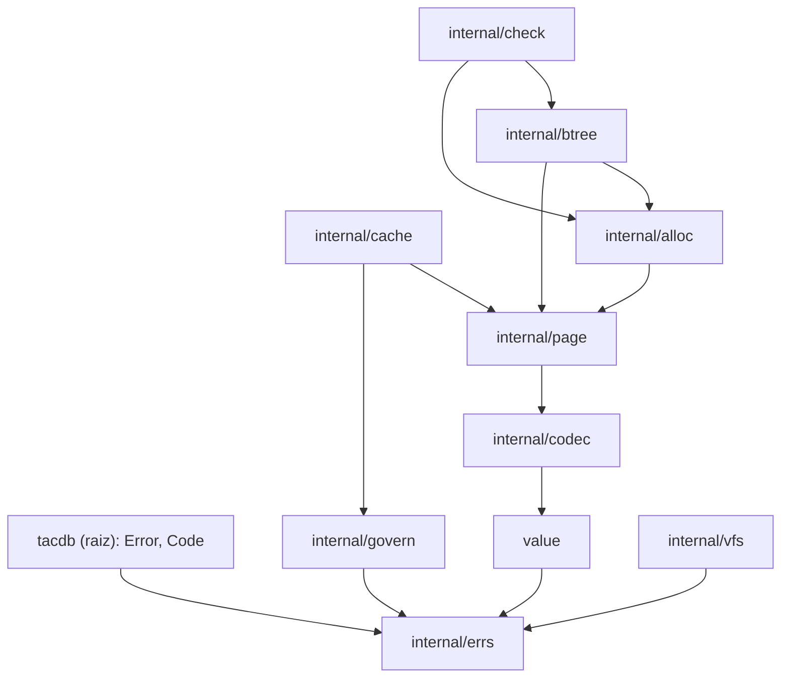

# Design — M1 Fundação (com o mínimo do M0)

**Data:** 24/10/2026 · **Base normativa:** `SPEC.md` 1.3 · **Branch:** `m1-fundacao`

Este documento fixa como o M1 da SPEC será construído: valores, codecs, VFS, locks, páginas G2, alocador, cache, governador, B+tree e checker estrutural. Ele não repete a SPEC; cita as seções que governam cada parte e registra as decisões de implementação.

## 1. Decisões já tomadas

| Decisão | Resultado |
|---|---|
| Base normativa | SPEC 1.2 do autor, revisada para 1.3 nesta sessão (§32.5 da SPEC, R13-01 a R13-21). |
| Primeiro subprojeto | M1 completo mais o mínimo do M0 de que ele depende. O oráculo diferencial e o inventário completo ficam para o M0 completo. |
| Nome do motor de referência | Nunca aparece no repositório: código, documentação, nomes de arquivos, pacotes ou funções (§2.1). Chamar de “motor de referência” ou “R0”. |
| Módulo Go | `github.com/TacFlow/tacdb`. O repositório GitHub será renomeado de `tac-db` para `tacdb` pelo autor antes do primeiro push. |
| Modelo de páginas da B+tree | PageID estável com overlay de cópia na primeira escrita (abordagem A). Shadow paging foi descartado porque exigiria remover o link entre folhas e mudar o WAL por PageID. |
| Representação no overlay | Cópias privadas **codificadas** de 4096 bytes, editadas no lugar (§4.9). Não há nós decodificados: há um só caminho de leitura, a memória fica limitada a uma página por página suja, e a cópia por época atende ao savepoint O(1) da §10.4 (REV-25). |
| Toolchain | `go 1.27` com `toolchain go1.27.3`. |

## 2. Escopo

### 2.1 Entregáveis de documentação (mínimo do M0)

- `SPEC.md` 1.3, já gerada a partir da 1.2.
- `FORMAT.md`: o formato G2 do que o M1 implementa, com as formas canônicas da §7 (superbloco e classificação de cópias, cabeçalho, slots, prefixo canônico, células, regra inline, extents e descritor, bitmap com ordem de bits, página livre, codec de Value, chaves compostas, uvarint). Cresce a cada marco.
- `COMPATIBILITY.md`: a matriz da §28 com status por linha e as decisões próprias do M1 (ordem total de valores; forma canônica obrigatória no codec).
- `AUDIT-REGRESSIONS.md`: tabela AUD/REV/R13 com status e evidência. O M1 fecha REV-19, REV-20, REV-42, R13-01 a R13-04, R13-10 e R13-15 a R13-21, e deixa com evidência pendente:
  - REV-14: componente pronto; o GOV-01 depende de transações e fica para o M2;
  - REV-21: o BT-05 fica parcial, porque o scrub é do M2;
  - R13-05: BT-02 e check estrutural no M1; o SEC-09 é do M9.
- `NOTICE`: o aviso de copyright e a licença MIT de R0, sem nomear o projeto, mais a licença BSD-3-Clause de `golang.org/x/sys`.
- `testdata/golden/`: vetores do codec e imagens de página, comparados byte a byte.

O `THREATMODEL.md` e o inventário de cláusulas e funções ficam para o M0 completo.

### 2.2 Código

| Pacote | Responsabilidade no M1 | SPEC |
|---|---|---|
| raiz `tacdb` + `internal/errs` | `Error` com `Details`, `Code` e sentinelas; catálogo completo de códigos. | §6.1 |
| `value` (público) | `Value` imutável com os 9 tipos, construtores que copiam, acessores sem expor memória mutável, `Compare`, `Limits`, `Validate`. | §5 |
| `internal/codec` | Codec G2 de Value, chaves compostas e uvarint mínimo. | §5.3, §7.1, §7.4 |
| `internal/vfs` | Interface VFS; implementação de SO confinada em `os.Root`; MemoryVFS com falhas; locks; identidade de arquivo; permissões por objeto; durabilidade por plataforma. | §8.3, §20.9 |
| `internal/govern` | Governador de memória do processo. | §8.5 |
| `internal/page` | Layout e formas canônicas das páginas, CRC32C, validação de ponteiros e extents, superbloco, e as interfaces de acesso `Reader`/`Writer`. | §7.1–§7.3 |
| `internal/alloc` | Alocador por bitmap com extents e limite de 337 extents por valor. | §8.4 |
| `internal/cache` | Cache CLOCK em shards, pins por execução e uma leitura por página para pedidos simultâneos. | §8.2 |
| `internal/btree` | B+tree sobre páginas codificadas: prefixo, separadores truncados, overflow em extents, cursores e `Verify` por árvore. | §8.1 |
| `internal/check` | Checker estrutural global: todas as raízes, dono único de página, bitmaps, `free_page_count`, extents e formas canônicas. É o “check de páginas” da §27 e a base do `check --structural` da §20.11. | §20.11, §27 |

### 2.3 Fora do M1

- WAL, transações, diretório de versões, publicação do superbloco, checkpoint e scrub (M2).
- O overlay persistente com savepoint O(1) (M2). O M1 define o contrato que a B+tree segue (§4.9).
- Chaves ordenáveis de propriedades e chave de igualdade/agrupamento (M3/M4).
- Payload das páginas `fixed` (M8): no M1 só existe a validação de cabeçalho.
- Oráculo diferencial: M0 completo, no repositório de ferramentas de referência.

### 2.4 Critério de saída

Verde em Linux, macOS e Windows:

| Teste | Cobertura no M1 |
|---|---|
| VAL-01 | Completo no nível de codec e página, com reabertura por arquivo; refeito via API no M3. |
| VAL-03 | Round-trip completo; a recusa de valores não finitos em índices é do M3. |
| VAL-04 | Cópia da entrada; a validade da saída depois de `Close` é do M3. |
| VAL-05 | Completo. |
| BT-01, BT-02, BT-03, BT-04, BT-06 | Completos. |
| BT-05 | Sem scrub (M2). |
| OPS-03 | Completo: alias por symlink, alias por hard link e outro processo. |
| SEC-08 | Completo nas três plataformas, sem exceção para o Windows. |
| `internal/check` | Aprova todas as árvores geradas pelos testes e detecta as mutações de §7.2. |
| Fuzz | Os alvos de §7.2 rodam sem falhas. |

O VAL-02 (ausência e Null na API e em consultas) é do M3. Os gates aplicáveis da §25.4 também valem; o `go build ./cmd/tacdb` entra com a CLI e o `tacdbvet` no M4.

## 3. Arquitetura



- **Interfaces em `page`:** `page.Reader` e `page.Writer` ficam em `internal/page`. Assim `alloc` e `btree` dependem de `page` sem ciclo.
- **Quem implementa:** no M1, o armazenamento de teste (§4.10); no M2, o overlay e o diretório de versões. O cache é usado pelas implementações de `Reader`, não pela B+tree diretamente.
- **Direção das dependências:** todas apontam para baixo.

## 4. Componentes

### 4.1 Erros

`Error{Code, Op, Message, Cause, Retryable, CommitToken?, Location?, Details}`.

- `Details` é `map[string]int64`, com chaves estáveis por código (§6.1, R13-17). No M1, `RESOURCE_LIMIT` traz `requested`, `available` e `limit`; as durações vão em nanossegundos.
- Cada código tem uma sentinela `tacdb.ErrX`, e `errors.Is` compara pelo código. `errors.As` dá acesso aos detalhes. `With` nunca altera uma sentinela: devolve uma cópia, para que as sentinelas globais sejam imutáveis.
- O catálogo inteiro da §6.1 vira constantes já no M1.
- Os códigos que o M1 produz: `INVALID_ARGUMENT`, `LIMIT_EXCEEDED`, `CORRUPT`, `IO`, `NO_SPACE`, `LOCKED`, `RESOURCE_LIMIT`, `UNSUPPORTED_FORMAT`, `UNSAFE_PATH`, `INSECURE_PERMISSIONS`, `CANCELED` e `DEADLINE`.
- As mensagens trazem PageID, offset e tamanhos, nunca conteúdo de chave ou valor (§20.12).

### 4.2 Valores

`Value` é um tipo de valor imutável. O zero value é Null.

- **Construtores:** `Null`, `Bool`, `Int`, `Float`, `String`, `Bytes`, `Vector`, `List`, `MapOf` (a partir de um `map` Go) e `MapFromEntries`. Os que recebem slices copiam a entrada. `MapFromEntries` devolve `INVALID_ARGUMENT` se houver chave duplicada.
- **Acessores sem cópia mutável:** `Kind`, `Len`, `Index`, `EntryAt`, `AppendBytes`, `VectorAt`. É com eles que o codec trabalha.
- **Validação:** `Validate(v, Limits)` checa UTF-8, profundidade (`MaxDepth`, 64), `MaxValueElements` (1 000 000), chaves de mapa (`MaxMapKeyBytes`, 64 KiB) e dimensão do Vector (`MaxVectorDimensions`, 4096 por padrão, até 65535). O tamanho codificado (`MaxValueBytes`, 16 MiB) é checado pelo codec, dono da codificação, porque `value` não pode importar `codec`. Os nomes dos campos seguem a §24.1.
- **Comparação:** `Value` não é comparável com `==` (um campo `[0]func()` transforma o uso em erro de compilação, em vez do panic que listas e mapas dariam em runtime); compara-se com `Compare` ou `Identical`.
- **`Compare`:** ordem total da §5.3, nesta sequência de famílias: Bool < número < String < Bytes < Vector < List < Map < Null.
  - Int e Float são comparados exatamente, sem converter o int64 para float64.
  - NaN fica depois dos números, `-0` empata com `+0` e dois NaN empatam.
  - Listas, mapas e vetores comparam elemento a elemento e depois pelo comprimento.
  - Strings e bytes comparam por bytes.

  A igualdade de expressão com NaN pertence ao executor, no M4.

### 4.3 Codec

- **`AppendValue(dst, v)` e `DecodeValue(b, DecodeOptions)`.** O decode recebe `Limits` e um orçamento `Budget`. Comprimentos e contagens são validados contra os bytes restantes antes de qualquer alocação. Cada elemento debita pelo menos 64 bytes mais os bytes variáveis.
  - Erros com `CORRUPT`: tag desconhecida, Bool fora de 0/1, UTF-8 inválido, chave duplicada ou fora de ordem, dimensão de Vector inválida e bytes sobrando.
  - A forma é canônica: recodificar um valor decodificado devolve exatamente os mesmos bytes.
- **Chaves compostas:** inteiros big-endian e strings com escape `00 → 00 FF`, terminadas por `00 00`. Inclui o cálculo do fim de faixa para prefix scan e checa o limite de 1024 bytes depois de codificar.
- **Uvarint:** sempre em forma mínima; forma não mínima é `CORRUPT`. `uvlen(n)` é a mesma função usada pela regra inline e pelos cálculos de tamanho.

### 4.4 VFS e locks

**Interface**
- Operações: abrir e criar exclusivo, `ReadAt` e `WriteAt` completos ou com erro, `Size`, `Truncate`, `Preallocate`, `Sync`, `SyncData`, rename atômico no mesmo diretório, `SyncDir`, `Remove`, listagem e lock.
- Uma escrita curta vira `IO`; `ENOSPC` vira `NO_SPACE`.
- As syscalls que o adaptador de plataforma chama direto (locks, `fallocate`, `F_FULLFSYNC`, `F_PREALLOCATE`) repetem em `EINTR`. Um gancho de teste injeta `EINTR` para provar isso.

**Confinamento**
- O caminho do chamador é resolvido uma vez (`Abs` + `EvalSymlinks` do diretório) e o diretório é aberto como `os.Root`.
- Antes de abrir, toda entrada passa por `Lstat` via root. O que não for arquivo regular ou diretório dá `UNSAFE_PATH` (R13-03, R13-21): symlink, junction (que no Windows aparece como `ModeIrregular`), dispositivo, socket.
- Nomes passam por `filepath.IsLocal` e por padrões permitidos: `nome.tacdb`, `nome.tacdb.lock`, `nome.tacdb-wal/<16 hex>.wal` e temporários com sufixo de `crypto/rand`.

**Permissões por objeto (§20.9, R13-18)**

| Objeto | Unix | Windows |
|---|---|---|
| Arquivos criados pelo tacdb (banco, lock, segmentos, temporários) | 0600, com o usuário efetivo como dono. | Dono e DACL protegida restritos ao usuário, a SYSTEM e a Administradores. |
| Diretórios criados pelo tacdb (WAL) | 0700, com o usuário efetivo como dono. | Mesma regra. |
| Diretório do chamador | Dono é o usuário efetivo ou root, e não pode haver escrita para grupo ou outros: 0755 passa, 0777 e 1777 não. | Dono é o usuário, SYSTEM ou Administradores, e nenhuma ACE efetiva concede escrita a outro SID. |

Qualquer violação dá `INSECURE_PERMISSIONS`, salvo `AllowSharedDirectory`.

**ACLs por plataforma (R13-21)**
- **macOS:** ACLs estendidas entram na mesma regra. Uma entrada allow que conceda escrita, append ou criação e remoção de entradas a um principal que não seja o dono torna o objeto inseguro; entradas deny, como o “everyone deny delete” das pastas do usuário, não contam. As ACLs são lidas por `fgetattrlist(ATTR_CMN_EXTENDED_SECURITY)` sobre o descritor já aberto via `os.Root`, nunca pelo caminho, com syscall crua do `x/sys/unix` (`Syscall6`), sem cgo. No diretório do chamador contam também as entradas herdáveis (`file_inherit` e `directory_inherit`, inclusive com `only_inherit`), e cada objeto criado é conferido logo após a criação.
- **Windows:** dono e DACL são lidos com `GetSecurityInfo` sobre o handle aberto. Os objetos criados recebem a DACL protegida já na criação, sem herança.
- **Linux:** os bits de modo bastam, porque a máscara das ACLs POSIX limita as entradas nomeadas.

O SEC-08 vale nas três plataformas. Se uma plataforma revelar uma limitação real, ela vira uma divergência com ID e teste, nunca um relaxamento silencioso.

**Durabilidade por plataforma**

| Plataforma | Mecanismo |
|---|---|
| Linux | `fdatasync` em `SyncData`, `fsync` em `Sync`. |
| macOS | `F_FULLFSYNC`. Se o `fcntl` de diretório não for suportado, `SyncDir` cai para `fsync` e a métrica registra isso. |
| Windows | `FlushFileBuffers`; rename com `MoveFileEx(REPLACE_EXISTING \| WRITE_THROUGH)`; `SyncDir` não faz nada, documentado. |

`Preallocate` usa `fallocate`, `F_PREALLOCATE` ou `SetFileInformationByHandle`. Se a pré-alocação falhar, o VFS segue com escrita normal.

**Locks em três camadas**
1. **Arquivo `.lock`** com nome estável, nunca removido. Exclusivo para o owner, compartilhado para processos só de leitura.
2. **Lock no arquivo principal** enquanto aberto (R13-04). No unix é o mesmo tipo de lock; no Windows, `LockFileEx` numa faixa a partir de 2^62, que não bloqueia I/O.
3. **Registro no processo** por identidade de arquivo (dev+inode, ou volume+índice no Windows).

Os tipos de lock seguem a §8.3: OFD (`F_OFD_SETLK`) no Linux, `flock` no macOS e `LockFileEx` no Windows. Locks POSIX por processo nunca são usados. Lock ocupado vira `LOCKED`.

**MemoryVFS**
- Cada arquivo e cada diretório tem imagem corrente e imagem durável. `Sync` promove o arquivo e `SyncDir` promove os nomes do diretório.
- `Crash(seed, opções)` volta à imagem durável. Opcionalmente aplica um subconjunto das escritas não sincronizadas em setores de 512 B: completas, parciais (torn) ou fora de ordem.
- Falhas injetáveis por operação e padrão de caminho: erro, escrita curta, `ENOSPC` depois de N bytes, falha de `Sync` e **truncamento** do arquivo (a cauda volta ao tamanho durável ou a um tamanho escolhido). Tudo é determinístico pela seed.
- Os locks também existem em memória, com a mesma semântica.

### 4.5 Governador

Há um `Governor` por processo, criado na primeira abertura, ou um explícito passado em opções. O orçamento padrão é 1 GiB.

- Categorias: cache, execução, overlay, selados, transporte e spool, cada uma com fração mínima garantida.
- `Reserve(ctx, categoria, bytes)` é incremental e devolve uma reserva que se libera no `Close`.
- Uma reserva que não cabe espera de forma cancelável até `GovernorWait` (1 s) e então devolve `RESOURCE_LIMIT` com `requested`, `available` e `limit` em `Details`.
- Há métricas por categoria.
- No M1, só o cache e o decode de Values debitam. As demais categorias passam a ser usadas no M2 e no M10.

### 4.6 Páginas e formas canônicas

**Cabeçalho**
- 48 bytes (§7.3), com CRC32C da página inteira calculado com o campo de CRC zerado.
- Tipos: free 0, internal 1, leaf 2, overflow 3, bitmap 4, fixed 5.
- `Verify(buf, id)` roda antes de expor uma página publicada. Checa:
  - CRC, `header_bytes`, tipo conhecido, PageID igual ao esperado e flags permitidas;
  - os campos não usados pelo tipo estão em zero;
  - `lower`/`upper` coerentes e regiões de células dentro dos limites, sem sobreposição;
  - uvarint mínimo;
  - chaves (prefixo + sufixo) estritamente crescentes;
  - nenhuma célula inline acima de 1344 bytes;
  - descritor de extents válido.

  Bytes zerados no espaço livre e a forma canônica do prefixo só são exigidos pela verificação completa (§4.11).

**Página slotted (leaf e internal)**
- Slots de 4 bytes: `offset:u16` e `length:u16`.
- **Prefixo canônico (R13-19):** seja `p` o maior prefixo comum entre a primeira e a última chave. A flag PREFIX fica ligada se e somente se há pelo menos duas chaves, `p ≥ 1` e a codificação com `p` é estritamente menor que a codificação sem prefixo. Ligada, o slot 0 guarda exatamente `p` e as células guardam só sufixos.
- **Tamanho canônico:** é o tamanho dessa forma, e nunca supera o de nenhuma outra escolha de prefixo. Toda decisão de caber usa o tamanho canônico (§4.9).
- Uma cópia privada no overlay pode ter outro leiaute, desde que caiba fisicamente no buffer; a finalização sempre normaliza.
- A busca binária compara a chave procurada com o prefixo e depois com cada sufixo.

**Formato das células**
- **Folha:** `flags:u8`, `suffix_len:uvarint`, `value_len:uvarint`, sufixo, e então o valor inline ou o descritor.
- **Interna:** `key_len:uvarint` (comprimento do sufixo armazenado), `right_child:u64` e o sufixo do separador. O filho à esquerda do primeiro separador fica no `aux`.
- **Regra inline (R13-01, R13-15):** o valor fica inline se `1 + uvlen(len(chave)) + uvlen(len(valor)) + len(chave) + len(valor) ≤ 1344`, com a chave completa. A medida não depende do prefixo da página.

**Extents e descritor**
- Até 4 extents ficam inline na célula (`extent_count:u8` mais pares `start:u64` + `pages:u32`). De 5 a 337, ficam numa página-descritor (bit 1 da célula e `descriptor:u64`).
- Forma canônica:
  - os extents seguem a ordem dos bytes do valor e têm `pages ≥ 1`;
  - somam exatamente `ceil(value_len/4048)` páginas;
  - dois extents consecutivos nunca são fisicamente contíguos;
  - a página-descritor é do tipo overflow, com `count = 12·n`.
- Uma página overflow usa os bytes 48..4095; `count` guarda os bytes úteis. Todas têm 4048 bytes úteis, exceto a última do valor.

**Bitmap**
- O grupo g tem seu bitmap na página `2 + g·32385`, com o número do grupo no offset 32 e 32 384 bits de payload.
- A página de índice `i = PageID − bitmap − 1` corresponde ao bit `i mod 8` do byte `48 + i/8`, contado a partir do bit menos significativo.

**Ponteiros (R13-05)**
- `page.CheckPointer(id, pageCount)` rejeita como `CORRUPT` o PageID 0 onde o ponteiro é obrigatório, o PageID 1, páginas de bitmap e qualquer PageID ≥ `pageCount`.
- `page.CheckExtent(e, pageCount)` faz o mesmo para cada página de um extent, o que também rejeita um extent que atravesse um bitmap.
- A descida da árvore, o alocador e o checker usam essas duas funções.

**Superbloco**
- Layout da §7.2, com `format_revision = 13`.
- `ChooseSuperblock(a, b)` classifica cada cópia isoladamente, na ordem da §7.2 1.3 (R13-20): magic, CRC, campos de versão (`format_version`, `format_revision`, `min_reader_version`) e, por último, os demais campos. Uma cópia de revisão futura nunca é tomada por danificada. Depois:
  - qualquer cópia não suportada: `UNSUPPORTED_FORMAT`;
  - duas estrangeiras: `UNSUPPORTED_FORMAT`;
  - entre as válidas, vence a maior geração;
  - geração igual com conteúdo diferente: `CORRUPT`;
  - sem nenhuma cópia válida: `CORRUPT`.

### 4.7 Interfaces de acesso a páginas

```go
// em internal/page
type Ref interface {
    Bytes() *[Size]byte // imagem imutável enquanto o pin existir
    Release()
}

type Pins interface { // orçamento de pins de uma execução (MaxPinnedBytesPerExecution)
    Acquire(bytes int) error
    Release(bytes int)
}

type Reader interface { // da transação; o orçamento de pins vem de cada execução
    Page(ctx context.Context, pins Pins, id ID) (Ref, error)                 // cópia privada se suja; senão versão publicada verificada
    ReadOverflow(ctx context.Context, pins Pins, e Extent, dst []byte) error // payloads verificados (tipo, PageID, CRC, count), em ordem
    PageCount() uint64
}

type Writer interface {
    Reader
    Writable(ctx context.Context, id ID) (*[Size]byte, error) // cópia privada da época de savepoint corrente
    Fresh(id ID) (*[Size]byte, error)                         // página recém-alocada, zerada, sem ler conteúdo antigo
    Discard(id ID)                                            // página liberada: descarta a cópia privada
    SetPageCount(n uint64)
    FreePageCount() uint64
    SetFreePageCount(n uint64)
}
```

**Contratos**
- **Leitura das próprias escritas:** `Page` devolve a cópia privada de uma página suja, então a B+tree e os cursores leem pelo mesmo caminho. Uma cópia privada não tem CRC até a finalização e não passa por `Verify`.
- **Imutabilidade:** só a `Ref` de uma página publicada é imutável. A `Ref` de uma cópia privada vale até a próxima mutação da árvore dona da página ou até a próxima restauração de savepoint. São exatamente as condições que invalidam cursores (§4.9), e o overlay não recicla o buffer antes disso.
- **Execução:** `Reader` e `Writer` pertencem à transação. Cada statement cria seu `Pins` e o passa a cada operação, de modo que um único `Tree` por transação atende statements sucessivos.
- **Época:** um buffer de `Writable` vale até a próxima chamada que possa abrir época nova (savepoint). A B+tree nunca guarda buffers entre operações.
- **Versão:** a versão de uma página publicada é o CommitID no cabeçalho dela, e é essa versão que entra na chave do cache. O armazenamento de teste atribui CommitIDs monotônicos a cada finalização.
- **Finalização** (armazenamento de teste no M1; coordenador de commits no M2): cada página suja é normalizada, ou seja, prefixo canônico, células compactadas e espaço livre zerado. Depois recebe o CommitID e o CRC, e só então é emitida, uma vez.

### 4.8 Alocador

**Interface**
- `Alloc(ctx, hint)` devolve uma página.
- `AllocExtents(ctx, nPages, hint)` devolve no máximo 337 extents.
- `Free(ctx, id)` e `FreeExtents(ctx, extents)` liberam e chamam `Writer.Discard` para cada página liberada.

**Funcionamento**
- Lê e escreve as páginas de bitmap pelo `page.Writer` da transação, porque o bitmap é versionado como qualquer página.
- Mantém `pageCount` e `free_page_count` pelo `Writer`.
- Cria o primeiro grupo na primeira alocação, e cria grupos novos quando a cauda avança. O crescimento físico do arquivo, em blocos de `FileGrowthBytes`, é da camada que grava.

**Política**
- Escolhe o menor endereço livre, com dica de localidade: o grupo da irmã ou do pai.
- Extents pedem uma faixa contígua. Se juntar buracos internos exigiria mais de 337 extents, o alocador usa uma faixa na cauda, onde só os bitmaps interrompem a faixa (R13-02).
- O sumário por grupo vive só em memória, como cache: é reconstruído sob demanda e atualizado por deltas.

### 4.9 B+tree

**Árvores e cursores**
- Uma árvore de leitura é um par (`page.Reader`, raiz).
- Uma árvore de escrita (`btree.Tree`) guarda `page.Writer`, alocador, raiz e um **contador de mutações próprio**.
- Um cursor guarda o contador da sua árvore e o contador de restaurações de savepoint da transação. Mutar *essa* árvore ou restaurar um savepoint invalida o cursor, e a próxima operação dele falha com `INVALID_ARGUMENT` e `Op` igual a `cursor`. Mutar outra árvore do mesmo overlay não o afeta (§8.1).
- Os dois contadores são monotônicos na transação: restaurar um savepoint incrementa o seu e nunca faz o contador de uma árvore voltar, o que evita ABA (R13-22).
- Quem cria as árvores (o M2) entrega um único `Tree` por raiz em cada transação.
- As operações recebem `ctx` e o `Pins` da execução corrente.

**Operações**
- `Get`, `Put`, `Delete`, `SeekGE`, `SeekGT`, `First`, `Next`, `Range` e `Verify`.
- `Put` e `Delete` devolvem a raiz nova.
- Valores devolvidos são sempre cópias do chamador.

**Decisão de caber e edição no lugar (R13-19)**
- **Decisão:** antes de mexer no buffer, calcula o tamanho canônico do conjunto resultante. Se passar de 4048 bytes de conteúdo, faz split; se couber, edita.
- **Edição:** insere o slot e escreve a célula a partir de `upper`. Se o leiaute atual da cópia não comportar a edição fisicamente (prefixo diferente ou espaço fragmentado), reescreve a cópia **já com a edição aplicada**, na forma canônica do conjunto resultante. Normalizar o conjunto antigo e depois inserir não basta: a forma canônica do conjunto antigo pode não ter o prefixo que torna o resultado cabível. Exemplo: cinco chaves de "kaaa" a "keee" mais "kfff".
- **Uma função de tamanho:** `encodedSize` calcula o tamanho canônico e é usada por todas as decisões e pelo encoder. Um teste de propriedade compara essa função com os bytes realmente codificados.

**Split (R13-16)**
- **Medida exata:** para cada ponto candidato, cada lado é medido pelo seu tamanho canônico exato. O prefixo é o maior prefixo comum entre a primeira e a última chave do lado, e os uvarint dos sufixos são recontados, porque `uvlen(len − p)` pode ser menor que `uvlen(len)`. O custo é O(n) por candidato, com n ≤ ~450 células, ou seja, O(n²) por split.
- **Escolha:** o ponto mais perto da metade em que os dois lados cabem. A regra de 1344 bytes garante que ele existe.
- **Separador:** em folhas, o menor `s` com `max(L) < s ≤ min(R)`, ou seja, `min(R)[:lcp(max(L), min(R)) + 1]`. Em nós internos, a chave do meio sobe.
- **Arredores:** o link de irmã é refeito, e o split da raiz cria uma raiz um nível acima.

**Delete**
- Abaixo de 25% de ocupação, considera uma irmã do mesmo pai, com a mesma medida exata:
  - se as duas cabem juntas, funde, sempre a direita dentro da esquerda, e a página da direita é liberada;
  - se não, redistribui células. Se o separador novo não couber no pai, a redistribuição não é feita e o nó fica abaixo de 25% (§8.1).
- Uma raiz interna sem separadores colapsa no seu filho; árvore vazia tem raiz 0.

**Overflow**
- Um valor que não fica inline vai para `AllocExtents`, com as páginas escritas por `Fresh`. O descritor segue a forma canônica de §4.6.
- A substituição grava os extents novos antes de liberar os antigos.
- A leitura usa `ReadOverflow`. Acima de `LargeValueBypassBytes`, a implementação lê sem passar pelo cache.

**Defesa**
- A descida tem limite de 40 níveis, com nível estritamente decrescente.
- PageID repetido no caminho é `CORRUPT`.
- Todo ponteiro passa por `CheckPointer` ou `CheckExtent`.

**`Verify(árvore)`** checa a estrutura de uma árvore:
- ordem, faixas e a regra dos separadores;
- a cadeia de folhas contra a travessia, e os níveis;
- extents canônicos;
- formas canônicas.

Devolve as páginas que a árvore possui, para o checker global (§4.11).

### 4.10 Armazenamento de teste

`internal/btree/btreetest` implementa `page.Reader`/`page.Writer` em memória, com épocas simples e finalização. Também grava e relê as imagens através de um VFS, sem WAL. As raízes, o `pageCount` e o `free_page_count` vão em superblocos G2 reais nas páginas 0 e 1, alternados a cada gravação com geração crescente, e a reabertura passa por `ChooseSuperblock` e pela validação de raízes. Isso habilita os testes de reabertura do M1 e não é usado em produção. No M2, o overlay persistente e o diretório de versões passam a implementar as mesmas interfaces.

### 4.11 Checker estrutural

`check.Structural(ctx, reader, raízes[32], pageCount, freeCount)` verifica o conjunto inteiro, além do que `btree.Verify` checa por árvore. Roda só sobre estado publicado, isto é, um `Reader` sem cópias privadas, nunca sobre um `Writer`.
- percorre todas as raízes não nulas e todas as páginas dos bitmaps até `pageCount`;
- exige que cada página de dados tenha exatamente um dono (uma árvore ou um extent);
- exige que os bits marquem exatamente as páginas possuídas e que `free_page_count` seja igual às páginas livres cobertas;
- exige que nenhuma página fora de `pageCount` seja referenciada;
- checa os bytes zerados e o prefixo máximo (forma canônica).

Devolve um relatório com contagens e o primeiro erro de cada categoria. Os testes do M1 usam o checker depois de cada sequência de operações; o M2 e a CLI (`check --structural`) reutilizam o mesmo pacote.

## 5. Fluxos

**Leitura (Get)**
1. Descida a partir da raiz: para cada página, `Reader.Page` devolve a cópia privada ou a versão publicada, via cache e `Verify`.
2. Busca binária por prefixo e sufixo.
3. Na folha, devolve uma cópia do valor inline, ou chama `ReadOverflow` sobre os extents.
4. Libera os pins.

**Escrita (Put com split)**
1. Descida registrando o caminho; `Writable` obtém cada cópia privada.
2. Inserção no lugar.
3. Se não couber: medida exata, split, `Alloc` e `Fresh` da página nova, e propagação do separador, que pode se repetir até criar uma raiz nova.
4. O contador de mutações da árvore avança.
5. Na finalização, cada página suja é normalizada, recebe o CRC e é emitida uma vez.

**Valor grande**
1. `AllocExtents` com faixa contígua.
2. `Fresh` de cada página overflow.
3. Descritor inline, ou página-descritor quando há mais de 4 extents.
4. Na leitura, um `ReadOverflow` sequencial por extent.

## 6. Tratamento de erros

- Nenhum caminho de decodificação, página, árvore, checker ou I/O dá panic com entrada corrompida ou forjada; o fuzz verifica isso (§7.2).
- Panic só existe para violação de invariante interna do próprio código, e todo caso conhecido é coberto por teste.
- `CORRUPT` traz o PageID e o motivo.
- Erros de I/O preservam a causa (`errors.Unwrap`).
- Cancelamento é observado onde há espera (governador e locks) e entre lotes do checker, e devolve `CANCELED` ou `DEADLINE`.

## 7. Testes e CI

### 7.1 Testes por pacote

| Área | Casos |
|---|---|
| Valores e codec | Tabelas com todas as tags e limites; casos inválidos da §4.3; VAL-05 (16 MiB de Nulls, chaves grandes, mapas fora de ordem); `MapFromEntries` com duplicata; propriedades de ordem total de `Compare` com valores gerados; casos fixos (Int contra Float em 2^53+1, NaN, `-0`, Null). |
| Páginas | Codificar e decodificar cada tipo; `Verify` contra mutações; uvarint não mínimo; célula inline acima de 1344 bytes rejeitada; ordem de bits do bitmap; forma canônica do descritor; `CheckPointer` e `CheckExtent`; todos os ramos de `ChooseSuperblock`, incluindo cópias mistas (revisão 14 com geração maior ao lado de revisão 13, revisão 14 com raiz 19 ou flag nova, estrangeira com válida, danificada com estrangeira). |
| Tamanho | Propriedade: `encodedSize` igual ao tamanho realmente codificado e nunca maior que o de qualquer outra escolha de prefixo. Caso dirigido: as chaves "kaaa" a "kddd" com valores de 1000 bytes ficam canônicas sem PREFIX e cabem exatamente. |
| Alocador (BT-05 parcial) | Alocação e liberação aleatórias com reabertura; preferência pelo menor endereço; limite de 337 extents com fallback para a cauda; extent nunca atravessa bitmap; `free_page_count` coerente com os bitmaps. |
| B+tree (BT-01 a BT-04, BT-06) | Sequências com seed (Put, Delete, Get, Seek, Range) contra um mapa ordenado. Chaves de 0 a 1024 bytes com prefixos comuns longos; valores de 0 a 16 MiB. Casos dirigidos: a fronteira de 1344 bytes; o caso 2000/2064/2000; uma página com 160 sufixos curtos sob um prefixo de 1000 bytes recebendo a chave "b" com valor de 1300 bytes, que precisa encontrar um ponto de split válido pela medida exata; redistribuição que alongaria o separador; cursor invalidado só pela própria árvore e por restauração de savepoint, sem ABA (com as épocas simples do armazenamento de teste); inserção que só cabe com o prefixo do conjunto resultante ("kaaa" a "kfff"). `Verify` e o checker rodam periodicamente, e o fanout interno mínimo é medido. |
| Checker | Árvores válidas aprovadas; página com dois donos, bit de bitmap errado, `free_page_count` errado, extent fora de `pageCount` e prefixo não máximo detectados. |
| Cache | Pin e unpin, ordem de evicção, `RESOURCE_LIMIT` com tudo fixado, limite de pins por execução, uma leitura para N goroutines, bypass de valores grandes; tudo sob `-race`. |
| Governador | Reserva, espera, cancelamento, prazo e `Details` do `RESOURCE_LIMIT`. GOV-01 completo fica no M2. |
| VFS e locks | Segundo handle no mesmo processo, alias por symlink e por hard link, outro processo (o binário de teste se re-executa) e leitores compartilhados. SEC-08 pela tabela de permissões de §4.4, nas três plataformas, incluindo diretório de outro dono e ACE de escrita para outro SID no Windows, ACL allow de escrita no macOS (direta e herdável no diretório do chamador) e junction no Windows. `EINTR` injetado. MemoryVFS: perda de escrita não sincronizada, escrita parcial, truncamento e rename com e sem `SyncDir`. |
| Reabertura | Árvore gravada pelo armazenamento de teste via VFS de SO e de memória, reaberta, relida com resultado idêntico e aprovada pelo checker. |
| Goldens | Vetores de Value e imagens de cada tipo de página e do superbloco, comparados byte a byte e regenerados com `-update`. |

### 7.2 Fuzz

Os nomes evitam que um alvo seja substring de outro no mesmo pacote. O gate `-fuzz=FuzzValue` da §25.4 aceita uma única correspondência.

| Pacote | Alvos |
|---|---|
| `internal/codec` | `FuzzValue` (decode; se bem-sucedido, recodifica para os mesmos bytes), `FuzzRoundTrip` (valores gerados), `FuzzKeyEncoding`, `FuzzUvarint`. |
| `internal/page` | `FuzzPage` (bytes brutos), `FuzzForgedPage` (mutação estrutural com CRC recalculado), `FuzzSuperblock`, `FuzzForgedSuperblock`, `FuzzBitmapExtents`. |
| `internal/btree` | `FuzzBTreeOps` (contra o modelo, com checker), `FuzzForgedTree` (páginas de uma árvore válida mutadas com CRC recalculado, lidas e verificadas sem panic nem laço). |

O corpus inicial vem dos goldens; entradas que derem crash ficam em `testdata/fuzz`.

### 7.3 CI (GitHub Actions)

- **Linux, macOS e Windows:** `CGO_ENABLED=0 go test ./...`, `CGO_ENABLED=0 go build ./...`, `go vet ./...` e checagem de gofmt.
- **Race:** `CGO_ENABLED=1 go test -race ./...` em Linux e macOS.
- **Fuzz curto:** 60 s por alvo no Linux, incluindo o gate literal `go test ./internal/codec -fuzz=FuzzValue -fuzztime=60s`.
- **Dependências:** `go mod verify`, `govulncheck ./...` e um script sobre `go list -deps -json` que falha se algum pacote de produção tiver `CgoFiles`.
- **Nomes (§2.1):** um job de `grep` usa o padrão da variável de repositório `FORBIDDEN_NAMES_REGEX`, que o autor configura no GitHub e que nunca fica em arquivo versionado. Sem a variável, o job falha avisando que ela falta. O padrão cobre o nome do projeto de referência, não o do autor, que a licença exige no `NOTICE`.
- **Versão:** o `setup-go` lê `go.mod`.

## 8. Riscos e pontos em aberto

| Risco | Tratamento |
|---|---|
| DACL no Windows (criar protegida, verificar a do diretório do chamador) depende de APIs de segurança de `x/sys/windows`. | Implementar e testar no runner Windows. Uma limitação real vira divergência com ID e teste em `COMPATIBILITY.md`, sem relaxar o SEC-08. |
| `os.Root` no Windows e operações novas (rename dentro da raiz, `Lstat`). | Usar só a API da 1.27; testar rename, listagem e detecção de symlink e junction no runner. |
| `F_FULLFSYNC` em diretório no macOS. | Fallback para `fsync`, com métrica e teste. |
| ACLs do macOS dependem de `fgetattrlist` por syscall crua, sem wrapper no `x/sys/unix`, e do formato `kauth_filesec`. | Testar no runner macOS com ACLs reais (`chmod +a`). Se a syscall crua falhar em alguma versão do sistema, registrar divergência com ID e teste em vez de relaxar o SEC-08. |
| Reescrever uma página inteira quando a chave nova não compartilha o prefixo custa O(página). | Aceito: é raro e limitado a 4 KiB. Medir nos benchmarks de BT-03. |
| Precisão do governador (RSS contra contabilidade). | O M1 mede só cache e decode; a medição de RSS do GOV-01 fica no M2. |
| Renomear o repositório GitHub antes do primeiro push. | Depende do autor; até lá, só commits locais no branch `m1-fundacao`. |
