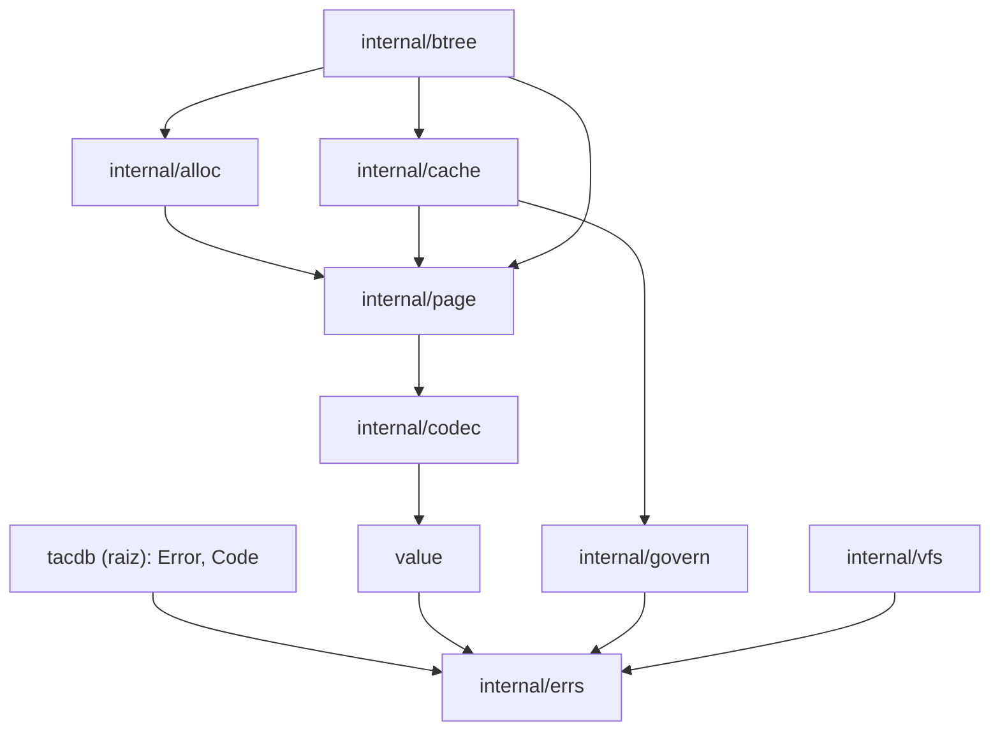

# Design — M1 Fundação (com o mínimo do M0)

**Data:** 24/10/2026 · **Base normativa:** `SPEC.md` 1.3 · **Branch:** `m1-fundacao`

Este documento fixa como o M1 da SPEC será construído: valores, codecs, VFS, locks, páginas G2, alocador, cache, governador e B+tree. Ele não repete a SPEC; cita as seções que governam cada parte e registra as decisões de implementação tomadas no design.

## 1. Decisões já tomadas

| Decisão | Resultado |
|---|---|
| Base normativa | SPEC 1.2 do autor, revisada para 1.3 nesta sessão (§32.5 da SPEC, R13-01 a R13-14). |
| Primeiro subprojeto | M1 completo mais o mínimo do M0 de que ele depende. O oráculo diferencial e o inventário completo ficam para o M0 completo. |
| Nome do motor de referência | Nunca aparece no repositório: código, documentação, nomes de arquivos, pacotes ou funções (§2.1). Chamar de “motor de referência” ou “R0”. |
| Módulo Go | `github.com/TacFlow/tacdb`. O repositório GitHub será renomeado de `tac-db` para `tacdb` pelo autor antes do primeiro push. |
| Modelo de páginas da B+tree | PageID estável com overlay de cópia na primeira escrita (abordagem A). Shadow paging foi descartado porque exigiria remover o link entre folhas e mudar o WAL por PageID. |
| Toolchain | `go 1.27` com `toolchain go1.27.3`. |

## 2. Escopo

### 2.1 Entregáveis de documentação (mínimo do M0)

- `SPEC.md` 1.3: já gerada a partir da 1.2.
- `FORMAT.md`: o formato G2 do que o M1 implementa (superbloco, cabeçalho de página, slots, prefixo, células folha e interna, overflow em extents, página-descritor, bitmap, página livre, codec de Value, chaves compostas, uvarint). Cresce a cada marco.
- `COMPATIBILITY.md`: a matriz da §28 com status por linha e as decisões próprias do M1. São duas: a ordem total de valores (§5.3) e a forma canônica obrigatória no codec, com mapas ordenados e uvarint mínimo.
- `AUDIT-REGRESSIONS.md`: tabela AUD/REV/R13 com status. O M1 fecha REV-14, REV-19, REV-20, REV-21 e REV-42, além de R13-01 a R13-05 e R13-10.
- `NOTICE`: o aviso de copyright e a licença MIT de R0, sem nomear o projeto, mais a licença BSD-3-Clause de `golang.org/x/sys`.
- `testdata/golden/`: vetores do codec e imagens de página, comparados byte a byte.

O `THREATMODEL.md` e o inventário de cláusulas e funções ficam para o M0 completo.

### 2.2 Código

| Pacote | Responsabilidade no M1 | SPEC |
|---|---|---|
| raiz `tacdb` + `internal/errs` | `Error`, `Code` e sentinelas; catálogo completo de códigos. | §6.1 |
| `value` (público) | `Value` imutável com os 9 tipos, construtores que copiam, acessores sem expor memória mutável, `Compare`, `Limits`, `Validate`. | §5 |
| `internal/codec` | Codec G2 de Value, chaves compostas e uvarint mínimo. | §5.3, §7.1, §7.4 |
| `internal/vfs` | Interface VFS; implementação de SO confinada em `os.Root`; MemoryVFS com falhas; locks; identidade de arquivo; durabilidade por plataforma. | §8.3, §20.9 |
| `internal/govern` | Governador de memória do processo. | §8.5 |
| `internal/page` | Layout das páginas, CRC32C, verificação estrutural, superbloco. | §7.2, §7.3 |
| `internal/alloc` | Alocador por bitmap com extents e limite de 337 extents por valor. | §8.4 |
| `internal/cache` | Cache CLOCK em shards, pins e uma leitura por página para pedidos simultâneos. | §8.2 |
| `internal/btree` | B+tree com prefixo, separadores truncados, overflow em extents, cursores e `Verify`. | §8.1 |

### 2.3 Fora do M1

- WAL, transações, diretório de versões, publicação do superbloco, checkpoint e scrub (M2). O scrub fica no M2 porque é parte do checkpoint.
- Chaves ordenáveis de propriedades e chave de igualdade/agrupamento (M3/M4).
- Payload das páginas `fixed` (M8): no M1 só existe a validação de cabeçalho.
- Oráculo diferencial: M0 completo, no repositório de ferramentas de referência.

### 2.4 Critério de saída

Os testes abaixo ficam verdes em Linux, macOS e Windows:
- **Valores:** VAL-01 a VAL-04 no nível de codec e página, com reabertura via arquivo, e VAL-05.
- **B+tree:** BT-01 a BT-06.
- **Locks:** OPS-03 (alias por symlink, hard link e outro processo).
- **Segurança de arquivos:** SEC-08.
- **Fuzz:** os alvos de §7 rodam sem falhas.
- **Gates:** os da §25.4 aplicáveis ao M1. O `go build ./cmd/tacdb` entra quando a CLI existir, e o `tacdbvet` no M4.

## 3. Arquitetura



Todas as dependências apontam para baixo; nenhum pacote do M1 importa `btree`. O `btree` não conhece arquivos: lê e escreve páginas pelas interfaces da §4.9. Quem liga páginas a arquivos é o M2 (WAL e diretório de versões). No M1, essa ligação existe só num armazenamento de teste, descrito na §4.10.

## 4. Componentes

### 4.1 Erros

`Error{Code, Op, Message, Cause, Retryable, CommitToken?, Location?}`.

- Cada código tem uma sentinela `tacdb.ErrX`, e `errors.Is` compara pelo código. `errors.As` dá acesso aos detalhes.
- O catálogo inteiro da §6.1 vira constantes já no M1, porque é contrato estável.
- Os códigos que o M1 produz: `INVALID_ARGUMENT`, `LIMIT_EXCEEDED`, `CORRUPT`, `IO`, `NO_SPACE`, `LOCKED`, `RESOURCE_LIMIT`, `UNSUPPORTED_FORMAT`, `UNSAFE_PATH`, `INSECURE_PERMISSIONS`, `CANCELED` e `DEADLINE`.
- As mensagens trazem PageID, offset e tamanhos, nunca conteúdo de chave ou valor (§20.12).

### 4.2 Valores

`Value` é um tipo de valor imutável. O zero value é Null.

- **Construtores:** `Null`, `Bool`, `Int`, `Float`, `String`, `Bytes`, `Vector`, `List`, `MapOf`, `MapFromEntries`. Os que recebem slices copiam a entrada, e o mapa é guardado como entradas ordenadas por bytes da chave.
- **Acessores sem cópia mutável:** `Kind`, `Len`, `Index`, `EntryAt`, `AppendBytes`, `VectorAt`. É com eles que o codec trabalha.
- **Validação:** `Validate(v, Limits)` checa UTF-8, profundidade (64), tamanho codificado (16 MiB), `MaxValueElements` (1 000 000), chaves de mapa (até 64 KiB) e dimensão do Vector (1..65535).
- **`Compare`:** ordem total da §5.3, nesta sequência de famílias: Bool < número < String < Bytes < Vector < List < Map < Null.
  - Int e Float são comparados exatamente, sem converter o int64 para float64.
  - NaN fica depois dos números, `-0` empata com `+0` e dois NaN empatam.
  - Listas, mapas e vetores comparam elemento a elemento e depois pelo comprimento.
  - Strings e bytes comparam por bytes.

  A igualdade de expressão com NaN (sempre falsa) pertence ao executor, no M4.

### 4.3 Codec

- **`AppendValue(dst, v)` e `DecodeValue(b, DecodeOptions)`.** O decode recebe `Limits` e um orçamento `Budget`. Comprimentos e contagens são validados contra os bytes restantes antes de qualquer alocação. Cada elemento debita pelo menos 64 bytes mais os bytes variáveis.
  - Erros com `CORRUPT`: tag desconhecida, Bool fora de 0/1, UTF-8 inválido, chave duplicada ou fora de ordem, dimensão de Vector inválida e bytes sobrando.
  - A forma é canônica: recodificar um valor decodificado devolve exatamente os mesmos bytes.
- **Chaves compostas:** inteiros big-endian e strings com escape `00 → 00 FF`, terminadas por `00 00`. Inclui o cálculo do fim de faixa para prefix scan e checa o limite de 1024 bytes depois de codificar.
- **Uvarint:** sempre em forma mínima; forma não mínima é `CORRUPT`.

### 4.4 VFS e locks

**Interface**
- Operações: abrir e criar exclusivo, `ReadAt` e `WriteAt` completos ou com erro, `Size`, `Truncate`, `Preallocate`, `Sync`, `SyncData`, rename atômico no mesmo diretório, `SyncDir`, `Remove`, listagem e lock.
- Uma escrita curta vira `IO`; `ENOSPC` vira `NO_SPACE`.

**Confinamento**
- O caminho do chamador é resolvido uma vez (`Abs` + `EvalSymlinks` do diretório) e o diretório é aberto como `os.Root`.
- Antes de abrir, toda entrada passa por `Lstat` via root: symlink dá `UNSAFE_PATH` (R13-03).
- Nomes passam por `filepath.IsLocal` e por padrões permitidos: `nome.tacdb`, `nome.tacdb.lock`, `nome.tacdb-wal/<16 hex>.wal` e temporários com sufixo de `crypto/rand`.

**Permissões**
- Arquivos são criados com 0600 e diretórios com 0700. Modo mais amplo, ou dono diferente do usuário efetivo, dá `INSECURE_PERMISSIONS`, salvo `AllowSharedDirectory`.
- No Windows: DACL restrita ao SID do usuário na criação, e verificação dessa DACL na abertura.

**Durabilidade por plataforma**

| Plataforma | Mecanismo |
|---|---|
| Linux | `fdatasync` em `SyncData`, `fsync` em `Sync`. |
| macOS | `F_FULLFSYNC`. Se o `fcntl` de diretório não for suportado, `SyncDir` cai para `fsync` e a métrica registra isso. |
| Windows | `FlushFileBuffers`; rename com `MoveFileEx(REPLACE_EXISTING \| WRITE_THROUGH)`; `SyncDir` não faz nada, documentado. |

`Preallocate` usa `fallocate`, `F_PREALLOCATE` ou `SetFileInformationByHandle`. Se a pré-alocação falhar, o VFS segue com escrita normal.

**Locks em três camadas**
1. **Arquivo `.lock`** com nome estável, nunca removido. Exclusivo para o owner, compartilhado para processos só de leitura.
2. **Lock no arquivo principal** enquanto aberto (R13-04). No unix é o mesmo tipo de lock; no Windows, `LockFileEx` numa faixa a partir de 2^62, que não bloqueia I/O.
3. **Registro no processo** por identidade de arquivo (dev+inode, ou volume+índice no Windows).

Os tipos de lock seguem a §8.3: OFD (`F_OFD_SETLK`) no Linux, `flock` no macOS e `LockFileEx` no Windows. Locks POSIX por processo nunca são usados. Lock ocupado vira `LOCKED`.

**MemoryVFS**
- Cada arquivo e cada diretório tem imagem corrente e imagem durável. `Sync` promove o arquivo e `SyncDir` promove os nomes do diretório.
- `Crash(seed, opções)` volta à imagem durável. Opcionalmente aplica um subconjunto das escritas não sincronizadas em setores de 512 B: completas, parciais (torn) ou fora de ordem.
- Falhas injetáveis por operação e padrão de caminho: erro, escrita curta, `ENOSPC` depois de N bytes, falha de `Sync`. Tudo é determinístico pela seed.
- Os locks também existem em memória, com a mesma semântica.

### 4.5 Governador

Há um `Governor` por processo, criado na primeira abertura, ou um explícito passado em opções. O orçamento padrão é 1 GiB.

- Categorias: cache, execução, overlay, selados, transporte e spool, cada uma com fração mínima garantida.
- `Reserve(ctx, categoria, bytes)` é incremental e devolve uma reserva que se libera no `Close`.
- Uma reserva que não cabe espera de forma cancelável até `GovernorWait` (1 s) e então devolve `RESOURCE_LIMIT` com `requested`, `available` e `limit`.
- Há métricas por categoria.
- No M1, só o cache e o decode de Values debitam. As demais categorias passam a ser usadas no M2 e no M10.

### 4.6 Páginas

**Cabeçalho**
- 48 bytes (§7.3), com CRC32C da página inteira calculado com o campo de CRC zerado.
- Tipos: free 0, internal 1, leaf 2, overflow 3, bitmap 4, fixed 5.
- `Verify(buf, id)` roda antes de qualquer exposição da página. Checa:
  - CRC, `header_bytes`, tipo conhecido, PageID igual ao esperado e flags permitidas;
  - os campos não usados pelo tipo estão em zero;
  - `lower`/`upper` coerentes e regiões de células dentro dos limites, sem sobreposição;
  - uvarint mínimo;
  - nenhuma célula inline acima de 1344 bytes.

  Bytes zerados no espaço livre só são exigidos pela verificação completa (`check`).

**Página slotted (leaf e internal)**
- Slots de 4 bytes: `offset:u16` e `length:u16`.
- Com a flag PREFIX, o slot 0 guarda o prefixo comum e as células guardam só sufixos.
- A busca binária compara a chave procurada com o prefixo e depois com cada sufixo, sem montar a chave inteira.

**Formato das células**
- **Folha:** `flags:u8`, `suffix_len:uvarint`, `value_len:uvarint`, sufixo, e então o valor inline ou o descritor. O descritor inline tem `extent_count:u8` de 1 a 4 e pares `start:u64` + `pages:u32`; com o bit 1 ligado, é um `descriptor:u64` que aponta para uma página-descritor.
- **Interna:** `key_len:uvarint`, `right_child:u64` e o sufixo do separador. O filho à esquerda do primeiro separador fica no `aux`.
- **Regra inline (R13-01):** o valor fica inline se a célula completa ocupar até 1344 bytes. A célula completa conta `flags`, os dois uvarint, a chave completa sem remoção do prefixo e o valor.

**Overflow e descritor**
- Uma página overflow usa os bytes 48..4095; `count` guarda os bytes úteis.
- Uma página-descritor é uma página overflow cujo conteúdo é uma lista de pares de 12 bytes, até 337.

**Bitmap**
- O grupo g tem seu bitmap na página `2 + g·32385`, com o número do grupo no offset 32 e 32 384 bits de payload.

**Superbloco**
- Layout da §7.2, com 32 raízes, `free_page_count`, `wal_floor_segment`, raft e `format_revision = 13`.
- `ChooseSuperblock(a, b)`:
  - os dois válidos: vence a maior geração;
  - geração igual com conteúdo diferente: `CORRUPT`;
  - um inválido: usa o outro;
  - os dois inválidos: `CORRUPT`, sem nunca criar banco por cima;
  - magic desconhecido, ou `format_revision` diferente de 13: `UNSUPPORTED_FORMAT` (REC-09).

**Ponteiros inválidos (R13-05):** PageID 0 como ponteiro obrigatório, PageID 1, uma página de bitmap ou qualquer PageID ≥ `pageCount` encontrado como raiz, filho, irmã ou extent é `CORRUPT`.

### 4.7 Alocador

**Interface**
- `Alloc(hint)` devolve uma página.
- `AllocExtents(nPages, hint)` devolve no máximo 337 extents.
- `Free(id)` e `FreeExtents` liberam.
- O alocador lê e escreve as páginas de bitmap pelo mesmo `PageSink` da transação, porque o bitmap é uma página versionada (§8.4).

**Política**
- Escolhe o menor endereço livre, com dica de localidade: o grupo da irmã ou do pai.
- Extents pedem uma faixa contígua. Se juntar buracos internos exigiria mais de 337 extents, o alocador usa uma faixa na cauda do arquivo, onde só os bitmaps interrompem a faixa (R13-02).
- O sumário por grupo (páginas livres e maior faixa livre) vive só em memória, como cache: é reconstruído sob demanda e atualizado por deltas.
- `free_page_count` é mantido pelo alocador e conferido pelo `Verify` do alocador.
- O primeiro grupo é criado na primeira alocação. O arquivo cresce em blocos de `FileGrowthBytes` (4 MiB).

### 4.8 Cache

- **Chave:** (UUID do banco, PageID, versão); as entradas são imutáveis.
- **Shards:** CLOCK com segunda chance; o número de shards é a maior potência de 2 ≤ 2×GOMAXPROCS, com mínimo 8.
- **Miss:** o loader roda fora de qualquer lock e pedidos simultâneos da mesma página esperam essa única leitura. O loader é quem chama `page.Verify`.
- **Orçamento:** em bytes, incluindo metadados e debitado do governador. Mínimo de 16 páginas por handle.
- **Evicção e pins:**
  - a evicção só considera entradas sem pin;
  - com tudo fixado, devolve `RESOURCE_LIMIT` sem bloquear;
  - cada execução pode fixar no máximo `MaxPinnedBytesPerExecution` (8 MiB);
  - um buffer só volta ao pool com contagem de referências zero.
- **Valores grandes:** valores acima de `LargeValueBypassBytes` (1 MiB) são lidos em buffers da própria execução, sem entrar no cache.

### 4.9 B+tree

**Interfaces**

```go
type PageSource interface {
    Page(id page.ID) (page.Ref, error)            // imagem imutável, verificada, com pin
    ReadPages(start page.ID, n int, dst []byte) error // leitura sequencial sem cache, para extents
}

type PageSink interface {
    PageSource
    Node(id page.ID) (*Node, error)               // nó mutável do overlay; decodifica na primeira escrita
    NewNode(kind page.Type, level uint16, hint page.ID) (*Node, error)
    WriteOverflow(start page.ID, data []byte) error
    Allocator() alloc.Allocator
    Generation() uint64                           // muda a cada mutação; invalida cursores de escrita
}
```

**Overlay**
- O overlay guarda nós decodificados: chaves completas e valores inline ou descritores.
- A imagem de 4096 bytes de cada nó sujo é codificada uma única vez, quando o overlay é finalizado, e é nesse momento que o prefixo da página é recalculado (§7.3). Isso cumpre o “uma serialização por página suja” e mantém split e merge simples.
- No M1, a finalização existe no armazenamento de teste; no M2 ela passa a ser feita pelo coordenador de commits.

**Operações**
- `Get`, `Put`, `Delete`, `SeekGE`, `SeekGT`, `First`, `Next`, `Range` e `Verify`. `Put` e `Delete` devolvem a raiz nova; quem guarda as raízes é o chamador.

**Split**
- O tamanho de cada lado é calculado relativo ao prefixo atual da página. Isso é um limite superior: o prefixo de cada metade só pode crescer.
- O ponto escolhido é o mais perto da metade dos bytes em que os dois lados cabem. A regra de 1344 bytes garante que ele existe.
- O separador é o menor `s` com `max(L) < s ≤ min(R)` (truncamento).
- Numa folha, a página da direita é nova, o link de irmã é refeito e o separador sobe para o pai.
- Num nó interno, a chave do meio sobe.
- Split da raiz cria uma raiz um nível acima.

**Delete**
- Abaixo de 25% de ocupação, funde com uma irmã do mesmo pai, sempre da direita para dentro da esquerda. Se não couber, redistribui células.
- Uma raiz interna com um único filho colapsa; árvore vazia tem raiz 0.

**Overflow**
- Um valor que não fica inline vai para extents vindos do alocador. Até 4 extents ficam inline na célula; acima disso, numa página-descritor.
- A substituição grava os extents novos antes de liberar os antigos, os dois no mesmo overlay.

**Cursor**
- Fica preso a um `PageSource` e uma raiz e avança pelo link de irmã.
- Um cursor aberto sobre um `PageSink` guarda a geração; depois de qualquer mutação, a próxima operação dele falha com `INVALID_ARGUMENT` e `Op` igual a `cursor`.
- Valores devolvidos são sempre cópias do chamador.

**Defesa**
- A descida tem limite de 40 níveis, com nível estritamente decrescente.
- PageID repetido no caminho é `CORRUPT`.
- `Verify` checa:
  - ordem, faixas dos separadores e a regra `max(L) < s ≤ min(R)`;
  - a cadeia de folhas contra a travessia, e os níveis;
  - extents dentro de `pageCount` e coerentes com `value_len`;
  - que cada página tem um único dono e que o bitmap marca exatamente as páginas usadas.

### 4.10 Armazenamento de teste

`internal/btree/btreetest` implementa `PageSource`/`PageSink` em memória, com finalização. Também grava e relê as imagens através de um VFS, sem WAL. Isso habilita os testes de reabertura do M1 e não é usado em produção. No M2, o diretório de versões passa a implementar as mesmas interfaces.

## 5. Fluxos

**Leitura (Get)**
1. Descida a partir da raiz: para cada página, `PageSource.Page`, que é cache hit ou leitura única seguida de `Verify`.
2. Busca binária no nível da página.
3. Ao chegar na folha, devolve uma cópia do valor inline. Se o valor estiver em extents, usa `ReadPages`, sem passar pelo cache acima de 1 MiB.
4. Libera os pins.

**Escrita (Put com split)**
1. Descida registrando o caminho e os nós; `Node(id)` decodifica e copia na primeira escrita.
2. Inserção. Se a página não cabe, split, com o alocador fornecendo a página nova e atualizando o bitmap.
3. O separador é propagado para o pai; isso pode se repetir até criar uma raiz nova.
4. Na finalização, cada nó sujo é codificado uma vez, com CRC.

**Valor grande**
1. `AllocExtents` com faixa contígua.
2. `WriteOverflow` por extent.
3. Descritor inline, ou página-descritor quando há mais de 4 extents.
4. Na leitura, um `ReadPages` sequencial por extent.

## 6. Tratamento de erros

- Nenhum caminho de decodificação, página, árvore ou I/O dá panic com entrada corrompida ou forjada; o fuzz verifica isso (§7).
- Panic só existe para violação de invariante interna do próprio código, e todo caso conhecido é coberto por teste.
- `CORRUPT` traz o PageID e o motivo.
- Erros de I/O preservam a causa (`errors.Unwrap`).
- Cancelamento só é observado onde há espera (governador e locks), e devolve `CANCELED` ou `DEADLINE`.

## 7. Testes e CI

### 7.1 Testes por pacote

| Área | Casos |
|---|---|
| Valores e codec | Tabelas com todas as tags e limites; casos inválidos da §4.3; VAL-05 (16 MiB de Nulls, chaves grandes, mapas fora de ordem); propriedades de ordem total de `Compare` com valores gerados; casos fixos (Int contra Float em 2^53+1, NaN, `-0`, Null). |
| Páginas | Codificar e decodificar cada tipo; `Verify` contra mutações; uvarint não mínimo; célula inline de 1345 bytes rejeitada; superbloco e `ChooseSuperblock` em todos os ramos. |
| Alocador (BT-05) | Alocação e liberação aleatórias com reabertura; preferência pelo menor endereço; limite de 337 extents com fallback para a cauda; `free_page_count` coerente com os bitmaps. |
| B+tree (BT-01 a BT-04, BT-06) | Sequências com seed (Put, Delete, Get, Seek, Range) contra um mapa ordenado. Chaves de 0 a 1024 bytes com prefixos comuns longos; valores de 0 a 16 MiB, incluindo a fronteira de 1344 bytes e o caso adversarial 2000/2064/2000. `Verify` roda periodicamente e o fanout interno mínimo é medido. |
| Cache | Pin e unpin, ordem de evicção, `RESOURCE_LIMIT` com tudo fixado, uma leitura para N goroutines, bypass de valores grandes; tudo sob `-race`. |
| Governador | Reserva, espera, cancelamento, prazo e detalhes do `RESOURCE_LIMIT`. GOV-01 completo fica no M2. |
| VFS e locks | Segundo handle no mesmo processo, alias por symlink e por hard link, outro processo (o binário de teste se re-executa) e leitores compartilhados. SEC-08: symlink dentro do diretório, `..`, permissões amplas e dono diferente. MemoryVFS: perda de escrita não sincronizada, escrita parcial e rename com e sem `SyncDir`. |
| Reabertura | Árvore gravada pelo armazenamento de teste via VFS de SO e de memória, reaberta e relida com resultado idêntico. |
| Goldens | Vetores de Value e imagens de cada tipo de página, comparados byte a byte e regenerados com `-update`. |

### 7.2 Fuzz

`FuzzValueDecode` exige que um decode bem-sucedido recodifique para os mesmos bytes. Os demais alvos são `FuzzValueRoundTrip`, `FuzzKeyEncoding`, `FuzzUvarint`, `FuzzPageVerify`, `FuzzSuperblock`, `FuzzBitmapExtents` e `FuzzBTreeOps`, este último contra o modelo.

Os alvos de página e árvore têm duas variantes: mutação bruta e mutação estrutural com CRC recalculado, para alcançar os validadores que um arquivo forjado alcançaria. O corpus inicial vem dos goldens, e entradas que derem crash ficam em `testdata/fuzz`.

### 7.3 CI (GitHub Actions)

- **Linux, macOS e Windows:** `CGO_ENABLED=0 go test ./...`, `CGO_ENABLED=0 go build ./...`, `go vet ./...` e checagem de gofmt.
- **Race:** `CGO_ENABLED=1 go test -race ./...` em Linux e macOS.
- **Fuzz curto:** 60 s por alvo no Linux.
- **Dependências:** `go mod verify`, `govulncheck ./...` e um script sobre `go list -deps -json` que falha se algum pacote de produção tiver `CgoFiles`.
- **Nomes (§2.1):** um job de `grep` usa o padrão da variável de repositório `FORBIDDEN_NAMES_REGEX`, que o autor configura no GitHub e que nunca fica em arquivo versionado. Sem a variável, o job falha avisando que ela falta.
- **Versão:** o `setup-go` lê `go.mod`.

## 8. Riscos e pontos em aberto

| Risco | Tratamento |
|---|---|
| DACL no Windows (criar restrita e verificar) depende de APIs de segurança de `x/sys/windows`. | Implementar com teste real no runner Windows; se a verificação de DACL não for confiável, o M1 documenta o limite em `SECURITY.md` em vez de anunciar a garantia. |
| `os.Root` no Windows e operações novas (`Rename` dentro da raiz). | Usar só a API da 1.27; testar rename e listagem no runner. |
| `F_FULLFSYNC` em diretório no macOS. | Fallback para `fsync`, com métrica e teste. |
| Codificar o nó no fim pode estourar a página se o cálculo de tamanho divergir do encoder. | Uma única função de tamanho, usada pelo split e pelo encoder, e teste de propriedade que confere tamanho calculado contra bytes codificados. |
| Precisão do governador (RSS contra contabilidade). | O M1 mede só cache e decode; a medição de RSS do GOV-01 fica no M2. |
| Renomear o repositório GitHub antes do primeiro push. | Depende do autor; até lá, só commits locais no branch `m1-fundacao`. |
